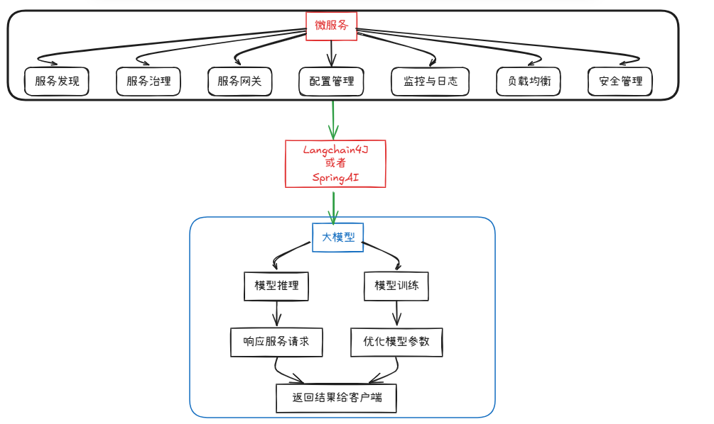

# LangChain4j 概述

LangChain4j 是 Java 生态系统中专为构建大语言模型（LLM）应用而设计的开源框架。它简化了 LLM 应用的开发流程，为 Java 开发者提供了统一、简洁的 API 来构建基于大语言模型的应用程序，支持多种 LLM 提供商、向量数据库、嵌入模型等组件的无缝集成。

LangChain4j 的设计灵感来源于 Python 生态中的 LangChain，但完全针对 Java 语言和生态进行了重写和优化，充分利用了 Java 的类型系统、面向对象特性和丰富的库生态。作为一个活跃的开源项目，LangChain4j 持续跟进最新的 AI 技术发展，支持越来越多的模型提供商和 embedding 服务，确保开发者能够使用最新的 AI 能力来构建应用。

LangChain4j 的核心优势在于其出色的抽象设计和广泛的兼容性。它不仅支持主流的商业 API 如 OpenAI、Anthropic、Google Vertex AI，还支持开源模型部署平台如 Ollama、HuggingFace Local Models，以及国产大模型平台如百度文心一言、阿里通义千问、智谱 ChatGLM 等。这种全方位的模型支持使企业能够根据自身需求和成本考量灵活选择最适合的模型方案，无需担心供应商锁定问题。

- 官方文档：https://docs.langchain4j.dev/
- 中文文档：https://docs.langchain4j.info/

## 发展历程

LangChain4j 项目始于对 Java 开发者在大语言模型应用开发领域需求的深刻洞察。随着 ChatGPT 等大语言模型的兴起，Java 开发者迫切需要一个像 LangChain 那样强大且易于使用的工具库。LangChain4j 正是为填补这一空白而诞生，它已经成为 Java 生态中最受欢迎的 LLM 应用开发框架之一。

## 核心设计原则

1. **简洁优先**：LangChain4j 追求 API 的简洁性和易用性。框架设计充分考虑了 Java 开发者的习惯，提供了直观、流式的 API 设计，让开发者能够用最少的代码实现复杂的 LLM 功能。

2. **可扩展性**：框架采用模块化设计，每个组件都有清晰的接口定义。开发者可以轻松地替换底层实现，或者创建自定义的组件来满足特定需求。

3. **类型安全**：充分利用 Java 的泛型和类型系统，在编译时捕获潜在错误，提供更好的开发体验和代码可维护性。

4. **组合优于继承**：通过组合（Composition）而非继承（Inheritance）来实现功能的灵活组合，使代码更加松耦合、易于测试和维护。

## 主要特性

LangChain4j 提供了丰富而强大的功能特性，使其成为 Java 开发者构建 AI 应用的首选框架。

首先，它提供了统一且直观的 API 来调用各类大语言模型，无论是同步调用还是异步流式调用都得到了良好支持。其次，框架内置了多种提示词模板引擎，支持动态构建复杂的多轮对话场景。再者，LangChain4j 实现了完整的记忆管理机制，能够在对话过程中保持上下文连贯性，这对于构建智能助手类应用至关重要。

在检索增强生成（RAG）方面，LangChain4j 提供了完整的文档加载、文本分割、向量存储和相似度检索功能，使开发者能够快速构建基于私有知识库的智能问答系统。此外，框架还支持工具调用机制，允许 AI 模型与外部系统进行交互，执行实际的操作任务，如数据库查询、API 调用、文件操作等。这种能力极大地扩展了 AI 应用的功能边界，使其能够从被动的问答工具转变为主动的任务执行助手。

LangChain4j 还特别注重与 Spring 生态系统的深度集成。通过提供与 Spring Boot、Spring AI 的无缝对接，Java 开发者可以利用熟悉的依赖注入、配置管理和测试工具来开发 AI 应用，降低学习成本的同时提高开发效率。同时，框架还支持多种部署场景，无论是云端 API 调用、本地模型部署还是边缘计算环境，都能找到合适的解决方案。

## 技术架构

LangChain4j 的架构设计遵循分层解耦的原则，核心组件包括**模型层**、**提示层**、**索引层**、**记忆层**、**链层**和**代理层**等多个层次。模型层负责与各种大语言模型进行通信，提供统一的接口来发送提示词并接收生成结果。提示层处理提示词的构建和模板化，支持变量替换、条件逻辑和复杂格式化。索引层管理外部数据的加载、处理和向量化存储，为 RAG 应用提供支持。记忆层维护对话状态和历史信息，确保多轮交互的连贯性。链层将多个操作串联成流水线式的处理流程，实现复杂的业务逻辑。代理层则协调各组件的协同工作，支持工具调用和决策制定。

这种分层架构的优势在于各层之间**松耦合、高内聚**，开发者可以根据需要灵活组合和替换各层组件。例如，当需要切换底层模型提供商时，只需修改模型层的配置，而无需修改上层的业务逻辑代码。当需要增强记忆管理能力时，可以无缝集成更高级的记忆实现。这种灵活性使 LangChain4j 能够适应各种复杂的应用场景和需求变化。

## 支持的 LLM 提供商

LangChain4j 提供了对多种主流 LLM 提供商的支持：

| 提供商 | 模型 | 特点 |
|--------|------|------|
| **OpenAI** | GPT-4, GPT-3.5-turbo | 生态完善，能力强 |
| **Anthropic** | Claude 3 系列 | 安全可靠，长上下文 |
| **Azure OpenAI** | GPT-4, GPT-3.5 | 企业级服务 |
| **Google** | Gemini 系列 | 多模态能力强 |
| **Ollama** | Llama 2, Mistral 等 | 本地运行，隐私保护 |
| **HuggingFace** | 开源模型 | 模型丰富 |
| **Cohere** | Command R 系列 | 企业搜索优化 |

## 支持的向量数据库

LangChain4j 集成了多种向量数据库用于存储和检索嵌入向量：

- **InMemoryVectorStore**：内存向量存储，适合开发测试
- **Pinecone**：云端向量数据库，托管服务
- **Milvus**：开源向量数据库，可自部署
- **PostgreSQL + pgvector**：基于 PostgreSQL
- **Chroma**：开源向量数据库
- **Weaviate**：开源向量搜索引擎
- **Qdrant**：高性能向量数据库

## 应用场景

1. **智能对话机器人**：构建能够进行多轮对话的智能助手，支持上下文记忆和个性化回复。

2. **文档问答系统**：基于 RAG 技术，构建能够回答关于特定文档内容的问题的系统。

3. **内容生成**：利用 LLM 的生成能力，自动生成文章、摘要、代码、报告等内容。

4. **数据提取与结构化**：从非结构化文本中提取结构化信息，转换为 JSON、CSV 等格式。

5. **代码分析与辅助**：构建代码分析工具，帮助开发者理解、审查和优化代码。

6. **知识库构建**：构建企业级知识库，支持语义搜索和智能问答。

## 优势与特点

1. **多 LLM 支持**：无缝集成 OpenAI、Anthropic、Azure、Google Vertex AI、HuggingFace 等主流 LLM 提供商

2. **统一的抽象层**：LangChain4j 为不同的 LLM 提供商和向量数据库提供了统一的抽象层，开发者可以在不修改业务代码的情况下切换底层实现。

3. **声明式 API**：流式 API 设计使代码更加简洁易读，开发者可以专注于业务逻辑而非底层细节。

4. **完善的文档**：框架提供了详尽的文档和丰富的示例代码，帮助开发者快速上手。

5. **RAG 完整支持**：内置文档加载、分割、嵌入、向量存储和检索的完整流程

6. **工具调用**：支持 Function Calling，让 LLM 能够调用外部工具和 API

7. **活跃的社区**：开源社区活跃，持续更新和完善，及时响应用户需求和反馈。

8. **良好的兼容性**：与 Spring Boot、Quarkus、Micronaut 等主流 Java 框架良好兼容，可以轻松集成到现有项目中。

## 与其他框架的对比

| 特性 | LangChain4j | Spring AI | Semantic Kernel |
|------|-------------|-----------|-----------------|
| **语言** | Java | Java | C#, Java, Python |
| **LLM 支持** | 丰富 | 丰富 | 丰富 |
| **向量存储** | 多种 | 多种 | 多种 |
| **社区活跃度** | 高 | 中 | 高 |
| **学习曲线** | 中等 | 较低 | 中等 |
| **Spring 集成** | 需要额外配置 | 原生支持 | 需要额外配置 |
