# Langchain4j 大模型平台

## 阿里百炼平台

官方网站：https://bailian.console.aliyun.com

### 创建API-KEY

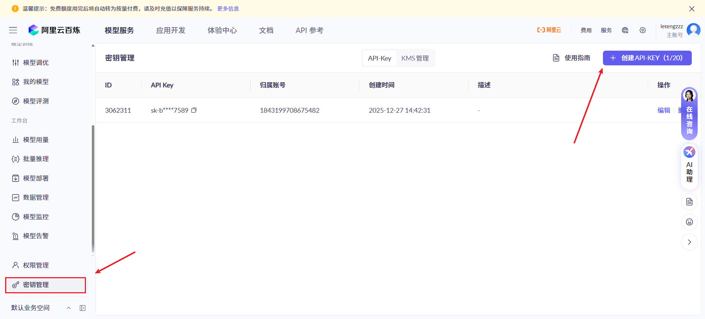

### 获取模型名

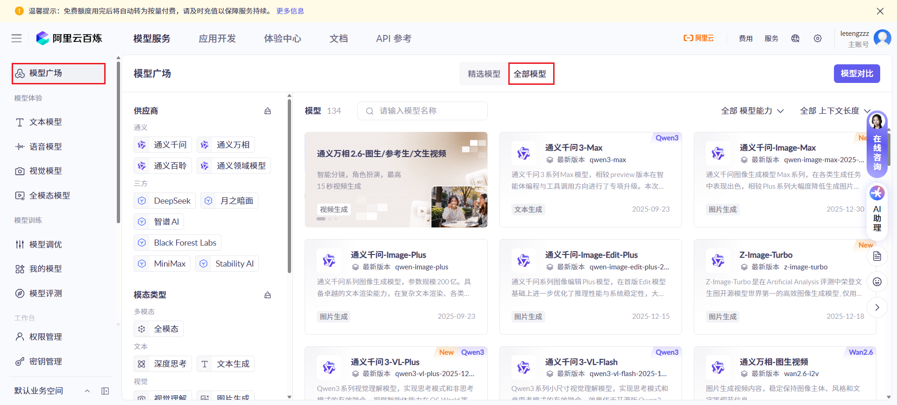

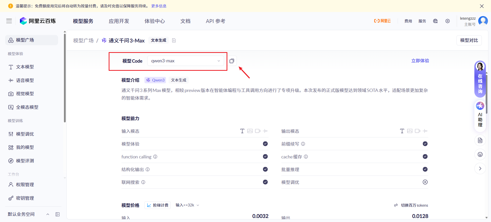

### 调用地址

使用OpenAI兼容协议：

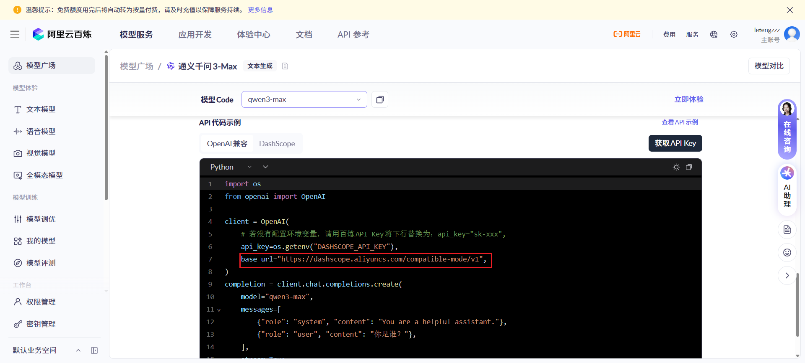

使用DashScope：

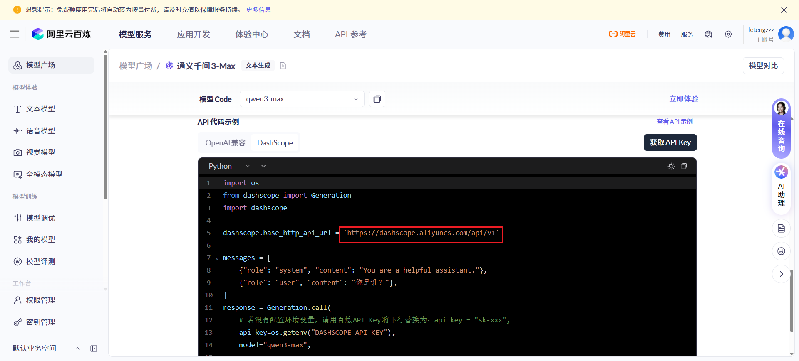

## 百度千帆平台

官方网站：https://console.bce.baidu.com/qianfan/ais/console/applicationConsole/application

### 创建API-KEY

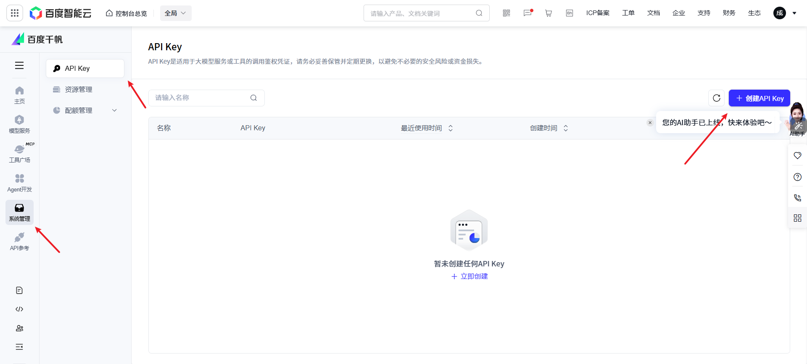

获取secretKey：

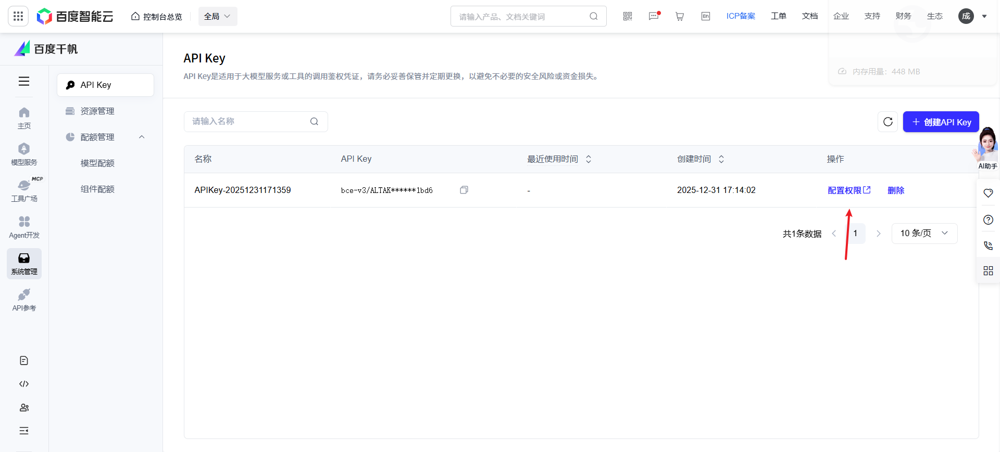

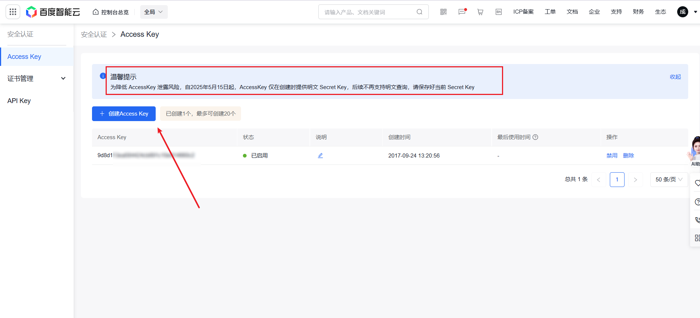


### 获取模型名

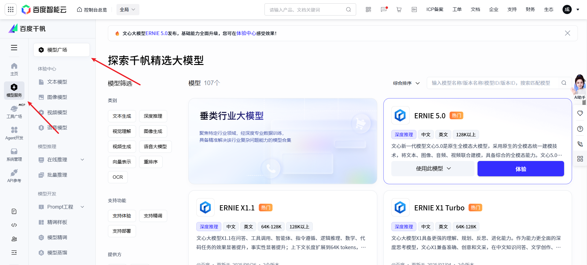

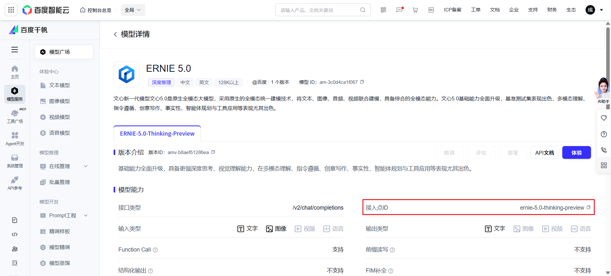

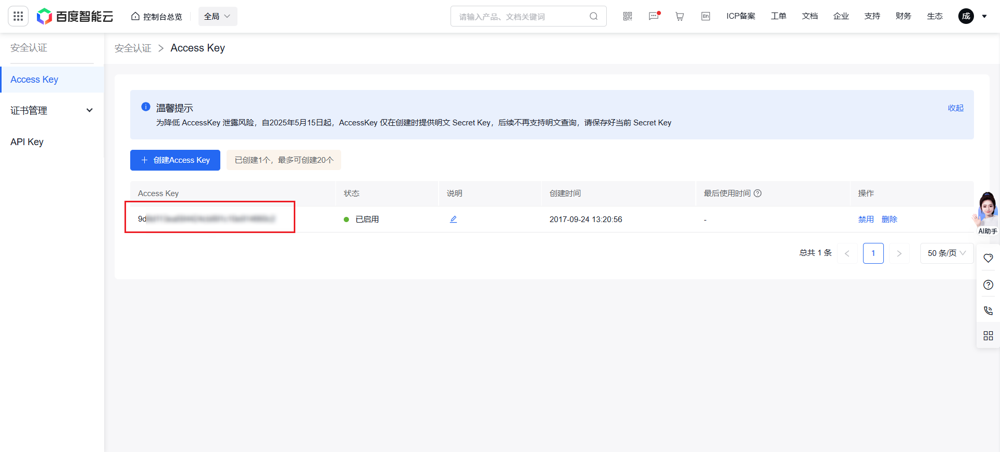

### 调用地址

百度千帆提供 OpenAI 兼容入口，鉴权方式与阿里百炼一致，因此 Langchain4j 的 OpenAI 适配器可以直接复用：

- **OpenAI 兼容地址**：`https://qianfan.baidubce.com/v2`
- **鉴权**：请求头 `Authorization: Bearer <API_KEY>`

**注意**：千帆同时保留了早期的 `access_token` + `secretKey` 鉴权链路，两套凭证不要混用。老教程里的 `https://aip.baidubce.com/oauth/2.0/token` 只用于换取 `access_token`，换来的字符串不能直接塞进 OpenAI 适配器的 `api-key`，否则会报鉴权失败。

```properties
# application.properties
langchain4j.open-ai.chat-model.base-url=https://qianfan.baidubce.com/v2
langchain4j.open-ai.chat-model.api-key=${QIANFAN_API_KEY}
langchain4j.open-ai.chat-model.model-name=ernie-4.0-8k
```

## 智谱AI开放平台

官方网站：https://open.bigmodel.cn/

### 创建API-KEY

登录后进入「API Keys」页面（右上角头像 → API Keys），点击「添加新的 API Key」。

**密钥只在创建时完整展示一次**，页面刷新后只能看到末尾几位。因此要在弹窗出现的那一刻复制并写入本地配置或密钥管理服务，不要靠截图留存。

### 获取模型名

在「模型中心」可以查看当前账号可调用的模型。常用的对话模型名如下：

| 模型名 | 定位 |
| --- | --- |
| `glm-4-plus` | 旗舰档，能力最强，价格最高 |
| `glm-4-air` | 均衡档，日常对话与轻量推理 |
| `glm-4-flash` | 免费档，适合开发调试与量大的简单任务 |

模型名即调用时传入的 `model` 字段，必须与官方文档完全一致，写错会直接返回「模型不存在」。

### 调用地址

智谱同样提供 OpenAI 兼容协议，base-url 以 `/v4` 结尾：

- **OpenAI 兼容地址**：`https://open.bigmodel.cn/api/paas/v4`

```properties
# application.properties
langchain4j.open-ai.chat-model.base-url=https://open.bigmodel.cn/api/paas/v4
langchain4j.open-ai.chat-model.api-key=${ZHIPU_API_KEY}
langchain4j.open-ai.chat-model.model-name=glm-4-flash
```

---

**三家平台速查**（截至 2026-10 的口径，具体以各平台官方文档为准）：

| 平台 | OpenAI 兼容 base-url | 鉴权 | 备注 |
| --- | --- | --- | --- |
| 阿里百炼 | `https://dashscope.aliyuncs.com/compatible-mode/v1` | `Bearer <API_KEY>` | 另有 DashScope 原生 SDK |
| 百度千帆 | `https://qianfan.baidubce.com/v2` | `Bearer <API_KEY>` | 保留 access_token 老链路 |
| 智谱 AI | `https://open.bigmodel.cn/api/paas/v4` | `Bearer <API_KEY>` | `glm-4-flash` 为免费档 |

**共同点**：三家的 OpenAI 兼容层都支持 `Authorization: Bearer <API_KEY>`，所以在 Langchain4j 里只需要换 `base-url`、`api-key`、`model-name` 三个配置项就能切换平台，业务代码一行都不用改。

