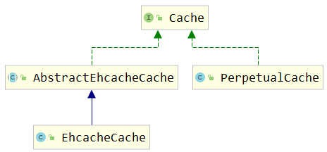
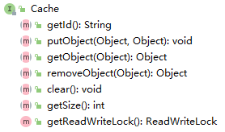
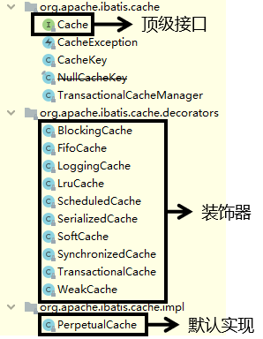
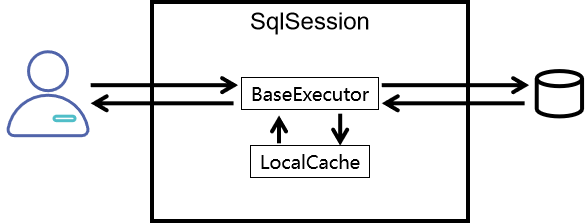
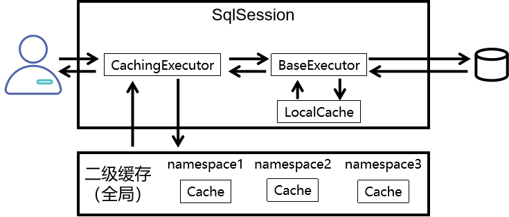
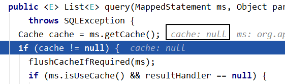
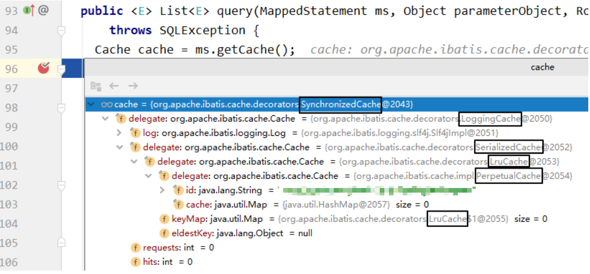
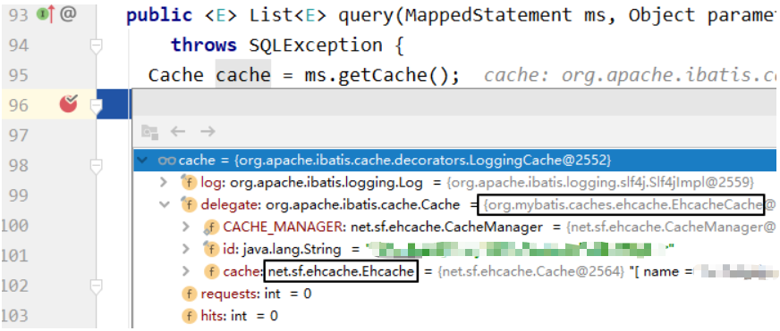
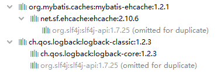
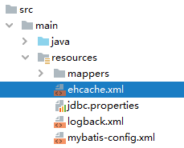

# MyBatis 缓存

缓存可以将数据保存在内存中，是互联网系统常常用到的。目前流行的缓存服务器有 MongoDB、Redis、Ehcache 等。**缓存是在计算机内存上保存的数据，读取时无需再从磁盘读入**，因此具备快速读取和使用的特点。

MyBatis 包含一个非常强大的查询缓存特性，它可以非常方便地配置和定制。 MyBatis3 中的缓存实现的很多改进都已经实现了，使得它更加强大而且易于配置。

和大多数持久化框架一样，MyBatis 提供了一级缓存和二级缓存的支持。**默认情况下，MyBatis 只开启一级缓存，二级缓存需手动开启**。

:::warning 说明

对于 MyBatis 缓存仅作了解即可，因为面对一定规模的数据量，内置的 Cache 方式就派不上用场了，并且对查询结果集做缓存并不是 MyBatis 所擅长的，它专心做的应该是 SQL 映射。对于缓存，采用 OSCache、Memcached 等专门的缓存服务器来做更为合理。

:::

## 缓存机制介绍


## 缓存的基本原理

### Cache接口

`org.apache.ibatis.cache.Cache`接口：所有缓存都必须实现的顶级接口



**Cache接口中的方法**：




### 缓存的本质

根据Cache接口中方法的声明我们能够看到，缓存的本质是一个**Map**。

### PerpetualCache



`org.apache.ibatis.cache.impl.PerpetualCache`是Mybatis的默认缓存，也是Cache接口的默认实现。Mybatis一级缓存和自带的二级缓存都是通过PerpetualCache来操作缓存数据的。同样是PerpetualCache这个类，怎么能区分出来两种不同级别的缓存呢？

其实很简单，调用者不同。

- 一级缓存：由BaseExecutor调用PerpetualCache
- 二级缓存：由CachingExecutor调用PerpetualCache，而CachingExecutor可以看做是对BaseExecutor的装饰

### 一级缓存机制



`org.apache.ibatis.executor.BaseExecutor`类中的关键方法：

- `query()`方法：

  ```java
  public <E> List<E> query(MappedStatement ms, Object parameter, RowBounds rowBounds, ResultHandler resultHandler, CacheKey key, BoundSql boundSql) throws SQLException {
      ErrorContext.instance().resource(ms.getResource()).activity("executing a query").object(ms.getId());
      if (closed) {
          throw new ExecutorException("Executor was closed.");
      }
      if (queryStack == 0 && ms.isFlushCacheRequired()) {
          clearLocalCache();
      }
      List<E> list;
      try {
          queryStack++;

          // 尝试从本地缓存中获取数据
          list = resultHandler == null ? (List<E>) localCache.getObject(key) : null;

          if (list != null) {
              handleLocallyCachedOutputParameters(ms, key, parameter, boundSql);
          } else {

              // 如果本地缓存中没有查询到数据，则查询数据库
              list = queryFromDatabase(ms, parameter, rowBounds, resultHandler, key, boundSql);
          }
      } finally {
          queryStack--;
      }
      if (queryStack == 0) {
          for (org.apache.ibatis.executor.BaseExecutor.DeferredLoad deferredLoad : deferredLoads) {
              deferredLoad.load();
          }
          // issue #601
          deferredLoads.clear();
          if (configuration.getLocalCacheScope() == LocalCacheScope.STATEMENT) {
              // issue #482
              clearLocalCache();
          }
      }
      return list;
  }
  ```

- `queryFromDatabase()`方法：

  ```java
  private <E> List<E> queryFromDatabase(MappedStatement ms, Object parameter, RowBounds rowBounds, ResultHandler resultHandler, CacheKey key, BoundSql boundSql) throws SQLException {
      List<E> list;
      localCache.putObject(key, EXECUTION_PLACEHOLDER);
      try {

          // 从数据库中查询数据
          list = doQuery(ms, parameter, rowBounds, resultHandler, boundSql);
      } finally {
          localCache.removeObject(key);
      }

      // 将数据存入本地缓存
      localCache.putObject(key, list);
      if (ms.getStatementType() == StatementType.CALLABLE) {
          localOutputParameterCache.putObject(key, parameter);
      }
      return list;
  }
  ```

### 二级缓存机制



CachingExecutor类中的`query()`方法在不同情况下使用的具体缓存对象：

- **未开启二级缓存**：

  

- **使用自带二级缓存**：

  

- **使用EHCache**：

  

## 一级缓存和二级缓存

:::tip 提示

下列各项操作均使用[user表](Table/user.md)来操作。

:::

### 使用顺序

首先查询二级缓存，因为二级缓存中可能会有其他程序已经查出来的数据，可以拿来直接使用。如果二级缓存没有命中，再查询一级缓存。如果一级缓存也没有命中，则查询数据库。SqlSession关闭之前，一级缓存中的数据会写入二级缓存。


### 效用范围

- 一级缓存：SqlSession级别
- 二级缓存：SqlSessionFactory级别


它们之间范围的大小：


### 一级缓存

一级缓存是基于 PerpetualCache(MyBatis自带)的 HashMap 本地缓存，**作用范围为 session 域内**。当 session flush(刷新)或者 close(关闭)之后，该 session 中所有的 cache(缓存)就会被清空。

在参数和 SQL 完全一样的情况下，使用同一个 SqlSession 对象调用同一个 mapper 的方法，往往只执行一次 SQL。因为使用 SqlSession 第一次查询后，MyBatis 会将其放在缓存中，再次查询时，如果没有刷新，并且缓存没有超时的情况下，SqlSession 会取出当前缓存的数据，而不会再次发送 SQL 到数据库。

由于 **SqlSession 是相互隔离的**，所以如果你使用不同的 SqlSession 对象，即使调用相同的 Mapper、参数和方法，MyBatis 还是会再次发送 SQL 到数据库执行，返回结果。

**一级缓存失效的情况**：

- 不是同一个SqlSession
- 同一个SqlSession但是查询条件发生了变化
- 同一个SqlSession两次查询期间执行了任何一次增删改操作
- 同一个SqlSession两次查询期间手动清空了缓存
- 同一个SqlSession两次查询期间提交了事务

**例**：

在 WebsiteMapper 类中添加 selectWebsiteById 方法：

```java
User selectUserById(@Param("id") Integer id);
```

WebsiteMapper.xml 中添加相应的映射 SQL 语句：

```xml
<select id="selectUserById" resultType="com.hjc.demo.pojo.User">
    select * from user where  id = #{id}
</select>
```

测试代码：

```java
public class UserMapperTest {
    private static Logger logger = Logger.getLogger(UserMapperTest.class);

    @Test
    public void testFirstCache() throws IOException {
        //读取MyBatis的核心配置文件
        InputStream resource = Resources.getResourceAsStream("mybatis-config.xml");
        //通过核心配置文件所对应的字节输入流创建工厂类SqlSessionFactory，生产SqlSession对象
        SqlSessionFactory build = new SqlSessionFactoryBuilder().build(resource);
        //创建SqlSession对象，此时通过SqlSession对象所操作的sql都必须手动提交或回滚事务
        //SqlSession sqlSession = sqlSessionFactory.openSession();
        //创建SqlSession对象，此时通过SqlSession对象所操作的sql都会自动提交
        SqlSession sqlSession = build.openSession(true);
        //通过代理模式创建UserMapper接口的代理实现类对象
        UserMapper mapper = sqlSession.getMapper(UserMapper.class);

        mapper.selectUserById(1);
        logger.debug("使用同一个SqlSession");
        //在同一SqlSession下
        //若在执行两次查询的期间执行了任何一次增删改操作，则一级缓存失效
//        mapper.insertUser(new User(null,"1","2",2));
        //在执行两次查询的期间执行清空缓存，则一级缓存失效
//        sqlSession.clearCache();
        mapper.selectUserById(1);
        System.out.println("--------");

        //使用不同一个SqlSession
        logger.debug("使用不同一个SqlSession");
        SqlSession sqlSession2 = build.openSession(true);
        UserMapper mapper2 = sqlSession2.getMapper(UserMapper.class);
        mapper2.selectUserById(1);
    }
}
```

**运行结果**：

> DEBUG ==> Preparing: select \_ from website where id = ?
>
> DEBUG ==> Parameters: 1(Integer)
>
> DEBUG <== Total: 1
>
> DEBUG 使用同一个SqlSession
>
> DEBUG 使用不同一个SqlSession
>
> DEBUG ==> Preparing: select \_ from website where id = ?
>
> DEBUG ==> Parameters: 1(Integer)
>
> DEBUG <== Total: 1

从运行结果可以看出，第一个 SqlSession 实际只发生过一次查询，而第二次查询就从缓存中取出了，也就是 SqlSession 层面的一级缓存。为了克服这个问题，往往需要配置二级缓存，使得缓存在 SqlSessionFactory 层面上能够提供给各个 SqlSession 对象共享。

### 二级缓存

二级缓存与一级缓存其机制相同，默认也是采用 PerpetualCache，HashMap存储，不同在于其**存储作用域为 Mapper(Namespace)**，并且**可自定义存储源**，如 Ehcache。

二级缓存是全局缓存，作用域超出 session 范围之外，可以被所有 SqlSession 共享(SqlSessionFactory)。

**一级缓存缓存的是 SQL 语句，二级缓存缓存的是结果对象**。

**二级缓存开启的条件**：

- 在核心配置文件中，设置全局配置属性`cacheEnabled="true"`，默认为true，不需要设置。
- 在映射文件中设置标签`<cache />`。
- 二级缓存必须在SqlSession关闭或提交之后有效。
- 查询的数据所转换的实体类类型必须实现序列化的接口。

**二级缓存失效的情况**： 两次查询之间执行了任意的增删改，会使一级和二级缓存同时失效。

#### 二级缓存的配置

1. **开启二级缓存功能**：默认不开启。

   :::danger 注意

   只有再次在 namescape 内(com.hjc.demo.mapper.WebsiteMapper)的查询才能共享这个缓存

   :::

   ```xml [WebsiteMapper.xml]
   <mapper namescape="com.hjc.demo.mapper.WebsiteMapper">
       <!-- cache配置 -->
       <cache eviction="FIFO" flushInterval="60000" size="512" readOnly="true" />
       <!-- ... 其余映射语句省略 -->
   </mapper>
   ```

   在 mapper 文件配置支持 cache 后，如果需要对个别查询进行调整，可以单独设置 cache，代码如下。

   ```xml
   <select id="getWebsiteList" resultType="net.biancheng.po.Website" usecache="true">    ...</select>
   ```

2. **让实体类支持序列化**：

   ```java
   public class Website implements Serializable {
       ...
   }
   ```

3. MyBatis 的全局缓存配置需要在 mybatis-config.xml 的 settings 元素中设置(默认为true，可忽略设置)：

   ```xml [mybatis-config.xml]
   <settings>
       <setting name="cacheEnabled" value="true" />
   </settings>
   ```

4. 测试代码：

   ```java
   @Test
   public void testTwoCache() throws IOException {
       InputStream is = Resources.getResourceAsStream("mybatis-config.xml");
       SqlSessionFactory build = new SqlSessionFactoryBuilder().build(is);
       SqlSession sqlSession1 = build.openSession(true);
       UserMapper mapper = sqlSession1.getMapper(UserMapper.class);
       mapper.selectUserById(1);
       //SqlSession关闭的时候，一级缓存中的内容会被存入二级缓存
       sqlSession1.close();

       logger.debug("在同一SqlSessionFactory下");
       //在同一SqlSessionFactory下
       SqlSession sqlSession2 = build.openSession(true);
       UserMapper mapper2 = sqlSession2.getMapper(UserMapper.class);
       mapper2.selectUserById(1);
       //SqlSession关闭的时候，一级缓存中的内容会被存入二级缓存
       sqlSession1.close();

       logger.debug("不在同一SqlSessionFactory下");
       //不在同一SqlSessionFactory下
       InputStream iss = Resources.getResourceAsStream("mybatis-config.xml");
       SqlSessionFactory build1 = new SqlSessionFactoryBuilder().build(iss);
       SqlSession sqlSession3 = build1.openSession(true);
       UserMapper mapper3 = sqlSession3.getMapper(UserMapper.class);
       mapper3.selectUserById(1);
       //SqlSession关闭的时候，一级缓存中的内容会被存入二级缓存
       sqlSession1.close();
   }
   ```

   **运行结果**：

   > DEBUG Cache Hit Ratio [com.hjc.demo.mapper.WebsiteMapper]: 0.0
   >
   > DEBUG ==> Preparing: select \_ from website where id = ?
   >
   > DEBUG ==> Parameters: 1(Integer)
   >
   > DEBUG <== Total: 1
   >
   > DEBUG 在同一SqlSessionFactory下
   >
   > DEBUG Cache Hit Ratio [com.hjc.demo.mapper.WebsiteMapper]: 0.5
   >
   > DEBUG 不在同一SqlSessionFactory下
   >
   > DEBUG Cache Hit Ratio [com.hjc.demo.mapper.WebsiteMapper]: 0.0
   >
   > DEBUG ==> Preparing: select \_ from website where id = ?
   >
   > DEBUG ==> Parameters: 1(Integer)
   >
   > DEBUG <== Total: 1

**cache属性说明**：

- eviction：代表的是**缓存回收策略**，目前 MyBatis 提供策略：
  - LRU：使用较少，移除最长时间不用的对象。
  - FIFO：先进先出，按对象进入缓存的顺序来移除它们。
  - SOFT：软引用，移除基于垃圾回收器状态和软引用规则的对象。
  - WEAK：弱引用，更积极地移除基于垃圾收集器状态和弱引用规则的对象。
- flushInterval：**刷新间隔时间**，单位为毫秒，这里配置的是 100 秒刷新，如果省略该配置，那么只有当 SQL 被执行的时候才会刷新缓存。
- size：**引用数目**，正整数，代表缓存最多可以存储多少个对象，不宜设置过大。设置过大会导致内存溢出。这里配置的是 1024 个对象。
- readOnly：**只读**，默认值为 false，意味着缓存数据只能读取而不能修改，这样设置的好处是可以快速读取缓存，缺点是没有办法修改缓存。

**缓存命中率**：

日志中打印的Cache Hit Ratio叫做缓存命中率

计算公式：**缓存命中率=命中缓存的次数/查询的总次数**

```text
Cache Hit Ratio [com.hjc.demo.mapper.CacheMapper]: 0.5
```

### 自定义缓存

除了使用 MyBatis 提供的默认缓存方式，你还可以通过实现你自己的缓存或其他第三方缓存方案创建适配器来完全覆盖缓存行为。

**使用一个自定义的缓存**：

```xml
<cache type="com.hjc.mybatis.cache.demo4.MyCustomCache" />
```

type 属性指定的类必须实现 `org.mybatis.cache.Cache` 接口。这个接口是 MyBatis 框架中很多复杂的接口之一。

**Cache 源码**：

```java [Cache.java]
package org.apache.ibatis.cache;

import java.util.concurrent.locks.ReadWriteLock;

public interface Cache {
    /** 获取缓存ID，如：com.hxstrive.mybatis.cache.demo4.UserMapper */
    String getId();
    /** 获取缓存大小 */
    int getSize();
    /** 将对象放入到缓存 */
    void putObject(Object key, Object value);
    /** 从缓存获取对象 */
    Object getObject(Object key);
    /** 从缓存移除一个对象 */
    Object removeObject(Object key);
    /** 清空缓存 */
    void clear();
    /** 获取一个读写锁对象 */
    ReadWriteLock getReadWriteLock();
}
```

如果要配置你自定义的缓存，可以通过 `<cache>` 标签的子标签 `<property>` 标签指定自定义缓存对象成员变量的值，相当于调用该变量的 setter 方法。比如：下面代码会在你的缓存实现中调用一个称为 "`setCacheFile(String file)`" 的方法，然后将指定的缓存文件位置放到 cacheFile 属性中。

```xml
<cache type="com.domain.something.MyCustomCache">
    <property name="cacheFile" value="D:\tmp\cache\data.tmp"/>
</cache>
```

当然，你可以使用所有 Java 简单类型作为 JavaBeans 的属性， MyBatis 会自动进行转换。

记得缓存配置和缓存实例是绑定在 SQL 映射文件的命名空间是很重要的。因此，所有在相同命名空间的语句（`<select>`、`<insert>`、`<update>` 和 `<delete>`）绑定的缓存是一样的。语句可以修改和缓存交互的方式，或在语句的基础上使用两种简单的属性（flushCache、useCache）来完全排除它们。 默认情况下，语句是这样配置的：

```xml
<!-- select 语句使用缓存 -->
<select ... flushCache="false" useCache="true" />
<insert ... flushCache="true" />
<update ... flushCache="true" />
<delete ... flushCache="true" />
```

如果你想改变默认的行为，只能设置 flushCache 和 useCache 属性。比如，在一些情况下你也许想排除从缓存中查询特定语句结果，或者你也许想要一个 `<select>` 语句来刷新缓存。相似地，你也许有一些 `<update>` 语句执行是不需要刷新缓存。

**例**：

MyBatis 配置文件 mybatis-cfg.xml：

```xml [mybatis-cfg.xml]
<?xml version="1.0" encoding="UTF-8" ?>
<!DOCTYPE configuration PUBLIC "-//mybatis.org//DTD Config 3.0//EN"
  "http://mybatis.org/dtd/mybatis-3-config.dtd">
<configuration>
    <properties resource="database.properties"/>
    <settings>
        <!-- 全局映射器启用缓存 -->
        <setting name="cacheEnabled" value="true" />
    </settings>
    <environments default="MySqlDatabase" >
        <environment id="MySqlDatabase" >
            <transactionManager type="JDBC" />
            <dataSource type="POOLED">
                <property name="driver" value="${jdbc.driver}"/>
                <property name="url" value="${jdbc.url}"/>
                <property name="username" value="${jdbc.username}"/>
                <property name="password" value="${jdbc.password}"/>
            </dataSource>
        </environment>
    </environments>
    <mappers>
        <mapper resource="com/hjc/mybatis/cache/demo4/UserMapper.xml" />
    </mappers>
</configuration>
```

```java [UserBean.java]
package com.hjc.mybatis.cache.demo4;

import java.io.Serializable;

public class UserBean implements Serializable {
   private Integer userId;
   private String name;
   private String sex;
   private Integer age;
   // 忽略 getter 和 setter 方法
}
```

定义 Mapper 文件：

```java [UserMapper.java]
package com.hjc.mybatis.cache.demo4;

import org.apache.ibatis.annotations.Param;

public interface UserMapper {
   UserBean getUserById(@Param("userId") int userId);
}
```

```xml [UserMapper.xml]
<?xml version="1.0" encoding="UTF-8"?>
<!DOCTYPE mapper PUBLIC "-//mybatis.org//DTD Mapper 3.0//EN"
   "http://mybatis.org/dtd/mybatis-3-mapper.dtd">
<mapper namespace="com.hxstrive.mybatis.cache.demo4.UserMapper">
   <!-- 开启二级缓存，使用自定义缓存 -->
   <cache type="com.hjc.mybatis.cache.demo4.MyCustomCache">
      <property name="cacheFile" value="D:\tmp\cache\data.tmp" />
   </cache>

   <!-- 映射结果 -->
   <resultMap id="RESULT_MAP" type="com.hjc.mybatis.cache.demo4.UserBean">
      <id column="user_id" jdbcType="INTEGER" property="userId" />
      <result column="name" jdbcType="VARCHAR" property="name" />
      <result column="sex" jdbcType="VARCHAR" property="sex" />
      <result column="age" jdbcType="INTEGER" property="age" />
   </resultMap>

   <!-- 查询所有用户信息 -->
   <select id="getUserById" resultMap="RESULT_MAP" useCache="true">
      select `user_id`, `name`, `sex`, `age`
      from `user` where `user_id`=#{userId}
   </select>
</mapper>
```

**自定义缓存**：

```java
package com.hjc.mybatis.cache.demo4;

import com.alibaba.fastjson.JSONObject;
import org.apache.commons.io.FileUtils;
import org.apache.ibatis.cache.Cache;
import java.io.File;
import java.util.Map;
import java.util.concurrent.ConcurrentHashMap;
import java.util.concurrent.locks.ReadWriteLock;
import java.util.concurrent.locks.ReentrantReadWriteLock;

/**
 * 自定义 Cache
 */
public class MyCustomCache implements Cache {
    // 缓存ID，如：com.hjc.mybatis.cache.demo4.UserMapper
    private String id;
    // 读写锁
    private ReadWriteLock readWriteLock = new ReentrantReadWriteLock();
    // 缓存对象Map
    private Map<Object,Object> cache = new ConcurrentHashMap<>();
    // 缓存磁盘文件
    private String cacheFile;

    /** 会被 <cache> 的 <property> 调用 */
    public void setCacheFile(String cacheFile) {
        this.cacheFile = cacheFile;
        System.out.println("setCacheFile() cacheFile=" + cacheFile);
        // 每次创建该对象时，从磁盘加载历史缓存
        try {
            String str = FileUtils.readFileToString(new File(cacheFile), "UTF-8");
            Map<Object,Object> tmpMap = JSONObject.parseObject(str, Map.class);
            for(Map.Entry<Object,Object> entry : tmpMap.entrySet()) {
                cache.put(entry.getKey(), entry.getValue());
            }
        } catch (Exception e) {
            System.err.println("加载缓存失败，" + e.getMessage());
            e.printStackTrace();
        }
    }

    public MyCustomCache(String id) {
        this.id = id;
        System.out.println("MyCustomCache id=" + id);
    }

    @Override
    public String getId() {
        System.out.println("getId()");
        return id;
    }

    @Override
    public int getSize() {
        System.out.println("getSize()");
        return cache.size();
    }

    @Override
    public void putObject(Object key, Object value) {
        System.out.println("putObject() key=" + key + ", value=" + value);
        cache.put(key, value);
        // 将数据写入磁盘
        try {
            String cacheStr = JSONObject.toJSONString(cache);
            FileUtils.write(new File(cacheFile), cacheStr, "UTF-8");
        } catch (Exception e) {
            System.err.println("缓存持久化失败，" + e.getMessage());
            e.printStackTrace();
        }
    }

    @Override
    public Object getObject(Object key) {
        System.out.println("getObject() key=" + key);
        return cache.get(key);
    }

    @Override
    public Object removeObject(Object key) {
        Object value = cache.get(key);
        if(null == value) {
            return null;
        } else {
            cache.remove(key);
            return value;
        }
    }

    @Override
    public void clear() {
        cache.clear();
    }

    @Override
    public ReadWriteLock getReadWriteLock() {
        return readWriteLock;
    }
}
```

**客户端代码**：

```java
package com.hjc.mybatis.cache.demo4;

import org.apache.ibatis.io.Resources;
import org.apache.ibatis.session.SqlSession;
import org.apache.ibatis.session.SqlSessionFactory;
import org.apache.ibatis.session.SqlSessionFactoryBuilder;
import java.io.InputStream;

public class CacheDemo {
   public static void main(String[] args) throws Exception {
      String cfgName = "com/hjc/mybatis/cache/demo4/mybatis-cfg.xml";
      InputStream input = Resources.getResourceAsStream(cfgName);
      SqlSessionFactoryBuilder factoryBuilder = new SqlSessionFactoryBuilder();
      SqlSessionFactory sqlFactory = factoryBuilder.build(input);
      getUserById(sqlFactory, 1);
      getUserById(sqlFactory, 2);
      getUserById(sqlFactory, 3);
      getUserById(sqlFactory, 3);
      getUserById(sqlFactory, 2);
      getUserById(sqlFactory, 1);
   }

   private static void getUserById(SqlSessionFactory sqlFactory, int userId) {
      System.out.println("查询用户信息：");
      SqlSession sqlSession = sqlFactory.openSession();
      UserMapper userMapper = sqlSession.getMapper(UserMapper.class);
      UserBean userBean = userMapper.getUserById(userId);
      System.out.println(userBean + " -- " + userBean.getName());
      sqlSession.close();
   }

}
```

### 整合EHCache

#### EHCache简介

官网地址：https://www.ehcache.org/


> Ehcache is an open source, standards-based cache that boosts performance, offloads your database, and simplifies scalability. **It's the most widely-used Java-based cache because it's robust, proven, full-featured, and integrates with other popular libraries and frameworks**. Ehcache scales from in-process caching, all the way to mixed in-process/out-of-process deployments with terabyte-sized caches.

#### 整合操作

##### Mybatis环境

在Mybatis环境下整合EHCache，**前提**当然是要先准备好**Mybatis的环境**。

##### 添加依赖

```xml [pom.xml]
<!-- Mybatis EHCache整合包 -->
<dependency>
    <groupId>org.mybatis.caches</groupId>
    <artifactId>mybatis-ehcache</artifactId>
    <version>1.2.1</version>
</dependency>
<!-- slf4j日志门面的一个具体实现 -->
<dependency>
    <groupId>ch.qos.logback</groupId>
    <artifactId>logback-classic</artifactId>
    <version>1.2.3</version>
</dependency>
```

**依赖传递情况**：



**各主要jar包作用**：

| jar包名称       | 作用                            |
| --------------- | ------------------------------- |
| mybatis-ehcache | Mybatis和EHCache的整合包        |
| ehcache         | EHCache核心包                   |
| slf4j-api       | SLF4J日志门面包                 |
| logback-classic | 支持SLF4J门面接口的一个具体实现 |

##### 整合EHCache

1. 创建EHCache配置文件

   

   ```xml [ehcache.xml]
   <?xml version="1.0" encoding="utf-8" ?>
   <ehcache xmlns:xsi="http://www.w3.org/2001/XMLSchema-instance"
            xsi:noNamespaceSchemaLocation="../config/ehcache.xsd">
       <!-- 磁盘保存路径 -->
       <diskStore path="D:\hjc\ehcache"/>

       <defaultCache
               maxElementsInMemory="1000"
               maxElementsOnDisk="10000000"
               eternal="false"
               overflowToDisk="true"
               timeToIdleSeconds="120"
               timeToLiveSeconds="120"
               diskExpiryThreadIntervalSeconds="120"
               memoryStoreEvictionPolicy="LRU">
       </defaultCache>
   </ehcache>
   ```

2. 添加指定缓存管理器的具体类型：

   ```xml [UserMapper.xml]
   <cache type="org.mybatis.caches.ehcache.EhcacheCache"/>
   ```

3. 加入logback日志：存在SLF4J时，作为简易日志的log4j将失效，此时我们需要借助SLF4J的具体实现logback来打印日志。

   ```xml [logbock.xml]
   <?xml version="1.0" encoding="UTF-8"?>
   <configuration debug="true">
   	<!-- 指定日志输出的位置 -->
   	<appender name="STDOUT"
   		class="ch.qos.logback.core.ConsoleAppender">
   		<encoder>
   			<!-- 日志输出的格式 -->
   			<!-- 按照顺序分别是：时间、日志级别、线程名称、打印日志的类、日志主体内容、换行 -->
   			<pattern>[%d{HH:mm:ss.SSS}] [%-5level] [%thread] [%logger] [%msg]%n</pattern>
   		</encoder>
   	</appender>

   	<!-- 设置全局日志级别。日志级别按顺序分别是：DEBUG、INFO、WARN、ERROR -->
   	<!-- 指定任何一个日志级别都只打印当前级别和后面级别的日志。 -->
   	<root level="DEBUG">
   		<!-- 指定打印日志的appender，这里通过“STDOUT”引用了前面配置的appender -->
   		<appender-ref ref="STDOUT" />
   	</root>

   	<!-- 根据特殊需求指定局部日志级别 -->
   	<logger name="com.hjc.demo.mapper" level="DEBUG"/>

   </configuration>
   ```

4. junit测试：

   正常按照[二级缓存](#二级缓存)的方式测试即可。因为整合EHCache后，其实就是使用EHCache代替了Mybatis自带的二级缓存。

#### EHCache配置文件说明

当借助`CacheManager.add("缓存名称")`创建Cache时，EhCache便会采用`<defalutCache/>`指定的的管理策略。

**defaultCache标签各属性说明**：


