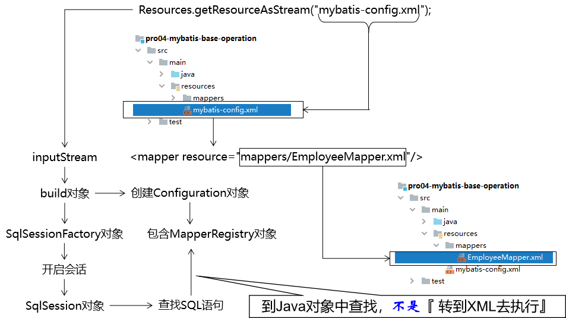
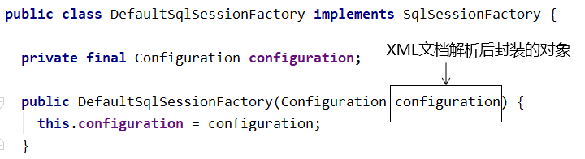
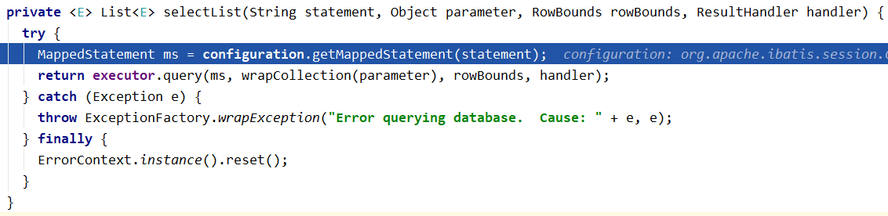
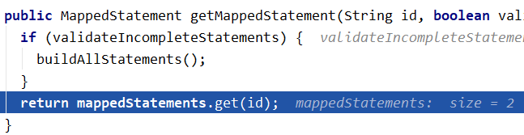
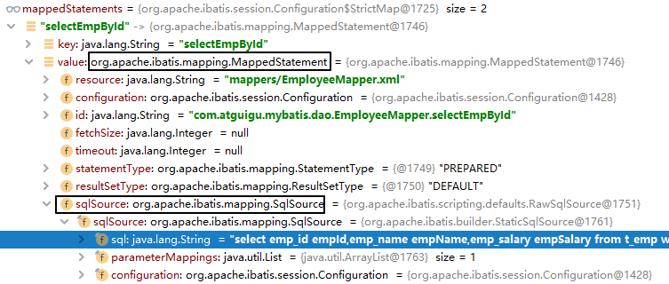

# MyBatis 源码解析

本页把 MyBatis 的一次查询拆成「解析配置 → 构建 SqlSessionFactory → 打开 SqlSession → 执行 → 结果映射」五段，逐段指出源码里的入口类。它不追求覆盖全部源码，只回答「这条链路每一步由谁负责」，适合需要在断点里快速定位的读者。

## 关于XML问题

刚开始接触框架，会认为Java程序会转入XML配置文件中执行，但其实框架会在初始化时将XML文件读取进来，封装到对象中，再然后就都是Java代码的执行了，XML中的配置是没法执行的。

## 源码

1. **封装Configuration对象**：

   所在类：`org.apache.ibatis.session.defaults.DefaultSqlSessionFactory`

2. **准备去获取已映射的指令**：

   所在类：`org.apache.ibatis.session.defaults.DefaultSqlSession`

3. **正式获取已映射的指令**：

   所在类：`org.apache.ibatis.session.Configuration`

4. **mappedStatements对象结构**：

   mappedStatements对象的类型：Configuration类中的一个静态内部类：StrictMap

