# SSM 整合

**微观**：将Spring、SpringMVC、Mybatis框架应用到项目中

- SpringMVC框架负责控制层
- Spring 框架负责整体和业务层的声明式事务管理
- MyBatis框架负责数据库访问层

**宏观**：Spring接管一切（将框架核心组件交给Spring进行IoC管理），代码更加简洁。

- SpringMVC管理表述层、SpringMVC相关组件
- Spring管理业务层、持久层、以及数据库相关 (DataSource,MyBatis)的组件
- 使用IoC的方式管理一切所需组件

**实施**：通过编写配置文件，实现SpringIoC容器接管一切组件。

SSM整合需要2个IoC容器：本质上说，整合就是将三层架构和框架核心API组件交给SpringIoC容器管理。一个容器可能就够了，但是常见的操作是创建两个IoC容器 (web容器和root容器)，组件分类管理。

**好处和目的**：

1. **分离关注点**：通过初始化两个容器，可以将各个层次的关注点进行分离。这种分离使得各个层次的组件能够更好地聚焦于各自的责任和功能。
2. **解耦合**：各个层次组件分离装配不同的IoC容器，这样可以进行解耦。这种解耦合使得各个模块可以独立操作和测试，提高了代码的可维护性和可测试性。
3. **灵活配置**：通过使用两个容器，可以为每个容器提供各自的配置，以满足不同层次和组件的特定需求。每个配置文件也更加清晰和灵活。

总的来说，初始化两个容器在SSM整合中可以实现关注点分离、解耦合、灵活配置等好处。它们各自负责不同的层次和功能，并通过合适的集成方式协同工作，提供一个高效、可维护和可扩展的应用程序架构。

---

**IoC容器对应类型组件**：

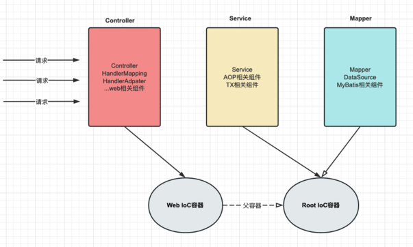

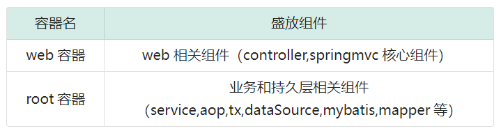

---

**IoC容器关系及调用方向**：

- 两个无关联的IoC容器之间的组件无法注入

  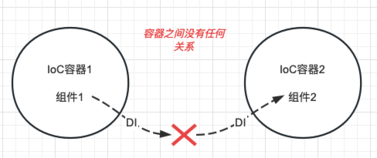

- 子IoC容器可以单向的注入父IoC容器的组件

  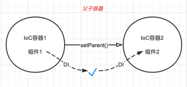

web容器是root容器的子容器，父子容器关系。

- 父容器：root容器，盛放service、mapper、mybatis等相关组件
- 子容器：web容器，盛放controller、web相关组件

源码体现：FrameworkServlet 655行

```Java
protected WebApplicationContext createWebApplicationContext(@Nullable ApplicationContext parent) {
    Class<?> contextClass = getContextClass();
    if (!ConfigurableWebApplicationContext.class.isAssignableFrom(contextClass)) {
      throw new ApplicationContextException(
          "Fatal initialization error in servlet with name '" + getServletName() +
          "': custom WebApplicationContext class [" + contextClass.getName() +
          "] is not of type ConfigurableWebApplicationContext");
    }
    ConfigurableWebApplicationContext wac =
        (ConfigurableWebApplicationContext) BeanUtils.instantiateClass(contextClass);

    wac.setEnvironment(getEnvironment());
    //wac 就是web ioc容器
    //parent 就是root ioc容器
    //web容器设置root容器为父容器，所以web容器可以引用root容器
    wac.setParent(parent);
    String configLocation = getContextConfigLocation();
    if (configLocation != null) {
      wac.setConfigLocation(configLocation);
    }
    configureAndRefreshWebApplicationContext(wac);

    return wac;
  }
```

调用流程图解：

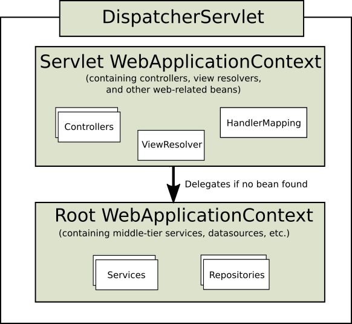

---

**具体配置类以及对应容器的关系**：

配置类的数量不是固定的，但是至少要两个，为了方便编写，可以三层架构每层对应一个配置类，分别指定两个容器加载即可。

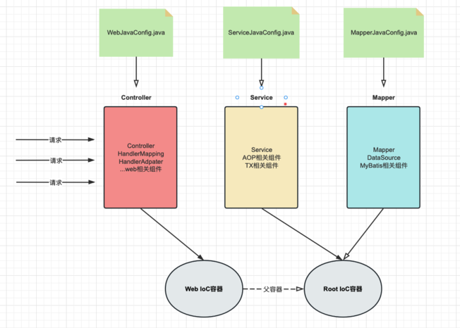

**建议配置文件**：

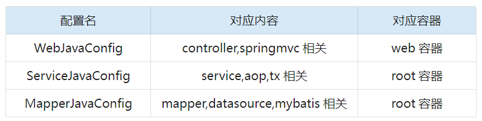

---

**IoC初始化方式及配置位置**：

在web项目下，可以选择web.xml和配置类方式进行ioc配置，**推荐配置类**。

对于使用基于 web 的 Spring 配置的应用程序，建议这样做：

```Java
public class MyWebAppInitializer extends AbstractAnnotationConfigDispatcherServletInitializer {

  //指定root容器对应的配置类
  //root容器的配置类
  @Override
  protected Class<?>[] getRootConfigClasses() {
    return new Class<?>[] { ServiceJavaConfig.class,MapperJavaConfig.class };
  }

  //指定web容器对应的配置类 webioc容器的配置类
  @Override
  protected Class<?>[] getServletConfigClasses() {
    return new Class<?>[] { WebJavaConfig.class };
  }

  //指定dispatcherServlet处理路径，通常为 /
  @Override
  protected String[] getServletMappings() {
    return new String[] { "/" };
  }
}
```

图解配置类和容器配置：

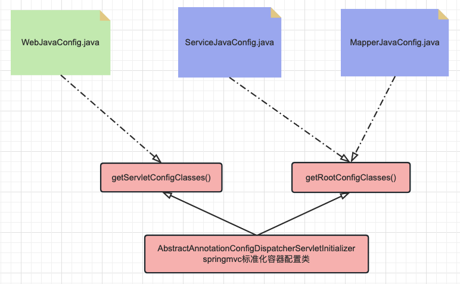

## 操作步骤

### 创建项目

创建一个父工程：

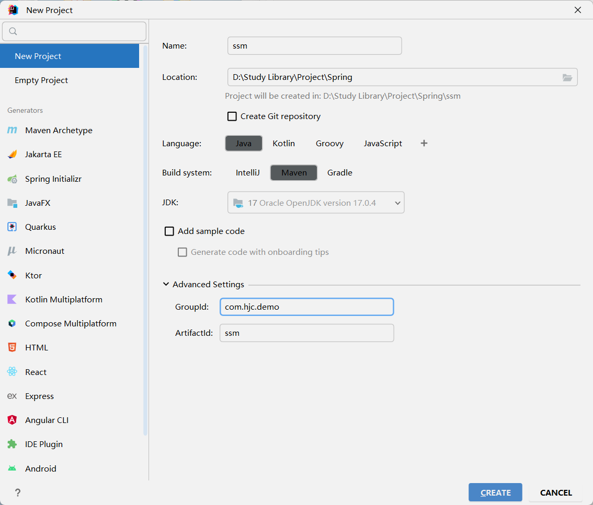

将打包方式修改为pom，只做项目管理：

```xml
<?xml version="1.0" encoding="UTF-8"?>
<project xmlns="http://maven.apache.org/POM/4.0.0"
         xmlns:xsi="http://www.w3.org/2001/XMLSchema-instance"
         xsi:schemaLocation="http://maven.apache.org/POM/4.0.0 http://maven.apache.org/xsd/maven-4.0.0.xsd">
    <modelVersion>4.0.0</modelVersion>

    <groupId>com.hjc.demo</groupId>
    <artifactId>ssm</artifactId>
    <version>1.0-SNAPSHOT</version>
    <packaging>pom</packaging>

    <properties>
        <maven.compiler.source>17</maven.compiler.source>
        <maven.compiler.target>17</maven.compiler.target>
        <project.build.sourceEncoding>UTF-8</project.build.sourceEncoding>
    </properties>

</project>
```

创建子工程并修改为Web工程：

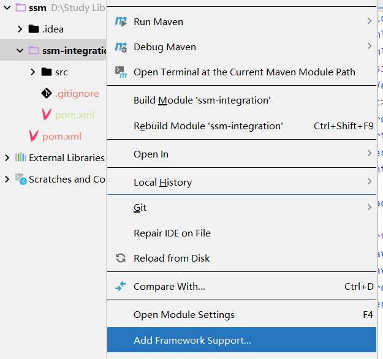

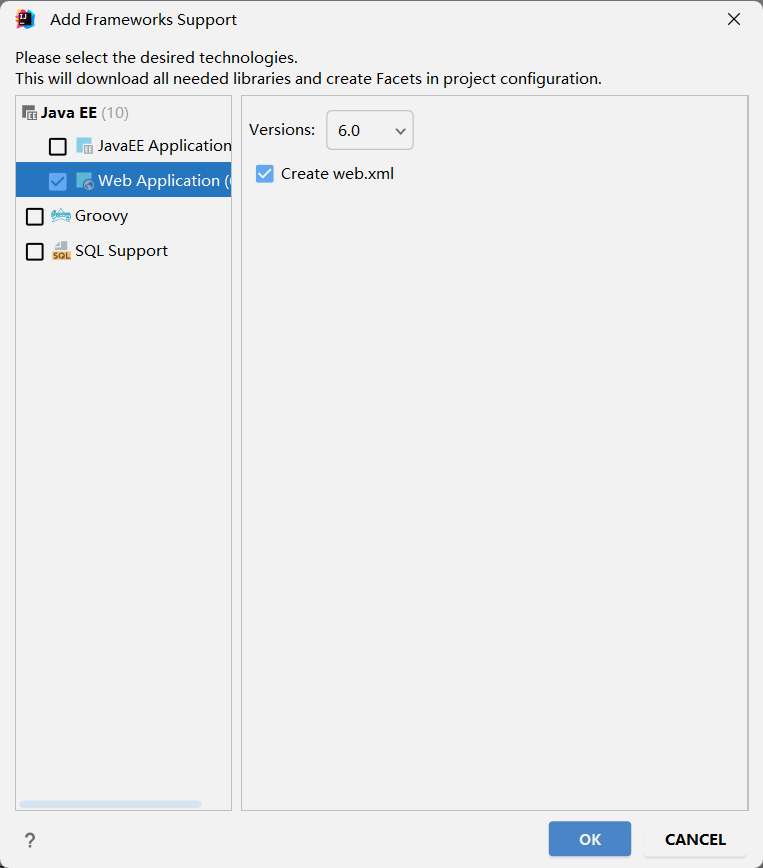

### 依赖整合和添加

导入依赖：

```xml
	<properties>
        <spring.version>6.0.0</spring.version>
        <jakarta.annotation-api.version>2.1.1</jakarta.annotation-api.version>
        <jakarta.jakartaee-web-api.version>9.1.0</jakarta.jakartaee-web-api.version>
        <jackson-databind.version>2.15.0</jackson-databind.version>
        <hibernate-validator.version>8.0.0.Final</hibernate-validator.version>
        <mybatis.version>3.5.11</mybatis.version>
        <mysql.version>8.0.30</mysql.version>
        <pagehelper.version>5.2.0</pagehelper.version>
        <mybatis-spring.version>3.0.2</mybatis-spring.version>
        <jakarta.servlet.jsp.jstl-api.version>3.0.0</jakarta.servlet.jsp.jstl-api.version>
        <logback.version>1.2.3</logback.version>
        <lombok.version>1.18.28</lombok.version>
        <maven.compiler.source>17</maven.compiler.source>
        <maven.compiler.target>17</maven.compiler.target>
        <project.build.sourceEncoding>UTF-8</project.build.sourceEncoding>
    </properties>
    <!--
       需要依赖清单分析:
          spring
            ioc/di
              spring-context / 6.0.0
              jakarta.annotation-api / 2.1.1  jsr250
            aop
              spring-aspects / 6.0.0
            tx
              spring-tx  / 6.0.0
              spring-jdbc / 6.0.0

          springmvc
             spring-webmvc 6.0.0
             jakarta.jakartaee-web-api 9.1.0
             jackson-databind 2.15.0
             hibernate-validator / hibernate-validator-annotation-processor 8.0.0.Final

          mybatis
             mybatis  / 3.5.11
             mysql    / 8.0.30
             pagehelper / 5.2.0

          整合需要
             加载spring容器 spring-web / 6.0.0
             整合mybatis   mybatis-spring x x
             lombok        lombok / 1.18.28
             logback       logback/ 1.2.3
    -->

    <dependencies>
        <!--spring pom.xml依赖-->
        <dependency>
            <groupId>org.springframework</groupId>
            <artifactId>spring-context</artifactId>
            <version>${spring.version}</version>
        </dependency>

        <dependency>
            <groupId>jakarta.annotation</groupId>
            <artifactId>jakarta.annotation-api</artifactId>
            <version>${jakarta.annotation-api.version}</version>
        </dependency>

        <dependency>
            <groupId>org.springframework</groupId>
            <artifactId>spring-aop</artifactId>
            <version>${spring.version}</version>
        </dependency>

        <dependency>
            <groupId>org.springframework</groupId>
            <artifactId>spring-aspects</artifactId>
            <version>${spring.version}</version>
        </dependency>

        <dependency>
            <groupId>org.springframework</groupId>
            <artifactId>spring-tx</artifactId>
            <version>${spring.version}</version>
        </dependency>

        <dependency>
            <groupId>org.springframework</groupId>
            <artifactId>spring-jdbc</artifactId>
            <version>${spring.version}</version>
        </dependency>


        <!--
           springmvc
               spring-webmvc 6.0.0
               jakarta.jakartaee-web-api 9.1.0
               jackson-databind 2.15.0
               hibernate-validator / hibernate-validator-annotation-processor 8.0.0.Final
        -->
        <dependency>
            <groupId>org.springframework</groupId>
            <artifactId>spring-webmvc</artifactId>
            <version>${spring.version}</version>
        </dependency>

        <dependency>
            <groupId>jakarta.platform</groupId>
            <artifactId>jakarta.jakartaee-web-api</artifactId>
            <version>${jakarta.jakartaee-web-api.version}</version>
            <scope>provided</scope>
        </dependency>

        <!-- jsp需要依赖! jstl-->
        <dependency>
            <groupId>jakarta.servlet.jsp.jstl</groupId>
            <artifactId>jakarta.servlet.jsp.jstl-api</artifactId>
            <version>${jakarta.servlet.jsp.jstl-api.version}</version>
        </dependency>

        <dependency>
            <groupId>com.fasterxml.jackson.core</groupId>
            <artifactId>jackson-databind</artifactId>
            <version>${jackson-databind.version}</version>
        </dependency>


        <!-- https://mvnrepository.com/artifact/org.hibernate.validator/hibernate-validator -->
        <dependency>
            <groupId>org.hibernate.validator</groupId>
            <artifactId>hibernate-validator</artifactId>
            <version>${hibernate-validator.version}</version>
        </dependency>
        <!-- https://mvnrepository.com/artifact/org.hibernate.validator/hibernate-validator-annotation-processor -->
        <dependency>
            <groupId>org.hibernate.validator</groupId>
            <artifactId>hibernate-validator-annotation-processor</artifactId>
            <version>${hibernate-validator.version}</version>
        </dependency>


        <!--
          mybatis
               mybatis  / 3.5.11
               mysql    / 8.0.25
               pagehelper / 5.1.11
        -->
        <!-- mybatis依赖 -->
        <dependency>
            <groupId>org.mybatis</groupId>
            <artifactId>mybatis</artifactId>
            <version>${mybatis.version}</version>
        </dependency>

        <!-- MySQL驱动 mybatis底层依赖jdbc驱动实现,本次不需要导入连接池,mybatis自带! -->
        <dependency>
            <groupId>mysql</groupId>
            <artifactId>mysql-connector-java</artifactId>
            <version>${mysql.version}</version>
        </dependency>

        <dependency>
            <groupId>com.github.pagehelper</groupId>
            <artifactId>pagehelper</artifactId>
            <version>${pagehelper.version}</version>
        </dependency>

        <!-- 整合第三方特殊依赖 -->
        <dependency>
            <groupId>org.springframework</groupId>
            <artifactId>spring-web</artifactId>
            <version>${spring.version}</version>
        </dependency>

        <dependency>
            <groupId>org.mybatis</groupId>
            <artifactId>mybatis-spring</artifactId>
            <version>${mybatis-spring.version}</version>
        </dependency>

        <!-- 日志 ， 会自动传递slf4j门面-->
        <dependency>
            <groupId>ch.qos.logback</groupId>
            <artifactId>logback-classic</artifactId>
            <version>${logback.version}</version>
        </dependency>

        <dependency>
            <groupId>org.projectlombok</groupId>
            <artifactId>lombok</artifactId>
            <version>${lombok.version}</version>
        </dependency>
    </dependencies>
```

### 控制层配置(SpringMVC整合)

控制层配置类交给 **web 容器**（子容器）加载，只扫描 controller 包，并负责视图解析、静态资源放行、拦截器等 Web 层专属能力。

```java
/**
 * Web 层配置类 —— 由 DispatcherServlet 创建的子容器加载
 */
@Configuration
@ComponentScan("com.atguigu.controller")   // 只扫控制层
@EnableWebMvc                              // 等价于 <mvc:annotation-driven/>
public class WebJavaConfig implements WebMvcConfigurer {

    // 视图解析器：/WEB-INF/views/*.jsp
    @Bean
    public InternalResourceViewResolver viewResolver() {
        InternalResourceViewResolver resolver = new InternalResourceViewResolver();
        resolver.setPrefix("/WEB-INF/views/");
        resolver.setSuffix(".jsp");
        return resolver;
    }

    // 静态资源放行，交给容器默认 Servlet 处理
    @Override
    public void configureDefaultServletHandling(DefaultServletHandlerConfigurer configurer) {
        configurer.enable();
    }

    // 拦截器（登录校验、日志等）
    @Override
    public void addInterceptors(InterceptorRegistry registry) {
        // registry.addInterceptor(new LoginInterceptor()).addPathPatterns("/**")
        //         .excludePathPatterns("/login", "/static/**");
    }
}
```

> **要点**：`@ComponentScan` 的包路径**不要写成项目根包**，否则会把 service、mapper 也扫进子容器，导致父容器里的实例和子容器里的实例不是同一个对象，声明式事务会静默失效（事务代理挂在父容器的 Bean 上，而实际调用的是子容器的那一份）。

### 业务层配置(AOP/TX整合)

业务层配置类交给 **root 容器**（父容器）加载。它需要三样东西：service 包扫描、AOP 注解驱动、事务管理器。

```java
/**
 * Service 层配置类 —— 由 ContextLoaderListener 创建的 root 容器加载
 */
@Configuration
@ComponentScan("com.atguigu.service")
@EnableAspectJAutoProxy          // 开启 AspectJ 注解驱动（Spring 6 默认 proxyTargetClass = true）
@EnableTransactionManagement     // 开启 @Transactional 声明式事务
public class ServiceJavaConfig {

    /**
     * 事务管理器：必须拿到上面持久层配置提供的 DataSource
     * 这里由 Spring 自动按类型注入 MapperJavaConfig 中的 dataSource Bean
     */
    @Bean
    public DataSourceTransactionManager transactionManager(DataSource dataSource) {
        DataSourceTransactionManager transactionManager = new DataSourceTransactionManager();
        transactionManager.setDataSource(dataSource);
        return transactionManager;
    }
}
```

**为什么 `@EnableTransactionManagement` 是必需的**：Spring 只会为标注了 `@Transactional` 的 Bean 生成代理，而生成代理的开关就是这个注解。漏掉它，事务注解会被**静默忽略**——方法照常执行，异常照常抛出，只是不回滚。

### 持久层配置(MyBatis整合)

持久层配置类同样交给 root 容器。整合的本质是把 `SqlSessionFactory` 交给 Spring 管理，并用 `MapperScannerConfigurer` 批量注册 Mapper 接口为 Bean。

```java
@Configuration
public class MapperJavaConfig {

    // 1. 数据源
    @Bean
    public DataSource dataSource() {
        DruidDataSource dataSource = new DruidDataSource();
        dataSource.setDriverClassName("com.mysql.cj.jdbc.Driver");
        dataSource.setUrl("jdbc:mysql://localhost:3306/ssm?serverTimezone=Asia/Shanghai");
        dataSource.setUsername("root");
        dataSource.setPassword("root");
        return dataSource;
    }

    // 2. SqlSessionFactory：MyBatis 的核心对象，交给 Spring 管理
    //    返回值类型必须是 SqlSessionFactoryBean，Spring 会自动调用它的 getObject()
    @Bean
    public SqlSessionFactoryBean sqlSessionFactory(DataSource dataSource) {
        SqlSessionFactoryBean factoryBean = new SqlSessionFactoryBean();
        factoryBean.setDataSource(dataSource);
        factoryBean.setTypeAliasesPackage("com.atguigu.pojo"); // 别名包
        // 如需 XML 映射文件，指定位置
        // factoryBean.setMapperLocations(
        //     new PathMatchingResourcePatternResolver()
        //         .getResources("classpath:mapper/*.xml"));
        return factoryBean;
    }

    // 3. 扫描 Mapper 接口，为每个接口生成代理对象并注册到容器
    //    与 @MapperScan 二选一
    @Bean
    public MapperScannerConfigurer mapperScannerConfigurer() {
        MapperScannerConfigurer configurer = new MapperScannerConfigurer();
        configurer.setBasePackage("com.atguigu.mapper");
        return configurer;
    }
}
```

> **易错点**：Mapper 接口是接口，不是类，**不能用 `@ComponentScan` 扫描**——扫不到任何东西，容器里也就没有 Mapper Bean。必须用 `MapperScannerConfigurer` 或 `@MapperScan`。

### 容器初始化配置类

配置类写完了，还要有人「启动」它们。Spring 6 在 Jakarta EE 10 环境下推荐用 `AbstractAnnotationConfigDispatcherServletInitializer`，由 Servlet 容器通过 SPI 自动发现。

```java
/**
 * 替代 web.xml：Servlet 容器启动时会自动发现本类
 * 它同时创建 root 容器与 web 容器，并建立父子关系
 */
public class MyWebAppInitializer extends AbstractAnnotationConfigDispatcherServletInitializer {

    // root 容器（父）：service + mapper
    @Override
    protected Class<?>[] getRootConfigClasses() {
        return new Class<?>[]{ServiceJavaConfig.class, MapperJavaConfig.class};
    }

    // web 容器（子）：controller
    @Override
    protected Class<?>[] getServletConfigClasses() {
        return new Class<?>[]{WebJavaConfig.class};
    }

    // DispatcherServlet 的映射路径
    @Override
    protected String[] getServletMappings() {
        return new String[]{"/"};
    }

    // 顺带注册过滤器（如中文乱码处理）
    @Override
    protected Filter[] getServletFilters() {
        CharacterEncodingFilter encodingFilter = new CharacterEncodingFilter();
        encodingFilter.setEncoding("UTF-8");
        encodingFilter.setForceEncoding(true);
        return new Filter[]{encodingFilter};
    }
}
```

三类配置类与两个容器的对应关系，可以整理成一张表：

| 配置类 | 目标容器 | 管理的组件 |
| --- | --- | --- |
| `WebJavaConfig` | web 容器（子） | Controller、视图解析器、拦截器 |
| `ServiceJavaConfig` | root 容器（父） | Service、事务管理器、切面 |
| `MapperJavaConfig` | root 容器（父） | DataSource、SqlSessionFactory、Mapper 代理 |

### 整合测试

整合完成后的自检顺序：**先证数据层通，再证事务生效，最后证 Web 层能调通**。三层各自可独立测试，不必启动整个 Tomcat。

```java
/**
 * 只加载 root 容器，验证「Service + Mapper + 事务」链路
 * 不加载 web 容器，因此不需要 Servlet 环境
 */
@ExtendWith(SpringExtension.class)
@ContextConfiguration(classes = {ServiceJavaConfig.class, MapperJavaConfig.class})
public class ServiceLayerTest {

    @Autowired
    private UserService userService;

    @Test
    public void testFindAll() {
        userService.findAll().forEach(System.out::println);
    }

    /** 事务自检：抛异常后数据应当回滚 */
    @Test
    public void testTransactionRollback() {
        try {
            userService.saveWithRollback();
        } catch (Exception ignored) {
        }
        // 断言行数没有增加
    }
}
```

```java
/**
 * 加载 web 容器（父子容器一起），验证控制层
 * 需要 @WebAppConfiguration 提供 ServletContext
 */
@ExtendWith(SpringExtension.class)
@WebAppConfiguration
@ContextConfiguration(classes = {ServiceJavaConfig.class, MapperJavaConfig.class, WebJavaConfig.class})
public class ControllerLayerTest {

    @Autowired
    private WebApplicationContext wac;

    private MockMvc mockMvc;

    @BeforeEach
    public void setup() {
        this.mockMvc = MockMvcBuilders.webAppContextSetup(wac).build();
    }

    @Test
    public void testList() throws Exception {
        mockMvc.perform(MockMvcRequestBuilders.get("/user/list"))
                .andExpect(MockMvcResultMatchers.status().isOk())
                .andExpect(MockMvcResultMatchers.view().name("user/list"));
    }
}
```

**整合完成的判据**（逐条核对，任一条不通过就说明对应环节没接上）：

| 编号 | 检查项 | 期望结果 |
| --- | --- | --- |
| S1 | `MapperJavaConfig` 是否产出 `MapperScannerConfigurer` | 容器中存在 Mapper 代理 Bean |
| S2 | `ServiceJavaConfig.transactionManager` 注入的 DataSource | 与 `MapperJavaConfig.dataSource` 是同一个 Bean |
| S3 | `@ComponentScan` 包路径是否越界 | web 容器里不应出现 service、mapper |
| S4 | 抛异常后数据库是否回滚 | 行数不变 |
| S5 | `MyWebAppInitializer.getServletMappings()` | 返回 `"/"`，不是 `"/*"` |

> `"/*"` 会拦截包括 `.jsp` 在内的所有请求，导致视图解析后再次进入 DispatcherServlet 形成死循环；`"/"` 才会把静态资源交给默认 Servlet。
