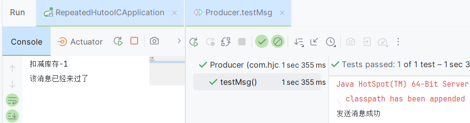
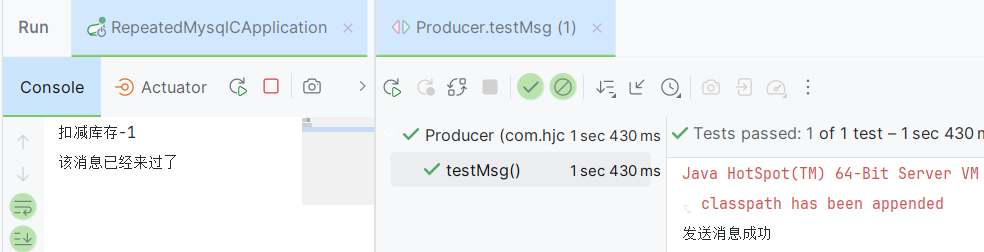

# 重复消费问题

RocketMQ 确保所有消息至少传递一次。 在大多数情况下，消息不会重复。

但是RocketMQ无法避免消息重复 (`Exactly-Once`)，所以如果业务对消费重复非常敏感，务必要在业务层面进行去重处理。

- 广播(`BROADCASTING`)模式下，所有注册的消费者都会消费，而这些消费者通常是集群部署的一个个微服务，这样就会多台机器重复消费，当然这个是根据需要来选择。

- 负载均衡(`CLUSTERING`)模式下，如果一个topic被多个consumerGroup消费，也会重复消费。

即使是在CLUSTERING模式下，同一个consumerGroup下，一个队列只会分配给一个消费者，看起来好像是不会重复消费。但是，有个特殊情况：一个消费者新上线后，同组的所有消费者要重新负载均衡，反之一个消费者掉线后也一样。一个队列所对应的新的消费者要获取之前消费的offset (偏移量，也就是消息消费的点位)，此时之前的消费者可能已经消费了一条消息，但是并没有把offset提交给broker，那么新的消费者可能会重新消费一次。虽然orderly模式是前一个消费者先解锁，后一个消费者加锁再消费的模式，比起concurrently要严格了，但是加锁的线程和提交offset的线程不是同一个，所以还是会出现极端情况下的重复消费。

在发送批量消息的时候，会被当做一条消息进行处理，那么如果批量消息中有一条业务处理成功，其他失败了，还是会被重新消费一次。

如果在负载均衡(`CLUSTERING`)模式下，并且在同一个消费者组中，不希望一条消息被重复消费，可以使用去重操作，找到消息唯一的标识，可以是msgId也可以是你自定义的唯一的key，这样就可以去重了

msgId一定是全局唯一标识符，但是实际使用中，可能会存在相同的消息有两个不同msgId的情况（消费者主动重发、因客户端重投机制导致的重复等），这种情况就需要使业务字段进行重复消费。

**官方文档**：https://rocketmq.apache.org/zh/docs/bestPractice/01bestpractice#%E6%B6%88%E8%B4%B9%E8%BF%87%E7%A8%8B%E5%B9%82%E7%AD%89

## 解决方案

使用去重方案解决，例如将消息的唯一标识存起来，然后每次消费之前先判断是否存在这个唯一标识，如果存在则不消费，如果不存在则消费，并且消费以后将这个标记保存，从而保证消息的幂等性(幂等性：多次操作产生的影响和第一次操作产生的影响相同)。

### 使用布隆过滤器解决问题

消息的体量是非常大的，可能在生产环境中会到达上千万甚至上亿条，可以选择布隆过滤器来保存所有消息的标识，并且又可以快速的判断是否存在

布隆过滤器 (`Bloom Filter`) 是1970年由布隆提出的。它实际上是一个很长的二进制向量和一系列随机映射函数。布隆过滤器可以用于检索一个元素是否在一个集合中。

- **优点**：空间效率和查询时间都比一般的算法要好的多
- **缺点**：有一定的误识别率和删除困难。

#### 使用hutool工具

https://hutool.cn/docs/#/bloomFilter/%E6%A6%82%E8%BF%B0

1. 添加hutool的依赖：

   ```xml
   <dependency>
       <groupId>cn.hutool</groupId>
       <artifactId>hutool-all</artifactId>
       <version>5.7.11</version>
   </dependency>
   ```

2. 编写生产者：

   ```java
   @SpringBootTest
   class Producer {

       /**
        * 注入rocketMQTemplate，使用它来操作mq
        */
       @Resource
       private RocketMQTemplate rocketMQTemplate;

       /**
        * 测试发送消息
        *
        * @throws Exception
        */
       @Test
       public void testMsg(){
           //生成唯一id
           String key = UUID.randomUUID().toString();
           Message<String> message = MessageBuilder.withPayload("扣减库存-1")
                   .setHeader(RocketMQHeaders.KEYS, key)
                   .build();
           // 往主题里面发送简单的字符串消息
           rocketMQTemplate.syncSend("repeatTopic", message);
           rocketMQTemplate.syncSend("repeatTopic", message);
           System.out.println("发送消息成功");
       }
   }
   ```

3. 编写消费者：

   ```java
   @Component
   @RocketMQMessageListener(topic = "repeatTopic",
           consumerGroup = "repeat-consumer-group")
   public class RepeatedMsgListener implements RocketMQListener<MessageExt> {
       public static BitMapBloomFilter bloomFilter = new BitMapBloomFilter(100);
       /**
        * 消费消息的方法
        * 如果泛型指定了固定的类型 那么消息体就是参数
        * MessageExt 类型是消息的所有内容
        * 如果没有报错 就签收了
        * 如果报错了 就是拒收 就会重试
        * @param messageExt
        */
       @Override
       public void onMessage(MessageExt messageExt) {
           // 拿到消息的key
           String keys = messageExt.getKeys();
           // 判断是否存在布隆过滤器中
           if (!bloomFilter.contains(keys)) {
               // 这个处理业务，然后放入过滤器中
               // do sth...
               System.out.println(new String(messageExt.getBody()));
               bloomFilter.add(keys);
           }else {
               // 直接返回了 不往下处理业务
               System.out.println("该消息已经来过了");
           }
       }
   }
   ```

4. 查看效果：

   

#### 使用redis的bitmap类型手写布隆过滤器

上一节的 hutool 布隆过滤器是**进程内**的：每个消费者实例各存一份位数组，彼此互不知晓。在多实例集群消费的场景下，同一条消息会被 A、B 两个实例各判一次「没来过」，去重直接失效。把位数组搬到 Redis 上，所有实例共享同一份位图，才能做到全局去重。

Redis 的 `SETBIT` / `GETBIT` 本身就是位操作，天然可以当作布隆过滤器的位数组使用，不需要额外引入组件。

**参数怎么定**：

- 位数组长度 `m ≈ -n·ln(p) / (ln 2)²`，其中 `n` 是预计元素个数，`p` 是可接受的误判率
- 哈希函数个数 `k ≈ (m / n) · ln 2`

例如预计 `n = 1000 万`、误判率 `p = 1%`，则 `m ≈ 9585 万` 位（约 11.4 MB），`k ≈ 7`。相比用 `SET` 存字符串（假设 key 平均 40 字节，需要约 400 MB），位图把内存压到了几十分之一。

> **两个必须在生产里补上的细节**：
>
> 1. 位图**不能删除元素**。如果业务需要「消息可重放」，要么按天切 key（`bloom:msg:2026-10-13`）并设过期时间，要么改用数据库唯一索引方案。
> 2. `EXPIRE` 要设置在 key 上，**不能在每次 SETBIT 后重置过期时间**，否则活跃量大的 key 永远不过期，内存只增不减。

```java
@Component
public class RedisBloomFilter {

    private final StringRedisTemplate redisTemplate;

    /** 位数组长度 m */
    private static final long BIT_SIZE = 95_850_000L;
    /** 哈希个数 k */
    private static final int HASH_COUNT = 7;
    /** 位图 key 前缀，按天切分便于回收 */
    private static final String KEY_PREFIX = "bloom:msg:";

    public RedisBloomFilter(StringRedisTemplate redisTemplate) {
        this.redisTemplate = redisTemplate;
    }

    private byte[] currentKey() {
        return (KEY_PREFIX + LocalDate.now()).getBytes(StandardCharsets.UTF_8);
    }

    /** 用 k 个不同种子对同一 value 做哈希，得到 k 个 bit 偏移 */
    private long[] offsets(String value) {
        long[] offsets = new long[HASH_COUNT];
        for (int i = 0; i < HASH_COUNT; i++) {
            // 不同种子 → 不同 hashCode，避免同一位被反复命中
            int h = (value + "#seed" + i).hashCode();
            offsets[i] = Math.abs(h) % BIT_SIZE;
        }
        return offsets;
    }

    /**
     * 存在则返回 true（视为重复消息）；
     * 不存在则写入全部 k 位并返回 false（视为首次出现）
     */
    public boolean exists(String value) {
        long[] offsets = offsets(value);
        byte[] key = currentKey();
        return Boolean.TRUE.equals(redisTemplate.execute((RedisCallback<Boolean>) conn -> {
            boolean allSet = true;
            for (long offset : offsets) {
                if (!Boolean.TRUE.equals(conn.getBit(key, offset))) {
                    allSet = false;
                    break;
                }
            }
            if (!allSet) {
                for (long offset : offsets) {
                    conn.setBit(key, offset, true);
                }
                conn.expire(key, Duration.ofDays(2).getSeconds()); // 到期自动回收
            }
            return allSet;
        }));
    }
}
```

在消费者里替换掉原来的进程内布隆过滤器即可：

```java
@Component
@RocketMQMessageListener(
        topic = "order-topic",
        consumerGroup = "order-consumer-group",
        consumeMode = ConsumeMode.CONCURRENTLY)
public class OrderConsumer implements RocketMQListener<MessageExt> {

    @Resource
    private RedisBloomFilter redisBloomFilter;

    @Override
    public void onMessage(MessageExt messageExt) {
        // 业务唯一键优先用业务字段，msgId 兜底
        String keys = messageExt.getKeys() != null
                ? messageExt.getKeys()
                : messageExt.getMsgId();

        if (redisBloomFilter.exists(keys)) {
            System.out.println("该消息已经来过了，直接返回");
            return;
        }
        // 首次出现，执行业务
        System.out.println(new String(messageExt.getBody()));
    }
}
```

**这套方案的边界**（想清楚再上生产）：

| 问题 | 说明 | 应对 |
| --- | --- | --- |
| 误判 | 布隆过滤器只会「假阳性」（把没来过的判成来过），不会「假阴性」，因此**不会重复消费，但可能漏消费** | 误判率调到 0.1% 以下；漏消费场景改用数据库唯一索引 |
| 删除 | 位图不支持删除单个元素 | 按时间切 key + 过期时间 |
| 并发 | 多个实例同时 `exists` 同一条消息时可能都读到「不存在」 | 用 `SET key value NX` 先抢占，或直接用 Redis 原子命令 `SETBIT` 的返回值判断 |
| 热 key | 单 key 的位图在集群模式下会集中在同一个分片上 | 按业务维度加哈希后缀，拆成多个 key |

> **一句话选型**：只要消费者是单实例、或者允许少量重复，进程内布隆过滤器够用；只要消费者是多实例集群，就必须把位图放到 Redis 上，否则「去重」只是看起来生效。

### 使用数据库解决问题

可以借助关系数据库进行去重。首先需要确定消息的唯一键，可以是msgId，也可以是消息内容中的唯一标识字段，例如订单Id等。在消费之前判断唯一键是否在关系数据库中存在。如果不存在则插入，并消费，否则跳过。
实际过程要考虑原子性问题，判断是否存在可以尝试插入，如果报主键冲突，则插入失败，直接跳过(普通插入是非幂等性，有唯一索引的新增是幂等的)

- 数据库操作，添加去重表：

  ```sql
  CREATE TABLE `order_oper_log` (
    `id` int NOT NULL AUTO_INCREMENT,
    `type` int DEFAULT NULL,
    `order_sn` varchar(255) DEFAULT NULL,
    `user` varchar(255) DEFAULT NULL,
    PRIMARY KEY (`id`),
    UNIQUE KEY `order_sn_idx` (`order_sn`) USING BTREE
  ) ENGINE=InnoDB DEFAULT CHARSET=utf8mb4 COLLATE=utf8mb4_0900_ai_ci;
  ```

- 导入依赖：

  ```xml
  <dependency>
      <groupId>mysql</groupId>
      <artifactId>mysql-connector-java</artifactId>
  	<version>8.0.33</version>
  </dependency>
  ```

- 生产者：

  ```java
  @SpringBootTest
  class Producer {

      /**
       * 注入rocketMQTemplate，使用它来操作mq
       */
      @Resource
      private RocketMQTemplate rocketMQTemplate;

      /**
       * 测试发送消息
       *
       * @throws Exception
       */
      @Test
      public void testMsg(){
          //生成唯一id
          String key = UUID.randomUUID().toString();
          Message<String> message = MessageBuilder.withPayload("扣减库存-1")
                  .setHeader(RocketMQHeaders.KEYS, key)
                  .build();
          // 往主题里面发送简单的字符串消息
          rocketMQTemplate.syncSend("repeatTopic", message);
          rocketMQTemplate.syncSend("repeatTopic", message);
          System.out.println("发送消息成功");
      }
  }
  ```

- 消费者：

  ```java
  @Component
  @RocketMQMessageListener(topic = "repeatTopic",
          consumerGroup = "repeat-consumer-group")
  public class RepeatedMsgListener implements RocketMQListener<MessageExt> {
      /**
       * 消费消息的方法
       * 如果泛型指定了固定的类型 那么消息体就是参数
       * MessageExt 类型是消息的所有内容
       * 如果没有报错 就签收了
       * 如果报错了 就是拒收 就会重试
       * @param messageExt
       */
      @Override
      public void onMessage(MessageExt messageExt) {
          //拿到key
          String keys = messageExt.getKeys();
          //新增 成功或报错 修改 成功或失败或报错
          //插入数据库 因为做了唯一索引
          //原生操作
          Connection connection = null;
          try {
              connection = DriverManager.getConnection("jdbc:mysql://localhost:3306/rocket?useUnicode=true&characterEncoding=UTF-8&serverTimezone=Asia/Shanghai&useSSL=false", "root", "123123");
              PreparedStatement statement = connection.prepareStatement("insert into order_oper_log(`type`,`order_sn`,`user`) values (1,'" + keys + "','123')");
              int i = statement.executeUpdate();
              //处理业务逻辑
              //如果业务逻辑报错需要删除掉去重表记录
              System.out.println(new String(messageExt.getBody()));
          } catch (SQLException e) {
              if (e instanceof SQLIntegrityConstraintViolationException) {
                  //唯一索引冲突异常 说明消息已经来过了
                  System.out.println("该消息已经来过了");
              }
              //e.printStackTrace();
          }
      }
  }
  ```

- 查看效果：

  
