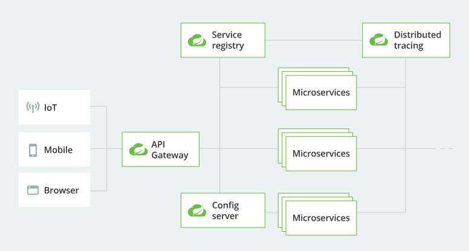

# Spring Cloud 2020（Ilford）· 历史版本入口

::: warning 版本状态：历史存档，仅存量项目使用
本组文档面向 **Spring Cloud 2020.x（Ilford 线）**，配套 **Spring Boot 2.4.x / 2.5.x** 与 **Spring Cloud Alibaba 2021.1**。该版本线的 OSS 支持已于 2022 年底结束，**内容按原貌保留、不再随新版本更新**，也不接受基于当前版本的勘误。

新项目请直接阅读 [Spring Cloud 完整专题](../../../../SpringCloud/index.md)，版本对照与升级要点见 [版本选择与演进](../../../../SpringCloud/Version/index.md)。保留本入口的理由见 [上级总览](../index.md) 的「历史版本存档」一节：旧版本的差异是**升级判断的输入**，删掉它就等于把「从哪来」这件事一起删掉。
:::

## 这一组文档包含什么

| 页面 | 内容 | 阅读时机 |
| --- | --- | --- |
| [Spring Cloud 简介与架构](./Overview/index.md) | 微服务治理的组件全景、Spring Cloud 的定位与架构图、Git 与官方文档入口 | 先读，建立组件地图 |
| [Spring Cloud Alibaba 组件速览](./Alibaba/index.md) | Nacos（注册与配置）、Sentinel（流控与熔断）、Seata（分布式事务）的版本对照表 | 接手 2020 线存量项目时读 |

## 读这一组时要知道的三件事

1. **版本号是三套并行的**：`Spring Cloud 2020.0.x`（Release Train）、`Spring Boot 2.4/2.5`、`Spring Cloud Alibaba 2021.1`。三者必须按官方对照表对齐，混搭的典型后果是「网关启动时报注册中心类找不到」。
2. **2020 线是 Netflix 组件退场后的第一代**：Eureka 仍在但已不是首选，Ribbon 被 Spring Cloud LoadBalancer 取代，Hystrix 已进入维护模式。所以这一组的示例里同时能看到新旧两套写法——**先看版本状态提示，再判断某段代码是否还适用**。
3. **Nacos 的配置与注册共用一个进程**：这让本地起环境少一个组件，但也意味着「注册中心挂了」与「配置拉不到」会同时发生，排障时不要分开查。

## 与其他专题的关系

- **下一个版本**：[Spring Cloud 2022（Kilburn）](../SpringCloud2022/index.md)——2020 线之后的断代版本（Java 17 基线、`javax` → `jakarta`、`spring.config.import` 取代 `bootstrap.yml`），从 2020 升级时先读它的「2022 线为什么值得单独留一页」一节
- [Spring Cloud 完整专题](../../../../SpringCloud/index.md)：当前稳定版本（2025.1.x Oakwood）的逐篇文档，**新项目看这里**
- [服务注册与发现](../../../../SpringCloud/Discovery/index.md)：注册中心的通用原理，不绑定版本
- [版本选择与演进](../../../../SpringCloud/Version/index.md)：Release Train 与 Spring Boot 的对照表，升级前必读
