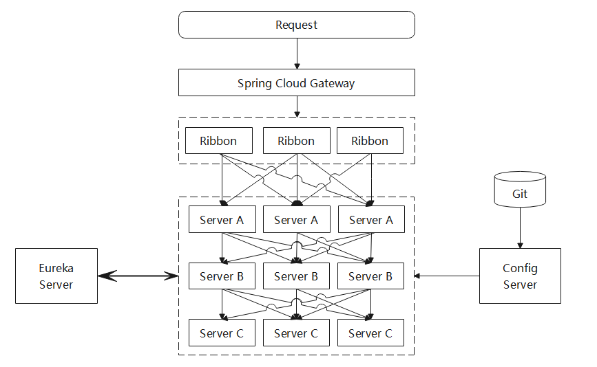

# Spring Cloud 2022（Kilburn）· 历史版本入口

::: warning 版本状态：历史存档，仅存量项目使用
本组文档面向 **Spring Cloud 2022.x（Kilburn 线）**，配套 **Spring Boot 3.0.x**。该版本线的 OSS 支持已结束，**内容按原貌保留、不再随新版本更新**。

新项目请直接阅读 [Spring Cloud 完整专题](../../../../SpringCloud/index.md)，版本对照与升级要点见 [版本选择与演进](../../../../SpringCloud/Version/index.md)。保留本入口的理由见 [上级总览](../index.md) 的「历史版本存档」一节。
:::

## 这一组文档包含什么

| 页面 | 内容 | 阅读时机 |
| --- | --- | --- |
| [Spring Cloud 简介与架构](./Overview/index.md) | 组件全景、Spring Cloud 的定位与架构图、Git 与官方文档入口 | 先读，建立组件地图 |
| [Spring Cloud Alibaba 组件速览](./Alibaba/index.md) | Nacos / Sentinel / Seata 的版本对照表 | 接手 2022 线存量项目时读 |

## 2022 线为什么值得单独留一页

它不是「2020 的下一版」，而是**一次断代**，三处变化决定了升级不能只改版本号：

| 变化 | 2020（Ilford） | 2022（Kilburn） | 升级时的实际影响 |
| --- | --- | --- | --- |
| Java 基线 | Java 8 / 11 | **Java 17** | 依赖里任何用 `sun.misc.*` 或反射访问 JDK 内部的库都会炸 |
| 命名空间 | `javax.*` | **`jakarta.*`** | 全量 import 改名；与第三方库混用时会出现「同一个类被加载两次」 |
| 配置引导 | `bootstrap.yml` 常用 | **`spring.config.import`** 为主 | 沿用 `bootstrap.yml` 而不加 `spring-cloud-starter-bootstrap` 时，配置静默不生效 |

第三行是最容易踩的：配置中心地址写在 `bootstrap.yml` 里，升级后**启动不报错、但拉到的全是默认值**。这类「静默不生效」在排障时表现为「某某配置改了没反应」，而日志里没有任何异常。

## 与其他专题的关系

- [Spring Cloud 完整专题](../../../../SpringCloud/index.md)：当前稳定版本（2025.1.x Oakwood）的逐篇文档，**新项目看这里**
- [配置中心](../../../../SpringCloud/ConfigCenter/index.md)：从 `bootstrap.yml` 到 `spring.config.import` 的迁移思路
- [版本选择与演进](../../../../SpringCloud/Version/index.md)：Release Train 与 Spring Boot 的完整对照表
