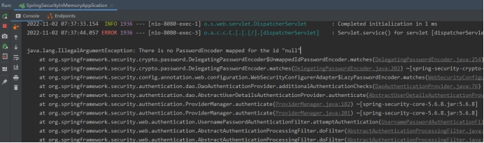

# Spring Security 常见错误

本页按「症状 → 根因 → 处置」收 Spring Security 6 的常见错误，重点在过滤器链顺序与配置写法变更这两条线。每条都给出可直接对照的报错文本。



**错误的原因**：

这个是因为spring Sercurity强制要使用密码加密，当然我们也可以不加密，但是官方要求是不管你是否加密，都必须配置一个密码编码（加密）器

**解决办法**：**添加密码加密器bean但是不对密码加密**

在MySecurityUserConfig类中加入以下bean：

```java
*
 * 从 Spring5 开始，强制要求密码要加密
 * 如果非不想加密，可以使用一个过期的 PasswordEncoder 的实例 NoOpPasswordEncoder，
 * 但是不建议这么做，毕竟不安全。
 *
 * @return
 */
@Bean
public PasswordEncoder passwordEncoder(){
    //不对密码进行加密，使用明文
    return NoOpPasswordEncoder.getInstance();
}
```
