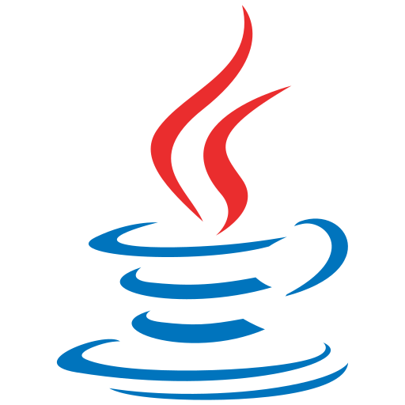

# Java

Java 是**基于 JVM 的跨平台面向对象语言**，也是本库后端内容的主干：从语言基础（JavaSE）到框架与生态（Spring 体系、Spring Cloud），再到单机性能与高并发这类系统级话题。本专题按「语言 → 框架 → 专项」三层组织，大版本差异按版本目录并存维护（如 Spring5 / Spring6）。

- [JavaSE](JavaSE/index.md)
- [框架](Frame/index.md)
- [其他](Others/index.md)
