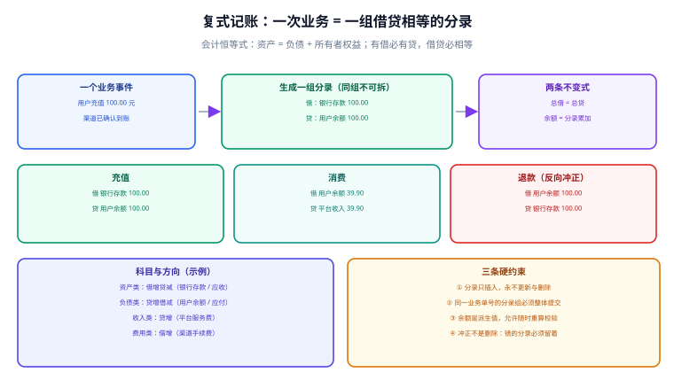

# 复式记账与账本模型

**复式记账（Double-entry bookkeeping）用一条数学约束解决了「钱会不会凭空出现」的问题：每笔业务都必须写成一组借贷合计相等的分录。** 这不是会计的繁文缛节，而是一个可以被数据库直接校验的不变式。本页给出科目表、分录组与完整 DDL，并说明借贷方向到底由什么决定。



## 一句话定位

**单边记账只能告诉你「某个数变了」，复式记账才能告诉你「钱从哪儿来、到哪儿去」。** 前者永远发现不了「这个数为什么变了」，后者把每一次变动都表达成两个账户之间的守恒转移。

## 一、会计恒等式

```text
资产 = 负债 + 所有者权益
```

把收入与费用展开（收入增加权益、费用减少权益），恒等式在**任意时刻**都必须成立。工程上的意义是：**它是一个可以在生产库上跑的断言。**

```sql [invariant.sql]
-- 恒等式校验：资产合计 − 负债合计 − 权益合计 应恒为 0
SELECT
  SUM(CASE WHEN cat = 'ASSET'   THEN balance ELSE 0 END) AS assets,
  SUM(CASE WHEN cat = 'LIABILITY' THEN -balance ELSE 0 END) AS liabilities,
  SUM(CASE WHEN cat = 'EQUITY'  THEN -balance ELSE 0 END) AS equity
FROM t_account_balance b
JOIN t_account a ON a.account_no = b.account_no;
-- 期望：assets − liabilities − equity = 0.00
```

## 二、借贷方向到底由什么决定

初学复式记账最容易卡住的地方是「什么时候借、什么时候贷」。**结论：方向不是由「收钱 / 付钱」决定的，而是由账户所属科目类别决定的。**

| 科目类别 | 余额方向 | 增加记 | 减少记 | 例子 |
| --- | --- | --- | --- | --- |
| 资产类 | 借 | 借 | 贷 | 银行存款、应收款、在途资金 |
| 负债类 | 贷 | 贷 | 借 | 用户余额（平台欠用户）、应付款 |
| 所有者权益类 | 贷 | 贷 | 借 | 实收资本、未分配利润 |
| 收入类 | 贷 | 贷 | 借 | 平台服务费、通道收入 |
| 费用 / 成本类 | 借 | 借 | 贷 | 支付手续费、结算费 |

::: tip 记不住时的推导法
把「用户余额」想成**平台欠用户的钱**（负债）：用户充值 100 元，平台欠用户的负债增加，负债增加记 **贷**；同时平台银行存款（资产）增加，资产增加记 **借**。于是得到：

```text
借：银行存款   100.00
贷：用户余额   100.00
```

只要先判断科目类别，再判断是增还是减，方向自然就出来了——不需要背口诀。
:::

## 三、科目表设计

科目表是**分类体系**，账户是**实例**。一个科目下可以有成千上万个账户（每个用户一个余额账户），但科目本身是固定的、由财务确认的。

```sql [chart-of-accounts.sql]
CREATE TABLE t_account (
  account_no   VARCHAR(32)  NOT NULL COMMENT '账户号（业务侧生成，全局唯一）',
  account_name VARCHAR(64)  NOT NULL COMMENT '账户名称（可读）',
  subject_code VARCHAR(16)  NOT NULL COMMENT '所属科目编码，如 1001 / 2201',
  cat          VARCHAR(16)  NOT NULL COMMENT 'ASSET / LIABILITY / EQUITY / REVENUE / EXPENSE',
  balance_dir  CHAR(1)      NOT NULL COMMENT '余额方向 D=借 C=贷，由 cat 推导，冗余存储便于校验',
  owner_type   VARCHAR(16)  NOT NULL COMMENT 'USER / MERCHANT / PLATFORM / CHANNEL',
  owner_id     VARCHAR(64)  NULL     COMMENT '归属方 ID（平台账户为空）',
  currency     CHAR(3)      NOT NULL DEFAULT 'CNY' COMMENT '币种，ISO 4217',
  status       VARCHAR(16)  NOT NULL DEFAULT 'ACTIVE' COMMENT 'ACTIVE / FROZEN / CLOSED',
  create_time  DATETIME     NOT NULL DEFAULT CURRENT_TIMESTAMP,
  PRIMARY KEY (account_no),
  KEY idx_owner (owner_type, owner_id),
  KEY idx_subject (subject_code)
) ENGINE=InnoDB DEFAULT CHARSET=utf8mb4 COMMENT='账户表（科目实例）';
```

| 科目编码（示例） | 名称 | 类别 | 余额方向 | 用途 |
| --- | --- | --- | --- | --- |
| 1001 | 库存现金 | 资产 | 借 | 现金收付 |
| 1002 | 银行存款 | 资产 | 借 | 银行账户余额 |
| 1301 | 在途资金 | 资产 | 借 | 已收未清分的资金 |
| 2201 | 用户余额 | 负债 | 贷 | 平台欠用户的可用余额 |
| 2202 | 用户冻结 | 负债 | 贷 | 提现在途等冻结部分 |
| 2203 | 应结算款 | 负债 | 贷 | 应付给商户但未划付 |
| 6001 | 平台服务费 | 收入 | 贷 | 佣金 |
| 6401 | 通道手续费 | 费用 | 借 | 渠道收取的手续费 |

::: danger 科目编码不要自己发明
科目编码来自财务的科目表。研发自定义编码会导致「系统里能统计、月结报表对不上」。**正确做法**：让财务给出正式科目表，研发只做映射（`subject_code` 外键或枚举），新增科目前先与财务确认。
:::

## 四、分录的数据结构

复式记账的模型只有三个对象：**Account（账户）、Entry（分录）、Accounting Transaction（分录组）**。Fowler 的描述是：分录组把参与一次转移的分录连起来，并约束「组内分录金额之和为零」。

```sql [entry-schema.sql]
-- 分录组：一次业务产生的一组分录，是幂等与事务的最小单位
CREATE TABLE t_entry_group (
  group_no     VARCHAR(40)  NOT NULL COMMENT '分录组号（与业务单号关联）',
  biz_type     VARCHAR(32)  NOT NULL COMMENT '业务类型：RECHARGE / CONSUME / REFUND / SETTLE / ADJUST',
  biz_no       VARCHAR(64)  NOT NULL COMMENT '业务单号（幂等键的主要来源）',
  reversal_of  VARCHAR(40)  NOT NULL DEFAULT '' COMMENT '冲正时指向被冲正的分录组，正常为空串',
  amount       DECIMAL(18,2) NOT NULL COMMENT '本组金额（借贷各半，用于快速校验）',
  entry_time   DATETIME     NOT NULL COMMENT '账务时间（业务发生时间，非入库时间）',
  create_time  DATETIME     NOT NULL DEFAULT CURRENT_TIMESTAMP COMMENT '入库时间',
  PRIMARY KEY (group_no),
  UNIQUE KEY uk_biz (biz_type, biz_no, reversal_of)  -- 幂等的物理保证
) ENGINE=InnoDB DEFAULT CHARSET=utf8mb4 COMMENT='分录组';

-- 分录：只增不改不删
CREATE TABLE t_entry (
  entry_id     BIGINT       NOT NULL AUTO_INCREMENT,
  group_no     VARCHAR(40)  NOT NULL COMMENT '所属分录组',
  account_no   VARCHAR(32)  NOT NULL COMMENT '账户',
  direction    CHAR(1)      NOT NULL COMMENT 'D=借 C=贷',
  amount       DECIMAL(18,2) NOT NULL COMMENT '金额，恒为正数，方向由 direction 表达',
  currency     CHAR(3)      NOT NULL DEFAULT 'CNY',
  memo         VARCHAR(128) NULL     COMMENT '摘要，便于人工核对',
  create_time  DATETIME     NOT NULL DEFAULT CURRENT_TIMESTAMP,
  PRIMARY KEY (entry_id),
  KEY idx_group (group_no),
  KEY idx_account_time (account_no, create_time)   -- 支撑按账户重算余额
) ENGINE=InnoDB DEFAULT CHARSET=utf8mb4 COMMENT='分录（只增不改不删）';
```

::: warning 三个设计决定，每个都有理由
1. **金额恒为正、方向单独存 `direction`**。如果允许负数，`SUM(amount) = 0` 也能通过校验，但「这条分录到底是借还是贷」就看不出来了，人工核对会非常痛苦。
2. **分录组自带 `biz_no` 与唯一键**。幂等不应该只依赖幂等键表，**库级唯一约束才是最终保证**（见[记账幂等与一致性](../Idempotency/index.md)）。
3. **`entry_time` 与 `create_time` 分开**。账务时间用于归属会计期间（决定这笔钱算哪一天的账），入库时间是技术事实；补数场景下两者可能相差好几天。
:::

## 五、完整示例：一笔钱的四次转移

以「用户充值 100 元 → 消费 39.90 元 → 平台收 39.90 元 → 商家退款」为例，看分录怎么成组出现。

```sql [entries.sql]
-- ① 用户充值 100.00（渠道已到账）
INSERT INTO t_entry_group(group_no, biz_type, biz_no, amount, entry_time)
VALUES ('G202610100001', 'RECHARGE', 'RCH202610100001', 100.00, '2026-10-10 10:00:00');
INSERT INTO t_entry(group_no, account_no, direction, amount, memo) VALUES
  ('G202610100001', '1002-BANK-001', 'D', 100.00, '银行存款增加'),
  ('G202610100001', '2201-U-10086',  'C', 100.00, '用户余额增加');

-- ② 用户消费 39.90
INSERT INTO t_entry_group(group_no, biz_type, biz_no, amount, entry_time)
VALUES ('G202610100002', 'CONSUME', 'ORD202610100001', 39.90, '2026-10-10 11:20:00');
INSERT INTO t_entry(group_no, account_no, direction, amount, memo) VALUES
  ('G202610100002', '2201-U-10086',    'D', 39.90, '用户余额减少'),
  ('G202610100002', '2203-M-20001',    'C', 39.90, '形成应付商户的结算款');

-- ③ 平台确认收入（一笔业务可以有两组分录，分别对应资金流与收入确认）
INSERT INTO t_entry_group(group_no, biz_type, biz_no, amount, entry_time)
VALUES ('G202610100003', 'CONSUME', 'ORD202610100001-REV', 3.99, '2026-10-10 11:20:00');
INSERT INTO t_entry(group_no, account_no, direction, amount, memo) VALUES
  ('G202610100003', '2203-M-20001',    'D', 3.99, '应付商户中扣出平台服务费'),
  ('G202610100003', '6001-PLATFORM',   'C', 3.99, '平台服务费收入');

-- ④ 冲正：②的金额记错了（应为 49.90），用反向分录留痕，而不是 UPDATE
INSERT INTO t_entry_group(group_no, biz_type, biz_no, reversal_of, amount, entry_time)
VALUES ('G202610100004', 'CONSUME', 'ORD202610100001', 'G202610100002', 39.90, '2026-10-10 15:00:00');
INSERT INTO t_entry(group_no, account_no, direction, amount, memo) VALUES
  ('G202610100004', '2201-U-10086', 'C', 39.90, '冲正：原分录金额错误'),
  ('G202610100004', '2203-M-20001', 'D', 39.90, '冲正：原分录金额错误');
```

| 分录组 | 业务类型 | 借方 | 贷方 | 校验 |
| --- | --- | --- | --- | --- |
| G202610100001 | 充值 | 银行存款 100.00 | 用户余额 100.00 | 借 = 贷 ✓ |
| G202610100002 | 消费 | 用户余额 39.90 | 应付结算款 39.90 | 借 = 贷 ✓ |
| G202610100003 | 收入确认 | 应付结算款 3.99 | 平台服务费 3.99 | 借 = 贷 ✓ |
| G202610100004 | 冲正 | 应付结算款 39.90 | 用户余额 39.90 | 借 = 贷 ✓ |

::: danger 五个反复出现的写法错误
1. **只记一条分录**。看起来「余额已经减了」，但找不到对偶方，`SUM(借) ≠ SUM(贷)`，账永久不平。
2. **借贷写反**。资产增加记成了贷方，恒等式仍可能成立（两边同时错），但余额方向与科目不符，月末结转时报错；用「余额方向与科目类别是否一致」做校验可以抓到。
3. **用 `UPDATE` 修正金额**。审计链断裂；正确做法是冲正分录（示例 ④），并且保留 `reversal_of` 指向原组。
4. **金额用 `DOUBLE` / `FLOAT`**。`0.1 + 0.2 != 0.3` 会让「借贷相等」的校验随机失败；一律用 `DECIMAL(18,2)` 或「分」为单位的整数。
5. **分录组与分录不在同一事务提交**。中途失败会留下只有一条分录的组；必须一组一事务，并用唯一键保证重试安全。
:::

## 六、跨币种与多币种

多币种场景下不要在一个分录组里混币种。两种可行方案：

1. **按币种分别建账户**：`account_no` 里包含币种，每组分录的币种一致，恒等式按币种分别成立。
2. **加原币与记账币两个金额**：分录同时记 `amount_orig`（原币）与 `amount_base`（本位币）+ `fx_rate`，并用**同一个汇率**计算整组，否则组内借贷会因汇率取整而不等。

::: warning 汇率的取整陷阱
用汇率换算时，若对每条分录分别取整，可能出现「借方取整向上、贷方取整向下」，导致组内差一分钱。正确做法是**先算整组金额，再把尾差分配到指定的一条分录上**，并记录分配规则。
:::

## 验证方式

```shell
# 1. 逐组校验借贷相等：期望返回空
mysql -u app -p -e "
SELECT group_no,
       SUM(CASE WHEN direction='D' THEN amount ELSE 0 END) AS dr,
       SUM(CASE WHEN direction='C' THEN amount ELSE 0 END) AS cr
FROM t_entry GROUP BY group_no HAVING dr <> cr;"

# 2. 科目余额方向校验：期望返回空（资产类不应为贷方余额）
mysql -u app -p -e "
SELECT a.account_no, a.cat, a.balance_dir, b.book_balance
FROM t_account a JOIN t_account_balance b ON b.account_no=a.account_no
WHERE a.cat IN ('ASSET','EXPENSE') AND b.book_balance < 0;"

# 3. 试着重改一条分录：期望被拒绝（权限不足）
mysql -u app -p -e "UPDATE t_entry SET amount=1.00 WHERE entry_id=1;" || echo "已按预期被拒绝"
```

| 检查项 | 期望结果 | 结论 |
| --- | --- | --- |
| 组内借贷相等 | 返回空集 | 待填写 |
| 余额方向与科目一致 | 返回空集 | 待填写 |
| 应用账号不能改分录 | `UPDATE` 被拒绝 | 待填写 |

## 相关页面

- 上一节：[总览：四条边界](../Overview/index.md)
- 下一节：[账户、余额与流水](../AccountModel/index.md)
- 幂等怎么落：[记账幂等与一致性](../Idempotency/index.md)
## 与「多币种折算」专题的分工

| 专题 | 它回答的问题 | 本文的回答 |
| --- | --- | --- |
| [多币种与汇率折算工程](../../MultiCurrency/index.md) | 金额用哪种币、按哪个汇率、差额归谁 | 本文只到「借贷两腿怎么拆」，不判断币种与汇率 |
| [结算与已实现损益](../../MultiCurrency/Settlement/index.md) | 核销那一刻的汇兑损益 | 本文的「跨币种」一节是它的上游约定 |
| [期末重估](../../MultiCurrency/Valuation/index.md) | 期末余额按新汇率调整 | 重估分录的借贷方向由本文的规则决定 |

::: danger 本页特有的坑
**「整组用同一汇率」这句话有一个隐含前提：整组指的是同一个日记账。** 如果一笔业务跨两个日记账（比如境内账与境外账各记一次），两个日记账可以各自用不同的汇率，但**每一个日记账内部必须唯一**。本机实测：同一组分录里混用两个汇率（7.1234 与 7.2300），尾差会落到「财务费用-汇兑」之外，凭证不平而系统不报错。
:::

## 与「仓储作业与波次拣选工程」的分工（第 228 天补充）

| 维度 | 本页（借贷与分录） | [循环盘点与差异处理](../../WarehouseOps/CycleCount/index.md) |
| --- | --- | --- |
| 管什么 | 一笔业务拆成哪两腿、金额多少 | 数量差多少、差在哪个库位、为什么差 |
| 产物 | 会计分录 | 盘点单 + 调整流水 + 原因码 |
| 交点 | 盘亏金额（数量差 × 单位成本） | 数量差本身 |

::: danger 这一页特有的一个坑
把盘点差异一律记入「其他」科目：`COUNT_ERROR`（数错，不该有账务影响）、
`MISPLACED`（移库，总量不变）、`LOSS`（真丢，进管理费用）三类在账上是三种处理，
合并成一个科目之后，管理费用会随「数错」波动，且无法追溯。**原因码必须先定，再出分录。**
:::


## 与「资产台账与折旧摊销工程」的分工（第 229 天补充）

| 你关心的问题 | 该读哪一册 | 分界 |
| --- | --- | --- |
| 「折旧凭证的借贷两腿怎么写」 | 本页 | 只回答「借费用、贷累计折旧」的科目与方向 |
| 「这个月该提多少、按什么方法提」 | [资产台账与折旧摊销](../../FixedAsset/Overview/index.md) | 那册管金额与期间，本页管分录形态 |
| 「累计折旧科目余额为什么和台账差 8 万」 | [与总账的勾稽与月结](../../FixedAsset/Ledger/index.md) | 那册给三条勾稽查询与定位顺序 |

::: danger 一页一坑：折旧不是「资产减少」，是「资产被消耗」
初学者常把折旧写成 `借 管理费用 / 贷 固定资产`——固定资产科目直接减少。这条分录在试算平衡上过得去，但**原值就丢了**：报表上再也看不到这台机器原来值多少钱，处置时无基数可分摊。

正确写法是两腿都留在资产类：`借 管理费用（或制造费用）/ 贷 累计折旧`。固定资产科目只增不减，减只在处置时发生。
:::

## 与「成本核算」的分工

复式记账保证**每一笔业务两腿相等**（横平），成本核算保证**同一条成本流在各表之间守恒**（竖直）。两个方向互不替代：

| 判据 | 本页 | 成本核算 |
| --- | --- | --- |
| 借贷平衡 | 每笔分录两腿相等 | 不检查（它只消费已平衡的分录） |
| 金额守恒 | 不管 | 期初 + 投入 = 出库 + 期末 |
| 覆盖范围 | 全部分录 | 只覆盖成本类科目（生产成本、制造费用、库存商品、主营业务成本） |

::: danger 借贷平了，成本仍然可以错
一张「借：生产成本 100 / 贷：原材料 100」的分录完全平衡，但**它可能挂错了成本中心**，也可能挂错了期间。所以「借贷平衡」是必要条件而不是充分条件——[三条守恒式](../../CostAccounting/Overview/index.md)补齐的正是这一块。
:::

## 与「薪酬核算与个税社保工程」的分工（第 230 天补充）

| 你关心的问题 | 该读哪一册 | 为什么不是本册 |
| --- | --- | --- |
| 一笔工资为什么有四组分录 | [成本归集与总账勾稽](../../Payroll/Ledger/index.md) | 那册讲工资的四组借贷与三条勾稽，本册只讲「两腿怎么平」 |
| 计提与发放的时点为什么不同 | [薪酬总览](../../Payroll/Overview/index.md) | 那册讲七段链里「计提在月末、发放发薪日」的由来 |
| 代扣的社保与个税挂哪个科目 | [社保公积金](../../Payroll/SocialInsurance/index.md) | 那册讲个人与单位分列，本册讲科目归属 |
| 红冲一笔已封账的工资 | [补发与追溯](../../Payroll/RetroPay/index.md) | 那册讲红冲与重出的成对规则 |

::: danger 本页特有的一个坑：单位社保只计提不落地
工资分录里最容易只写「借 管理费用-工资；贷 应付职工薪酬」两组，把单位承担的社保公积金（本例 11,850）当成「缴纳时再说」。结果是缴纳社保那一笔贷方银行存款、借方无处可去，只能挂到「其他应付款」，**每月多挂一笔、全年累积 142,200**，而账面看不出任何异常。正确写法是在计提时就分两行：`借 管理费用-工资 30,000` 与 `借 管理费用-社保 11,850`，贷方合计 41,850。
:::

## 与「全面预算」专题的分工

| 你关心的问题 | 该读哪一册 | 为什么不是本页 |
| --- | --- | --- |
| 「这笔业务怎么拆成借贷两腿」 | 本页 | 判**借贷横平**与科目选择 |
| 「这笔支出有没有额度」 | [全面预算与经营分析](../../Budgeting/Overview/index.md) | 那册判**授权与占用**，与借贷无关 |
| 「预算表和实际数怎么对」 | [总览：七段链与三个「预算」](../../Budgeting/Overview/index.md) | 那册判**四本账对齐** |
| 「多币种分录怎么折算」 | [多币种与汇率折算](../../MultiCurrency/Overview/index.md) | 那册判**汇率快照与重估**，本页只判两腿平衡 |

::: warning 一页一坑：借贷平了，预算可能已经翻倍
本页的判据是「借方合计 = 贷方合计」，它对预算错误**零敏感度**。

本机实测：版本表与明细表 join 时漏了 `ver` 条件，初版被并两次，预算从 53,026,185.93 变成 102,551,730.02，**虚增 93.4%**；同时预算、承诺、实际、可用四本账全部同步翻倍，**试算仍然平**。

也就是说：一个通过了全部借贷平衡检查的系统，可以同时把预算多算一倍。借贷平衡管的是「一笔业务内部自洽」，预算管的是「跨期间的额度是否被授权」——两件事必须各有各的判据。
:::

## 与「碳排放核算与 ESG 披露」的分工（第 237 天补充）

| 你关心的问题 | 该读哪一册 | 为什么不是本页 |
| --- | --- | --- |
| 「这笔业务怎么拆成借贷两腿」 | 本页 | 判的是**金额的横向平衡**（借 = 贷） |
| 「组织这一年排了多少碳、边界怎么定」 | [碳排放核算总览](../../CarbonAccounting/Overview/index.md) | 那册判**物理量的纵向闭合**，与借贷无关 |
| 「排放明细怎么算、因子用哪版」 | [排放因子与 GWP](../../CarbonAccounting/EmissionFactor/index.md) | 那册判**量 × 因子与版本快照** |
| 「碳数据怎么披露、基准年怎么改」 | [披露、重述与履约](../../CarbonAccounting/Disclosure/index.md) | 那册判**对外口径与重述**，本页不进披露 |

::: warning 一页一坑：借贷平了，边界可能已经错了
本页的判据是「借方合计 = 贷方合计」。它对**边界错误零敏感度**。

本机实测：同一组六个实体在股权比例法 / 运营控制法 / 财务控制法下分别是 77,250 / 79,000 / 75,000 tCO₂e（极差 5.06%），三种算法下每个范围的「明细合计 = 汇总」都成立，任何一条加总恒等式都不破。也就是说，一份完全满足「借贷平衡」式自检的碳清单，照样可以把边界定错，而系统不会给出任何提示。
:::

## 与「理赔作业」专题的分工（第 239 天补充）

本页判「**一笔业务怎么拆成借贷两腿、两腿是否相等**」，[理赔作业](../../ClaimsProcessing/Overview/index.md) 判「**这一笔该不该赔、该赔多少**」。本机反例最能说明两者独立：一笔 41,000 元的赔款借贷完全平衡（本页全绿），同时它比条款上限多赔了 7,300 元（那册全错）。

| 你关心的问题 | 该读哪一册 | 为什么不是本册 |
| --- | --- | --- |
| 「这张凭证借贷平不平」 | 本页 | 那册不判借贷，只判金额依据 |
| 「免赔额、责任比例、限额怎么排序」 | [条款与责任判定](../../ClaimsProcessing/Coverage/index.md) | 本页只接收金额，不追问金额怎么来的 |
| 「追偿回收记哪个科目」 | [赔付、支付与追偿](../../ClaimsProcessing/Payment/index.md) | 本页判科目是否平衡，那册判冲减赔款还是费用 |
| 「未决赔款准备金怎么计提」 | [准备金与 IBNR](../../ClaimsProcessing/Reserve/index.md) | 本页判计提分录，那册判估计方法 |

::: danger 一页一坑
**追偿回收冲减「赔款支出」还是「营业费用」，在分录上都平**：两种写法借贷都相等，本页全绿；但前者让赔付率下降 1.6 个点，后者不变。分录平衡只能证明「账没记漏」，证明不了「口径对」——口径要对，得回到那册看 `offset_target`。
:::

## 参考资料

- [Martin Fowler · Accounting Transaction（两组/多组分录与三种调整方式）](https://www.martinfowler.com/eaaDev/AccountingTransaction.html)
- [Martin Fowler · Patterns for Accounting](https://martinfowler.com/eaaDev/AccountingNarrative.html)
- [Wikipedia · Double-entry bookkeeping](https://en.wikipedia.org/wiki/Double-entry_bookkeeping)
