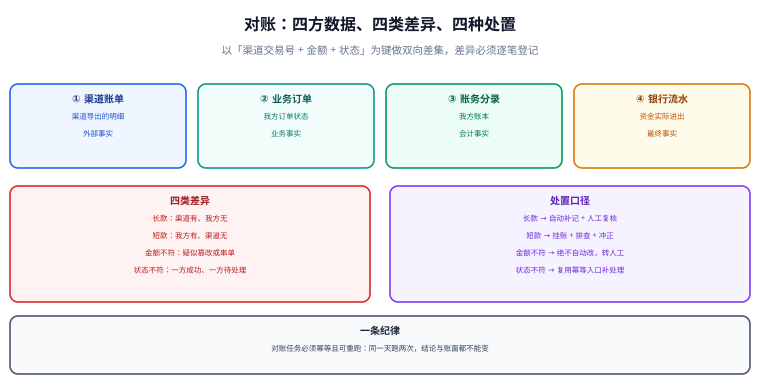

# 对账体系与差错处理

**对账不是「把两个数字比一比」，而是一套把差异变成可追踪任务的机制。** 它的产出不是「对上了」，而是**一张差异清单 + 每条差异的处理结果**。本页给出三层对账的划分、四类差异的处置口径，以及挂账、冲正、长短款这些必须落到表里的动作。



## 一句话定位

**只要钱经过别人的系统，就一定有对不上的时候。** 对账的价值在于：**在用户投诉之前发现它，并且留下它被处理的证据。**

## 一、三层对账

很多团队只有一层对账（渠道账单 vs 支付单），于是「渠道对上了，但账本不平」这类问题永远查不出来。完整体系至少三层：

| 层 | 比什么 | 发现什么问题 | 频率 |
| --- | --- | --- | --- |
| **外部 · 渠道对账** | 渠道账单 ↔ 我方支付单 | 回调丢失、串单、金额篡改 | T+1 |
| **外部 · 资金对账** | 银行流水 ↔ 我方资金账户余额 | 出款未记账、入账未登记 | T+1 |
| **内部 · 账本自洽** | 分录聚合 ↔ 余额表 | 余额被直接改坏、记账漏写分录 | 每小时 / 每日 |

::: warning 内部对账不是「多余的」
渠道对账通过，只说明「我方支付单与渠道一致」；它**完全不检查我方账本**。如果某次记账只写了分录没更新余额（或反过来），渠道对账照样全绿，而用户余额已经错了。内部对账是唯一能发现这类问题的检查，且成本极低——它就是本次那条「余额与分录聚合比对」的 SQL。
:::

## 二、对账的五个步骤

```text
① 拉账单   →  从渠道/银行获取对账单文件（注意就绪时间，不要凌晨硬拉）
② 解析入库 →  落到对账临时表（tmp_*），保留原文与文件哈希
③ 双向比对 →  以业务键做双向差集，并为每条差异生成记录
④ 分类处置 →  按差异类型走自动修正或转人工，动作必须留痕
⑤ 归档     →  保存账单原文、比对结果与处理记录，作为审计依据
```

```sql [reconcile-tables.sql]
-- 对账批次：一次对账运行的可追溯记录
CREATE TABLE t_recon_batch (
  batch_no      VARCHAR(40) NOT NULL COMMENT '对账批次号 = 类型 + 日期 + 渠道',
  recon_type    VARCHAR(16) NOT NULL COMMENT 'CHANNEL / FUND / INTERNAL',
  recon_day     DATE        NOT NULL,
  channel       VARCHAR(16) NULL,
  file_hash     VARCHAR(64) NULL     COMMENT '账单文件哈希，用于证明比的是哪一份',
  total_cnt     INT         NOT NULL DEFAULT 0,
  matched_cnt   INT         NOT NULL DEFAULT 0,
  diff_cnt      INT         NOT NULL DEFAULT 0,
  status        VARCHAR(16) NOT NULL DEFAULT 'RUNNING' COMMENT 'RUNNING / DONE / FAILED',
  create_time   DATETIME    NOT NULL DEFAULT CURRENT_TIMESTAMP,
  PRIMARY KEY (batch_no),
  UNIQUE KEY uk_batch (recon_type, recon_day, channel)   -- 同一批次不可重复运行
) ENGINE=InnoDB DEFAULT CHARSET=utf8mb4 COMMENT='对账批次';

-- 差异明细：每条差异一条记录，必须能追踪到「谁、何时、怎么处理」
CREATE TABLE t_recon_diff (
  diff_id       BIGINT      NOT NULL AUTO_INCREMENT,
  batch_no      VARCHAR(40) NOT NULL,
  biz_key       VARCHAR(96) NOT NULL COMMENT '比对键，如 渠道交易号 / 银行流水号',
  diff_type     VARCHAR(24) NOT NULL COMMENT 'LONG=长款 SHORT=短款 AMOUNT=金额不符 STATE=状态不符 MISSING=内部缺失',
  local_amount  DECIMAL(18,2) NULL,
  remote_amount DECIMAL(18,2) NULL,
  diff_amount   DECIMAL(18,2) NULL,
  handle_action VARCHAR(32) NOT NULL DEFAULT 'PENDING' COMMENT 'PENDING / AUTO_FIXED / MANUAL_SUSPENDED / WRITTEN_OFF / REVERSED',
  handle_by     VARCHAR(64) NULL,
  handle_time   DATETIME    NULL,
  handle_memo   VARCHAR(255) NULL COMMENT '处理说明（人工项必填）',
  create_time   DATETIME    NOT NULL DEFAULT CURRENT_TIMESTAMP,
  PRIMARY KEY (diff_id),
  UNIQUE KEY uk_diff (batch_no, biz_key, diff_type),   -- 重跑不重复登记
  KEY idx_action (handle_action, create_time)
) ENGINE=InnoDB DEFAULT CHARSET=utf8mb4 COMMENT='对账差异明细';
```

## 三、四类差异与处置口径

| 差异类型 | 含义 | 危害 | 处置 |
| --- | --- | --- | --- |
| **长款** | 渠道 / 银行有，我方无 | 用户付了钱但没拿到权益 | 自动补记 + **人工复核**（金额大时必须复核） |
| **短款** | 我方有，渠道 / 银行无 | 记录了不存在的收入 | 挂账 → 排查 → 确认后冲正 |
| **金额不符** | 两边都有但金额不同 | 可能串单或被篡改 | **绝不自动修正**，转人工 |
| **状态不符** | 一边成功、一边未完成 | 用户已付但订单未推进 | 复用幂等入口补处理（安全，因为幂等） |
| **内部缺失** | 分录存在但余额未更新（或反之） | 余额错误，用户可见 | 用分录重算余额修复（幂等操作） |

::: danger 对账处理的四条铁律
1. **金额不符绝不自动修正。** 自动修正会抹掉「可能被篡改」的信号，让问题永远查不出来。
2. **长款优先于短款处理。** 长款意味着用户的钱在平台上但权益没到账，属于「欠用户」，优先级最高，且要主动通知或退款。
3. **每一笔差异必须有 `handle_action`。** 「对账差异数 = 已处理数 + 待处理数」必须成立；没有这条断言，差异清单会越积越多，最终没人看。
4. **对账任务本身必须幂等。** 同一天重跑两次，差异记录不能翻倍（`uk_diff` 兜底），自动处理动作不能重复执行。
:::

## 四、挂账与冲正

**挂账**是把无法立即定性的差异先「临时入账」到一个专用科目，避免它污染正常账户，同时保持账本平衡。

```sql [suspend.sql]
-- 挂账：把短款先记入「待处理差异」科目，账本保持平衡，等待定性
INSERT INTO t_entry_group(group_no, biz_type, biz_no, amount, entry_time)
VALUES ('G-SUSPEND-20261010001', 'ADJUST', 'DIFF-20261010-0001', 128.00, '2026-10-10 12:00:00');
INSERT INTO t_entry(group_no, account_no, direction, amount, memo) VALUES
  ('G-SUSPEND-20261010001', '1901-DIFF-SUSPEND', 'D', 128.00, '短款挂账：我方有渠道无'),
  ('G-SUSPEND-20261010001', '1002-BANK-001',    'C', 128.00, '短款挂账：暂冲减银行存款');

-- 定性后冲正挂账：用反向分录释放挂账科目，并把正确的结果记入正式账户
INSERT INTO t_entry_group(group_no, biz_type, biz_no, reversal_of, amount, entry_time)
VALUES ('G-SUSPEND-20261010002', 'ADJUST', 'DIFF-20261010-0001', 'G-SUSPEND-20261010001', 128.00, '2026-10-11 09:00:00');
INSERT INTO t_entry(group_no, account_no, direction, amount, memo) VALUES
  ('G-SUSPEND-20261010002', '1901-DIFF-SUSPEND', 'C', 128.00, '挂账冲回：差异已定性'),
  ('G-SUSPEND-20261010002', '1002-BANK-001',    'D', 128.00, '挂账冲回：恢复银行存款');
```

| 动作 | 何时用 | 是否改变历史分录 | 留痕方式 |
| --- | --- | --- | --- |
| 挂账 | 差异性质未定 | 否 | 新增分录组 + 差异记录 |
| 冲正 | 确认原分录错误 | 否（只追加反向分录） | `reversal_of` 指向原分录组 |
| 补记 | 确认漏记（长款） | 否 | 新增分录组 + 差异记录 |
| 核销 | 差异金额极小且确认无法追回 | 否 | 手续费 / 损益科目 + 审批记录 |

::: warning 跨周期差异必须单独处理
如果一笔差异在月底最后一天被发现、下月才定性，它会影响两个会计期间的报表。正确做法：**在发现的当期先挂账**（保证当期账平），**在定性的当期冲回挂账并记入正确科目**，而不是「等定了再说」。判据：任何一个已关账期间的账都不会被后续动作修改。
:::

## 五、渠道账单接入的工程注意点

以微信支付为例（写作时口径，以官方为准）：

| 注意点 | 事实 | 工程动作 |
| --- | --- | --- |
| 账单就绪时间 | 次日约 9 点生成，建议 10 点后获取 | 任务从 10 点开始重试，未就绪不算失败 |
| API 下载范围 | 仅支持近 3 个月、单次单日 | 补数超过 3 个月要走平台下载或联系渠道 |
| 下载链接有效期 | 约 5 分钟 | 拿到 `download_url` 后立即下载，不要存起来稍后用 |
| 完整性校验 | 接口返回 `hash_type` 与 `hash_value`；下载响应不带签名头 | **必须比对哈希**；不要对下载响应做验签（会一直失败） |
| 账单类型 | 交易账单与资金账单分开 | 交易账单对「支付单」，资金账单对「资金账户」，分别入不同临时表 |

::: danger 账单接入的四个坑
1. **把「拉不到账单」当成对账失败并告警**。账单未就绪是正常状态，会产生大量无效告警，最终没人看告警。**正确做法**：区分「未就绪（重试）」与「已就绪但解析失败（告警）」。
2. **不校验文件哈希**。下载中断或缓存污染时会拿到残缺文件，比对结果全是假差异。
3. **把账单原文覆盖式入库**。账单是可重拉的，但**比对结论与处理记录不可丢**；原文与结果分离存储，原文可按保留策略清理。
4. **在同一个任务里既拉账单又做人工处理**。自动任务应只产出差异清单；人工处置走独立流程，否则任务超时会卡住整条链路。
:::

## 六、用 SQL 做双向差集

```sql [recon-diff.sql]
-- 差异一：渠道有、我方无（长款）
SELECT c.channel_trade_no AS biz_key, 'LONG' AS diff_type, NULL AS local_amount, c.amount AS remote_amount
FROM tmp_channel_bill c
LEFT JOIN t_payment p ON p.channel = c.channel AND p.channel_trade_no = c.channel_trade_no
WHERE p.pay_no IS NULL;

-- 差异二：我方有、渠道无（短款）
SELECT p.channel_trade_no AS biz_key, 'SHORT', p.amount, NULL
FROM t_payment p
LEFT JOIN tmp_channel_bill c ON c.channel = p.channel AND c.channel_trade_no = p.channel_trade_no
WHERE p.status = 'SUCCESS' AND c.channel_trade_no IS NULL;

-- 差异三：金额不符（绝不自动处理）
SELECT p.channel_trade_no AS biz_key, 'AMOUNT', p.amount, c.amount
FROM t_payment p
JOIN tmp_channel_bill c ON c.channel = p.channel AND c.channel_trade_no = p.channel_trade_no
WHERE p.amount <> c.amount;

-- 差异四（仅账务侧有）：内部对账 —— 余额与分录聚合不一致
SELECT b.account_no AS biz_key, 'MISSING', b.book_balance, IFNULL(e.entry_sum, 0)
FROM t_account_balance b
LEFT JOIN (
  SELECT account_no, SUM(CASE WHEN direction='D' THEN amount ELSE -amount END) AS entry_sum
  FROM t_entry GROUP BY account_no
) e ON e.account_no = b.account_no
WHERE b.book_balance <> IFNULL(e.entry_sum, 0);
```

**把差异写入登记表时统一用 `INSERT ... ON DUPLICATE KEY UPDATE`**，这样重跑只会更新结果，不会重复登记：

```sql [write-diff.sql]
INSERT INTO t_recon_diff(batch_no, biz_key, diff_type, local_amount, remote_amount, diff_amount)
VALUES (#{batchNo}, #{bizKey}, #{diffType}, #{local}, #{remote}, #{diff})
ON DUPLICATE KEY UPDATE
  local_amount  = VALUES(local_amount),
  remote_amount = VALUES(remote_amount),
  diff_amount   = VALUES(diff_amount);
-- 注意：只更新金额字段，绝不覆盖 handle_action / handle_by
```

## 验证方式

```shell
# 1. 差异守恒：差异数必须等于已处理 + 待处理
mysql -u app -p -e "
SELECT batch_no,
       COUNT(*) AS total,
       SUM(handle_action <> 'PENDING') AS handled,
       SUM(handle_action = 'PENDING')  AS pending
FROM t_recon_diff GROUP BY batch_no;"

# 2. 金额不符必须全部转人工（期望待处理之外不得出现 AUTO_FIXED）
mysql -u app -p -e "
SELECT diff_id, biz_key, diff_amount, handle_action
FROM t_recon_diff WHERE diff_type = 'AMOUNT' AND handle_action = 'AUTO_FIXED';"   # 期望空集

# 3. 对账任务幂等：同一天重跑，差异条数不变
python3 scripts/recon.py --day 2026-10-10 --channel WECHAT | tail -1
python3 scripts/recon.py --day 2026-10-10 --channel WECHAT | tail -1

# 4. 内部对账（最容易漏的一层，必须为空）
mysql -u app -p < check-balance-drift.sql
```

| 检查项 | 期望结果 | 结论 |
| --- | --- | --- |
| 差异守恒 | 总数 = 已处理 + 待处理 | 待填写 |
| 金额不符无自动修正 | 返回空集 | 待填写 |
| 对账任务幂等 | 两次差异条数相同 | 待填写 |
| 内部对账 | 返回空集 | 待填写 |

## 相关页面

- 上一节：[清分与结算](../Settlement/index.md)
- 下一节：[实战：从一笔支付到日终打平](../Practice/index.md)
- 渠道侧对账细节：[电商 · 支付、幂等与对账](../../Ecommerce/Payment/index.md)
- 增量取数（对账取数的常用手段）：[数据同步与 CDC](../../../DB/CDC/index.md)

## 与本专题的分工（订阅计费）

本页对的是「分录内部平不平」，[订阅计费 · 三向对账](../../SubscriptionBilling/Reconciliation/index.md)对的是「账单 ⇄ 支付 ⇄ 账务三者能不能逐 `bill_id` 对上」。

| 对账 | 输入 | 判据 | 能发现什么 |
| --- | --- | --- | --- |
| 分录对账（本页） | `journal_entry` 借贷两方 | 借贷相等、科目余额自洽 | 记账写错、科目挂错 |
| 三向对账（订阅计费） | 账单、支付、分录 | 逐 `bill_id` 逐分相等 | 漏记、重复入账、金额漂移 |

::: danger 「账平了」不等于「账对了」
分录侧借贷天然相等（复式记账的构造保证），所以「借贷平衡」这个检查**永远通过**，它发现不了「整组分录漏记」——一笔应收和一笔收入同时没记，借贷仍然相等。本机三向对账的读数里，**账务缺失 63 条**全部属于这一类：分录侧完全平，但账单侧找不到对应收款。所以三向对账必须以**账单为主表**做左连接，而不是以分录为主表。
:::

## 与「批量数据交换工程」的分工（第 208 天补充）

本页对的是「分录内部平不平」与「账单 ⇄ 支付 ⇄ 账务能不能逐笔对上」，而**对账的输入往往是别人导出的一个文件**。[批量数据交换工程](../../BulkDataExchange/ExportSnapshot/index.md) 管的就是「这个文件凭什么能当基准」。

| 环节 | 本页 | 专题 |
| --- | --- | --- |
| 拿到对账文件 | 假定文件可信 | 快照时点、keyset 分页、口径页、公式前缀处理 |
| 比较口径 | 逐 `bill_id` 逐分相等 | 导出条件（是否含软删除）必须与系统页一致 |
| 差异归口 | 六类差异（漏记/重复/金额） | 「导出时正在写」造成的差异单独归一类 |

::: danger 对账文件最常见的「假差异」
**导出条件与系统页面不一致**，会造出一批根本不存在的差异。典型写法是导出 SQL 带了 `where deleted_at is null`，而列表页为了「能撤销删除」故意不过滤——于是同一个时间范围，页面显示 10,020 条，文件里 10,000 条，对账时被当成「账务漏记 20 条」。本机实测：20,000 行导出期间并发删除 20 条，offset 分页**漏 20 行（0.1%）**且多读 20 条新行——这类差异没有任何业务含义，却要花一整天排查。所以导出文件必须带过滤条件与行数，对账第一步先核「文件的行数对不对」。
:::

## 与「履约交付与承运商集成工程」的分工（第 210 天补充）

本页对的是**你自己的三向账**（订单 × 支付 × 库存），差异方向是「我方少记/多记」；承运商账单核对（页面待补）对的是**承运商开给你的账**，差异方向是「对方多收」。同叫对账，责任归属相反：

| 问题 | 归本页 | 归履约交付专题 |
| --- | --- | --- |
| 差异归口 | D1 漏单 / D2 假支付 / D3 金额不符… | D1 单价 / D2 重量复核 / D3 附加费 / D4 重复行… |
| 证据在哪 | 你自己的流水与预占 | 仓内测量记录与面单数据 |
| 谁改 | 你改自己的账 | 你提争议，对方改账单 |
| 频率 | 日增量 + 周全量 | 日 L1+L2、月 L3 |

::: danger 本页特有的一个坑
**把承运商账单调成一张「差异表」混进三向差集**。承运商账单的差异不是「我漏记」，而是「他多收」——混进同一个差集会让「差集之和」既不等于资金缺口，也不等于应收，**两边的数都不再可信**。正确做法是两张表、两个负责人、两份 runbook，只在「应付总额」这一层做勾稽。
:::

## 与「会员积分与储值账户工程」的分工（第 211 天补充）

| 这一页讲的 | 专题里讲的 |
| --- | --- |
| 两套账（业务库 vs 渠道账单/总账）怎么对 | 三方对账：账户余额 ⇄ 流水 ⇄ 批次剩余 |
| 差异分类与找平流程 | 差异归因：`LEDGER_MISMATCH` 与 `BATCH_MISMATCH` |
| 日切与快照 | 月结五步与 breakage 版本管理 |

**这一页特有的一个坑**：对账时只对「金额」不对「数量」。积分没有金额（或金额由比例折算），只对金额会把「余额少 300 分但金额四舍五入后相同」的差异漏掉。正确做法是**数量与金额各对一次**，且数量口径优先——数量差是事实，金额差可能是取整。见[负债与对账](../../LoyaltyProgram/LiabilityRecon/index.md)。

## 与「采购到付款（P2P）与三单匹配工程」的分工（第 224 天补充）

| 这件事 | 本页负责 | [采购到付款专题](../../ProcureToPay/index.md) 负责 |
| --- | --- | --- |
| 两个账本对不上之后怎么找差 | 差异定位、挂账、冲销、日终对账 | 差额**在哪一段产生**：收货差量、匹配差额、折扣放弃 |
| 未达账项 | 如何分类（在途、未达、差错）与处理时限 | 在途与 GR/IR 的**口径定义**（四个时点） |
| 供应商对账单 | 与账面逐笔核对的算法 | 对账单文件从哪来、字段怎么校验 |
| 差错治理 | 差异科目、长账龄清理 | 差异四分类（价差/量差/税差/费差）与各自动作 |

一句话：**本页处理「已经对不上」之后的事，P2P 专题处理「为什么会差」**。

::: danger 本页特有的一个坑（与 P2P 相关）
**不要把 GR/IR 暂估余额当成「对账差异」去平掉**。它不是一个错误，而是「货已到、票未到」的**未达账项**，月末余额本来就该非零。把它当差异冲销，等于凭空确认了一笔应付；正确做法是按 `(po_no, po_line_no)` 列出未开票收货，逐笔等票，超过 90 天再升级到采购催票。
:::

## 与「供应商对账日报」的分工（第 225 天补充）

| 维度 | 本页（内部对账） | [供应商对账日报](../../SupplierCollaboration/ReconciliationDaily/index.md) |
| --- | --- | --- |
| 对的是谁 | 自己的两本账（业务账 / 会计账） | 我方台账 ⇄ **对方**对账单 |
| 差异来源 | 记账时点、口径、漏记 | 期间 / 含税 / 单据状态 / 计量单位四个口径 |
| 频率 | 日切与月结 | 日频五行 + 月结冻结 |
| 差异归口 | 按科目与凭证 | 按**责任人**（采购 / 仓库 / 财务 / 供应商） |

**一页一坑**：内部对账里「总额差 0 就是对了」是合理的近似，因为两本账出自同一套单据；而对**外部**对账单，总额差 0 完全不代表对。本机模拟 5,000 行台账注入 120 条差异后，两边总额只差 **-0.130%**，逐单却有 **120 条**（含 15 条重复）。把内部那套「先看总额」的习惯搬到供应商对账，会让重复付款一直重复下去。


## 与「资产台账与折旧摊销工程」的分工（第 229 天补充）

| 你关心的问题 | 该读哪一册 | 分界 |
| --- | --- | --- |
| 「两个系统的账对不上，方法论是什么」 | 本页 | 讲差集、归口、幂等重跑与交接 |
| 「卡片台账和总账怎么对」 | [与总账的勾稽与月结](../../FixedAsset/Ledger/index.md) | 那册给三条具体的勾稽 SQL |
| 「差异是漏建卡还是漏过账」 | [资产卡片与组件拆分](../../FixedAsset/AssetCard/index.md) | 那册讲卡号唯一性与重复建卡的形态 |

::: danger 一页一坑：只对总额，不对明细
资产勾稽最容易偷的懒是「比总额」：台账合计 4,193,640.33，科目余额 4,110,460.14，差 83,180.19——差额不为 0，说明有问题；但如果某个月「多提一张、少提一张、金额刚好相等」，总额是对平的，明细却错了两处。

所以三条勾稽里必须有两条是**逐卡**的（净值恒等、应提未提差集），只有一条可以按总额比。总额对平只能证明「加起来没错」，不能证明「每一张都对」。
:::

## 与「薪酬核算与个税社保工程」的分工（第 230 天补充）

| 你关心的问题 | 该读哪一册 | 为什么不是本册 |
| --- | --- | --- |
| 应付职工薪酬为什么每月要归零 | [成本归集与总账勾稽](../../Payroll/Ledger/index.md) | 那册讲工资侧的三条勾稽，本册讲对账方法论 |
| 工资的「对手方」为什么不是公司 | [银行代发与工资条](../../Payroll/Payout/index.md) | 那册讲代发回执与逐笔状态，本册讲余额核对 |
| 个税代扣总额怎么与申报表对 | [个税累计预扣](../../Payroll/IIT/index.md) | 那册讲累计口径的三个存值，本册讲对账差异归因 |

::: danger 本页特有的一个坑：拿应发合计去对银行付款合计
工资对账最常见的错，是拿「工资单应发合计」去对「银行付款合计」。两者天然不等，差额正是个人社保公积金加个税（本例 6,700）。这个差额每月都出现、每月都被当成「待查差异」挂着，挂了半年之后没人再查。正确做法是三条各自独立：应发合计对计提凭证、实发合计对银行付款、代扣合计对社保与税务申报。
:::

## 与「资金管理与现金流预测工程」的分工（第 231 天补充）

| 你关心的问题 | 该读哪一册 | 为什么不是本册 |
| --- | --- | --- |
| 「这笔差异算哪一类」 | 本册 | 本册管**归因**：六类差异、四态幂等、日报口径 |
| 「银行余额和企业账面怎么调平」 | [资金管理与现金流预测](../../Treasury/Statement/index.md) | 那册管**调节表**：银行 − 未达CR + 未达DR = 账面，只有一个写法 |
| 「钱到底什么时候能用」 | [账户、余额与价值日期](../../Treasury/AccountModel/index.md) | 那册管**价值日期**，本册假设金额已确定 |
| 「付款重投为什么会有两笔」 | [付款工厂与账号白名单](../../Treasury/Outflow/index.md) | 那册管**付款侧的幂等键**，本册只处理事后差异 |

**这一页特有的一个坑**：把「未达账项」当成「差错」去归因。未达账项是**双方记账时点不同**造成的正常差异，下个月会自己消失；一旦把它归进「六类差错」，同一批差异会在每个月的日报里重复出现，而真正需要处理的差错被淹没。本机读数：同一份 5,000 行对账单，按「同日记账日」匹配只有 **31.76%** 命中——剩下 68% 里绝大多数不是差错，是差了 1~2 天的时点。判据应该是：**同一笔差异连续三个月出现**才算差错。

## 与「指标平台与语义层」专题的分工（第 242 天补充）

两种对账的目的不同：**本页对的是「账」，允许差异挂账（未达账项）等下一期自然消解；指标平台对的是「算法」，差异必须当期归因，否则下个月原样复现**。

| 维度 | 本页（账务对账） | 指标平台对账 |
| --- | --- | --- |
| 两边是什么 | 银行流水 vs 账面记录 | 平台算法 vs 手工 SQL |
| 差异处理 | 编制余额调节表、挂账 | 归因到四类之一，当期货闭环 |
| 时间作用 | 未达账项会随时间自然消失 | 时区差不会自己消失 |
| 判据 | 调节后余额相等 | 差异可解释、可复算 |

**一页一坑**：账务对账里「差 78 笔先挂着」是合规做法，指标对账里同样的处理会把问题固化成常态。本机实测：UTC 切日的预聚合 16,325 单 vs 东八区明细 16,247 单，差 **78 单（0.478%）**，全部落在边界日——这是系统性时区问题，挂账一年也还是 78 单。见[双口径对账](../../MetricPlatform/Reconcile/index.md)。

## 与本专题的分工（门店零售与 POS，第 243 天补充）

本页讲账务侧的对账：分录是否横平、差异怎么归因、未达账项怎么挂。门店侧的对账是它的**上游**——先要保证「小票 / 钱箱 / 渠道」三个数各自成立，才谈得上入账。

| 维度 | 本页（账务对账） | [门店零售与 POS](../../RetailPOS/DayClose/index.md) |
| --- | --- | --- |
| 对象 | 分录与银行流水 | 小票、钱箱现金、渠道到账 |
| 差异形态 | 未达账项、时间性差异 | 时点 / 笔数 / 金额 / 归属四种形状 |
| 责任人 | 财务 | 店长 + 收银员（长短款） |
| 调平手段 | 银行存款余额调节表 | `recon_diff` 挂账 + 归因类型 |
| 频率 | 日 / 月 | 班结（每班）+ 日结（每天） |

一处该页特有的坑：**把「小票应收」直接当收入入账**。小票的 `payable` 里含一项 `rounding`（现金凑整，实测 2,064 笔、合计 −1.63 元），它既不是收入也不是折扣，而是一笔**为了收现金方便产生的尾差**；把它并进 `discount` 会让「让利总额」虚高，并进收入会让「实收」与「应收」永久差几分。正确做法是三个字段分列：`gross` / `discount` / `rounding`，入账时 `rounding` 单独进「尾差」科目。

## 与「预约与资源档期工程」专题的分工（第 245 天补充）

| 隔壁那一册 | 它回答什么 | 本页不重复讲 |
| --- | --- | --- |
| [预约与资源档期工程](../../AppointmentBooking/Reconcile/index.md) | 号源侧的**四种差异形状**与渠道配额 | 分录横平、未达账项 |
| 本页 | 账务差异怎么归因、怎么调平 | 渠道单与本地单的匹配 |
| [支付与回调](../../Ecommerce/Payment/index.md) | 渠道对账文件与掉单 | 号源数量对不对 |
| [指标平台](../../MetricPlatform/Overview/index.md) | 口径契约与差异归因 | 单条差异的处置 |

一句话结论：**账务对账问「钱对不对」，号源对账问「位对不对」**；前者的差异会体现在余额上，后者的差异只体现在「有人站着没位」上，所以后者必须按形状分类才查得动。

::: danger 本页没讲的一个坑
号源对账的差异率（实测 0.344%，81 / 23,534）单独看毫无意义：漏传 37、多出 21、重复 14、时区 9，**四类互相抵消之后总数可以接近 0**。差异台账必须有 `kind` 与 `handled` 两列——没有处理状态的清单，第三周就没人看了。
:::

## 与「履约交付与承运商集成工程」专题的分工（第 256 天补充）

承运商账单是「三向对账」之外的一条独立支流：它不是「我方账 vs 对方账」的金额差，而是**逐行的计费口径差**。

| 这件事 | 本册负责 | 交给 [履约交付专题](../../ShippingCarrier/BillRecon/index.md) |
| --- | --- | --- |
| 运费作为成本入账 | 会计分录、期间归属、暂估与冲销 | 只给出行级金额与差异 |
| 承运商结算单与银行流水 | 付款、核销、账龄 | 单票重算（计费重、附加费、分区） |
| 差异的会计处理 | 差异科目、审批阈值 | 差异归口六类与申诉窗口 |
| 对账节奏 | 月结与关账日历 | 日对账（账单先到、发票后到） |

::: danger 一页一坑：把承运商账单当「一张发票」对
发票是汇总金额，账单是逐行明细——**只有逐行对，才能发现「总额刚好对上但单票全错」**。本仓履约交付专题的实测里，3,000 行账单有 146 行真错误（4.87%），其中 16 行是「净额为零」（加收与减免互相抵消），只看总额的话这 16 行会被百分之百漏掉。入账前必须先做行级重算，再按差异科目汇总。
:::


## 与「酒店房态与预订管理工程」专题的分工（第 258 天补充）

酒店把库存卖成「房 × 夜」的格子，本页把库存卖成借贷分录与未达账项。两者都是「有限资源 + 时间窗口」，但**分母与失败形态不同**，边界如下：

| 这件事 | 本页负责 | 酒店专题负责 |
| --- | --- | --- |
| 对账对象 | 总账 ↔ 明细账 ↔ 银行流水 | PMS 订单 ↔ 渠道账单 ↔ 银行到账 |
| 差额形状 | 未达账项四类：漏记、重记、金额错、方向错 | 漏单、重复、金额不符、佣金不符 |
| 归口 | 按科目与期间归口 | 按渠道与营业日归口 |
| 平账纪律 | 禁止用「调平分录」掩盖差异 | 禁止用总额差额平账，四类必须分开 |

**分工线**：**「差异能不能追到单据」**：本页追到凭证号，酒店追到渠道单号。追不到单号的差异在两边都属于流程问题，不该混进四类里。

::: danger 只在本页成立的一个坑
**把渠道账单当成一张普通发票来对**。渠道账单里同时有「成交」「取消」「改单」三类行，且佣金基数在三种情况下不同（整单 / 违约金 / 首晚）。按发票的「总额对总额」方式对，会把取消单的佣金差额一起吞掉——实测漏剔取消单会多付 15% 的取消单房费，本机是 40,992 元。
:::

酒店侧的完整口径见 [酒店房态与预订管理工程](../../HotelPMS/index.md)。

## 与税务与发票工程的分工

对账在这个库里有两种对象，容易被当成一件事：

| 这件事 | 本页负责 | 税务专题负责 |
| --- | --- | --- |
| 比对的两方 | 银行流水 ⟄ 记账凭证 | 账簿 ⟄ 发票 ⟄ 申报表 |
| 差额的名字 | 未达账项（时间性，会自行消失） | 四种形状（仅账无票 / 仅票无账 / 金额不等 / 时点不同） |
| 判断依据 | 回单、对账单 | 票号、确认单、申报回执 |

::: danger 注意
把「票税差异」当「未达账项」处理，是月结里最常见的误判：未达账项会随时间自动消失，票税差异不会。本机 3,000 笔业务里，343 笔时点差异在次月抵消，而 175 笔「金额不等」永远不会自己变平——它们只能被查清或被调整。
:::

## 参考资料

- [微信支付 · 账单产品介绍（账单类型、日切与数据时间）](https://pay.wechatpay.cn/doc/v3/partner/4013080592)
- [微信支付 · 下载账单（哈希校验与有效期）](https://pay.weixin.qq.com/docs/partner/apis/combine-payment-identity/bill-download/download-fund-bill.html)
- [Stripe · Reconciliation（对账报表口径）](https://docs.stripe.com/reports/reconciliation)
- [Martin Fowler · Patterns for Accounting（Difference / Reversal Adjustment）](https://martinfowler.com/eaaDev/AccountingNarrative.html)
