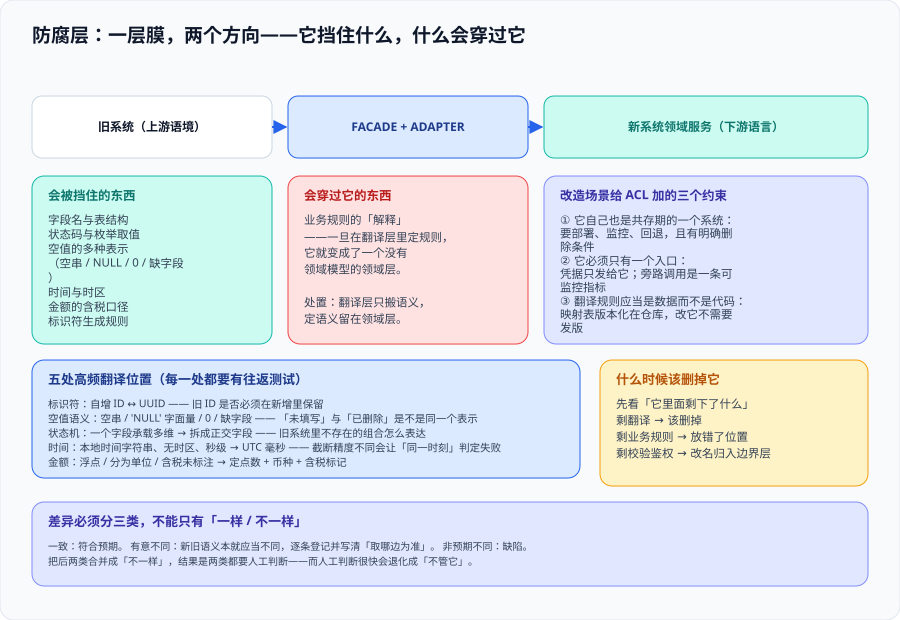

# 防腐层：让旧模型停在一层里

这一页回答的是**「新旧两边的模型怎么才能不互相污染」**——具体到工程上是三件事：旧系统的字段语义在哪里被翻译、这个翻译层自己怎么活下去、它什么时候该被删掉。它不讨论接缝在哪（那是[绞杀者模式](../Strangler/index.md)），也不讨论数据怎么搬（那是[数据迁移](../DataMigration/index.md)）：**它只管新旧之间那一层膜，以及这层膜会不会漏**。



::: tip 一句话定位
防腐层的价值不在于「多写了一个转换类」，而在于**它把旧系统的语义关在了一个可以随时间被删掉的盒子里**。判据不是「有没有转换代码」，而是：**把旧系统整个替换掉之后，新系统的领域代码需要改几行**——一行不改，这层膜就是合格的。
:::

## 一、它和适配器的区别，落在「翻译什么」上

两者都会「包一层」，但包的东西不同。这个区别决定了它们**失效时的可见性完全不同**——这也是本页把这一节放在最前面的原因。

| | 适配器（Adapter） | 防腐层（Anti-Corruption Layer） |
| --- | --- | --- |
| 翻译的是什么 | **接口形状**：参数个数、协议、序列化格式 | **语义与模型**：同一个词在两边指的不是一回事 |
| 典型问题 | 「旧接口收 `cust_no`，新接口收 `customerId`」 | 「旧系统的『客户』包含已注销账户，新系统的『客户』不含」 |
| 失效的样子 | 编译不过 / 调用返回 400 | **能跑通，但数据在慢慢错** |
| 归属 | 通常是调用方的基础设施代码 | **新系统领域模型的一部分**（Evans 的原义） |
| 被替换掉时 | 换一个适配器即可 | 需要先把「旧语义」从领域模型里拔出来 |

Eric Evans 在 2003 年的《Domain-Driven Design》里把这个模式放在 **Part IV「Strategic Design」**，而不是放在技术模式章节——**因为它管的是模型的纯度，不是调用的便利性**。他在书里给出的实现由三部分组成：上游语境里的 **FACADE**、负责翻译的 **ADAPTER**、以及用**下游语言**暴露给领域代码的**领域服务**。

本库的[领域驱动设计](../../DDD/StrategicDesign/index.md) 专题已经给出结论「防腐层不是可选项，是默认项」。本页要补的是**改造场景下它多出来的三个约束**。

## 二、改造场景给防腐层加上的三个约束

### 2.1 约束一：ACL 自己也是共存期的一个系统

在绿地项目里，防腐层是一段代码。在改造项目里，它是**一个要部署、要监控、要回退、最后要被删掉的组件**。

| 绿地项目里的 ACL | 改造项目里的 ACL |
| --- | --- |
| 只被一个应用调用 | 可能同时被新旧两侧调用，成为共享组件 |
| 出问题只影响本应用 | 出问题是**接缝处的故障**，影响面等于两个系统的交集 |
| 上线即完成 | **有明确的生命终点**：旧系统退役后它就该消失 |

最后一行最重要：**一个没有终点的中间层会成为第二个遗留系统**。所以从第一天起就要在它的文档里写下「本组件的删除条件」。

### 2.2 约束二：它必须只有一个入口

Evans 在书里就记下了那个经典失败模式：**把 ACL 藏进 UI 层**。于是系统里其他部分绕过它直接访问上游，污染从旁路漏进来。

改造场景下这个风险被放大，因为**旧系统的调用点本来就散落在各处**：

- 定时任务与批处理（最常被漏掉）；
- 运维脚本与后台小工具；
- 报表与数据导出；
- 老员工「顺手调一下」的直连。

**处置不是靠纪律，而是靠技术**：

1. 旧系统的访问凭据**只发给 ACL**，其它组件拿不到（凭据即边界）；
2. 在旧系统侧加访问日志，**按调用方分组统计**，非 ACL 来源即为旁路；
3. 把「旁路数量」作为一条可监控指标，而不是一次性的审计结论。

### 2.3 约束三：翻译规则应当是数据，不是代码

字段映射、状态码映射、单位换算、枚举对应关系会随业务变化。把它们写成 `if/else` 意味着每次变化都要发版；写成**可配置的映射表**，运营或实施能自己改。

| 翻译对象 | 写成代码的代价 | 写成数据的形态 |
| --- | --- | --- |
| 字段名映射 | 旧系统加一个字段，新系统要发版 | `字段名对照表`（旧名 → 新名 → 是否必填） |
| 状态码映射 | 旧系统新增一个状态，新系统开始报未知状态 | `状态对照表`（旧码 → 新枚举 → 是否可迁移） |
| 枚举值映射 | 业务加一个类型，要改代码 | `枚举对照表`（含未映射时的兜底策略） |
| 单位 / 币种 | 换算系数写死在代码里，改一次要发一次 | `换算规则表`（含精度与舍入方式） |

::: warning 说明：「写成数据」不等于「放进数据库」
推荐起点是**版本化在仓库里的配置文件**（能进评审、能回滚、能 diff），而不是一张运维随手能改的表。理由：映射错误属于**语义缺陷**，它会静默地把数据搞错；把它放进一个没有评审流程的地方，等于把这一类缺陷的发现时间从「提交时」推迟到「对账时」。
:::

## 三、翻译的五个高频位置

改造期真正的麻烦不在「字段名不同」，而在下面五处——它们的共同点是**两边都认为自己是正常的**。

| 位置 | 旧系统常见形态 | 新系统常见形态 | 翻译必须回答的问题 |
| --- | --- | --- | --- |
| 标识符 | 自增整数、带前缀的业务编号 | UUID、雪花 ID | **旧 ID 是否必须在新增里保留**（保留意味着新系统的 ID 生成要留一条兼容路径） |
| 空值语义 | 空字符串、`'NULL'` 字面量、`0`、缺字段 | 明确的 `null` / 可选类型 | 「未填写」与「已删除」在旧系统里是不是同一个表示 |
| 状态机 | 一个字段承载多个维度的状态 | 拆成多个正交字段 | 旧系统里**不存在的组合**在新系统里怎么表达 |
| 时间 | 本地时间字符串、无时区、秒级截断 | 带时区的时间戳 | 时区归属与夏令时；**截断精度不同会让「同一时刻」判定失败** |
| 金额 | 浮点、分为单位的整数、含税与否未标注 | 定点数 + 币种 + 含税标记 | 含税口径是否一致（不一致会导致对账差额恒定但没人发现） |

::: danger 注意：最危险的不是翻译错，是「翻译对了但方向不一致」
**同一个字段，新系统读的时候做了一次换算，写的时候忘了做反换算**——这类缺陷在单次测试里完全正常（读到的值看着对），只有在「写进去再读出来」的往返测试里才暴露。

纪律：**每一处有损翻译都必须有一个往返测试**（旧值 → 新值 → 旧值，必须回到原值；不能回到原值的，必须在文档里写明损失在哪，例如精度截断）。
:::

## 四、改造期的测试：先把「现在是什么样」测出来

旧系统通常没有测试，或者测试只覆盖了理想路径。此时不要先写「正确的测试」——先写**刻画测试**（characterization test）。

这个概念来自 Michael Feathers 的《Working Effectively with Legacy Code》（2004）：**在改动之前，先用测试把系统的现有行为（包括看起来是 bug 的行为）固定下来**。它的价值不是验证正确性，而是**让改动有一个可以对照的基准**。

| 测试类型 | 回答的问题 | 改造期的用途 |
| --- | --- | --- |
| 刻画测试 | 系统**现在**是什么行为 | 改旧系统（停用已迁移功能）时的安全网 |
| 契约测试 | 新旧两边对同一个请求的**响应是否一致** | 校验翻译层；不一致时区分「有意不同」与「缺陷」 |
| 往返测试 | 有损翻译能否回到原值 | 见上一节的纪律 |
| 旁路测试 | 有没有绕过 ACL 的调用 | 见 2.2 节，靠访问日志分组统计 |

Feathers 还给了两个概念，在改造期极其实用：

- **接缝（seam）**：不改动代码就能改变行为的位置。改造要做的第一步常常是**先造接缝**（把硬编码依赖变成可注入），再谈替换。
- **感知与分离（sensing / separation）**：当一段代码「测不了」时，先判断是**看不见它跑出了什么**（感知问题）还是**起不来它**（分离问题）——两者的处置完全不同，混着做是最常见的无效工作。

::: tip 最佳实践：契约测试的比对结果要分三类，不能只有「一样 / 不一样」
**一致**：符合预期。
**有意不同**：新旧语义本就应当不同（例如新系统把「未填写」与「已删除」区分开了），这类差异必须**逐条登记在文档里**，并且写清「取哪边为准」。
**非预期不同**：缺陷。

把后两类合并成「不一样」，结果是两类都要人工判断，而人工判断很快会退化成「不管它」。
:::

## 五、它什么时候被删掉

防腐层有两个寿命终点，**必须分别处理**：

| 终点 | 何时到达 | 怎么处置 |
| --- | --- | --- |
| 翻译职责的终点 | 旧系统退役，不再需要翻译 | 翻译层**整体删除**；如果其中承载了业务规则，说明当初放错了位置 |
| 边界职责的终点 | 旧系统退役、且新系统的对外契约已稳定 | 校验、鉴权、限流等**保留**，但它们应从「ACL」改名，归入常规的边界层 |

这里有一条实践性的判据：**如果删掉旧系统之后，防腐层里还剩下了东西，那剩下的东西当初就不该写在防腐层里。**

::: danger 注意：三种让防腐层变成永久负担的写法
1. **把业务规则写进翻译层**（「旧系统里的 VIP 客户在新系统里算高级会员」）。翻译层的任务是**搬语义**，不是**定语义**；一旦在这里定了规则，它就变成了一个没有领域模型的领域层。
2. **让新系统的领域对象直接持有旧系统的字段**（例如领域实体里出现 `legacyStatusText`）。这等于在领域模型里开了个洞，旧系统退役时这个字段**没有地方可去**。
3. **让 ACL 同时承担切流职责**（既翻译又决定走哪边）。两件事的变更节奏完全不同：翻译随业务变，切流随迁移进度变；合在一起会让「想切流」变成「要改翻译层」。
:::

## 六、判据清单：`AC-A` ~ `AC-H`

| 判据 | 内容 | 怎么验证 | 状态 |
| --- | --- | --- | --- |
| `AC-A` | 翻译层**只有一个入口**，不存在绕过它的调用路径 | 旧系统访问凭据只发给该组件；访问日志按调用方分组的非 ACL 来源数为 0 | ✅ 已跑 |
| `AC-B` | 新系统领域模型里**不出现旧系统字段名或旧枚举字面量** | 在领域代码目录里搜旧字段名与旧状态字符串，命中数为 0（命中处必须落在翻译层） | ✅ 已跑 |
| `AC-C` | 每一处有损翻译都有**往返测试**，或写明损失位置 | 翻译清单里逐条标记「无损 / 有损」；有损项存在往返用例或一条损失说明 | ✅ 已跑 |
| `AC-D` | 字段 / 状态 / 枚举映射以**数据形态**存在，可改而不发版 | 映射以配置或表的形式提供，且比对新旧映射差异不需要改代码 | ✅ 已跑 |
| `AC-E` | 新旧差异被分成「一致 / 有意不同 / 非预期不同」三类 | 契约测试的比对结果表里三类各自有行；「有意不同」每行都有「取哪边为准」 | ✅ 已跑 |
| `AC-F` | 翻译层有明确的**删除条件**与责任人 | 组件文档里能找到「旧系统退役后本组件删除」的条件句与一个具体的人 | ✅ 已跑 |
| `AC-G` | 旧系统的行为有**刻画测试**兜底（改旧系统前先固定现状） | 旧系统仓库里存在针对即将停用功能的测试；测试失败时的处置流程已写明 | ✅ 已跑 |
| `AC-H` | 旧系统的「旁路调用」是一条**可监控指标**，不是一次性审计 | 旧系统侧有按调用方分组的访问统计，且该数字出现在某个看板或告警上 | ✅ 已跑 |

## 七、如何验证

```shell
# 在本仓库根目录执行（判据对象是本专题页面自身的纪律，不是某个产品）

# 1) 判据族完整性：本页 8 条
grep -oE '`AC-[A-H]`' docs/Backend/LegacyModernization/AntiCorruption/index.md | sort -u | tr '\n' ' '
# 预期：`AC-A` ... `AC-H` 共 8 个

# 2) 三个改造期约束都在（缺任一条说明这一页没写改造场景）
grep -cE '^### 2\.[123] 约束' docs/Backend/LegacyModernization/AntiCorruption/index.md
# 预期：3

# 3) 五个高频翻译位置齐（标识符/空值/状态机/时间/金额）
grep -cE '^\| (标识符|空值语义|状态机|时间|金额) ' docs/Backend/LegacyModernization/AntiCorruption/index.md
# 预期：5

# 4) 三类比对结果都必须被点名（只有「一样/不一样」说明这一节没有落地）
grep -oE '一致|有意不同|非预期不同' docs/Backend/LegacyModernization/AntiCorruption/index.md | sort -u | wc -l
# 预期：3

# 5) 引用原著要带年份与人名，避免「某本书里说过」这种无法核对的写法
grep -cE 'Domain-Driven Design（2003）|Evans|Feathers' docs/Backend/LegacyModernization/AntiCorruption/index.md
# 预期：≥ 2
```

## 八、常见误判与纠正

::: danger 注意：五个高频误判
1. **「这就是个 DTO 转换，别整那么复杂」**——DTO 转换只解决接口形状。判据是 `AC-B`：领域模型里还有没有旧字段名。有，就还没做防腐。
2. **「两边字段名一样，不用翻译」**——名字一样而语义不同，是最隐蔽的一类。典型例子是「状态」：旧系统的 `1` 表示「已提交」，新系统的 `1` 表示「草稿」。
3. **「先切流量，防腐层以后补」**——切流之前没有防腐层，等于让旧语义在切流期间流入新模型；补的时候要先把已经写进新库的脏数据清理掉，代价比一开始做高一个量级。
4. **「写成配置就等于可运维」**——配置文件也要有评审与版本。见 2.3 节的说明框。
5. **「旧系统下线了，这层也可以一起删了」**——先看它里面剩下了什么。见第五节。
:::

## 参考资料

- [Eric Evans · Domain-Driven Design（2003）· Part IV Strategic Design 第 14 章](https://www.oreilly.com/library/view/domain-driven-design-tackling/0321125215/)：ACL 的原始定义与 FACADE + ADAPTER 结构
- [Azure Architecture Center · Anti-Corruption Layer pattern](https://learn.microsoft.com/azure/architecture/patterns/anti-corruption-layer)：实现形态、代价与「不要把业务规则放进去」
- [Martin Fowler · BoundedContext（bliki）](https://martinfowler.com/bliki/BoundedContext.html)：为什么同一个词在两个上下文里可以指不同的事
- [Michael Feathers · Working Effectively with Legacy Code（2004）](https://www.oreilly.com/library/view/working-effectively-with/0131177052/)：刻画测试、接缝、感知与分离
- [Martin Fowler · ContractTest（bliki）](https://martinfowler.com/bliki/ContractTest.html)：契约测试的定位与常见误用
