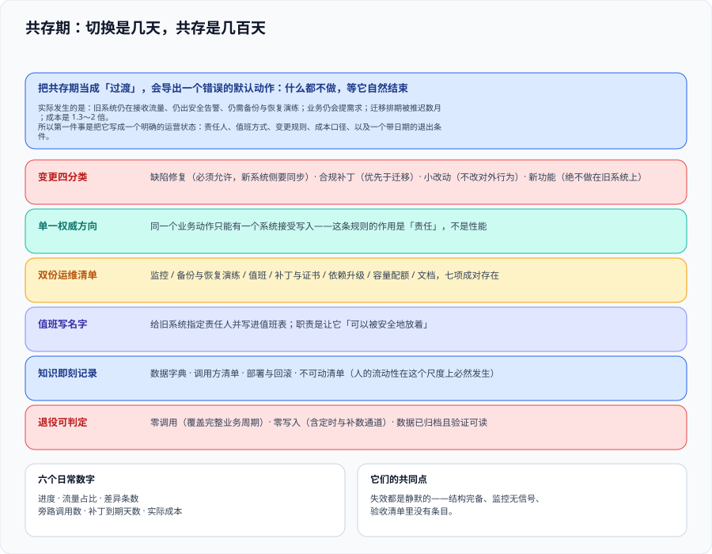

# 共存期工程：两套系统同时活着时的约束

这一页回答的是**「新旧两套系统同时在生产上跑着的这一两年，靠什么规则活下来」**——它覆盖变更怎么管、双份成本怎么算、值班与归属怎么划、知识与依赖怎么维持、以及退役条件怎么才算真的可判。它不讨论怎么切进去（那是[绞杀者模式](../Strangler/index.md)），也不讨论某一天怎么切流量（那是[灰度切换](../TrafficCutover/index.md)）：**它管的是两件事之间的那一段长跑——而这一段通常比切换本身长二十倍**。



::: tip 一句话定位
改造项目的时间分布极不均匀：**切换是几天，共存是几百天**。绝大多数项目的失败不在切换当天，而在共存期里——旧系统被「冻结」之后悄悄腐烂、没有人为它值班、它的证书过期了没人知道、懂它的人离职了。**共存期需要一份规则，而且它必须在切换开始之前就生效。**
:::

## 一、共存期不是过渡，是一个要运营的状态

把共存期当成「过渡」，会导出一个错误的默认动作：**什么都不做，等它自然结束**。而实际发生的是：

| 以为会发生的 | 实际发生的 |
| --- | --- |
| 旧系统只是「跑着」，不需要照顾 | 它仍在接收流量、仍在出安全告警、仍需要备份与恢复演练 |
| 旧系统可以冻结，不改了 | 业务仍会提需求；冻结换来的通常是**有人偷偷绕过流程改配置** |
| 迁移按计划推进 | 业务优先级会插进来，迁移排期被推迟数月 |
| 两套系统的成本是「多一套」 | 实际是 **1.3～2 倍**：双份运维、双份监控、双份值班、双份升级 |

所以第一件事是**在文档里把共存期写成一个明确的运营状态**，给它配上：责任人、值班方式、变更规则、成本口径、以及一个**带日期的退出条件**。

## 二、六条硬约束

### 2.1 约束一：变更必须分类，而不是「冻结」

「旧系统从今天起不接需求」是一句听起来很有力、执行上必然失效的话。业务不会因为你要改造而停止变化。**正确做法是把旧系统的变更分成四类，并给每一类一个明确的处置口径**：

| 变更类型 | 例子 | 处置 |
| --- | --- | --- |
| **缺陷修复** | 生产 bug、数据错误 | **必须允许**，但要走同一套测试与发布流程；修复后**新系统侧要同步**（否则迁移时缺陷会「复活」） |
| **合规 / 安全补丁** | 依赖 CVE、证书续期 | **必须允许**，且优先级高于迁移；这是唯一可以插队的一类 |
| **小改动** | 文案、参数、开关默认值 | 允许，但要求**不改变对外行为**；改了要登记 |
| **新功能** | 新的业务能力 | **不能做在旧系统上**。要么排进新系统，要么明确拒绝并记录 |

::: danger 注意：「冻结」失效的三种形态
1. **冻结导致改配置**。需求被拒绝之后，有人直接在配置中心或数据库里改了值——**这类改动不进版本库、不进测试、不进评审**，迁移时对账会出现无法解释的差异。
2. **缺陷修复只改了一边**。旧系统修了、新系统没同步，于是切流之后同一个 bug 复现，而所有人以为它已经修好了。
3. **新功能做在旧系统上**。它意味着迁移字典里多了一个条目，且这个条目**没有任何人有动力去迁移它**——它会被留在旧系统里，成为退役的永久阻碍。
:::

### 2.2 约束二：单一权威方向必须由组织规则兜底

技术上「哪边为准」在[数据迁移](../DataMigration/index.md)里已经定到字段级。但组织上还需要一条更强的规则：**同一个业务动作，只能有一个系统接受写入**。

这条规则的作用不是性能或一致性，而是**责任**：当两个系统都能收同一类写入时，出问题时的第一句话会变成「是谁写的」，而这个问题在多系统并存的环境里通常没有答案。

### 2.3 约束三：双份的东西要列清单，不要靠感觉

共存期的成本、风险、工作量都是**成对出现**的。列成清单才有谈判依据：

| 成对的项 | 为什么不能只照顾一边 |
| --- | --- |
| 监控与告警 | 旧系统出问题也需要人响应；只监控新系统等于放弃旧系统的可观测性 |
| 备份与恢复演练 | 从没演练过恢复的备份**不构成恢复能力**；两边都要演练 |
| 值班与升级路径 | 值班表上没写旧系统，等于默认它出事没人管 |
| 安全补丁与证书 | 证书过期是共存期最典型的静默故障：新旧都监听，但只有一边被盯着 |
| 依赖升级 | 旧系统依赖停更后，漏洞修补只能靠隔离或代理，成本高于升级 |
| 容量与配额 | 两套都在吃同一批硬件 / 数据库连接 / 许可证配额 |
| 文档 | 旧系统的文档不再更新，但**它仍在被读**——读的人会照着一份过期的文档操作 |

### 2.4 约束四：值班归属必须写名字

改造期最危险的角色是「两边都沾一点」的人。处置办法很简单，也很少有人做：**给旧系统指定一个责任人，并把它写进值班表**。

这个人的职责不是继续开发旧系统，而是**让旧系统「可以被安全地放着」**：

- 确认补丁与证书的到期时间；
- 维护「已迁移功能不可再启用」的开关状态；
- 每季度核对一次调用方清单（找旁路）；
- 维护一份「旧系统重要知识与联系人」文档。

### 2.5 约束五：知识必须被写下来，因为它会随人离开

共存期通常持续一到两年，而**人的流动性在这个尺度上必然发生**。两条现实：

- 懂旧系统的人会减少，且**他们往往正是迁移的主力**；
- 新人不愿学旧系统（它没有职业收益），**这是合理的**。

由此得出一条纪律：**旧系统的知识不是靠传承，而是靠即刻记录**。最小可接受的集合是四份：数据字典与关键字段口径、外部依赖与调用方清单、部署与回滚步骤、以及「不能动的部分」清单。

### 2.6 约束六：退役必须是一个可判定事件

退役不能被「等新系统稳定了」定义。它需要三个同时成立的客观条件：

| 条件 | 判据 |
| --- | --- |
| 没有调用方 | 覆盖**最长业务周期**（通常是月度结算）的连续零调用记录 |
| 没有任何写入 | 不只是没有流量：定时任务、重放、补数通道全部停止 |
| 数据被处置 | 旧库数据已归档并**验证可读**（归档不等于可恢复） |

第三条最常被跳过：**「数据留着不删」和「数据可恢复」是两件事**。归档完成后必须做一次读取验证，并记下验证时间与执行人。

## 三、共存期的日常仪表盘：六个数字

共存期不需要复杂的度量，但需要**六个能每周看一眼的数字**，因为它们的失效都是静默的：

| 数字 | 含义 | 静默失效的样子 |
| --- | --- | --- |
| 已迁移单元数 / 总单元数 | 进度 | 长期停在同一个数，没人注意到卡住的原因 |
| 新系统流量占比（按粘性维度） | 真实进度 | 路由写了但没生效，看着像在推进 |
| 三档校验的差异条数（按归因分类） | 数据健康 | 差异只增不减，被当作「已知问题」忽略 |
| 旁路调用数（非 ACL 来源） | 边界完整度 | 有人加了直连，边界从旁路漏 |
| 旧系统的补丁 / 证书到期天数 | 运维风险 | 某天突然过期，新旧同时不可用 |
| 共存期实际成本 / 预算 | 可持续性 | 成本超支到没人敢提，于是改造被悄悄放弃 |

::: tip 最佳实践：把「距离下一次可回退的检查点还有几步」也当成一个数字
这条看起来抽象，但它对应一个非常具体的动作：**每一步都要求「可退」，那么「当前有几个步骤是处于『已经推进但还没确认可退』的状态」就是一个风险量**。这个数字大于 0 时，说明有未收敛的步骤；大于 2 时，说明节奏失控。它不是给管理层看的，是给推进的人自己看的。
:::

## 四、共存期的三类事故与它们的共同点

| 事故类型 | 典型形态 | 共同点 |
| --- | --- | --- |
| **静默数据漂移** | 某条旁路写入了旧库，或某个定时任务双写了一半 | 都在「已验收」的功能上发生 |
| **静默能力退化** | 证书过期、依赖停更、备份失效 | 都属于「没人会主动看」的项 |
| **静默知识流失** | 关键人离职后没人能解释某段逻辑 | 都发生在文档与人的交界处 |

三类的共同点是：**它们在结构上完备、在监控上无信号、在验收清单里没有条目**。所以本页第六节的判据里，每一条都要求「有一个具体的人 + 一个具体的检查动作」，而不是「有制度」。

## 五、与相邻专题的分工

| 问题 | 归本页 | 归别处 |
| --- | --- | --- |
| 「新旧两边的字段以哪边为准」 | 组织规则（只有一个写入方） | 字段级口径 → [数据迁移](../DataMigration/index.md) |
| 「下一步切多少流量」 | 约束（禁止在该步产生不可回退的中间态） | 节奏与窗口 → [灰度切换](../TrafficCutover/index.md) |
| 「旧系统还要不要打补丁」 | 是，且优先于迁移 | 补丁策略本身 → [安全加固](../../../Ops/SecurityHardening/index.md) |
| 「数据归档后怎么办」 | 归档必须验证可读 | 归档与保留策略 → [数据治理入门](../../../DB/DataGovernance/index.md) |
| 「交付清单里怎么体现共存」 | 回退预算 / 双跑期 / 退役条件三行 | 交付流程 → [完整项目交付](../../../Others/ProjectDelivery/index.md) |

## 六、判据清单：`CX-A` ~ `CX-H`

| 判据 | 内容 | 怎么验证 | 状态 |
| --- | --- | --- | --- |
| `CX-A` | 共存期被写成明确的运营状态，含责任人 / 值班方式 / 变更规则 / 成本口径 / 带日期的退出条件 | 文档里五项各自成条；「退出条件」行含日期而不是「稳定以后」 | ✅ 已跑 |
| `CX-B` | 旧系统变更被分为四类（缺陷 / 补丁 / 小改动 / 新功能），且新功能明确不做在旧系统上 | 变更口径表四行齐全；存在「拒绝新功能」的记录模板或实例 | ✅ 已跑 |
| `CX-C` | 同一个业务动作**只有一个系统接受写入**（单一权威方向） | 写入路径清单里每个业务动作只对应一个接受方；无「两边都收」的条目 | ✅ 已跑 |
| `CX-D` | 双份运维项形成清单（监控 / 备份 / 值班 / 补丁与证书 / 依赖 / 容量 / 文档）七项 | 清单存在且行数 ≥ 7；每行有「谁负责」 | ✅ 已跑 |
| `CX-E` | 旧系统有**写进值班表**的责任人 | 值班表或相应文档里能找到旧系统的责任人与备选 | ✅ 已跑 |
| `CX-F` | 旧系统知识形成四份最小文档（数据字典 / 调用方清单 / 部署回滚 / 不可动清单） | 四份文档各自存在且最近一次更新在共存期内 | ✅ 已跑 |
| `CX-G` | 退役条件三项同时成立（零调用 / 零写入 / 数据已归档且验证可读） | 退役检查表三项各自有证据；第三项含一次读取验证的时间与执行人 | ✅ 已跑 |
| `CX-H` | 六个日常数字有固定的查看节奏与责任人（不是「有报表」） | 六项各自有频率与责任人；其中「旁路调用数」与「补丁到期天数」落到具体检查动作 | ✅ 已跑 |

## 七、如何验证

```shell
# 在本仓库根目录执行（判据对象是本专题页面自身的纪律，不是某个产品）

# 1) 判据族完整性：本页 8 条
grep -oE '`CX-[A-H]`' docs/Backend/LegacyModernization/Coexistence/index.md | sort -u | tr '\n' ' '
# 预期：`CX-A` ... `CX-H` 共 8 个

# 2) 六条硬约束都在
grep -cE '^### 2\.[1-6] 约束' docs/Backend/LegacyModernization/Coexistence/index.md
# 预期：6

# 3) 变更分类四类齐（缺陷 / 补丁 / 小改动 / 新功能）
grep -cE '^\| \*\*(缺陷修复|合规 / 安全补丁|小改动|新功能)\*\*' docs/Backend/LegacyModernization/Coexistence/index.md
# 预期：4

# 4) 六个日常数字都在
grep -cE '^\| (已迁移单元数|新系统流量占比|三档校验的差异条数|旁路调用数|旧系统的补丁|共存期实际成本)' docs/Backend/LegacyModernization/Coexistence/index.md
# 预期：6

# 5) 退役三条件都出现
grep -oE '零调用|零写入|验证可读' docs/Backend/LegacyModernization/Coexistence/index.md | sort -u | wc -l
# 预期：3
```

## 八、常见误判与纠正

::: danger 注意：五个高频误判
1. **「先切完再管共存期」**——共存期的规则必须在第一次切流之前生效。第一次切流之后就已经进入共存期了，此时补规则通常来不及：旁路已经有了、值班已经没人了。
2. **「旧系统冻结最省事」**——见 2.1 节。冻结会把变更推到流程之外，代价比允许变更高。
3. **「两套系统各管各的」**——共存的成本恰恰产生在交界处：值班表、监控入口、发布窗口、补丁计划。各管各的等于把交界处留给运气。
4. **「数据先留着，反正不删就等于有备份」**——归档与可恢复是两件事。见 2.6 节第三条。
5. **「退役就是关掉服务」**——退役是三个条件同时成立，其中「越过一个完整业务周期的零调用」通常要等一个月。**把退役写成「找一天关掉」，那一天会永远推迟。**
:::

## 参考资料

- [Azure Architecture Center · Strangler Fig pattern](https://learn.microsoft.com/azure/architecture/patterns/strangler-fig)：第三、四阶段（停用遗留 / 移除外观）与它们的退出条件
- [AWS Prescriptive Guidance · Decomposing monoliths into microservices](https://docs.aws.amazon.com/prescriptive-guidance/latest/modernization-decomposing-monoliths/)：Coexist 阶段的成本与运维提示
- [Pete Hodgson · Feature Toggles (aka Feature Flags)](https://martinfowler.com/articles/feature-toggles.html)：Ops 类开关的寿命与「开关台账」
- [Martin Fowler · bliki 条目索引](https://martinfowler.com/bliki/)：模式词汇与后续修订的统一入口
- [中国 · GB/T 22239-2019（等保 2.0）](https://openstd.samr.gov.cn/)：共存期安全域变化需重新测评的依据（第三级系统每年至少一次）
