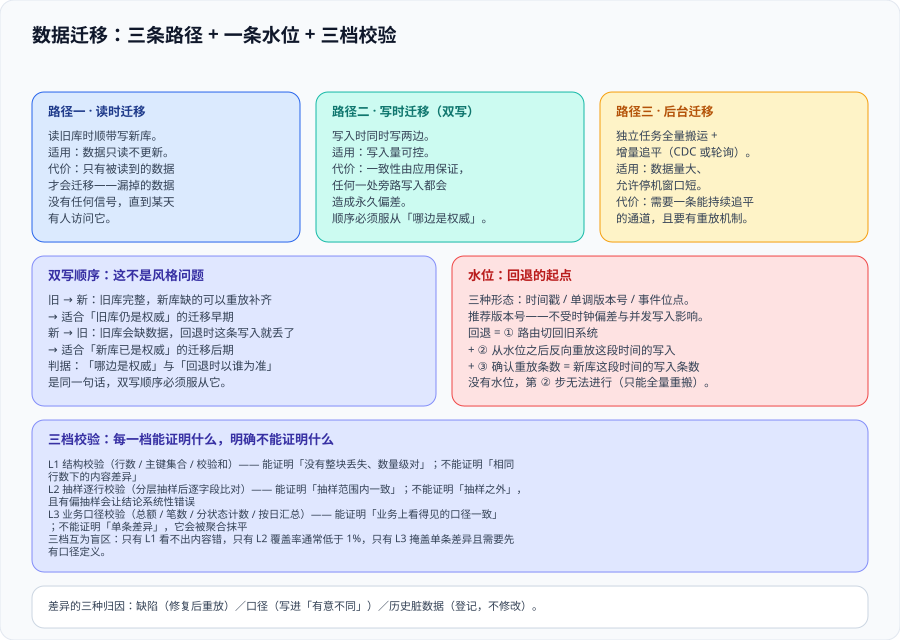

# 数据迁移：双写、追平与三档校验

这一页回答的是**「数据怎么跟着代码一起走，以及走了之后怎么知道它是对的」**——它覆盖三种迁移路径（读时、写时、后台）、双写的顺序问题、追平期的水位与重放、以及一套分三档的校验办法。它不讨论流量怎么切（那是[灰度切换](../TrafficCutover/index.md)），也不讨论两边的语义差异怎么翻译（那是[防腐层](../AntiCorruption/index.md)）：**它只管一件事——新旧两边的数据在任意一个时刻，能不能被证明是一致的；不能证明时，差值有没有上限**。



::: tip 一句话定位
数据迁移的失败几乎都不是「搬丢了」，而是**「搬完了，但没有办法证明它搬对了」**。所以本页给的不是一套搬运工具，而是**一套能让第二个人独立跑出同样结论的校验办法**，以及一条在每个时刻都能回答「现在要不要重放、从哪一条开始重放」的水位线。
:::

## 一、三条迁移路径，代价与适用面完全不同

| 路径 | 做法 | 什么时候能用 | 主要代价 |
| --- | --- | --- | --- |
| **读时迁移** | 读旧库时顺带写入新库（lazy migration） | 数据只读不更新，或更新极少 | **只有被读到的数据才会迁移**；漏掉的数据没有任何信号，直到某天有人访问它 |
| **写时迁移** | 写入时同时写两边（双写） | 写入量可控、且两边都能接受额外延迟 | 一致性由应用保证，**任何一处旁路写入都会造成永久偏差** |
| **后台迁移** | 独立任务全量搬运 + 增量追平 | 数据量大、允许停机窗口很短 | 需要一条能持续追平的增量通道（CDC 或变更时间戳），且要有重放机制 |

实践中这三条会同时存在：**全量用后台建基线，增量用 CDC 追平，新产生的写入用双写保证两边可见**。三条路径合起来才构成一次迁移，**只做其中一条是绝大多数「迁移后数据对不上」的成因**。

## 二、双写：顺序不是风格问题

双写看起来只是「两次写」，但**先写哪一边决定了你能接受哪种失败**。这不是工程偏好，而是可以推导出来的：

| 顺序 | 失败时（第二步没成功） | 一边成功一边失败时会怎样 | 适合的场景 |
| --- | --- | --- | --- |
| **旧 → 新** | 旧库有、新库缺 | 新库缺一条 → **旧库是完整的**，可从旧库重放补齐 | **旧库仍然是权威**（迁移早期） |
| **新 → 旧** | 新库有、旧库缺 | 旧库缺一条 → 若此刻回退，这条写入就丢了 | **新库已经是权威**（迁移后期） |

判据只有一句：**「哪边是权威」与「回退时以谁为准」是同一句话，而双写顺序必须服从它。**

- 迁移早期旧库是权威 → **先写旧库**。这样「新库缺数据」是可修复的（重放即可），而「旧库缺数据」是不可接受的。
- 迁移后期新库成为权威 → 反过来。**这个切换点必须被显式写下来**，因为它同时意味着回退成本变了：回退从「改路由」变成「把新库的增量搬回旧库」。

::: danger 注意：双写的三个必坏形态
1. **两次写不在同一个事务里，且没有补偿**。第二次写失败时，调用方拿到了成功响应——**失败被静默吞掉**。正确做法是把第二次写变成**必须成功或必须被记录**：写失败要落一条补偿记录，由对账任务重放。
2. **有人绕过应用直接写库**。运维脚本、后台工具、另一个系统——任何一处直连都会造成永久偏差。这与[防腐层](../AntiCorruption/index.md)里那条「必须只有一个入口」是同一个问题，处置方式也一样：**把写入凭据收在一处**。
3. **两边都「成功」但时间序不同**。并发场景下，两次写的可见顺序可能与实际发生顺序不同，读旧库与读新库会看到不同的最终值。处置：**给每一行带一个单调递增的版本号**，读时以版本号大者为准，而不是以到达时间。
:::

### 2.1 跨库写入的可靠做法：本地事务 + 发件箱

跨两个数据库的「要么都成功」在分布式事务里代价很高，工程上更常用的是**发件箱（outbox）**：

1. 在权威库的**同一个本地事务**里，既写业务数据，也写一行「待同步事件」；
2. 事务提交后，由一个独立进程读取发件箱并同步到另一侧；
3. 消费侧按事件 ID **幂等**执行（重复投递是必然发生的，不是异常）；
4. 同步成功后标记事件已完成；失败则保留并重试，**积压量是一条必须被监控的指标**。

这条路径的收益是：**「业务写入」与「变更事件」的原子性由本地事务保证**，不需要跨库事务。代价是**从写入到另一边可见之间存在延迟**，而延迟必须被写成一个可被监控的数字上限（见第五节的水位）。

本库的[消息队列](../../MessageQueue/index.md) 专题讲了这件事的中间件侧；本页只用到它两个结论：**至少一次投递 + 消费侧幂等**，以及**顺序只在同一分区 / 同一键内成立**。

## 三、增量追平：CDC 与它的版本现实

全量搬完之后，必须有一条通道持续把新变更送过去，否则水位会越落越远。两条常见路线：

| 路线 | 原理 | 优点 | 约束 |
| --- | --- | --- | --- |
| **CDC（变更数据捕获）** | 读数据库日志（binlog / redo / WAL）解析变更 | 对业务代码无侵入；能捕获绕过应用的直连写入 | 与数据库版本强绑定；**DDL 变更会让解析中断**；需要处理大事务与快照 |
| **变更时间戳轮询** | 按 `updated_at` 增量拉取 | 实现简单、无版本绑定 | **只有应用写入的数据才有正确的时间戳**；删除无法捕获；并发写入可能漏掉边界行 |

CDC 的路线里，Debezium 是最常见的选择。**2026-10 口径的版本事实**（核对时间 2026-10）：

| 项目 | 数值与日期 | 要点 |
| --- | --- | --- |
| Debezium 版本 | **3.7.0.Final**，**2026-09-29** 发布 | 18 个源连接器 / 25 个汇连接器 |
| 破坏性变更 | 3.7 起 Oracle **12** 的连续挖掘（continuous mining）被**移除** | 必须改用 LogMiner；**升级前必须核对自己连的 Oracle 版本** |
| 制品更名 | `debezium-core` 自 **3.5.0.CR1** 起更名 | 改为 `debezium-connector-common`；依赖直接引用旧名会构建失败 |

::: warning 说明：CDC 的三条现实约束
1. **它捕获的是「提交后的变更」，不是「事务内的中间态」**；大事务提交瞬间会形成一次流量尖峰，目标侧要能接住。
2. **DDL 会让解析中断**，而中断通常是**静默的**（连接还在、位点不动）。所以「位点是否在推进」必须是一条独立告警，而不是靠看目标侧行数。
3. **首次快照与增量之间有一个交接窗口**。不少事故出自这个窗口：快照开始时旧数据量大、耗时超过了日志的保留时长，等快照做完，增量位点已经被日志清理掉了。**处置：先确认日志保留时长能覆盖预估快照时长，留三倍余量。**
:::

## 四、水位、重放与回退点

迁移期最需要被写下来、最容易漏掉的东西是**水位**（watermark）：一条能描述「已经一致到哪里」的标记。

| 水位的形态 | 怎么用 | 失效的样子 |
| --- | --- | --- |
| 时间戳（`synced_at ≤ T`） | T 之前的变更都已同步 | 并发写入与时钟偏差会让边界行被跳过或重复 |
| 单调版本号（`version ≤ V`） | V 之前的变更都已同步 | 需要所有写入路径都维护版本号（含直连路径） |
| 事件位点（offset / LSN / SCN） | 精确可重放 | 与具体数据库强绑定；位点重置后语义会变 |

有了水位，**回退才有确切含义**：

```text
回退动作 = ① 把路由切回旧系统
         + ② 把「切换到回退」这段时间内新库接受的写入，从水位之后重放到旧库
         + ③ 确认重放的条数与新库这段时间的写入条数相等
```

第②步就是本专题[总览](../Overview/index.md)与[绞杀者模式](../Strangler/index.md)反复强调的「回退时间的第③段」。**没有水位，这一步无法进行**——你不知道从哪一条开始补，只能全量重搬。

::: danger 注意：回退点是一个必须提前演练的动作，不是一段代码
三个必踩的坑：

1. **重放方向搞错**。水位记录的是「同步到旧→新的位点」，回退时要反向重放，方向与正向相反。**方向的正确性只有一个办法能证明：演练一次，并把重放条数与写入条数对平。**
2. **重放不幂等**。同一行被重放两次，如果更新是 `balance = balance + x` 这类相对操作，结果就错了。纪律：**重放单元必须是「用整行覆盖」而不是「累加」**；无法整行覆盖的，必须带幂等键。
3. **忘记关掉还在跑的东西**。回退之后，新系统的定时任务、队列消费者、重试线程仍在运行，并继续写新库。**回退清单里必须包含「停掉所有异步写入者」这一项**，且它应当排在切路由之前。
:::

## 五、三档校验：每一档能证明什么，不能证明什么

这是本页的核心。校验的价值不在于「跑了很多条 SQL」，而在于**每一档各自能发现什么、明确不能发现什么**。把三档合成一档的结果是：跑的时候很壮观，结论上很含糊。

| 档位 | 怎么做 | 能证明 | **不能证明** | 成本 |
| --- | --- | --- | --- | --- |
| **L1 结构校验** | 行数、主键集合、关键列的非空数、按分区的校验和 | 「数据没有整块丢失」「数量级对得上」 | **完全相同行数下的内容差异**——换了 1 行、丢 5 行补 5 行，行数一样 | 极低 |
| **L2 抽样逐行校验** | 按主键抽样、对整行做逐字段比对（含类型与精度） | 「抽样范围内的内容一致」 | 抽样范围外的差异；**有偏抽样会让结论系统性错误**（例如按主键前缀抽样，恰好避开了所有新写入的数据） | 中 |
| **L3 业务口径校验** | 用业务聚合值对账（总额、笔数、分状态计数、按日汇总） | 「业务上看得见的口径一致」 | 单条差异被聚合抹平；**两边口径不同时这一档会报假差异** | 高（且必须有口径定义） |

三档的关系不是「一档比一档好」，而是**互为盲区**：

- 只有 L1：内容错了看不出来。
- 只有 L2：抽样之外看不出来，且抽样成本随数据量线性上升，实际覆盖率通常低于 1%。
- 只有 L3：**单条差异会被聚合掩盖**，而且它需要先有一份「业务口径定义」，这份定义本身就是一件要负责人的事（见本库[数据治理入门](../../../DB/DataGovernance/index.md)）。

::: tip 最佳实践：把校验结果写成三个百分比，而不是一个「通过」
推荐的上线判据形态：

```text
L1：主键集合差集 = 0；分区行数逐块差集 = 0
L2：抽样 N = 20000 条（分层抽样：新写入 / 历史 / 边界值三类各占一档），逐字段差异条数 = 0
L3：8 个业务口径全部对齐（列出口径名），差异超过 0 的口径必须逐条给出解释与归因
```

**「L3 有 3 个口径不一致，原因已查明为旧系统的历史脏数据（附实例）」是一个合格结论；「校验通过」不是。**
:::

### 5.1 差异的三种归因，必须分清楚

校验报出差异之后，**先归因再修数据**。三类归因的处置完全不同：

| 归因 | 特征 | 处置 |
| --- | --- | --- |
| **缺陷**（新写入漏了 / 重放了） | 差异集中在某个时间窗口、某个来源 | 修复同步路径后重放，可自愈 |
| **口径**（两边定义不同） | 差异是一个稳定的比例或恒定差额 | 属于[防腐层](../AntiCorruption/index.md)的翻译问题，要写进「有意不同」清单 |
| **历史脏数据** | 差异集中在很久以前的数据上，且规则各异 | 不修，登记为已知差异并写进交付文档（**不要为了「校验全绿」去改历史数据**） |

## 六、判据清单：`MG-A` ~ `MG-H`

| 判据 | 内容 | 怎么验证 | 状态 |
| --- | --- | --- | --- |
| `MG-A` | 三条路径（读时 / 写时 / 后台）各自负责哪一段被写明，无空白段 | 文档里存在一张「路径 → 覆盖范围」表；覆盖范围的并集等于全部数据类别 | ✅ 已跑 |
| `MG-B` | 双写顺序与「哪边是权威」一致，且权威的切换点被显式写出 | 文档里能找到「早期先写旧库、第 N 天起先写新库」这类带切换条件的句子 | ✅ 已跑 |
| `MG-C` | 跨库一致性由**本地事务 + 发件箱**保证，而不是「两次写都别失败」 | 写入路径存在发件箱表或同类机制；失败补偿的记录与重放流程已写明 | ✅ 已跑 |
| `MG-D` | 存在一条可读的**水位**（时间戳 / 版本号 / 位点三选一） | 能从运维界面或一条查询语句读出当前水位，并说明它代表什么 | ✅ 已跑 |
| `MG-E` | 回退包含**反向重放**，且重放是幂等的（整行覆盖或带幂等键） | 回退清单里能读出反向重放这一步；重放语句形态为覆盖写 | ✅ 已跑 |
| `MG-F` | 三档校验各自有明确的**通过判据**与**已知盲区** | 文档里三档各自成行，且每行都写了「不能证明什么」 | ✅ 已跑 |
| `MG-G` | L2 抽样是**分层**的（新写入 / 历史 / 边界值），不是均匀随机 | 抽样方案里能读出分层维度与各层配额 | ✅ 已跑 |
| `MG-H` | 差异被归为**缺陷 / 口径 / 历史脏数据**三类，且历史脏数据不被修改 | 差异清单里每一行有归因字段；存在一份「已知差异」清单且其条目未被修数据 | ✅ 已跑 |

## 七、如何验证

```shell
# 在本仓库根目录执行（判据对象是本专题页面自身的纪律，不是某个产品）

# 1) 判据族完整性：本页 8 条
grep -oE '`MG-[A-H]`' docs/Backend/LegacyModernization/DataMigration/index.md | sort -u | tr '\n' ' '
# 预期：`MG-A` ... `MG-H` 共 8 个

# 2) 三条迁移路径与三档校验都在
grep -cE '^\| \*\*(读时迁移|写时迁移|后台迁移)\*\*' docs/Backend/LegacyModernization/DataMigration/index.md
grep -cE '^\| \*\*L[123] ' docs/Backend/LegacyModernization/DataMigration/index.md
# 预期：3 与 3

# 3) 每档校验都必须写出「不能证明什么」（这是本页的核心判据）
grep -c '不能证明' docs/Backend/LegacyModernization/DataMigration/index.md
# 预期：≥ 4

# 4) CDC 版本事实带日期（不可写「当前最新版本」）
grep -cE '3\.7\.0\.Final|2026-09-29' docs/Backend/LegacyModernization/DataMigration/index.md
# 预期：≥ 2

# 5) 三种差异归因都出现
grep -oE '缺陷|口径|历史脏数据' docs/Backend/LegacyModernization/DataMigration/index.md | sort -u | wc -l
# 预期：3
```

## 八、常见误判与纠正

::: danger 注意：五个高频误判
1. **「行数对了就迁完了」**——L1 是最弱的档位。见第五节。
2. **「双向同步更保险」**——双向同步会引入冲突解决策略，而冲突解决的正确性无法被上面的三档校验证明（两边都可能「有理」）。**纪律：同一时刻只有一个权威方向，反向只读或只重放。**
3. **「先搬数据，代码后面改」**——数据搬过去而顺序未定（权威未定），等于给自己制造了一段无法回退的窗口。
4. **「校验脚本是临时的，跑完就删」**——校验口径要在共存期**每天**跑一遍，它是共存期的仪表盘，不是一次性的验收动作（见[共存期工程](../Coexistence/index.md)）。
5. **「差异就修，修到全绿为止」**——历史脏数据修完之后，旧系统一旦继续写入又会重新产生差异。**正确做法是把「已知差异」写成一份清单，而不是把差异消灭**。
:::

## 参考资料

- [Martin Fowler · BoundedContext / ParallelChange 等 bliki 条目索引](https://martinfowler.com/bliki/)：模式词汇的统一入口
- [Danilo Sato · Parallel Change（2014-05-13）](https://martinfowler.com/bliki/ParallelChange.html)：expand / migrate / contract 三阶段与数据库重构
- [Debezium · Releases](https://debezium.io/releases/)：3.7.0.Final（2026-09-29）与连接器清单
- [Debezium · 升级说明与破坏性变更](https://debezium.io/documentation/reference/stable/upgrade.html)：制品更名与 Oracle 连续挖掘移除
- [Microservices.io · Transactional outbox](https://microservices.io/patterns/data/transactional-outbox.html)：本地事务 + 发件箱的原始描述
- [Martin Kleppmann · Designing Data-Intensive Applications（2017）](https://dataintensive.net/)：变更数据捕获、幂等重放与顺序保证的基础论述
