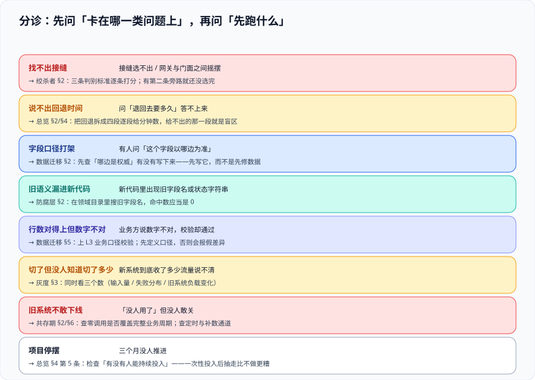

# 常见问题与最佳实践

这一页是**分诊台**：当你手上有一个具体的问题——「接缝选不出来」「数据对不上」「切了一半不敢继续」——它告诉你去哪一页、先跑什么命令。它不重复讲原理，只做三件事：按现象分诊、回答高频问题、给一份推进自查清单。



::: tip 怎么用这一页
先看第一节的分诊表，找到离你最近的**现象**（不是「组件」也不是「技术名词」）。如果现象对不上任何一行，说明问题很可能出在[总览](../Overview/index.md)的四条边界上——**那说明你还在「该不该做」的阶段，不该往下看模式细节**。
:::

## 一、分诊表：按现象找页

| 现象 | 先看哪一页 | 先跑什么 |
| --- | --- | --- |
| 说不出「退回去要多久」 | [总览](../Overview/index.md) 第二、四节 | 把回退拆成四段，逐段给分钟数；给不出的那一段就是盲区 |
| 在网关和门面之间选不出接缝 | [绞杀者模式](../Strangler/index.md) 第二节 | 用三条判别标准逐条打分；只要有第二条旁路存在，就还没选完 |
| 有人问「这个字段以哪边为准」答不出来 | [数据迁移](../DataMigration/index.md) 第二节 | 查「哪边是权威」是否被写下来；没写下来时，先写它而不是先修数据 |
| 新代码里出现旧系统的字段名或状态字符串 | [防腐层](../AntiCorruption/index.md) 第二节 | 在领域目录里搜旧字段名，命中数应当是 0 |
| 行数对得上但业务方说数字不对 | [数据迁移](../DataMigration/index.md) 第五节 | 上 L3 业务口径校验；先确认两边口径定义，否则会报假差异 |
| 切了 5%，但没人知道新系统到底收了多少流量 | [灰度切换](../TrafficCutover/index.md) 第三节 | 同时看三个数（新系统输入量 / 失败分布 / 旧系统负载变化） |
| 回退演练时发现卡在某一步很久 | [绞杀者模式](../Strangler/index.md) 第四节 | 按四段定位：判断、生效、数据、验证——**通常是卡在第三段** |
| 旧系统「没人用了」但不敢下线 | [共存期工程](../Coexistence/index.md) 第二、六节 | 查零调用是否覆盖完整业务周期；查定时任务与补数通道是否真的停了 |
| 迁移排期被业务需求不断插队 | [共存期工程](../Coexistence/index.md) 2.1 节 | 把变更分四类，给「新功能不做在旧系统上」一条明确的拒绝口径 |
| 整个项目停了三个月没人推进 | [总览](../Overview/index.md) 第四节第 5 条 | 检查「有没有人能持续投入」；一次性投入后抽走，结果是外观层搭好但一步没走完 |

## 二、高频问题

### 2.1 「该重写还是该改造？」

先量两个数：**旧系统的调用方数量**、**数据量级**。判据不是感觉，而是：

- 调用方超过 3 个，或者一次性数据搬迁需要停机 → 重写的风险集中在一天，**它不再是更快，而是更晚**；
- 系统本身就小、或者本来就准备整体下线 → Azure 的文档把「系统本身很小」直接列为绞杀者模式**不适用**；改造的固定成本（外观层、双跑、双份监控）在小系统上摊不平。

### 2.2 「请求无法在边缘拦截，还能做绞杀者吗？」

不能直接做。Azure 与 AWS 两份官方文档**同时点名**这是第一条不适用场景：如果流量不从任何一个你能控制的位置经过（例如客户端直连旧系统的专用协议），第一阶段（引入外观）就搭不起来。

替代路径是 **Branch by Abstraction**：在**遗留栈深处**的组件上建一层抽象，把所有调用方改为依赖抽象，再换实现，最后删抽象。AWS 的原文同时写明它**不适合涉及数据一致性的场景**——所以数据那部分仍要单独处理（见[数据迁移](../DataMigration/index.md)）。

### 2.3 「双写两次都失败怎么办？」

这个问题的正确提法不是「怎么办」，而是「**你打算接受哪种失败**」。见[数据迁移](../DataMigration/index.md)第二节：先写旧库时，新库缺数据是可重放修复的；先写新库时，旧库缺数据在回退时是不可接受的。

真正的处置是加上**补偿记录**（发件箱）：第二次写失败必须留下一条可重放的记录，而不是吞掉错误。**「两次写都成功」不能作为设计前提。**

### 2.4 「灰度切流为什么要粘性？按百分比不是更均衡吗？」

均衡是**负载**的目标，一致是**数据**的目标。按百分比随机分流时，同一个用户在一次操作里可能既读新库也读旧库，如果两边有同步延迟，他会看到自己的数据在闪烁。**读多写少且无状态的场景可以用随机比例；任何「同一视图内需要互相一致的多个数字」都必须粘性。**

### 2.5 「防腐层和适配器，我们只写一个行不行？」

行，只要你知道它叫适配器：它管接口形状，不管语义。判据是 `AC-B`——**领域模型里有没有旧系统的字段名或枚举字面量**。有，就说明污染已经进来了。

### 2.6 「并行运行会不会拖慢线上请求？」

会。库级并行运行（新旧都执行）的耗时是两者的较大者，且新系统的故障会占用调用方的线程/连接。三条缓解：影子调用走独立线程池并设超时、影子侧失败只计数不抛出、以及**先只对低流量路径开影子**。

### 2.7 「旧系统在共存期能不能改？」

能，而且要分类（见[共存期工程](../Coexistence/index.md) 2.1 节）。**唯一必须拒绝的是「新功能」**。缺陷修复必须允许，但新系统侧要同步——否则迁移时缺陷会「复活」。

### 2.8 「怎么证明新旧行为一致？」

三层手段按成本排序：**影子/镜像流量**（验证性能与异常）→ **库级并行运行**（验证行为等价）→ **离线重放**（验证版本回归）。**最便宜的验证是「先把旧系统的行为测出来」**——没有刻画测试的旧系统，任何「一致」的说法都没有基准。

### 2.9 「数据校验要跑到什么程度才算通过？」

三档校验各有盲区，所以**「通过」不是单一结论**。推荐的判据形态见[数据迁移](../DataMigration/index.md)第五节：L1 差集为 0、L2 分层抽样差异条数为 0、L3 列出全部业务口径并逐条对齐。**差异有三种归因（缺陷 / 口径 / 历史脏数据），其中历史脏数据不该被修改。**

### 2.10 「改造做到一半，业务方向变了怎么办？」

这是**节奏**问题，不是技术问题。处置顺序：① 先确认已经切过去的部分是否可以就地冻结（处于可退状态就冻结）；② 更新「退役条件」里的日期而不是悄悄放弃；③ 把未迁移部分的「本轮不做」清单更新一次。**最坏的一种处置是既不推进也不宣布停止——它会让外观层永久留在架构里。**

### 2.11 「怎么判断我们已经掉进大爆炸了？」

四个信号：切流**没有外观层**（每一批回退都要回滚数据 + 重新部署）；价值**只在最后一天兑现**；回退**从未演练**；进度用**功能实现度**而不是「已切流比例」衡量。任一成立，就已经不是绞杀者了。

### 2.12 「谁来宣布旧系统退役？」

需要一个**双签**：架构负责人（确认没有调用方）+ 业务/运营负责人（确认没有业务依赖）。单签会怎样：技术说停，业务在某个报告季发现少了数据。**宣布必须带日期，并写进文档。**

## 三、推进自查清单（20 项）

**立项与边界**

- [ ] 项目以**一个可迁移单元**立项，而不是以「重构 / 优化」立项（`LM-A`）
- [ ] 不可停机清单分三档，每档有依据（`LM-B`）
- [ ] 每一步的回退时间是一个数字，且拆成四段（`LM-C` `SF-E`）
- [ ] 「本轮不做」被显式写出（`LM-G`）
- [ ] 停机窗口、接缝位置、数据口径、切流节奏各有明确的责任人

**接缝与路由**

- [ ] 接缝唯一且能被点名（`SF-A`）
- [ ] 改一条配置即可改变归属，无需重新部署（`SF-B`）
- [ ] 路由是粘性的，且与数据同步方式兼容（`SF-C` `LP-C`）
- [ ] 路由逐条列举，没有兜底规则（`SF-D` `LP-B`）
- [ ] 旧系统访问凭据只发给防腐层（`AC-A`）

**数据**

- [ ] 双写顺序与「哪边是权威」一致，权威切换点被写下来（`MG-B`）
- [ ] 跨库一致性由本地事务 + 发件箱保证（`MG-C`）
- [ ] 水位可读，且说明它代表什么（`MG-D`）
- [ ] 反向重放**演练过**且能对平条数（`MG-E` `LP-F`）
- [ ] L2 抽样是分层的（新写入 / 历史 / 边界值）（`MG-G`）
- [ ] 已知差异有清单，历史脏数据不被修改（`MG-H`）

**切流与共存**

- [ ] 并行运行有「副作用为零」的断言（`GV-A` `LP-E`）
- [ ] 观察窗口长度覆盖最慢的业务周期（`GV-D` `LP-G`）
- [ ] 切流当天决策表提前冻结，含回退动作清单（`GV-G`）
- [ ] 旧系统有写进值班表的责任人；退役条件三项可判定（`CX-E` `CX-G`）

## 四、最佳实践（10 条）

1. **把「今天能不能退」做成每日一问。** 答案每天都不一样，因为每天都在往前走；能连续三十天答上来，这条路就是真的可退。
2. **第一次切流的目标是练流程，不是兑现价值。** 选影响面小、读多写少、依赖少的功能。
3. **每一次有损翻译都配一个往返测试。** 读对了、写错了这类缺陷只在往返里暴露。
4. **契约差异分三类，不只分「一样 / 不一样」。** 否则人工判断会退化成「不管它」。
5. **把旧系统的行为先测出来，再改它。** 刻画测试是改旧系统（停用已迁移功能）的安全网。
6. **每一个 Ops 类开关都要有台账，并写明「不删除」。** 它是回退能力的物理载体。
7. **回退演练在切换窗口开始前 30 分钟做一次。** 代价十分钟，换来当天不乱。
8. **把「已知差异」写成清单，而不是把差异消灭。** 旧系统还在写，差异会持续产生。
9. **六个数每周看一眼。** 它们的失效都是静默的（进度、流量占比、差异条数、旁路数、补丁到期、成本）。
10. **每一次回退都写进文档。** 它的价值在第三次回退时才体现。

## 五、术语表

| 术语 | 英文 | 一句话解释 |
| --- | --- | --- |
| 绞杀者模式 | Strangler Fig Application | 在新旧之间加一个可切换的接缝，逐块替换并在每步保留退路（Fowler，2004） |
| 分支抽象 | Branch by Abstraction | 在遗留栈深处换实现的路径：建抽象 → 改调用方 → 换实现 → 删抽象 |
| 平行变更 | Parallel Change | 把不兼容接口变更切成 expand / migrate / contract 三个可独立发布的阶段（Sato，2014） |
| 防腐层 | Anti-Corruption Layer | 把上游语义翻译成下游语言的隔离层，阻止旧模型污染新领域（Evans，2003） |
| 接缝 | Seam | 不改代码就能改变行为的位置；也是「新旧边界」在架构里的落点 |
| 刻画测试 | Characterization Test | 在改动前把系统现有行为（含疑似缺陷）固定下来的测试（Feathers，2004） |
| 特性开关 | Feature Toggle / Flag | 四类用途与寿命各不相同的开关：Release / Experiment / Ops / Permissioning |
| 变更数据捕获 | CDC | 读数据库日志解析变更，对业务代码无侵入的增量同步手段 |
| 发件箱 | Outbox | 在本地事务里同时写业务数据与待同步事件，事务外异步投递 |
| 水位 | Watermark | 描述「已一致到哪里」的标记（时间戳 / 版本号 / 位点），回退重放的起点 |
| 并行运行 | Parallel Run | 新旧都执行、只返回旧结果，用于验证行为等价（Scientist / Diffy） |
| 粘性路由 | Sticky Routing | 同一用户 / 租户始终落到同一侧，避免单次操作里数据来自两个系统 |

## 六、判据清单：`LQ-A` ~ `LQ-G`

| 判据 | 内容 | 怎么验证 | 状态 |
| --- | --- | --- | --- |
| `LQ-A` | 分诊表的**第一列是现象**，不是组件或技术名词 | 表内每一行的现象能在真实对话里被说出来（「说不出来」这类不算） | ✅ 已跑 |
| `LQ-B` | 分诊表每一行都能落到**一个具体页面 + 一个具体动作** | 每行都有页内锚点式指向与一条可执行的首步动作 | ✅ 已跑 |
| `LQ-C` | 高频问题覆盖改造的四个阶段（立项 / 接缝 / 数据 / 切流共存） | 12 个问答可被归入四阶段，无空白阶段 | ✅ 已跑 |
| `LQ-D` | 自查清单 **20 项**，且每项都挂到一条判据编号 | 清单行数 = 20；每行末尾有 `XXX-N` 形式的编号 | ✅ 已跑 |
| `LQ-E` | 最佳实践 **10 条**，每条是**可执行的动作**而不是态度 | 逐条检查是否含动词（做 / 写 / 跑 / 记 / 看），纯形容词判不合格 | ✅ 已跑 |
| `LQ-F` | 术语表 12 条，每条含英文原名与一句话解释 | 行数 = 12；每行三列齐全 | ✅ 已跑 |
| `LQ-G` | 本页只做分诊与索引，**不重复讲解原理** | 页面内不出现完整的模式定义段落；原理处一律给页面链接 | ✅ 已跑 |

## 七、如何验证

```shell
# 在本仓库根目录执行（判据对象是本专题页面自身的纪律，不是某个产品）

# 1) 判据族完整性：本页 7 条
grep -oE '`LQ-[A-G]`' docs/Backend/LegacyModernization/FAQ/index.md | sort -u | tr '\n' ' '
# 预期：`LQ-A` ... `LQ-G` 共 7 个

# 2) 自查清单 20 项（不含小标题）
grep -c '^- \[ \] ' docs/Backend/LegacyModernization/FAQ/index.md
# 预期：20

# 3) 最佳实践 10 条
grep -cE '^[0-9]+\. \*\*' docs/Backend/LegacyModernization/FAQ/index.md
# 预期：≥ 10（含高频问题的编号项）

# 4) 术语表 12 行（表头与分隔行不计）
grep -cE '^\| [^|]+ \| [a-zA-Z]' docs/Backend/LegacyModernization/FAQ/index.md
# 预期：12

# 5) 分诊表的每一行都必须指向一个本专题页面（不指向外部）
grep -cE '^\| .* \| \[[^]]+\]\(\.\./[A-Za-z]+/index\.md\) \|' docs/Backend/LegacyModernization/FAQ/index.md
# 预期：≥ 10
```

## 八、十条不能省的纪律（回到起点）

::: danger 注意：这十条是前面所有页面的最小公倍数，任一条缺失都会在某个时刻变成事故
1. **回退时间必须是数字**，且拆成判断 / 生效 / 数据 / 验证四段。
2. **接缝唯一**，且改一条配置就能改变归属。
3. **路由不留兜底**，已迁移路径逐条列举。
4. **防腐层只有一个入口**，凭据即边界。
5. **权威方向唯一**，双写顺序服从它。
6. **反向重放必须演练过**，重放必须幂等（整行覆盖）。
7. **并行运行必须证明副作用为零。**
8. **观察窗口由最慢的信号决定**，不由人力决定。
9. **回退预算提前定**，回退权限下放给窗口里在场的人。
10. **退役条件带日期与责任人**，否则旧系统不会死。
:::

## 参考资料

- [Martin Fowler · StranglerFigApplication](https://martinfowler.com/bliki/StranglerFigApplication.html)：模式起源与不适用场景
- [Azure Architecture Center · Strangler Fig pattern](https://learn.microsoft.com/azure/architecture/patterns/strangler-fig)：四阶段与「系统本身很小」的不适用判定
- [AWS Prescriptive Guidance · Decomposing monoliths into microservices](https://docs.aws.amazon.com/prescriptive-guidance/latest/modernization-decomposing-monoliths/)：Branch by Abstraction 六步与其数据一致性限制
- [Pete Hodgson · Feature Toggles (aka Feature Flags)](https://martinfowler.com/articles/feature-toggles.html)：开关四分类
- [Michael Feathers · Working Effectively with Legacy Code（2004）](https://www.oreilly.com/library/view/working-effectively-with/0131177052/)：刻画测试与接缝
- [Martin Fowler · bliki](https://martinfowler.com/bliki/)：模式词汇的统一入口
