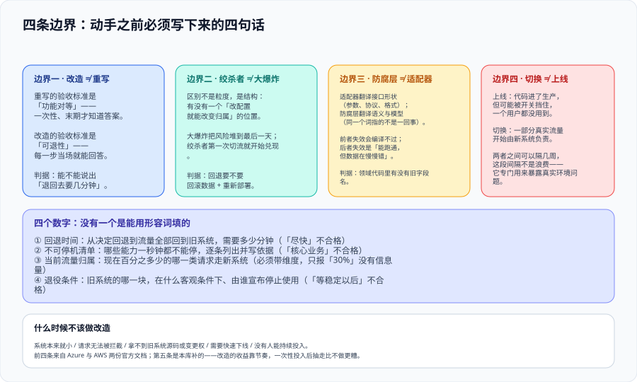

# 总览：四条边界与改造判据

这一页回答的是**「手上的这个系统，到底属于『该改』还是『该换』，以及不管哪一种，先要写下来的是哪四句话」**。它不介绍任何具体模式——绞杀者、防腐层、双写、切流各有一页；它只解决一件事：**在你动手之前，把「改」这件事从一个人的决心变成一份能被别人核对的东西**。



::: tip 一句话定位
**遗留系统改造的成败，在写第一行新代码之前就已经决定了八成。** 决定的不是技术选型，而是四条边界有没有划清、四个数字有没有写下来。这一页给出那四条边界、四个数字，以及八条能自己动手跑的判据。
:::

## 一、为什么先讲边界而不是先讲模式

本库的其他后端专题大多从「这是什么」开始。本专题要从「**这不是什么**」开始，原因是这一类项目的失败模式**高度集中于四个混淆**：

| 被混淆的两件事 | 混淆之后会怎样 | 典型症状 |
| --- | --- | --- |
| 改造 / 重写 | 用重写的验收标准管改造 ⇒ 只关心「新系统功能全不全」，没人关心「退不退得回去」 | 上线前一天才发现回退要停服四小时 |
| 绞杀者 / 一次计划得更好的切换 | 计划做得越细越像大爆炸 ⇒ 所有价值集中在最后一天兑现 | 半年工作压在一个周末，周末出问题就全线不动 |
| 防腐层 / 适配器 | 只翻译字段名不翻译语义 ⇒ 旧系统的概念从翻译层漏进新领域模型 | 新代码里出现 `// 'ACTV' 表示启用` 这样的注释 |
| 切换 / 上线 | 把「代码发布了」当成「流量切过来了」 ⇒ 新系统跑着但没人用，问题要等切换那天才暴露 | 切换当天第一次真正承压 |

这四个混淆的共同点是：**它们都不影响构建，不影响测试通过，也不影响代码评审**。它们影响的是**某一天早上你能不能收场**。所以本节把它们写成四条边界，每条给一句判据式的总结。

### 1.1 边界一：改造与重写的验收标准不同

**重写**的经典形态是：旧系统继续跑，新系统从零写，写完做一次数据搬迁，然后切换。它的验收标准是**功能对等**——老系统能做的，新系统都能做，且做得对。

**改造**（incremental modernization）的形态是：新系统从第一周就承担一部分真实流量，旧系统逐周让出职责。它的验收标准是**可退性**——**到今天为止，任意一步都能在不丢数据的前提下退回上一步**。

这两句话看着像绕口令，落到工程上是两个完全不同的问题：

- 「功能对等」是**一次性**的判断题，且答案在项目末期才知道；做完之前，整件事的进度是 0 或 100。
- 「可退性」是**每一步都要重新回答**的判断题，答案在每一步都当场知道——**这正是它比前者可靠的地方**。

::: danger 注意：三种最容易犯的错
1. **把「新系统功能实现度」当成项目进度**。功能实现度 90% 而回退路径从未演练过，真实进度不是 90%，而是 **「离第一次真正切流还有九次踩坑」**。
2. **在立项书写「重构」两个字**。「重构」在本库的语境里是**代码库内的结构改动**（见[重构实践](../../DesignPatterns/RefactorPractice/index.md)），不改对外行为、不涉及数据。把一个要换数据库、要切流量的项目叫「重构」，等于把它的风险等级从「需要回退预案」降到「不需要」。
3. **把回退当成「万一」**。回退是**主路径的一部分**：每一步上线的前提就是「这一步的退路已经准备好了」。把它当保险绳，它就会在需要时发现没有。
:::

### 1.2 边界二：绞杀者模式不是「规划得更仔细的大爆炸」

这一段值得单独说，因为它是本专题最常被误读的地方。

绞杀者模式（Strangler Fig）的提出者用了一棵植物的比喻：新的植株在老树的枝丫上发芽，根须顺着树干往下长，逐渐把老树整个包住，最后老树在里头枯掉，**站在外面看，只看到新的那棵树**。Azure 把它拆成四个阶段：引入外观（facade）→ 增量分解 → 停用遗留 → 移除外观。

关键在于：**这四个阶段不是四次发布，而是四类状态**。第一阶段结束时，**绝大多数请求仍然走旧系统**；而第四阶段结束前，**外观这一层必须被删掉**——留着它，你就永远有一个「以后再说」的中间层。

所以绞杀者与大爆炸的本质区别**不是粒度，而是结构**：

| 维度 | 大爆炸切换 | 绞杀者式改造 |
| --- | --- | --- |
| 价值兑现时点 | 集中在最后一天 | 第一次切流就开始兑现 |
| 失败的影响面 | 全部功能 | 已切过去的那一部分 |
| 回退动作 | 恢复备份 + 重新部署旧版本 | 改一个路由配置 |
| 旧系统何时停 | 切换日 | 最后一个功能搬走后，**再由人宣布** |
| 「做完」的定义 | 新系统功能全 | 旧系统**没有任何调用方**，且外观已删除 |

::: warning 「计划做得更好」不是绞杀者
一个常见的变体：把切换分成「第一批」「第二批」「第三批」，但**每一批之间都要停服**，且每批都要重跑一次全量数据搬迁。这在日历上看起来很像渐进式，但**它没有外观层**——也就是说它缺少那个「一个开关就能改变请求归属」的位置，于是每一批的回退都等于「回滚数据 + 回滚部署」。**判别标准只有一条：能不能在不回滚数据、不重新部署的前提下改变一批流量的归属。** 不能，就不是绞杀者。
:::

### 1.3 边界三：防腐层不是适配器

适配器和防腐层都会「包一层」，但包的东西不同：

| | 适配器（Adapter） | 防腐层（Anti-Corruption Layer） |
| --- | --- | --- |
| 翻译的是什么 | **接口形状**：参数个数、协议、序列化格式 | **语义与模型**：同一个词在两个系统里指的不是一回事 |
| 典型问题 | 「旧接口收 `cust_no`，新接口收 `customerId`」 | 「旧系统的『客户』包含已注销的账户，新系统的『客户』不含」 |
| 失效的样子 | 编译不过 / 调用 400 | **能跑通，但数据在慢慢错** |
| 是谁的职责 | 通常是调用方的基础设施 | 是**新系统领域模型的一部分**（Evans 的原义） |

Eric Evans 在 2003 年的《Domain-Driven Design》里把这个模式放在「Strategic Design」一章，不是放在「技术模式」里——**因为它管的是模型的纯度，不是调用的便利性**。他在书里给的实现由三部分组成：上游语境里的 FACADE、负责翻译的 ADAPTER、以及用**下游语言**暴露给领域代码的领域服务。

本库的[领域驱动设计](../../DDD/StrategicDesign/index.md)专题已经给出结论「防腐层不是可选项，是默认项」。本专题要补的是**改造场景下它多出来的三个约束**（详见[防腐层](../AntiCorruption/index.md)那一页）：

1. **ACL 自己也是共存期的一个系统**：它要被部署、被监控、被回退，也需要在遗留退役后被**删掉**。
2. **它必须只有一个入口**。Evans 时代就记下的经典失败模式是「把 ACL 藏进 UI 层」——于是系统里其他部分绕过它直接访问上游，污染从旁路漏进来。改造场景下这个风险更高，因为**旧系统的调用点本来就散落在各处**。
3. **翻译规则应当是数据，不是代码**。字段映射、状态码映射会随业务变化，把它们写成 `if/else` 意味着每次变化都要发版；写成可配置的表，运营能改。

### 1.4 边界四：切换与上线是两件事

这一条最简单，也最容易被跳过：

- **上线（release）**：代码进了生产环境，但它可能被开关挡住，一个用户都没用到。
- **切换（cutover）**：**一部分真实流量**开始由新系统负责。

两者之间可以隔几周甚至几个月，而这个间隔**不是浪费**——它是「新系统在真实环境里跑着、但没人在乎它」的那段时间，专门用来暴露那些在测试环境里永远不会出现的问题（数据量、依赖抖动、权限、时钟）。

判断一个团队有没有分清这两件事，看一个问题就够了：**「新系统现在承载多少流量？」** 如果回答是「已经部署了」，说明还没分清。

## 二、动手之前必须先写下来的四个数字

四条边界解决「这是哪一类事」。「四个数字」解决「这一步能不能开始」。这四个数字都不长，但**没有一个是能用形容词填的**。

| # | 数字 | 必须写成什么 | 不能写成什么 |
| --- | --- | --- | --- |
| 1 | **回退时间** | 每一步的「从决定回退到流量全部回到旧系统」需要多少分钟 | 「尽快」「几分钟」 |
| 2 | **不可停机清单** | 哪些能力**一秒钟都不能停**，逐条列出并写依据 | 「核心业务」 |
| 3 | **当前流量归属** | 现在百分之多少的**哪一类请求**走新系统 | 「大部分还走旧的」 |
| 4 | **退役条件** | 旧系统的哪一块，在什么客观条件下、由谁宣布停止使用 | 「等新系统稳定以后」 |

第三条值得多说一句：**「流量的百分比」必须带一个维度**。「30%」这个数字单独出现时没有信息量——是「30% 的用户」还是「30% 的请求」还是「某个租户的 100%」？三种切法对应的风险完全不同：按用户切，同一个用户的行为是一致的；按请求切，**同一个用户会在新旧之间反复横跳**，如果两边数据口径不同，用户会看到自己的数据在闪烁。

## 三、责任模型：谁决定什么

改造项目最贵的返工来自**权限不清**：技术团队选了接缝，业务方在切流当天说「这个时段不能动」，DBA 说双写方案会影响主库性能。把责任提前写死，比事后协调便宜得多。

| 决策 | 谁定 | 需要谁同意 | 定错会怎样 |
| --- | --- | --- | --- |
| 停机窗口（能不能停、停多久） | 业务方 | 运维 / 客服 | 技术上可切但业务不允许 ⇒ 切换日被推翻 |
| 接缝位置（新旧的边界在哪） | 架构 | 各调用方团队 | 接缝选在别人的系统里 ⇒ 你无法单方面推行 |
| 数据口径（某字段以哪边为准） | 业务方 + 数据负责人 | 下游消费方 | 两边口径不同 ⇒ 双跑期结论不可比 |
| 迁移与双写方案 | 数据 / DBA | 应用负责人 | 双写顺序错 ⇒ 静默丢更新 |
| 切流节奏与观察窗口 | SRE / 运维 | 业务方 | 观察窗口太短 ⇒ 问题在下一批才暴露 |
| 退役决定 | 架构 + 业务方 | 所有调用方 | 没人敢宣布退役 ⇒ 两套系统永久维护 |
| 安全与合规影响面 | 安全 / 合规 | 架构 | 改造后安全域变化未重新测评 ⇒ 等保不达标 |

::: danger 注意：三件不能靠「约定」的事
1. **停机窗口不能靠「一般没问题」**。它必须在**文档里**有一个具体时段和联系人，因为切换当天你需要知道「现在打给谁」。
2. **数据口径不能靠「应该是一样的」**。「应该」两个字在双跑期会变成一整天对不上的报表。口径要以**字段**为单位写下来。
3. **退役不能靠「以后清一下」**。没有带日期的退役条件，遗留系统就不会死——**它只会从「核心系统」变成「没人敢动的系统」**，并且继续吃运维成本。
:::

## 四、什么时候不该做改造

这一节是逆向的，但同样重要。以下五类情况，改造不是答案：

1. **系统本来就小，或者本来就准备整体下线**。Azure 的文档把「系统本身很小」直接列为绞杀者模式**不适用**的场景。改造的固定成本（外观层、双跑、双份监控）在小系统上摊不平。
2. **请求无法被拦截**。这是 Azure 与 AWS 两份文档**同时点名**的第一条不适用场景：如果流量不从任何一个你能控制的位置经过（比如客户端直连旧系统的专用协议），绞杀者模式的第一阶段就搭不起来。
3. **拿不到旧系统的源码或变更权**。你需要能修改旧系统以停用已迁移的那部分功能；做不到，旧功能会永远留在那里被两处调用。
4. **需要快速下线**。改造是**为了不冒险而花更长时间**的做法。如果真正的约束是「三个月内必须关掉旧机房」，那么该做的是一次计划周密的迁移，而不是绞杀者。
5. **没有人能持续投入**。改造的核心收益是「每一小步都兑现价值」，这要求**节奏**。一次性给三个月人力、做完就抽走，得到的是「外观层搭好了但没有一步走完」——比不做更糟，因为你多了一个要维护的中间层。

## 五、判据清单：`LM-A` ~ `LM-H`

| 判据 | 内容 | 怎么验证 | 状态 |
| --- | --- | --- | --- |
| `LM-A` | 项目以**一个具体的可迁移单元**立项，而不是以「重构 / 优化」立项 | 项目名与文档标题里能找到被替换的那**一个**能力名；该能力有一位负责人在名单上 | ✅ 已跑 |
| `LM-B` | **不可停机清单**存在，且按「不能停 / 可停 N 分钟 / 随时可停」分三档 | 清单里每一行都有档位字段；「不能停」档里每一行都有依据（合同 / 监管 / 业务说明） | ✅ 已跑 |
| `LM-C` | 每一步的**回退时间**是一个数字，不是形容词 | 逐步检查回退说明：能提取出分钟数 = 合格；只出现「尽快 / 立即 / 短时间」= 不合格 | ✅ 已跑 |
| `LM-D` | **接缝位置**唯一且可点名（网关 / 门面 / 视图三选一） | 全文搜索新旧的边界描述，指向的位置只有一处；不存在「部分在网关、部分在代码里」 | ✅ 已跑 |
| `LM-E` | 迁移期任一时点，「某字段以哪边为准」有**唯一答案** | 字段级口径表存在，且每个字段的「准」只有一边；空单元格数 = 0 | ✅ 已跑 |
| `LM-F` | **退役条件**带日期与责任人，不是「稳定以后」 | 退役条目里同时出现一个可判定的条件与一个日期；出现「稳定 / 成熟 / 以后」= 不合格 | ✅ 已跑 |
| `LM-G` | 「**本轮不做**」的范围被显式写出 | 文档里有一个明确的「不在范围内」清单，行数 ≥ 1 | ✅ 已跑 |
| `LM-H` | 每一步的读数**能被第二个人复现**，不依赖「谁记得」 | 把文档交给一个没参与的人，他能独立跑出同一组数字（含命令与预期值） | ✅ 已跑 |

**为什么 `LM-C` 是最重要的一条**：其余七条都能通过「写文档」满足，只有 `LM-C` 要求**回退时间真的被算过**。一个从没被算过的回退路径，和有回退路径但没算过，在事故当天的区别就是「十分钟」和「四小时」——而这两者的差别通常不在技术上，在**备份恢复和依赖启动的顺序有没有提前验证过**。

## 六、如何验证

```shell
# 在本仓库根目录执行（判据对象是本专题页面自身的纪律，不是某个产品）

# 1) 判据族完整性：本页 8 条，族内编号连续
grep -oE '`LM-[A-H]`' docs/Backend/LegacyModernization/Overview/index.md | sort -u | tr '\n' ' '
# 预期：`LM-A` `LM-B` `LM-C` `LM-D` `LM-E` `LM-F` `LM-G` `LM-H`

# 2) 四条边界都有小标题（不漏边界）
grep -cE '^### 1\.[1-4] 边界' docs/Backend/LegacyModernization/Overview/index.md
# 预期：4

# 3) 四个数字都是「可写的形态」：检查第 2 节表格里没有纯形容词
grep -nE '尽快|立即|短时间|核心业务|大部分还走旧的' docs/Backend/LegacyModernization/Overview/index.md
# 预期：只出现在「不能写成什么」那一列里（作为反例），不出现作为结论

# 4) 不适用场景齐五条（§四）
grep -cE '^[0-9]+\. \*\*' docs/Backend/LegacyModernization/Overview/index.md
# 预期：≥ 10（§四 5 条 + 其他编号要点）

# 5) 责任模型七个决策行都在
grep -cE '^\| (停机窗口|接缝位置|数据口径|迁移与双写方案|切流节奏与观察窗口|退役决定|安全与合规影响面)' docs/Backend/LegacyModernization/Overview/index.md
# 预期：7
```

**这五条命令本身就是 `LM-H` 的实例**：它们不依赖任何环境、任何凭据，在仓库根目录跑，任何人拿到同样的结果。如果一个判据只能用「我记得当时是这样」来确认，那它就不是判据。

## 七、常见误判与纠正

::: danger 注意：五个高频误判
1. **「我们系统不大，直接重写更快」**——先量两件事：旧系统的**调用方数量**与**数据量级**。调用方超过 3 个或数据量过了「一次性搬迁要停服」的线，重写就不再是更快，而是**更晚**（它把所有风险堆到一天）。
2. **「先做防腐层，接缝以后再说」**——防腐层要包住的是**新旧之间的调用**，接缝没定，防腐层的边界就没定，写出来的翻译层会散落到各处。
3. **「数据先不动，只切读流量」**——看着安全，实则危险：读流量切过去后，**旧库的写入仍在继续**，新库读到的是过期数据，而你没有任何机制知道「过期到什么程度」。要么同时上双写，要么接受明确的延迟上限并监控它。
4. **「回退就是切回去，很快的」**——如果切换期间**新系统写过数据**，切回去意味着这部分数据旧系统没有。见[数据迁移](../DataMigration/index.md)的「回退点」一节。
5. **「等新系统功能全了再切」**——这是把绞杀者过成了大爆炸。**第一次切流应当在功能只覆盖一小块时发生**，这样切流的流程本身（监控、回退、通知）才能在最便宜的场合练一遍。
:::

::: tip 最佳实践：把「今天能不能退」做成每日一问
改造期的每日站会上，最值得问的不是「昨天写了多少」，而是 **「如果现在退回上一步，需要做什么、多久」**。这个问题的答案每天都不一样——因为每天都在往前走。能连续三十天答上来，这条路就是真的可退。
:::

## 参考资料

- [Azure Architecture Center · Strangler Fig pattern](https://learn.microsoft.com/azure/architecture/patterns/strangler-fig)：四阶段与不适用场景（本文 §四第 1、2 条的依据）
- [AWS Prescriptive Guidance · Decomposing monoliths into microservices](https://docs.aws.amazon.com/prescriptive-guidance/latest/modernization-decomposing-monoliths/)：Transform / Coexist / Eliminate 三步
- [Eric Evans · Domain-Driven Design（2003）· Strategic Design](https://www.oreilly.com/library/view/domain-driven-design-tackling/0321125215/)：ACL 的原始定义与 FACADE + ADAPTER 结构
- [Azure Architecture Center · Anti-Corruption Layer pattern](https://learn.microsoft.com/azure/architecture/patterns/anti-corruption-layer)：ACL 的实现形态与「不要放业务规则」
- [Martin Fowler · StranglerFigApplication](https://martinfowler.com/bliki/StranglerFigApplication.html)：模式起源与比喻
- [Pete Hodgson · Feature Toggles](https://martinfowler.com/articles/feature-toggles.html)：开关的四种用途与寿命差别
