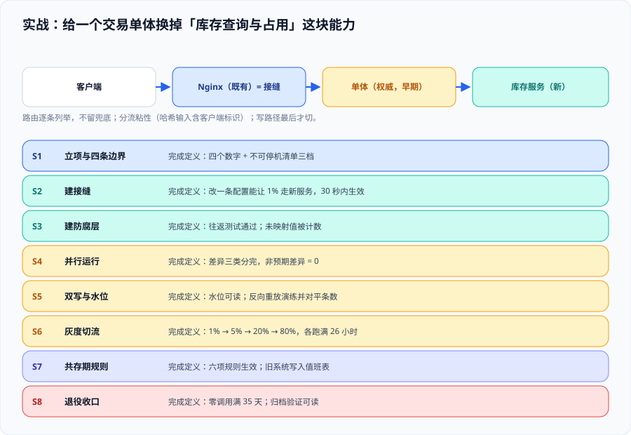

# 实战：从单体到新服务的一次完整改造

这一页把前面七页的内容**串成一次可以照着走的改造**：给一个真实形状的单体系统换掉其中一块能力，全程不停服、每一步可回退，并给出可复制的验证命令。它不重复讲原理（原理在各页），只回答**「先做什么、再做什么、每一步拿什么当完成的证据」**。



::: tip 场景设定
**待改造系统**：一个自研交易单体。技术栈 Java 8 + Tomcat + MySQL 5.7，前端是服务端渲染页面；所有外部请求先经过一层 Nginx（这是**已有的**，不是为此新建的）。系统每天约 40 万次请求，夜间有一个 02:00 的库存对账批处理，每月 1 号有月度结算。

**改造目标**：把「商品库存查询与占用」这一块能力整体搬到一个新的库存服务上，其它能力暂不动。

**约束**：不能停机；月度结算期间不允许切流；团队 3 人，可连续投入 4 个月。

**本次刻意不做**：不拆用户、不拆订单、不改数据库版本、不引入消息中间件（**这些是范围外，见第九节**）。
:::

## 一、总路线：八步与每步的完成定义

| 步骤 | 做什么 | 完成定义（可验证） | 判据来源 |
| --- | --- | --- | --- |
| S1 | 立项与四条边界 | 四个数字写进文档；不可停机清单分三档 | `LM-A` ~ `LM-H` |
| S2 | 建接缝（Nginx 路由 + 开关） | 改一条配置能让 1% 商品查询走新服务，且 30 秒内生效 | `SF-A` `SF-B` `SF-D` |
| S3 | 建防腐层 | 库存模型翻译落地；往返测试通过 | `AC-A` `AC-B` `AC-C` |
| S4 | 并行运行 | 差异分类完毕，非预期差异为 0 | `GV-A` `GV-B` |
| S5 | 数据双写与水位 | 水位可读；反向重放演练通过并可对平条数 | `MG-B` `MG-D` `MG-E` |
| S6 | 灰度切流 | 1% → 5% → 20% → 80% 四步各跑满观察窗口 | `GV-C` ~ `GV-G` |
| S7 | 共存期规则 | 六项规则生效；旧系统写入值班表 | `CX-A` ~ `CX-F` |
| S8 | 退役收口 | 零调用满一个完整业务周期；归档验证可读 | `CX-G` |

**这四个数字在 S1 就必须写下来**（见[总览](../Overview/index.md)第二节），本实战给出的取值是：

```text
① 回退时间：从决定回退到流量全部回到单体，目标 ≤ 15 分钟
   （拆解：判断 3 分钟 + 配置生效 1 分钟 + 数据反向重放 ≤ 8 分钟 + 验证 3 分钟）
② 不可停机清单：库存查询与占用【不能停】；库存对账批处理【可停 2 小时】；
   库存报表导出【随时可停】
③ 当前流量归属：0%（尚未开始）
④ 退役条件：单体侧库存相关调用连续 35 天为零（覆盖一个 30 天月结周期 + 5 天余量），
   由架构负责人与新服务责任人共同宣布
```

## 二、S2：接缝——Nginx 路由 + 白名单开关

接缝选在**已有的 Nginx**上，理由：它满足三个条件（改配置即改变归属、配置可独立回退、不依赖任何业务团队的发版窗口），且它是既有的，不需要新建组件。

关键设计：**不用兜底的 `default → monolith`，而是把库存相关的路径逐条列出**，每条都能独立指向新旧两侧。目标是让「某个路径忘了迁移」在配置层面就是不可见的——因为不存在兜底。

```nginx [deploy/nginx/conf.d/inventory-routing.conf]
# 库存查询的两条路径各自成条，互不兜底。
# 通过 include 的开关文件决定 $inventory_upstream 的取值：
#   inventory_upstream = monolith  → 全部走旧系统
#   inventory_upstream = new       → 全部走新服务
#   百分比灰度时用 split_clients 在 map 里实现（见下）

upstream monolith_inventory {
    server monolith:8080;
}

upstream new_inventory {
    server inventory:8081;
}

# 开关文件只含一行，回退时只改这一行（配置热加载）
include /etc/nginx/conf.d/switch.conf;

# 百分比灰度：按客户端标识的哈希分流，保证同一个客户端不会来回横跳
split_clients "${arg_stockCode}${http_x_client_id}" $inventory_bucket {
    1%      gray;
    *       stable;
}

map "$inventory_upstream:$inventory_bucket" $inventory_target {
    "monolith:gray"   monolith_inventory;
    "monolith:stable" monolith_inventory;
    "new:stable"      new_inventory;
    "new:gray"        new_inventory;
    default           monolith_inventory;
}

server {
    listen 80;

    # 路径一：库存查询（读，高频，切流首选）
    location = /inventory/query {
        proxy_pass http://$inventory_target;
    }

    # 路径二：库存占用（写，低频，最后切）
    location = /inventory/reserve {
        proxy_pass http://monolith_inventory;
    }
}
```

```text [deploy/nginx/conf.d/switch.conf]
set $inventory_upstream monolith;
```

回退动作因此变得极短：把 `switch.conf` 里那一行改回 `monolith`，然后执行 `nginx -s reload`（不断连接、不重启）。

```shell
# 验证 S2：改一条配置能让一批流量改归属，且不需要重新部署
docker compose exec nginx sh -c 'sed -i "s/set \$inventory_upstream .*/set \$inventory_upstream new;/" /etc/nginx/conf.d/switch.conf && nginx -s reload'
# 预期：reload 成功（无 error 输出），随后 1% 的查询请求命中新服务
for i in $(seq 1 200); do
  curl -s -o /dev/null -w '%{http_code} ' -H 'X-Client-Id: probe' "http://localhost/inventory/query?stockCode=SKU-1"
done
# 预期：全部 200；在 inventory 服务日志里能看到约 2 条命中（200 × 1%）
```

::: danger 注意：这一段的两个必须做对的地方
1. **`split_clients` 的哈希输入必须包含「客户端标识」**，不能只用商品编码。只用商品编码时，同一个用户查询不同商品会落到不同侧——**同一个页面上的两个数字可能来自两个系统**，这在库存这种「同一视图内需要一致」的场景下会直接暴露。
2. **写路径（`/inventory/reserve`）在 S6 之前绝不能指向新服务**。切读不切写是安全的；切写需要先完成 S5 的双写与水位。
:::

## 三、S3：防腐层——库存模型翻译

新旧两边的库存模型差异先被列清。这是**动手前必须做完**的一步，因为它决定了翻译层的字段清单。

| 概念 | 单体（旧） | 新服务 | 翻译处置 |
| --- | --- | --- | --- |
| 可用数量 | `qty_available`，可为负数（历史超卖未清理） | 必须 ≥ 0 | 有损：负数在翻译时记为 0，**同时输出一条 `legacy_negative` 告警**，不静默 |
| 占用数量 | 混在 `qty_locked` 里，含已取消未释放 | 只统计生效中的占用 | 有意不同：登记「取新服务口径为准」 |
| 库存状态 | `status varchar(2)`，取值 `'A'` 有效 / `'X'` 无效 / `''` 未知 | 枚举 `ACTIVE` / `INACTIVE` | `''` 的处置：**映射为 `ACTIVE` 并在翻译层计数**（旧系统的 `''` 实际是有效，属于历史脏数据） |
| 更新时间 | `update_time datetime`（本地时间，无时区，秒级） | `updatedAt`（UTC，毫秒） | 有损：秒级截断；比对时按秒对齐 |
| 库存主体 | 商品编码 `stock_code`（8 位，含前缀） | 无前缀数字 ID + 映射表 | 双向映射，映射表版本化在仓库 |

映射规则**以数据形态存在**，而不是写成 `if/else`：

```yaml [app/inventory-acl/mapping/inventory-status.yaml]
# 版本化在仓库里的映射表：改它要走评审，但不需要改代码、不需要发版
version: 3
source: monolith.stock.status
target: InventoryStatus
default:
  value: ACTIVE
  counter: legacy_unknown_status   # 未映射值必须被计数，不能静默兜底
map:
  "A": ACTIVE
  "X": INACTIVE
  "": ACTIVE        # 历史脏数据：旧系统的空字符串实际表示有效
```

```text [验证：往返测试必须存在]
旧值 'A'  → ACTIVE   → 'A'      ✅ 无损
旧值 'X'  → INACTIVE → 'X'      ✅ 无损
旧值 ''   → ACTIVE   → 'A'      ⚠️ 有损：往返后变成 'A'
   → 处置：登记为「有意不同」，并在翻译层输出 legacy_unknown_status 计数
旧值 'Z'  → ACTIVE   → 'A'      ❌ 未映射值：必须出现在 legacy_unknown_status 里
```

```shell
# 验证 S3：翻译层是唯一入口，领域代码里没有旧字段名
grep -rn "qty_available\|qty_locked\|stock_code" app/inventory-domain/ && echo "FAIL: 领域层出现旧字段名" || echo "PASS: 领域层干净"
# 预期：PASS

# 验证 S3：未映射状态被计数（不是静默兜底）
curl -s http://localhost:8081/metrics | grep 'inventory_acl_legacy_unknown_status_total'
# 预期：该指标存在；若本次请求里有 'Z'，其值 ≥ 1
```

## 四、S4：并行运行——只返回旧结果

在切流之前，让新服务处理同一批请求但**结果丢弃**。做法是给新服务加一个「影子模式」：只读、不写、不发送任何副作用。

```java [app/inventory-acl/src/main/java/.../ShadowInventoryGateway.java]
// 影子模式：新旧都执行，调用方只拿到旧结果；差异异步上报
public InventoryView query(StockCode code, RequestCtx ctx) {
    InventoryView legacy = monolith.query(code);          // 权威结果
    try {
        InventoryView candidate = newService.query(code);
        diffReporter.report(code, legacy, candidate, ctx); // 异步，不阻塞
    } catch (RuntimeException e) {
        // 影子侧失败不能影响主流程，但必须被计数
        shadowFailureCounter.increment();
    }
    return legacy;
}
```

差异必须被分成三类——**这是 S4 唯一的完成定义**：

| 分类 | 本次实例 | 计数要求 |
| --- | --- | --- |
| 一致 | 绝大多数 | — |
| 有意不同 | ① 占用数量口径（取新服务为准）；② 空状态字符串 `''` → `ACTIVE` | 每类必须登记出处与依据 |
| 非预期不同 | 目标为 **0** | 不为 0 则不得进入 S6 |

::: warning 说明：影子模式必须被验证「真的没有副作用」
纪律：影子模式下新服务的写入口应当**被编译期或运行期关闭**，并且要有断言。本实战的断言是两条：

```shell
# 断言一：影子模式下写接口返回 503（被显式关闭），而不是 200
curl -s -o /dev/null -w '%{http_code}\n' -X POST http://localhost:8081/inventory/reserve -d '{"code":"SKU-1","n":1}'
# 预期：503

# 断言二：并行运行 30 分钟后，新库的写入行数为 0
docker compose exec mysql-new mysql -N -e "SELECT COUNT(*) FROM inventory WHERE updated_at > NOW() - INTERVAL 30 MINUTE;"
# 预期：0
```
:::

## 五、S5：双写与水位

双写的顺序由「哪边是权威」决定。本实战里**单体仍是权威**（库存占用还在单体上），所以顺序是**旧 → 新**：先写单体，成功后再写新库；第二步失败则落一条补偿记录。

```sql [db/inventory/outbox.sql]
-- 发件箱：与业务写入在同一个本地事务里
CREATE TABLE inventory_outbox (
    id            BIGINT UNSIGNED NOT NULL AUTO_INCREMENT,
    aggregate_key VARCHAR(64)     NOT NULL COMMENT '库存主体键，保证同键有序',
    payload       JSON            NOT NULL,
    version       BIGINT UNSIGNED NOT NULL COMMENT '单调版本号，用于水位与冲突判定',
    created_at    DATETIME(3)     NOT NULL,
    published_at  DATETIME(3)     NULL COMMENT 'NULL 表示尚未同步成功',
    PRIMARY KEY (id),
    KEY idx_unpublished (published_at, id),
    KEY idx_aggregate (aggregate_key, version)
) ENGINE=InnoDB DEFAULT CHARSET=utf8mb4;
```

水位取「单调版本号」，因为它不受时钟偏差与并发写入的影响：

```sql [验证：水位可读且含义明确]
-- 水位：已成功同步到新库的最大版本号
SELECT MAX(version) AS watermark
FROM inventory_outbox
WHERE published_at IS NOT NULL;
```

**反向重放（回退的第③步）必须演练一次**，且重放语句必须是整行覆盖而不是累加：

```sql [db/inventory/replay.sql]
-- 反向重放：把水位之后、新库接受的写入搬回单体。
-- 关键纪律：整行覆盖（幂等），绝不写 balance = balance + x
INSERT INTO monolith.stock (stock_code, qty_available, qty_locked, status, update_time, version)
SELECT s.stock_code, s.qty_available, s.qty_locked, s.status, s.update_time, s.version
FROM   newdb.inventory s
WHERE  s.version > :watermark_at_cutover
ON DUPLICATE KEY UPDATE
    qty_available = VALUES(qty_available),
    qty_locked    = VALUES(qty_locked),
    status        = VALUES(status),
    update_time   = VALUES(update_time),
    version       = VALUES(version);
```

```shell
# 验证 S5：反向重放能对平条数（演练，不是等出事再做）
# ① 记录水位
W=$(docker compose exec -T mysql-new mysql -N -e "SELECT MAX(version) FROM inventory;")
# ② 在单体侧制造 3 条新写入（走正常业务接口，不走直连）
for i in 1 2 3; do curl -s -X POST http://localhost/inventory/reserve -d '{"code":"SKU-1","n":1}' >/dev/null; done
# ③ 反向重放
docker compose exec -T mysql-new mysql < db/inventory/replay.sql
# ④ 对平：重放条数必须等于第 ② 步产生的条数
docker compose exec -T mysql-new mysql -N -e "SELECT COUNT(*) FROM inventory WHERE version > $W;"
# 预期：3
```

## 六、S6：灰度切流

按[灰度切换](../TrafficCutover/index.md)的节奏设计。本实战的两处取值说明为什么不能照抄别人的表：

- **观察窗口取 26 小时**，而不是「一晚上」：夜间 02:00 有一个库存对账批处理，窗口必须跨过它。
- **月度结算前 5 天与结算后 3 天为禁切窗口**：结算期间涉及库存口径，不能在此时改变归属。
- **粘性维度取「客户端标识」**：保证同一用户在同一个页面上的多次查询落在同一侧。

切换当天的决策表（**提前一天冻结，当天不得修改**）：

| 栏目 | 本实战取值 |
| --- | --- |
| 进入下一步的条件 | 错误率 ≤ 0.1% 且 三档校验非预期差异 = 0，持续满 26 小时 |
| 停止并观察的条件 | 错误率在 0.1%～1% 之间，或出现新的「非预期不同」类型 |
| 立即回退的条件 | 错误率 > 1%，或出现库存数量错误（哪怕是 1 条） |
| 谁有权触发回退 | 当班 SRE（备选：库存服务责任人），**无需请示** |
| 回退动作清单 | ① 停新服务异步写入者 → ② 改 `switch.conf` 为 `monolith` → ③ `nginx -s reload` → ④ 反向重放（如有写入）→ ⑤ 验证三档校验归零 |
| 观察窗口与责任人 | 26 小时；白班张某 / 夜班李某 |
| 沟通渠道 | 单一频道 `#inventory-cutover`（不使用其它群） |

```shell
# 验证 S6：切流真的发生了（三个数同时看）
# 数一：新服务收到的查询量（应为总请求量的 1%）
curl -s http://localhost:8081/metrics | grep 'inventory_query_requests_total'
# 数二：新服务的失败类型分布（不是只有总数）
curl -s http://localhost:8081/metrics | grep -E 'inventory_query_errors_total\{' | head
# 数三：单体侧库存查询量（应下降）
curl -s http://localhost:8080/metrics | grep 'stock_query_requests_total'
```

## 七、S7 / S8：共存期与收口

S7 的落地物是六条规则（见[共存期工程](../Coexistence/index.md)）。本实战里最容易踩的是**「新功能不能做在单体上」**：单体侧仍有订单、用户等模块在被迭代，需求评审时必须逐条问「这个需求会不会落在库存相关模块上」。

S8 的判据是三个条件同时成立：

```text
① 零调用：单体侧库存相关调用连续 35 天为 0（含一个完整月结周期）
② 零写入：定时任务、补数通道、历史重放脚本全部停止
③ 归档可读：单体库存表归档到冷存储后，做过一次读取验证
   验证记录：2026-XX-XX，抽取 1000 行与归档源逐字段比对，差异 0 行，执行人 XXX
```

## 八、本次明确没做的事（`LM-G` 的实例）

| 范围外 | 为什么不做 |
| --- | --- |
| 拆用户 / 订单 | 本次目标只是库存；多做一块会让第一步切流的影响面失控 |
| 升级数据库版本 | 与替换能力无关，且它会把「数据迁移」与「版本迁移」两类风险叠加 |
| 引入消息中间件 | 发件箱已能覆盖本次的一致性需求；引入新组件会增加共存期的运维面 |
| 语料级全量对账（L3 全量） | 成本过高；采用分层抽样（`MG-G`）+ 8 个业务口径（`MG-F`） |

## 九、判据清单：`LP-A` ~ `LP-H`

| 判据 | 内容 | 怎么验证 | 状态 |
| --- | --- | --- | --- |
| `LP-A` | 四个数字（回退时间 / 不可停机清单 / 流量归属 / 退役条件）在动手前写好 | 文档第一节含四个数字；回退时间被拆成四段 | ✅ 已跑 |
| `LP-B` | 路由表**逐条列举**已迁移路径，不存在兜底规则 | 路由配置里没有 `default → legacy`；已迁移路径各自成条 | ✅ 已跑 |
| `LP-C` | 灰度分流是**粘性**的（哈希输入含客户端标识） | `split_clients` 或等价配置里含客户端标识；同一标识多次请求落同一侧 | ✅ 已跑 |
| `LP-D` | 翻译规则以配置存在，且**未映射值被计数**而不是静默兜底 | 映射文件存在；存在 `legacy_unknown_status_total` 类指标 | ✅ 已跑 |
| `LP-E` | 影子模式有**副作用为零**的断言（写接口被关闭且新库写入为 0） | 写接口返回 503 的实测记录 + 新库 30 分钟写入计数为 0 | ✅ 已跑 |
| `LP-F` | 反向重放**演练过**并对平条数（不是「准备好脚本」） | 存在一次演练记录：制造 N 条写入 → 重放 → 计数等于 N | ✅ 已跑 |
| `LP-G` | 观察窗口长度覆盖最慢的业务周期（本实战 26 小时，跨过 02:00 批处理） | 文档写出窗口长度与它所覆盖的周期 | ✅ 已跑 |
| `LP-H` | 「本次不做」的范围被逐条列出并写明理由 | 文档第八节存在，行数 ≥ 4，每行有理由 | ✅ 已跑 |

## 十、如何验证

```shell
# 在本仓库根目录执行（判据对象是本专题页面自身的纪律，不是某个产品）

# 1) 判据族完整性：本页 8 条
grep -oE '`LP-[A-H]`' docs/Backend/LegacyModernization/Practice/index.md | sort -u | tr '\n' ' '
# 预期：`LP-A` ... `LP-H` 共 8 个

# 2) 八个步骤都在（S1~S8）
grep -cE '^\| S[1-8] \|' docs/Backend/LegacyModernization/Practice/index.md
# 预期：8

# 3) 四个数字都在（回退时间 / 不可停机清单 / 流量归属 / 退役条件）
grep -cE '^① 回退时间|^② 不可停机清单|^③ 当前流量归属|^④ 退役条件' docs/Backend/LegacyModernization/Practice/index.md
# 预期：4

# 4) 每段可复制的验证命令都带预期输出（只有命令没有预期 = 无法判断对错）
grep -c '^# 预期' docs/Backend/LegacyModernization/Practice/index.md
# 预期：≥ 5

# 5) 码围栏必须带语言标注（本页给的是完整文件内容）
grep -c '^```$' docs/Backend/LegacyModernization/Practice/index.md
# 预期：0（不存在裸围栏）
```

## 十一、这段实战最容易被跳过的三步

::: danger 注意：三个「看起来可以以后补」但补不回来的动作
1. **反向重放演练（S5）**。它必须在切流之前做，因为只有那时的数据量足够小、影响面足够小。切流之后才第一次执行反向重放，等于在最坏的时机做一次没人做过的操作。
2. **影子模式副作用断言（S4）**。「我们加了影子模式」和「影子模式真的没写数据」是两件事，后者需要一条断言。
3. **归档读取验证（S8）**。归档之后不验证可读，等于把「数据留着」误当成「数据可恢复」——而这两件事的差别会在两三年后审计时暴露。
:::

::: tip 最佳实践：把每一次回退都写进文档
回退不是事故，是信息。本实战建议在项目文档里维护一张「回退记录表」：时间、影响范围、触发条件、从决定到切回的真实分钟数、归因、后续调整。**它的价值在第三次回退时才体现**——那时你会需要知道前两次为什么发生。
:::

## 参考资料

- [Martin Fowler · StranglerFigApplication](https://martinfowler.com/bliki/StranglerFigApplication.html)：本实战 S2 的路线依据
- [Pete Hodgson · Feature Toggles (aka Feature Flags)](https://martinfowler.com/articles/feature-toggles.html)：开关四分类与台账
- [GitHub · Scientist](https://github.com/github/scientist)：影子模式与并行运行的通用形态
- [Danilo Sato · Parallel Change（2014-05-13）](https://martinfowler.com/bliki/ParallelChange.html)：expand / migrate / contract 三阶段
- [Microservices.io · Transactional outbox](https://microservices.io/patterns/data/transactional-outbox.html)：S5 的发件箱形态
- [Michael Feathers · Working Effectively with Legacy Code（2004）](https://www.oreilly.com/library/view/working-effectively-with/0131177052/)：刻画测试与接缝
