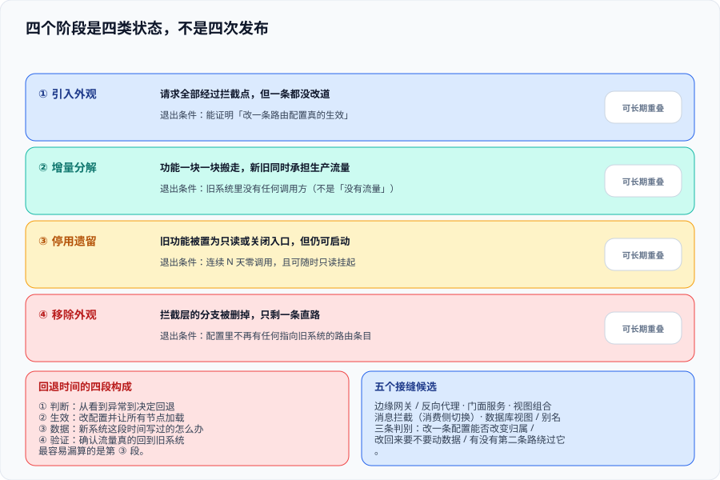

# 绞杀者模式：把替换拆成可回退的步骤

这一页回答的是**「接缝画在哪、流量怎么分流、出问题怎么退回来」**——它是本专题唯一一页在讲「怎么真正切进去」的工程细节。它不讨论该不该改造（那是[总览](../Overview/index.md)的四条边界），也不讨论新旧模型怎么互不污染（那是[防腐层](../AntiCorruption/index.md)）：它只管一件事，**让同一批请求在某一个位置上可以被决定「走旧的还是走新的」，并且这个决定能在一分钟内改回来**。



::: tip 一句话定位
绞杀者的实质不是「分多步做」，而是**在架构里加进一个可切换的接缝**。有了这个接缝，每一步都是一次配置变更；没有这个接缝，每一步都是一次停机发布加一次数据回滚——**后者在日历上也可以叫「分批上线」，但它的风险与大爆炸完全一样**。
:::

## 一、四个阶段是四类状态，不是四次发布

Azure 把它写成四阶段、AWS 写成三步（Transform → Coexist → Eliminate），名字不同但形状一致。容易读错的地方是：**这四类状态可以长期重叠**，而不是排成一队列。

| 阶段 | 系统处在什么状态 | 读者最容易误读成 | 真正的退出条件 |
| --- | --- | --- | --- |
| 引入外观（facade） | 请求全部经过拦截点，但**一条都没改道** | 「搭了个网关」 | 拦截点上线并稳定运行，且能证明「改一条路由配置真的生效」 |
| 增量分解（incremental） | 功能一块一块搬走，新旧同时承担生产流量 | 「进入长期维护期」 | 旧系统里**没有任何调用方**（不是「没有流量」） |
| 停用遗留（disable） | 旧系统的功能被置为只读或关闭入口，但仍可启动 | 「已经下线了」 | 旧系统**连续 N 天零调用**且可随时重新只读挂起 |
| 移除外观（remove facade） | 拦截层的分支被删掉，只剩一条直路 | 「优化」 | 配置文件里不再有任何指向旧系统的路由条目 |

::: warning 说明：为什么第四阶段最难
前三阶段的收益是「风险下降」，第四阶段的收益是「复杂度下降」，而复杂度下降**没有人为它站台**——它不解决任何人的燃眉之急，却要先动一处跑得好好的配置。所以外观层会留下来，跟着系统一起变旧，最后变成第二个遗留系统。**把「删掉外观」写进立项文档的验收项里**，是唯一有效的办法。
:::

## 二、接缝选在哪里：五个候选位置与判别标准

「接缝」（seam）就是那个可以切换请求归属的位置。它必须**唯一**——两个接缝意味着两套决策、两次回退、以及「为什么这个请求没按我说的走」这类无人能答的问题。

| 候选位置 | 怎么切 | 适用前提 | 主要代价 |
| --- | --- | --- | --- |
| 边缘网关 / 反向代理 | 按路径、域名、Header 路由到新旧两套 | 所有流量都经过同一个入口；网关本身高可用 | 网关成为关键路径，需要多副本与限流；**按路径切要求新旧的路由边界与业务边界对齐** |
| 门面服务（facade） | 新建一个薄服务，替调用方转发并做协议转换 | 有多个内部调用方，入口不在边缘 | 多一跳网络与一次序列化；门面自身需要被监控与回退 |
| 视图组合（页面上层） | 页面上同一个位置由两个后端各出一块 | 只在读链路上可行 | 一次页面渲染依赖两套系统，**写操作无法这样切** |
| 消息拦截（消费侧切换） | 同一条消息由新旧两个消费者竞争或双投 | 异步链路、业务允许重复消费 | 消费幂等变成硬前置；顺序性要重新论证 |
| 数据库视图 / 别名 | 把表的读入口换成视图，指向不同的物理表 | 只能切**读**，且 SQL 可被改写成两套都能执行 | 写路径切不过去；视图层容易被绕过 |

判别接缝合不合格，只问三个问题：

1. **改一条配置，能不能改变一批请求的归属？** 不能（要重新部署、要改代码）就不算接缝。
2. **改回来要不要动数据？** 最理想是不要。如果需要回滚数据，那这一步的「回退时间」就必须按数据恢复来算，而不是按配置生效来算。
3. **有没有第二条路绕过它？** 旧系统的调用点本来就散落各处（定时任务、后台脚本、运维工具、报表），**只要有一条旁路，污染与不一致就会从那条路进来**。这就是本专题总览里那条「ACL 必须只有一个入口」的工程版本。

::: danger 注意：接缝选在别人的系统里
最常见的选址错误是把接缝放在**某个别人的服务内部**——比如在订单服务里加一个 `if (useNewInventory)`。你无法单方面推行它（要人家的发版窗口）、无法单独回退它（回退等于回滚人家的服务）、也无法监控它（没有独立的指标出口）。

**正确做法是把接缝放在你能独立部署、独立回退、独立监控的一层上**，即使这一层是为此专门新建的。
:::

## 三、路由的四类维度与两类陷阱

接缝决定了「在哪里切」，路由维度决定「切谁」。四种维度的风险差异极大：

| 维度 | 例子 | 优点 | 风险 |
| --- | --- | --- | --- |
| 按用户 / 账号 | 用户 ID 取模 | **同一个用户的行为一致**，不会看到自己的数据在两套系统间闪烁 | 用户行为集中时，切过去的那 10% 可能是最活跃的 10%，压力分布会骗人 |
| 按租户 | 整租户切换 | 一个租户的完整业务都在同一侧，最容易对账 | 大租户切过去等于一次「小爆炸」，必须按数据量而非按数量排序 |
| 按请求属性 | 渠道、终端、地区、业务类型 | 业务上可解释，出问题能精确描述影响面 | 属性本身可能不准或缺失，回落到默认值时会把不该切的切过去 |
| 按百分比 | 随机比例 | 最容易实现，压测友好 | **同一个用户会在新旧之间反复横跳** |

前两种是「粘性」切法，后两种不粘。粘与不粘的区别，在数据层面被放大：

::: danger 注意：两类路由陷阱
1. **不粘性路由撞上双写延迟**。按百分比路由时，同一个用户在 1 秒内可能既读新库也读旧库。如果两边是异步同步的，用户会看到「刚下的单不见了」——然后刷新一下又出现了。**处置不是加长同步间隔，而是意识到这个维度与异步双写不兼容**，需要改成按用户或按租户。
2. **把「按路径切」当成按业务切**。路由只认 URL 前缀，而一个业务动作往往横跨多个路径（列表页、详情页、提交接口）。只切一半的结果是「新系统的页面调旧系统的接口」，此时**任何一侧的数据都对不上**。路径清单必须在文档里逐条列出来，而不是靠约定「大概就是这几个」。
:::

## 四、回退路径：从「能有」到「算过」

回退不是保险绳，而是主路径的一部分。本专题的总览已经写了判据 `LM-C`（回退时间必须是数字），这里给出**算这个数字的方法**。

回退时间由四段构成，**容易被忽略的是后三段**：

| 段落 | 包含什么 | 常见误算 |
| --- | --- | --- |
| ① 判断时间 | 从「看到异常」到「决定回退」 | 按「有告警就立刻知道」算。实际是：告警先要有人看到、还要有人有权做这个决定 |
| ② 生效时间 | 改配置并让所有节点加载新配置 | 以为配置中心一改就全网生效；实际有缓存、有长连接、有本地文件兜底 |
| ③ 数据处置时间 | 新系统在切换期间写过的数据怎么办 | **完全没算**，于是回退卡在这一步 |
| ④ 验证时间 | 确认回退成功（流量回到旧系统、旧系统真的能承压） | 按「切回去就算好了」算 |

第③段是分水岭，它决定了回退是「改一个开关」还是「做一次数据迁移」：

- **新系统只读**：回退即改路由，③ 的时间为 0。
- **新系统只写新库**：回退要把这段时间的写入增量补回旧库，③ 的时间 = 增量数据的迁移时间。
- **新系统写了旧库**：回退最简单，但会牵出「谁在写哪个库」的口径问题（见[数据迁移](../DataMigration/index.md)）。

::: tip 最佳实践：把回退演练排进日常
回退路径只在**演练过**之后才可信。做法很简单也很少有人做：在流量很小的时段，真实地切一批流量过去、观察、再切回来，全程计时。**演练的收益不是「练熟了」，而是发现那些从没被算进去的段落**——比如配置生效需要重启、比如旧系统在闲置期间被改了配置、比如新系统的定时任务在回退后还在继续跑。
:::

## 五、开关：四类用途，混用就是债务

Pete Hodgson 在 2017 年把特性开关分成四类，**它们的寿命与责任人完全不同**。绞杀者模式用到的开关属于其中两类，把这两类混起来是开关债务的根源。

| 类型 | 用途 | 典型寿命 | 谁负责删它 |
| --- | --- | --- | --- |
| Release toggle | 代码已发布但功能未开放，用来解耦发布与上线 | 天到周 | 发布功能的那个团队 |
| Experiment toggle | A/B 实验分组 | 周到月 | 实验负责人 |
| **Ops toggle** | 降级、限流、熔断、**流量切换** | **长期（可能永久）** | 运维 / SRE（**它不该被删**） |
| Permissioning toggle | 按套餐 / 权限开放功能 | 长期 | 产品 |

改造期的路由开关是 **Ops toggle**：它的寿命是整个共存期，可能长达一两年，而且**必须常驻**——它是回退能力的物理载体，删掉它等于删掉回退路径。

由此得出两条纪律：

1. **不要用 Release toggle 承担切流职责**。Release 开关的默认预期是「用完就删」，让一个即将被删的开关决定流量归属，等于给自己埋一颗定时炸弹。
2. **每一个判断新旧的开关都要有一张「开关台账」**：开关名、当前值、默认值、谁有权改、失效后系统表现成什么样、计划删除日期（Ops 类写「长期保留」）。

::: danger 注意：Knight Capital——开关复用型的教科书事故
2012 年 8 月 1 日，某券商在部署新代码时，8 台服务器中 **7 台**装上了新版本，**1 台**因部署遗漏仍跑旧路径；而新旧路径**复用了同一个特性开关**，那台旧服务器上还有个早已作废的、被重新赋值的标志位。结果该服务器开始以每分钟数十万笔的量发送无主订单，**45 分钟内直接损失约 4.6 亿美元**，公司随后被收购。

三处可从本页直接对应的缺陷：**部署不一致没有被检查**（一台没更新）、**新旧路径共用开关**（本页第五节第 1 条）、**死代码 + 陈旧配置留在生产**（本页第四阶段的「移除外观」从没做过）。

:::

## 六、第一次切流应该切什么

第一次切流的目的**不是兑现业务价值，而是把切流这套流程本身跑一遍**。所以选择标准与「哪个功能最重要」相反：

| 选择标准 | 理由 |
| --- | --- |
| 业务影响面小 | 出问题时的损失可控，且不需要半夜叫醒业务方 |
| 读多写少 | 不涉及数据写入，回退时间接近 0 |
| 依赖少 | 不与多个下游共享状态，失败域清楚 |
| 数据量小 | 即使要补数据，也在分钟级 |
| 有现成的对账手段 | 能立刻判断新旧结果是否一致（见[数据迁移](../DataMigration/index.md)的校验三档） |

反面清单同样明确：**不要拿一个「重要但不常用」的功能做第一次**——它既给不了信心（流量太小，压不出问题），又给不了容错（一旦错了，业务立刻发现）。

## 七、判据清单：`SF-A` ~ `SF-H`

| 判据 | 内容 | 怎么验证 | 状态 |
| --- | --- | --- | --- |
| `SF-A` | 接缝**唯一**，且能被点名（网关 / 门面 / 视图 / 消息 / 库视图五选一） | 全文档搜索新旧边界描述，落点只有一处；不存在「部分在网关、部分在代码里」 | ✅ 已跑 |
| `SF-B` | 改一条配置即可改变一批请求的归属，**不需要重新部署** | 在内网环境真实改一次路由并观察归属变化；若必须重启或发版才能生效，判不合格 | ✅ 已跑 |
| `SF-C` | 路由**维度**被写明，且与数据同步方式兼容（粘性路由 × 异步双写 = 不合格） | 路由配置里能读出维度字段；文档里有一句「为什么选这个维度」 | ✅ 已跑 |
| `SF-D` | 每个功能单元有**独立的路由条目**，不共用一条兜底规则 | 路由表里不存在只有一条 `default → legacy` 的形态；已迁移单元各自成条 | ✅ 已跑 |
| `SF-E` | 回退时间被拆成四段并给出分钟数（含数据处置段） | 回退说明里能分别找到 ①判断 ②生效 ③数据 ④验证 四个数 | ✅ 已跑 |
| `SF-F` | 新旧判断所用的开关被登记为 **Ops 类**，有台账且写明「不删除」 | 台账里该开关的「计划删除日期」列写的是「长期保留」而不是某个日期 | ✅ 已跑 |
| `SF-G` | **第一次切流的目标**写在文档里，且符合「影响面小 / 读多写少 / 依赖少」三条 | 文档里有明确的「首个迁移单元」及其入选理由；理由与三条标准逐条对应 | ✅ 已跑 |
| `SF-H` | 「移除外观」有明确的判据与责任人（第四阶段不是自动到达的） | 文档里能找到外观层的删除条件（旧系统零调用 N 天）与一个具体的人 | ✅ 已跑 |

## 八、如何验证

```shell
# 在本仓库根目录执行（判据对象是本专题页面自身的纪律，不是某个产品）

# 1) 判据族完整性：本页 8 条，族内编号连续
grep -oE '`SF-[A-H]`' docs/Backend/LegacyModernization/Strangler/index.md | sort -u | tr '\n' ' '
# 预期：`SF-A` ... `SF-H` 共 8 个且不重复

# 2) 四个阶段表与五个接缝候选都在
grep -cE '^\| (引入外观|增量分解|停用遗留|移除外观)' docs/Backend/LegacyModernization/Strangler/index.md
grep -cE '^\| (边缘网关|门面服务|视图组合|消息拦截|数据库视图)' docs/Backend/LegacyModernization/Strangler/index.md
# 预期：4 与 5

# 3) 回退时间的四段必须齐（缺任一段就是没算过）
grep -cE '^\| [①②③④] ' docs/Backend/LegacyModernization/Strangler/index.md
# 预期：4

# 4) 四类开关的名称都出现（Pete Hodgson 的分类不能被简化成「开/关」）
grep -oE 'Release toggle|Experiment toggle|Ops toggle|Permissioning toggle' docs/Backend/LegacyModernization/Strangler/index.md | sort -u | wc -l
# 预期：4

# 5) 事故案例带日期与金额（不可只写「某券商出过事」）
grep -cE '2012 年 8 月 1 日|4\.6 亿美元' docs/Backend/LegacyModernization/Strangler/index.md
# 预期：≥ 1
```

这五条命令都不依赖环境、不依赖凭据，任何人拿到同样的读数——它们本身就是判据 `LM-H`（读数能被第二个人复现）的实例。

## 九、常见误判与纠正

::: danger 注意：五个高频误判
1. **「我们已经在用网关，所以已经是绞杀者了」**——网关只是**可能**的接缝位置。判据是「改一条配置能不能改变归属」，不是「有没有网关」。
2. **「先切 50%，反正有回退」**——第一次切流不应该以覆盖率为目标。覆盖率高意味着失败影响面大，而你要练的是流程而不是覆盖率。**第一次切 5% 并且有意演练一次回退，比一次切 50% 更有价值。**
3. **「旧系统没人调了，可以下掉了」**——「没有流量」与「没有调用方」是两件事。定时任务、月结报表、运维脚本可能是月频的。判据是**连续 N 天零调用**，N 要覆盖最长的那一个周期（通常是月度结算）。
4. **「回退就是改回去」**——只要新系统在生产期间写过数据，回退就包含第③段。见本页第四节。
5. **「外观层以后有空再删」**——「以后」不会到达。见本页第一节的说明框。
:::

::: tip 最佳实践：每一步都要求一个「半小时内可退」的证据
把「这一步能不能在半小时内退回去」作为**推进下一步的前置条件**，而不是作为事后检查项。具体做法：每一步的完成定义里包含一次**真实回退演练**及其计时记录。做不到半小时就说明这一步拆得还不够小——**拆细，而不是延长预算**。
:::

## 参考资料

- [Martin Fowler · StranglerFigApplication](https://martinfowler.com/bliki/StranglerFigApplication.html)：模式起源、比喻与「何时不该用」
- [Azure Architecture Center · Strangler Fig pattern](https://learn.microsoft.com/azure/architecture/patterns/strangler-fig)：四阶段划分与不适用场景
- [AWS Prescriptive Guidance · Decomposing monoliths into microservices](https://docs.aws.amazon.com/prescriptive-guidance/latest/modernization-decomposing-monoliths/)：Transform / Coexist / Eliminate 三步与代理层风险提示
- [Martin Fowler · BranchByAbstraction](https://martinfowler.com/bliki/BranchByAbstraction.html)：边缘拦不到时的替代路径
- [Pete Hodgson · Feature Toggles (aka Feature Flags)](https://martinfowler.com/articles/feature-toggles.html)：四类开关的分类、寿命与责任人
- [SEC · Administrative Proceeding, Knight Capital Americas LLC（2013）](https://www.sec.gov/litigation/admin/2013/34-70694.pdf)：开关复用型事故的原始文档
