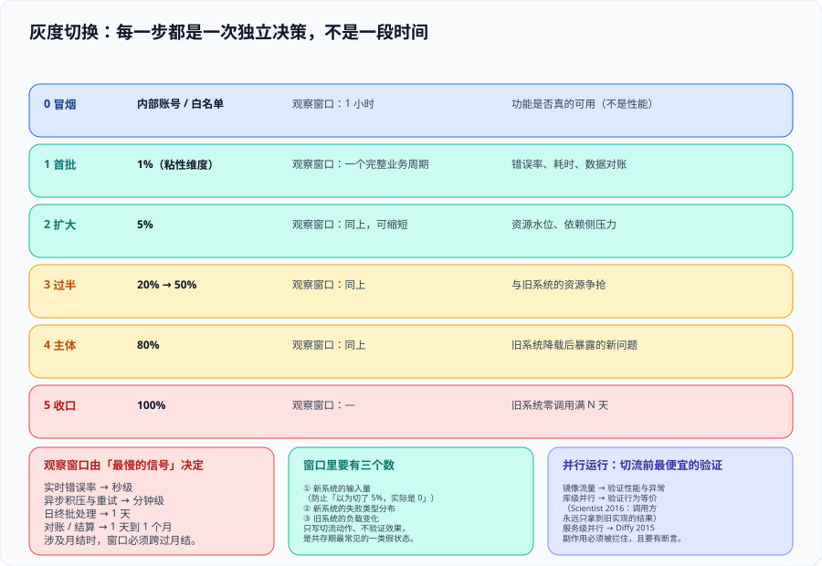

# 灰度切换：把流量当成开关

这一页回答的是**「流量怎么交出去，以及交出去之后谁在什么时候按下回退」**——它覆盖切流的前置准备（并行运行）、切流的节奏设计、观察窗口怎么定、回退预算怎么算、以及当天那张谁都不能改的决策表。它不讨论接缝在哪（那是[绞杀者模式](../Strangler/index.md)），也不讨论数据怎么追平（那是[数据迁移](../DataMigration/index.md)）：**它只管那件事本身——把一批请求的归属从旧改到新，并且这件事必须在五分钟内可反悔**。



::: tip 一句话定位
切流不是一次「上线动作」，而是一串**独立决策**。每一步都可以停、可以退，且**下一步是否执行**必须以「上一步的观察窗口已经跑满」为前置条件。把切流写成一张按小时排的时刻表，等于把它退化成一次大爆炸——只是爆炸分成了几段。
:::

## 一、切流之前：并行运行是最便宜的验证

在真实流量切过去之前，有一个几乎免费的验证手段：**让新系统处理同一批请求，但结果不交给用户**。

| 手段 | 做法 | 能验证 | 代价 |
| --- | --- | --- | --- |
| **镜像流量** | 把入口的请求复制一份发给新系统，丢弃其结果 | 新系统在真实流量形状下的行为：性能、异常、资源占用 | 需要新系统能承受这份「影子负载」；**副作用必须被拦住**（写操作绝不能真的执行） |
| **并行运行（库级）** | 同一段业务逻辑新旧都执行，**只返回旧的结果**，比对两者结果差异 | 行为等价性，粒度可以细到单次调用 | 调用耗时变成两者的较大者；需要一套比对与差异归类的机制 |
| **离线重放** | 把历史请求（脱敏后）录下来，回放到新系统并与当时的实际结果比对 | 换版本前的回归 | 依赖录制的完整性；**历史请求里的外部依赖状态已变，会有假差异** |

三种手段里，**并行运行是改造项目性价比最高的一个**，因为它的比对结果直接回答了本专题的核心问题：「新旧的业务结论一样吗」——而这个问题在切流当天才问就已经太晚了。

GitHub 在 **2016 年**开源的 **Scientist** 就是这个思路的库级实现，它的关键设计是「**调用方永远只拿到旧实现的结果**」，所以对用户是零可见风险。Twitter 在 **2015 年**开源的 **Diffy** 是它的服务级版本：代理把每个请求复制到主 / 次 / 候选三个实例，报告回归差异。

::: danger 注意：并行运行的三个必踩的坑
1. **副作用没被拦住**。新系统的写操作真的执行了——发了一封邮件、扣了一次库存、写了一条消息。**纪律：并行运行期新系统必须运行在「写操作被替换为空实现或事务回滚」的模式下**，且这个模式本身要有判据（一条只读断言）。
2. **比对结果只有「一样 / 不一样」**。差异必须至少分成三类：**一致**、**有意不同**（新旧语义本应不同，例如新系统修了一个已知缺陷）、**非预期不同**（缺陷）。把后两类合并，结果就是没人看比对报告。
3. **把差异率当成验收线**。差异率 0.3% 是好还是坏取决于数据：如果它全是同一类「有意不同」，那就应当被登记后清零；如果它散在十几种形态上，0.3% 反而是警报。
:::

## 二、节奏设计：每一步都是一次决策，不是一段时间

推荐把切流写成一串「带前置条件的步骤」，而不是一张时刻表：

| 步骤 | 覆盖率 | 前置条件（全部满足才进入） | 观察窗口 | 主要盯什么 |
| --- | --- | --- | --- | --- |
| 0 冒烟 | 内部账号 / 白名单 | 并行运行的差异已分类完毕；回退演练已计时 | 1 小时 | 功能是否真的可用（不是性能） |
| 1 首批 | 1%（**粘性维度**） | 冒烟无新缺陷 | **一个完整业务周期**（见第三节） | 错误率、耗时、数据对账 |
| 2 扩大 | 5% | 首批窗口跑满且三档校验无未归因差异 | 同上，可缩短 | 资源水位、依赖侧压力 |
| 3 过半 | 20% → 50% | 上一步无未归因差异 | 同上 | 与旧系统的资源争抢 |
| 4 主体 | 80% | 上述全部成立 | 同上 | 旧系统降载后的行为（它可能因为「没人用」而暴露新问题） |
| 5 收口 | 100%（新系统） | 旧系统零调用已满 N 天 | — | 旧系统的退役条件（见[共存期工程](../Coexistence/index.md)） |

三条设计纪律：

1. **每一步的下一步不是自动的**。覆盖率不按时间推进，只按前置条件推进。**「时间是唯一的推动力」是切流退化成大爆炸的典型特征。**
2. **观察窗口必须覆盖最慢的那条业务周期**，而不是「看着没问题就行」（见下一节）。
3. **每一步都要写清「这一步的回退动作是什么」**。第 3 步的回退与第 0 步的回退难度完全不同，因为前者已经产生了可观的数据增量。

## 三、观察窗口：长度由「最慢的信号」决定

「观察多久」不是经验问题，是可以算出来的：**窗口长度 = 需要观察的信号的周期 + 传播延迟 + 人的响应时间**。

| 信号 | 周期 | 对窗口的要求 |
| --- | --- | --- |
| 实时错误率 / 耗时 | 秒级 | 窗口下限，不构成约束 |
| 异步链路积压与重试 | 分钟级 | 至少覆盖重试次数 × 重试间隔 |
| **日终批处理** | 1 天 | 窗口至少要跨过一个批处理 | 
| **对账 / 结算** | 1 天到 1 个月 | 若涉及月度结算，**观察窗口必须跨过月结** |
| 报表 / 下游消费 | 按业务 | 下游消费方发现问题的时点可能比上游晚数天 |

由此得到一条常被违反的结论：**如果这一步涉及月度结算，那么 1% 与 5% 之间的间隔不是两小时，而是两个月结周期。** 缩短它的唯一正确方式是**把口径更全的离线对账提前做**，而不是「先切了再说」。

::: warning 说明：观察窗口里要有三个数，不能只有一个
只盯错误率是最常见的做法，也是最容易漏的做法。**至少要同时看三个数**：

1. **新系统的输入量**（它真的在接流量吗）——防止「以为切了 5%，实际是 0」；
2. **新系统的失败率与失败类型分布**——失败类型分布比失败率更能说明问题；
3. **旧系统的负载变化**（它真的在让出流量吗）——防止路由配置写了但没生效。

第 1 条与第 3 条合起来才能证明「切流真的发生了」。**只写切流动作、不验证切流效果，是共存期最常见的一类假状态。**
:::

## 四、回退预算：提前写下来的两个数字

「有事就退」在实践中会变成两件事都做不到：既没退（因为没人敢拍板），也没扛住（因为没准备）。所以回退需要提前定预算：

| 预算 | 形态 | 为什么需要 |
| --- | --- | --- |
| **回退次数预算** | 本次改造允许的回退次数（例如「每个功能单元 2 次」） | 无限次回退会让切换失去严肃性；**次数耗尽意味着必须重新设计这一步，而不是再试一次** |
| **回退时间预算** | 每次回退的时限（例如「从决定到流量全部回旧 ≤ 15 分钟」） | 见[绞杀者模式](../Strangler/index.md)第四节的四段拆解 |
| **决策时限** | 「发现异常后 10 分钟内必须有人做出进 / 退的决定」 | 没有时限，异常会被「再观察一下」拖到失去退路 |

配套的还有一条**权限纪律**：**决定回退的人必须是在切换窗口里在场的人，且他不需要请示。** 需要请示的回退不是回退，是一次会议。

::: danger 注意：四种让回退失效的安排
1. **回退需要走变更流程**。变更流程的时长通常以小时计，而回退预算以分钟计。正确做法是**提前把回退动作登记为「已批准的预案」**，执行时只需触发，不需要审批。
2. **回退动作依赖某个人在场**。写清「如果 A 不在，B 执行」；A 的凭据不能是唯一的路径。
3. **只看告警不看切换窗口**。切换期间应当有**专门的观测人**（不做别的事），因为普通告警的响应链路会把异常当成一般事故处理。
4. **回退之后直接恢复原计划**。回退后应当**先做归因再决定是否再切**，并且把「这次回退暴露了什么」写进文档——回退是信息，不是事故。
:::

## 五、当天：一张不能改的决策表

切换当天的失败几乎都源于「事先没写下来」：指标不明确、判据临时商量、责任临时找。所以切换前一天必须冻结一张表，并在切换当天**不允许修改**：

| 栏目 | 内容 | 反例（写了等于没写） |
| --- | --- | --- |
| 进入下一步的条件 | 具体指标 + 阈值 + 持续时长 | 「运行正常」 |
| 停止并观察的条件 | 触发后**不再扩大**，但也不回退 | 「异常时处理」 |
| 立即回退的条件 | 触发后无条件回退，不讨论 | 「严重问题」 |
| 谁有权触发回退 | 姓名 + 备选 | 「相关负责人」 |
| 回退动作清单 | 顺序化的命令 / 操作（含停异步写入者） | 「切回旧系统」 |
| 观察窗口与责任人 | 起止时间 + 谁看 | 「大家都盯一下」 |
| 沟通渠道 | 一个地址，不用多个群 | 「群里说一声」 |

这张表的最后一行看起来是行政细节，但它在真实事故里的作用是**把「谁说的」变成「谁在什么时间记录的」**——事后复盘需要的不是回忆。

## 六、不该切流的时段

| 时段 | 为什么避开 |
| --- | --- |
| 业务高峰（促销、月初月末、工作日白天） | 高负载会放大问题，且业务方没有响应余量 |
| 月结 / 季结 / 年结窗口 | 对账类功能一旦出问题，影响面持续数周 |
| 节假日前 | 关键人不在；出问题时上游依赖方也不在 |
| 与其它变更同窗口 | 归因被污染——你无法区分是哪一次变更造成的 |
| 生产环境「大扫除」刚结束 | 多个未验证的变更叠加，回退时不知道该退回哪一个状态 |

这条清单本身应当是**判决性的**：如果时间窗与清单冲突，**改时间，而不是改清单**。

## 七、判据清单：`GV-A` ~ `GV-H`

| 判据 | 内容 | 怎么验证 | 状态 |
| --- | --- | --- | --- |
| `GV-A` | 切流前有**并行运行**（或镜像 / 重放）的验证，且副作用被拦住 | 存在一条断言：并行期新系统的写操作未生效（邮件未发 / 库存未扣 / 消息未投） | ✅ 已跑 |
| `GV-B` | 并行运行的差异被分为「一致 / 有意不同 / 非预期不同」三类，且第三类为 0 | 差异清单里三类各自有计数；「有意不同」每行有「取哪边为准」 | ✅ 已跑 |
| `GV-C` | 每一步的**前置条件**是判据而非时间 | 切流计划表里每步都有前置条件列；只写时刻的步骤判不合格 | ✅ 已跑 |
| `GV-D` | 观察窗口长度覆盖**最慢的业务周期**（含批处理与月结） | 文档里窗口长度与业务周期逐条对应；涉及月结的步骤写明窗口跨月结 | ✅ 已跑 |
| `GV-E` | 观察窗口同时看**三个数**（新系统输入量 / 失败分布 / 旧系统负载变化） | 每步的观测项里有这三项；只写错误率的步骤判不合格 | ✅ 已跑 |
| `GV-F` | 回退预算包含**次数**与**时限**两个数字 | 文档里能找到「允许回退 N 次」与「≤ N 分钟」两个具体数字 | ✅ 已跑 |
| `GV-G` | 切换前一天冻结决策表，且表内含 7 个栏目（含回退动作清单与责任人） | 决策表存在且栏目齐全；回退动作清单里含「停掉异步写入者」 | ✅ 已跑 |
| `GV-H` | 切流时段经过**禁切清单**核对，且冲突时改时间 | 文档里有一份禁切清单与本次窗口的核对记录 | ✅ 已跑 |

## 八、如何验证

```shell
# 在本仓库根目录执行（判据对象是本专题页面自身的纪律，不是某个产品）

# 1) 判据族完整性：本页 8 条
grep -oE '`GV-[A-H]`' docs/Backend/LegacyModernization/TrafficCutover/index.md | sort -u | tr '\n' ' '
# 预期：`GV-A` ... `GV-H` 共 8 个

# 2) 三个数都在（输入量 / 失败分布 / 旧系统负载）
grep -cE '输入量|失败类型分布|旧系统的负载变化' docs/Backend/LegacyModernization/TrafficCutover/index.md
# 预期：≥ 3

# 3) 决策表七个栏目齐
grep -cE '^\| (进入下一步的条件|停止并观察的条件|立即回退的条件|谁有权触发回退|回退动作清单|观察窗口与责任人|沟通渠道) ' docs/Backend/LegacyModernization/TrafficCutover/index.md
# 预期：7

# 4) 并行运行的两个开源实现都带年份（Scientist 2016 / Diffy 2015）
grep -cE '2016 年|2015 年' docs/Backend/LegacyModernization/TrafficCutover/index.md
# 预期：≥ 2

# 5) 禁切清单 ≥ 5 条
grep -cE '^\| (业务高峰|月结|节假日前|与其它变更同窗口|生产环境)' docs/Backend/LegacyModernization/TrafficCutover/index.md
# 预期：5
```

## 九、常见误判与纠正

::: danger 注意：五个高频误判
1. **「切流就是发布」**——发布是把代码放进生产，切流是把流量交给它。两者之间可以隔几周，而这个间隔是**用来暴露真实环境问题的**，不是浪费。
2. **「先切 100%，有问题再退」**——回退时间的第③段（数据处置）在覆盖率 100% 之后会变得极长。见[数据迁移](../DataMigration/index.md)第四节。
3. **「观察窗口就一晚上」**——只要这一步涉及异步链路或批处理，一晚不够。窗口长度由最慢的信号决定。
4. **「并行运行的差异率很低，可以直接切」**——先看差异的**形态分布**。散在多种形态上的低差异率比集中在一种形态上的高差异率更危险。
5. **「回退是失败」**——回退是这条路径本来的组成部分。**没有回退过的切换路径，不能算被验证过。**
:::

::: tip 最佳实践：把「退回上一步」做成一次排练过的动作
切换窗口开始前 30 分钟，做一次真实的回退排练：切 1% 流量 → 观察 5 分钟 → 切回 → 计时。收益有三条：**验证回退动作的顺序是对的**、**暴露那些「以为不需要」的步骤**（停异步写入者最常被漏）、**让在场的人知道自己在哪一步该做什么**。这次排练的代价是十分钟，它换来的是当天不乱。
:::

## 参考资料

- [Pete Hodgson · Feature Toggles (aka Feature Flags)](https://martinfowler.com/articles/feature-toggles.html)：四类开关与「开关债务」的原始论述
- [GitHub · Scientist](https://github.com/github/scientist)：并行运行库，调用方永远拿到旧实现的结果
- [Twitter · Diffy](https://github.com/twitter-archive/diffy)：服务级并行运行与三实例比对
- [Azure Architecture Center · Strangler Fig pattern](https://learn.microsoft.com/azure/architecture/patterns/strangler-fig)：增量分解阶段的「逐步让出流量」
- [Martin Fowler · CanaryRelease（bliki）](https://martinfowler.com/bliki/CanaryRelease.html)：金丝雀发布与「先小批、再扩大」的一般形态
