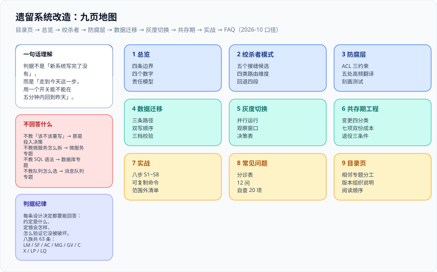

# 遗留系统改造

<p style="text-align:center;"></p>



这一页讲的是**一个已经在跑、不能停、也没人完全懂的系统，怎么在不停止服务的前提下被换掉**。它不回答「该不该重写」——那是投入决策；它回答的是**如果必须换，怎么把一次几年的「大爆炸」拆成二十次可回退的小步，并且在每一步上都能说清楚「现在新旧各承担多少、出问题多久能退回去」**。

本专题的主线是 **边界（改与不改的分界）→ 绞杀者（怎么切进去）→ 防腐层（新旧模型怎么不互相污染）→ 数据迁移（数据怎么跟着走）→ 灰度切换（流量怎么交出去）→ 共存期工程（两套系统同时活着时的约束）→ 落地路线**，每一步都配一条可本机跑的判据。

::: tip 一句话理解
**遗留系统改造的产出不是「一个新系统」，而是「一条每一步都能退回去的路径」。** 判据不是「新系统写完了没有」，而是「**走到今天这一步，用一个开关能不能在五分钟内回到昨天**」。
:::

- [总览：四条边界与改造判据](Overview/index.md)
- [绞杀者模式：把替换拆成可回退的步骤](Strangler/index.md)
- [防腐层：让旧模型停在一层里](AntiCorruption/index.md)
- [数据迁移：双写、追平与三档校验](DataMigration/index.md)
- [灰度切换：把流量当成开关](TrafficCutover/index.md)
- [共存期工程：两套系统同时活着时的约束](Coexistence/index.md)
- [实战：从单体到新服务的一次完整改造](Practice/index.md)
- [常见问题与最佳实践](FAQ/index.md)

## 本专题的判据纪律

本专题每一页都配一张「判据定义表」：每条设计决定都要能回答三件事——**约定是什么、定错会怎样、怎么验证它没被破坏**。判据族前缀与数量如下，便于逐页对照。

| 页面 | 判据族 | 数量 |
| --- | --- | --- |
| 总览：四条边界与改造判据 | `LM-A` | 8 |
| 绞杀者模式 | `SF-A` | 8 |
| 防腐层 | `AC-A` | 8 |
| 数据迁移与双写 | `MG-A` | 8 |
| 灰度切换 | `GV-A` | 8 |
| 共存期工程 | `CX-A` | 8 |
| 实战 | `LP-A` | 8 |
| 常见问题 | `LQ-A` | 7 |

合计 **63 条**判据。它们**逐页独立**（同一族内编号连续、跨族不复用前缀），不做「总判据表」——因为「把 63 条汇总成一张表」的结果是没人会读它，而每一页的读者只关心自己这一页的判据。

## 2026-10 事实与规格速览（核对时间 2026-10）

下表按 **2026-10** 的官方发布页核对。**这张表会过期，而且比你想象的快**——本专题管的领域里，一条工具的版本号改一次，「我们用什么做 CDC」这段建议就可能要重写。所以每一页的结论后面都带核对日期，而不是写「当前最新」；本库的硬纪律是：**没有日期的「最新」等于没有信息**。

| 出处 | 模式 / 资产 | 日期或版本（核对时间 2026-10） | 要点 |
| --- | --- | --- | --- |
| Martin Fowler · bliki | **StranglerFigApplication** | 名字由 Fowler **2004 年**提出 | 取自昆士兰雨林里绞杀榕的比喻（2001 年所见）；后改称 Strangler **Fig** Application 以显明来源。**这不是一个新概念，是一份 20 年的共识** |
| Azure Architecture Center | **Strangler Fig pattern** | 四阶段：引入外观 → 增量分解 → 停用遗留 → 移除外观 | 不适用：**请求无法被拦截** / 拿不到遗留源码以停用已迁移功能 / 系统本身很小 / 需要快速下线 |
| AWS Prescriptive Guidance | **绞杀者模式（Transform → Coexist → Eliminate）** | 三步迁移法 | 不适用：请求**无法在边缘拦截并路由**；明确警告**代理层可能变成单点故障或性能瓶颈** |
| AWS Prescriptive Guidance | **Branch by Abstraction** | 六步：找组件 → 建抽象 → 改调用方 → 新实现 → 切换 → 清理 | 用于「遗留栈**深处**、有上游依赖、边缘拦不到」的组件；**AWS 原文写明它「不适合涉及数据一致性的场景」** |
| Jez Humble（Go CD） | Branch by Abstraction 的工程实录 | 在生产上换掉 iBatis→Hibernate、Velocity→JRuby on Rails，**连续发布一年多不停** | 关键纪律是一句话：**新的调用一律不许再走旧实现** |
| martinfowler.com bliki | **Parallel Change**（也叫 expand / migrate / contract） | **Danilo Sato，2014-05-13** | 把不兼容的接口变更切成**三个各自可发布**的阶段；这也是**绝大多数数据库重构**的标准手法 |
| Eric Evans | **Anti-Corruption Layer（ACL）** | 《Domain-Driven Design》，**2003**，Part IV「Strategic Design」第 14 章 | 由 FACADE（上游术语）+ ADAPTER（翻译）+ 领域服务组成；**ACL 自身也是一个限界上下文**，它的语言就是「翻译」 |
| Pete Hodgson · martinfowler.com | **Feature Toggles（aka Feature Flags）四类** | **2017-10** | Release / Experiment / Ops / Permissioning；**四类的寿命与责任人不同，混为一谈是开关债务的根源** |
| 事故案例（SEC 2013 行政程序） | **Knight Capital** | 事故日 **2012-08-01**；直接损失约 **4.6 亿美元** | 8 台服务器中 **7 台**部署了新代码、**1 台**仍跑旧路径且复用了同一个开关 → 这就是「死代码 + 陈旧配置」型事故的教科书 |
| GitHub | **Scientist** | **2016 年**开源 | 并行运行：新旧都执行、结果比对，**调用方永远只拿到旧实现的结果**——零用户可见风险 |
| Twitter | **Diffy** | **2015 年** | 服务级并行运行：代理把每个请求复制到三个实例（主 / 次 / 候选）并报告回归 |
| Debezium | **3.7.0.Final** | **2026-09-29** 发布 | **18** 个源连接器 / **25** 个汇连接器；3.7 起 Oracle 12 的连续挖掘被**移除**（改用 LogMiner）；`debezium-core` 自 **3.5.0.CR1** 起更名为 `debezium-connector-common` |
| 中国 · 强制标准 | **GB/T 22239-2019（等保 2.0）** | 第三级信息系统**每年至少一次**等级测评 | 改造若涉及安全域，**不是做一次备案就一劳永逸**；同时要求国密 **SM2/SM3/SM4** 与**三员分立**（系统 / 安全 / 审计管理员） |

::: warning 说明：三条时间线互不同步
**模式提出 ≠ 官方推荐 ≠ 工具版本**。绞杀者模式 2004 年就写出来了，但 Azure 与 AWS 把它写成「官方推荐模式」是后来各自文档体系里的动作；而 Debezium 3.7 的破坏性变更（Oracle 12 连续挖掘移除）与模式本身毫无关系，却可能让你上周还能跑的数据管道今天起不来。页面里凡出现日期，都写明**它属于哪条线**（哪个文档、哪一版、哪个生效日）。
:::

## 版本组织说明：为什么本专题不建版本目录

本库对**大版本差异**的处理办法是建版本目录（`docs/Backend/Java/Frame/Spring/Spring5/` 与 `Spring6/`、`docs/Backend/Java/Frame/SpringBoot/v2/` 与 `v3/`、`docs/Backend/Java/Frame/SpringCloud/SpringCloud2020/` 与 `SpringCloud2022/`、`docs/Frontend/Frame/Vue/Vue2/` 与 `Vue3/`），旧版本目录**保留并在页首标注维护状态，不覆盖旧内容**。

「遗留系统改造」**不按这个办法组织**，理由有三条：

1. **它不是一个产品的名字，没有「第 5 版 / 第 6 版」两条并行内容线**。对比：`Spring5` 与 `Spring6` 是两条需要长期并存的技术线，因为**存量系统还在跑**——这恰恰说明「按大版本建目录」这个办法是为**具体技术栈**准备的。本专题的「版本」是它**引用的那些模式**的年份（2003 / 2004 / 2014 / 2017），而这些模式**没有新旧并存问题**：Parallel Change 不会因为某个新框架出现而「还有人在用旧版」。
2. **它天然是「过程」而不是「制品」**。绞杀者模式的价值在于**顺序**，而顺序不属于任何版本。把 2004 年的说法与 2024 年的说法分成两个目录，读者拿到的会是两份「什么时候先做什么」——**而这两份本该是同一份**。
3. **它服务的是「存量」这件事本身，而存量永远在现场**。这也是本专题与库内其他主题最根本的不同：Spring 6 的文档写给「要新建一个 Spring 项目的人」，本专题的文档写给「手上已经有一个不许停的系统的人」——**后者的约束条件每天都在变（业务在长、人在走、依赖在升级），但模式不变**。

::: info 旧版本内容怎么保留
本专题**不删除、不改写**库内任何既有的大版本目录内容（`Spring5`～`SpringCloud2022` 等一律原样保留），也**不覆盖**库内既有的两条相关表述：`Backend/Microservices/Overview` 里那句「不要大爆炸式重构，优先采用绞杀者模式」与 `Backend/DDD/StrategicDesign` 里那条「防腐层不是可选项，是默认项」——本专题是把它们**展开**，不是把它们重写。
:::

## 相关专题与分工

本专题与库内八个相邻专题存在明确边界，**互不替代**：

| 相邻专题 | 它讲什么 | 本专题讲什么 |
| --- | --- | --- |
| [设计模式](../DesignPatterns/index.md) | 单个模式的定义、结构、适用场景与代码形态 | **模式的组合顺序**：什么时候先用绞杀者、什么时候只能退到 Branch by Abstraction |
| [重构实践](../DesignPatterns/RefactorPractice/index.md) | 在**一个代码库内**怎么安全地改结构 | 本专题管的是**跨进程边界**的替换；代码库内的那一步归那边 |
| [领域驱动设计](../DDD/index.md) | 限界上下文、上下文映射、ACL 的**概念定义** | ACL 在**改造场景**里的工程约束：它也是并存系统的一个、它会被谁绕过、它什么时候该退役 |
| [微服务](../Microservices/index.md) | 「拆成什么样」：边界怎么划、服务怎么分 | 「**怎么拆过去**」：接缝在哪、流量怎么交、数据怎么跟、出问题怎么退 |
| [Go 微服务](../GoMicroservices/index.md) | 另一条技术栈上的落地形态 | 技术栈无关：本专题的判据在 Go、Java、.NET 上写法不同，**读数一样** |
| [数据治理入门](../../DB/DataGovernance/index.md) | 元数据、血缘、质量规则、组织与流程 | 治理管「这份数据**可不可信**」；本专题管「它在**迁移期**怎么保证两边一致、不一致了怎么发现」 |
| [消息队列](../MessageQueue/index.md) | 消息中间件的能力、语义与可靠投递 | 本专题用它的地方只有两处：**事务性发件箱**与 **CDC 事件流**；队列自身怎么选归那边 |
| [完整项目交付](../../Others/ProjectDelivery/index.md) | 需求到上线的项目流程方法论 | 交付清单里**「替换」这一类项目**多出来的那几行：回退预算、双跑期、退役条件 |

一句话判据：**要问「这个系统该不该拆成微服务」，去微服务专题；要问「拆的过程中这半年怎么活下来」，来本专题。**

## 建议阅读顺序

```text
Overview（四条边界：先分清是「改」还是「换」）
  → Strangler（切进去：接缝、拦截面、路由、回退）
  → AntiCorruption（新模型不被旧模型污染）
  → DataMigration（数据怎么走：双写顺序、追平、三档校验）
  → TrafficCutover（流量怎么交：切流维度、观察窗口、回退预算）
  → Coexistence（两套同时活着时的硬约束）
  → Practice（照着走一遍，跑通 LP-A~LP-H）
  → FAQ（分诊树）
```

::: tip 给「只看一页」的读者
如果你现在就要做决定，只看 [总览](Overview/index.md) 的「四条边界」与 [灰度切换](TrafficCutover/index.md) 的「回退预算」两节——**前者决定你该不该动手，后者决定你动手之后能不能收场**。
:::

## 与「契约演进与兼容」专题的分工

本页讲**系统级**的渐进替换：绞杀者模式、双跑比对、流量切分、旧系统退场。

[契约演进与兼容](../ContractEvolution/index.md) 把同一套思路下沉到**契约级**——一次字段、一张表、一个消息体的演进。

| 层级 | 本页 | 契约演进专题 |
| --- | --- | --- |
| 单位 | 系统 / 模块 | 字段 / 表 / 事件 |
| 核心手法 | 绞杀者、双跑、灰度切流 | expand-contract 四阶段、双写 + 影子读 |
| 回滚边界 | 切回旧系统 | [删除三条件](../ContractEvolution/SchemaEvolution/index.md)：无读、无写、无回滚需求 |
| 不可逆点 | 旧系统下线 | 老列停止写入 / 旧路由删除 |

::: tip 两页共享的同一条纪律
**「承认下不掉」比「假装下掉了」安全。** 本页对应的是「旧系统保留只读模式」；专题对应的是「长尾调用方保留最小实现 + `legacy-frozen` 标记」。
:::

## 与「批量数据交换工程」的分工（第 208 天补充）

遗留系统改造里，**数据搬迁十有八九是以文件为媒介的**：老系统导出一份 CSV/DBF，新系统导入。本页讲改造策略与阶段划分，[批量数据交换工程](../BulkDataExchange/index.md) 提供搬迁那一段的工程纪律。

| 阶段 | 本页 | 专题 |
| --- | --- | --- |
| 搬迁前 | 数据盘点、字段映射、割接方案 | 文件契约（列定义、单位、日期格式、版本标记） |
| 搬迁中 | 双写、灰度、旁路校验 | 批次幂等、部分成功、错误回执、断点续跑 |
| 搬迁后 | 对账、回滚预案 | 快照导出 + 口径页（否则对账没有基准） |

::: danger 迁移脚本最容易漏的一条
**一次性迁移脚本通常没有幂等键**。理由是「只跑一次」，但现实是：割接当晚跑失败、第二天重跑、发现字段映射错了修完再跑——每一次都往新库里追加一批数据，而没人会去核 `count(*)` 是 1 倍还是 3 倍。做法与批量导入一致：先算源文件哈希做批次号，目标表建业务唯一键，重跑一律 upsert。代价是多两行 DDL，收益是「割接失败可以放心重来」。
:::

## 参考资料

- [Martin Fowler · StranglerFigApplication](https://martinfowler.com/bliki/StranglerFigApplication.html)：绞杀者模式的原出处
- [Azure Architecture Center · Strangler Fig pattern](https://learn.microsoft.com/azure/architecture/patterns/strangler-fig)：四阶段划分与「不适用场景」
- [AWS Prescriptive Guidance · Decomposing monoliths into microservices](https://docs.aws.amazon.com/prescriptive-guidance/latest/modernization-decomposing-monoliths/)：Transform / Coexist / Eliminate 三步法与 Branch by Abstraction 的六步
- [Martin Fowler · BranchByAbstraction](https://martinfowler.com/bliki/BranchByAbstraction.html)：单代码库内换实现的做法
- [Danilo Sato · Parallel Change（martinfowler.com bliki，2014-05-13）](https://martinfowler.com/bliki/ParallelChange.html)：expand / migrate / contract 三阶段
- [Pete Hodgson · Feature Toggles (aka Feature Flags)](https://martinfowler.com/articles/feature-toggles.html)：四类开关的分类与寿命
- [Azure Architecture Center · Anti-Corruption Layer pattern](https://learn.microsoft.com/azure/architecture/patterns/anti-corruption-layer)：ACL 的结构、代价与「不要把业务规则放进去」
- [Eric Evans · Domain-Driven Design（2003）](https://www.oreilly.com/library/view/domain-driven-design-tackling/0321125215/)：ACL 的原始出处（Part IV Strategic Design）
- [Debezium · Releases](https://debezium.io/releases/)：CDC 连接器版本与破坏性变更
- [GitHub · Scientist](https://github.com/github/scientist)：并行运行库的原始实现
- [SEC · Administrative Proceeding, Knight Capital Americas LLC（2013）](https://www.sec.gov/litigation/admin/2013/34-70694.pdf)：开关复用型事故的原始文档
