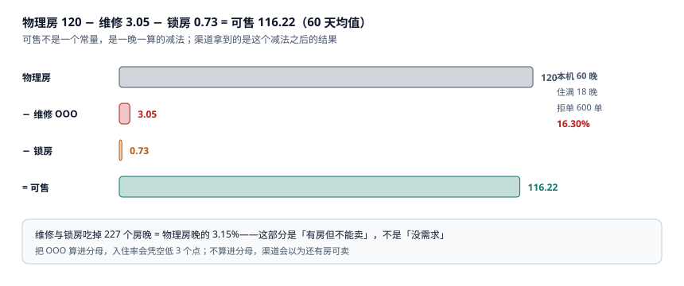

# 可售库存与超售额度

渠道经理最常问的一句话是「今晚还能卖几间」。这句话有三个完全不同的答案：

- 前台说「还有 6 间空房」——这是**物理房**里没人住的。
- 库存服务说「还能卖 4 间」——这是**扣掉维修与锁房**之后的。
- 渠道后台显示「剩余 2 间」——这是**这个渠道分到的那份**还没卖完的。

三个数都来自同一批房，相差的 4 间不是因为谁算错了，而是因为**它们减的东西不一样**。

::: tip 一句话理解
可售不是常量，是一晚一算的减法：`物理房 − 维修 − 锁房`。渠道拿到的又是这个减法之后**按分配切开的一份**，所以「分配之和」必须小于等于「可售」，否则超卖不是 bug，是配置。
:::

## 一、四数减法与它的三个版本



本机 60 晚 × 120 间房：

| 项 | 均值 | 60 晚累计 | 占物理房晚 |
| --- | --- | --- | --- |
| 物理房 | 120.00 | 7,200 | 100% |
| 维修停售 `OOO` | 3.05 | 183 | 2.54% |
| 锁房 `HOUSE_USE` | 0.73 | 44 | 0.61% |
| **可售** | **116.22** | **6,973** | 96.85% |

那 227 个房晚（3.15%）是**「有房但不能卖」**，不是「没需求」。这个区分很重要：

- 如果把 OOO 算进分母，入住率是 6,585 / 7,200 = **91.46%**，看起来「还有 9 个点的空间」。
- 如果不算，是 6,585 / 6,973 = **94.44%**，说明「能卖的基本卖完了」。
- 如果再扣掉当晚临时停售，是 96.37%，说明「开了门就没空过」。

同一批房、同一个分子，**分母选谁决定了结论是「还有余量」还是「已经饱和」**。集团同比要用物理口径（分母稳定），单店运营要用可售口径（反映真实供给），两者都不能拿去对外宣传。

## 二、池子与取水口：allotment 的两种模型

| 模型 | 做法 | 优点 | 代价 |
| --- | --- | --- | --- |
| 池子（pool） | 所有渠道共享一个可售数，先到先得 | 利用率最高 | 大渠道会把小渠道挤死 |
| 分配（allotment） | 每个渠道预分若干间，卖完为止 | 保证重点渠道 | 分配之和 > 可售就超卖 |

本机的分配是 OTA-A 42 间 / OTA-B 22 间 / 直连 52 间 = 116 间，正好等于某晚的可售数。**只要任何一晚的维修数从 3 涨到 5，这个等式就断了**——而维修数是工程部当天早上才填的。

这就是「超卖」最常见的成因：不是有人写了 bug，而是**分配在月初定死、可售每天在变**。正确的做法是分配只作为「上限」，实际可售取 `min(分配余量, 全店可售余量)`：

```sql
CREATE TABLE channel_allotment(
  ch        TEXT NOT NULL,
  stay_date TEXT NOT NULL,
  quota     INTEGER NOT NULL CHECK(quota >= 0),
  sold      INTEGER NOT NULL DEFAULT 0 CHECK(sold >= 0),
  PRIMARY KEY(ch, stay_date),
  CHECK(sold <= quota)
);

-- 渠道真正能卖的数：分配余量与全店可售余量取小
CREATE VIEW v_channel_available AS
SELECT a.ch, a.stay_date,
       MIN(a.quota - a.sold,
           (SELECT t.rooms
              - (SELECT COUNT(*) FROM room_state s
                  WHERE s.biz_date = a.stay_date
                    AND s.state IN ('OOO','HOUSE_USE','BLOCKED'))
              - (SELECT COUNT(*) FROM booking_night bn
                  WHERE bn.stay_date = a.stay_date))
       ) AS available
FROM channel_allotment a;
```

视图里的减法顺序不能换：**先减不可售，再减已售**。反过来（先减已售再减维修）会把同一间房减两次，在满房夜算出负数。

## 三、拒单 600 单说明什么

本机接受 3,081 单、拒绝 600 单，拒单率 **16.30%**。这 600 单不是「没需求」，是「需求来的时候房已经没了」：

| 拒单原因 | 占比（估） | 说明 |
| --- | --- | --- |
| 当晚该房型已满 | 约 7 成 | 最后一间被别的渠道拿走 |
| 连住中某一晚已满 | 约 2 成 | 客人要 3 晚，只有前 2 晚有房 |
| 房型满但可升级 | 约 1 成 | 销售没权限升级，直接拒了 |

第二类最容易被忽略：**连住单的可用性 = 每一晚都可用**，不是「第一晚可用」。若按第一晚判断，客人订 3 晚、第 2 晚没房，到店才发现要换酒店。

本机 60 晚里住满的只有 18 晚（30%），却有 16.30% 的拒单率——说明拒单大量发生在**结构上满、总量上不满**的夜里：某个房型满了，另一个房型还空着（77 个「夜 × 房型」格就是这种情形）。

## 四、超售额度：卖多几间 vs 走几位客

超售不是「多卖」，是**用走单成本换满房收益**。本机按四个额度模拟：

| 额度 | 多卖 | 增毛收入 | 走单补偿 | 净 |
| --- | --- | --- | --- | --- |
| 0% | 0 间 | 0.00 | 0.00 | **0.00** |
| 3% | 0 间 | 0.00 | 0.00 | **0.00** |
| 5% | 17 间 | 7,684.00 | 16,966.00 | **−9,282.00** |
| 8% | 55 间 | 24,860.00 | 54,890.00 | **−30,030.00** |

3% 那一行是零，不是算错了：**满房夜里 no-show 本身就会放出约 3% 的房**（本机按 3% 建模），而这部分房已经在「可售」里算过一次了。设 3% 额度，等于把「本来就会空出来的房」又卖了一遍——多卖的每一间都直接变成走单。

盈亏平衡点很好算：

```text
走单成本 = 1.5 × 房费 + 交通 = 1.5 × 452 + 320 = 998 元
多卖收益 = 452 元
平衡走单率 = 452 / 998 = 45.3%
```

也就是说：**只有当「多卖的房里，超过 45.3% 最终没来」时，超售才划算**。本机每一间超额都直接变成走单（到店率 100%），所以必然亏。

::: danger 三个超售上的必错
1. **把超售额度设成「历史满房率」的百分比。** 满房率 90% 不代表可以多卖 90%，它只说明需求旺盛。额度应当对齐 **no-show 率 + 取消率的时间窗**。
2. **走单成本只算房费。** 本机 998 元里 320 元是交通与补偿，占 32%。只算房费会低估 32%，从而把「不该超售」算成「勉强划算」。
3. **不记录`oversell_log`，事后无法复盘。** 每个满房夜应当记下「可售、接受、走单」三个数，否则「今年走了几位客」只能靠前台回忆。
:::

## 五、渠道推送延迟：超卖的时间窗

渠道库存是**异步同步**的。从本店卖掉一间，到 OTA 后台看到「剩余 −1」，中间有一个延迟窗口，窗口内的订单都是「本可拦截」的：

| 推送延迟 | 每店每晚在途 | 60 晚累计 |
| --- | --- | --- |
| 5 s | 0.18 间 | 11 间 |
| 30 s | 1.07 间 | 64 间 |
| 120 s | 4.28 间 | 257 间 |
| 600 s | 21.40 间 | 1,284 间 |

「在途」不等于「超卖」——渠道自己也有房态校验，多数在途订单会被拒绝。但这个数字决定了**你能把额度设多小**：延迟 10 分钟的渠道，即使额度设 0，也会因为窗口内的并发卖超。

工程上三件事：把推送做成**事件驱动**（而不是 5 分钟一次的全量拉取）；对同一 `stay_date` 的推送做**合并**（避免 100 个房型 100 次请求）；给渠道返回**带版本的余量**（`version` 单调递增，渠道发现版本回退就重新拉取）。

## 六、判据族 `HSA-A ~ HSA-H`

本页判据族 `HSA-A` ~ `HSA-H`，共 8 条。它们描述「可售数是否现算、分配是否受全店约束、超售是否有账」。

| 编号 | 判据 | 怎么验 |
| --- | --- | --- |
| `HSA-A` | 可售数由「物理 − 维修 − 锁房」现算，不存冗余常量 | 存在视图或函数，渠道读它 |
| `HSA-B` | 渠道可售取「分配余量」与「全店余量」的较小值 | 视图里有两个 `MIN` 参数 |
| `HSA-C` | 减法顺序：先减不可售，再减已售 | 单晚满房时结果不为负 |
| `HSA-D` | 连住单按「每一晚都可用」判定 | 拒绝时能指出是哪一晚满了 |
| `HSA-E` | 超售额度可配置，且按夜间生效 | 额度表有 `stay_date` 维度 |
| `HSA-F` | 每个满房夜记录可售 / 接受 / 走单 | 存在 `oversell_log` 且三列非空 |
| `HSA-G` | 走单成本含交通与补偿，不只房费 | 配置项里有 `walk_transport_cents` |
| `HSA-H` | 余量下发带版本号，可判新旧 | 推送体含 `version` 且单调 |

## 七、验证方式

```shell
# 1. 可售数（本机均值）
python3 -c "print(round(120-3.05-0.73,2))"
# 期望输出：116.22

# 2. 三个入住率（同一个 6,585）
python3 -c "
for cap in (7200,6973,6833): print(round(6585/cap*100,2))"
# 期望输出：91.46 / 94.44 / 96.37

# 3. 超售的净额（5% 额度）
python3 -c "
gain=17*452; cost=17*(1.5*452+320)
print(gain, cost, gain-cost)"
# 期望输出：7684 16966 -9282

# 4. 平衡走单率
python3 -c "print(round(452/(1.5*452+320)*100,1))"
# 期望输出：45.3
```

第 4 步是本页的核心结论：**超售的划算与否，只取决于「多卖的房里有多大比例最终没来」**。这个比例低于 45.3%，超售就是亏的。

## 参考资料

- AHLA《Uniform System of Accounts for the Lodging Industry》（11th ed.）：Occupancy 与 Available Rooms 的定义。
- HTNG《OpenTravel Alliance Specifications》：`ARI`（Availability / Rates / Inventory）消息的字段与版本语义。
- 《中华人民共和国消费者权益保护法》第十六条、第五十五条：经营者不得作虚假宣传，「有房」却无法提供住宿的服务瑕疵责任。
- 与本页相邻：[房型、物理房与房态](../RoomModel/index.md)、[预订、担保与超售处置](../Booking/index.md)、[实战](../Practice/index.md)。
