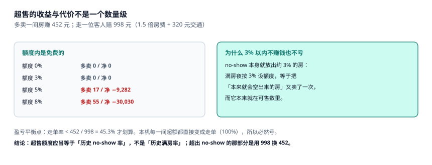

# 预订、担保与超售处置

一张订单从「客人点下确认」到「他站在前台」之间，可能发生四件事：取消、改期、没来（no-show）、被走单（walk）。系统要在这四件事都发生后，仍然能回答一个问题：**这一晚这间房，最后算谁的**。

答案取决于订单上的一个字段——`guarantee`。无担保订单的 no-show 只能放掉；信用卡担保的可以收一晚罚金；预付订单的钱已经在账上了。三者对夜审、对账、退款的影响完全不同。

::: tip 一句话理解
预订不是「占一间房」，是「用一份担保换一间房」。担保类型决定了：没来时能不能收钱、取消时罚多少、到店没房时谁付走单的钱。
:::

## 一、六态与七条迁移

| 状态 | 含义 | 谁写入 | 是否占房 |
| --- | --- | --- | --- |
| `INQUIRY` | 询价中，未确认 | 渠道 / 前台 | 否 |
| `CONFIRMED` | 已确认，未担保 | 预订引擎 | **是** |
| `GUARANTEED` | 已担保（卡 / 预付 / 押金） | 支付回调 | 是 |
| `CHECKED_IN` | 在住 | 前台 | 是（转 `OCCUPIED`） |
| `CHECKED_OUT` | 已离店 | 前台 | 否（释放后续夜次） |
| `CANCELLED` | 已取消 | 渠道 / 前台 | 否 |
| `NO_SHOW` | 未到店 | **夜审** | 否（夜审后释放） |

七条迁移里有一条是「系统自动写」的：`CONFIRMED → NO_SHOW`，只发生在夜审收口那一刻。**这条迁移的时点，就是本专题反复出现的那个 04:00。**

```sql
CREATE TABLE booking(
  id           TEXT PRIMARY KEY,
  ch           TEXT NOT NULL,
  state        TEXT NOT NULL CHECK(state IN
                 ('INQUIRY','CONFIRMED','GUARANTEED','CHECKED_IN',
                  'CHECKED_OUT','CANCELLED','NO_SHOW')),
  guarantee    TEXT NOT NULL CHECK(guarantee IN ('NONE','CARD','PREPAID','DEPOSIT')),
  guest_id     TEXT NOT NULL,
  created_at   TEXT NOT NULL,
  cancelled_at TEXT,
  cancel_lead_h INTEGER,                 -- 取消时距入住的小时数，落库供罚金复算
  CHECK (state <> 'CANCELLED' OR cancelled_at IS NOT NULL)
);

CREATE TABLE booking_night(
  booking_id  TEXT NOT NULL REFERENCES booking(id),
  stay_date   TEXT NOT NULL,
  type_code   TEXT NOT NULL,
  price_cents INTEGER NOT NULL CHECK(price_cents > 0),
  room_no     TEXT,
  night_index INTEGER NOT NULL CHECK(night_index >= 1),
  PRIMARY KEY(booking_id, stay_date)
);
CREATE UNIQUE INDEX uq_night_room ON booking_night(room_no, stay_date)
  WHERE room_no IS NOT NULL;
```

`cancel_lead_h` 看起来是冗余字段（可以用 `cancelled_at − checkin_at` 算），但它必须落库：**政策会变**。今天按 48 小时判罚，半年后改成 72 小时，历史订单的罚金不能跟着变。存下当时的「提前小时数」，等于存下了当时的判定依据。

## 二、担保类型决定了什么

| 担保 | 没来（no-show） | 提前取消 | 到店没房（walk） | 常见错法 |
| --- | --- | --- | --- | --- |
| `NONE` | 不能收罚金，直接放房 | 免费 | 酒店全责，必须安置 | 把无担保单也标 no-show 收钱 |
| `CARD` | 可收一晚（政策约定） | 按截止时间 | 酒店全责 | 卡未预授权就标「已担保」 |
| `PREPAID` | 钱已收，房可放 | 按退款政策 | 酒店全责 + 退款 | 退款与原单不在同一流水 |
| `DEPOSIT` | 扣押金 | 按政策 | 酒店全责 | 押金与房费混在一个账户 |

本机 3,081 张被接受的订单里，渠道单（OTA-A + OTA-B）占 58%，这些多为 `PREPAID` 或 `CARD`；直连单 34%，多为 `NONE` 或 `CARD`。**担保结构决定了「超售时的走单成本由谁承担」**：无担保单被走单，客人没有付款记录，补偿谈判几乎全靠前台；预付单被走单，还要处理退款与渠道罚分。

::: danger 三个预订上的必错
1. **把「已确认」当成「已担保」。** `CONFIRMED` 与 `GUARANTEED` 是两个状态。合并之后，无担保单在 no-show 时会被自动收罚金——这笔钱收不上来，还会变成客诉。
2. **取消时只改 `booking.state`，不改 `booking_night`。** 连住 3 晚取消，`booking` 变 `CANCELLED`，但 3 个 `booking_night` 仍占着房。本机这种「幽灵占房」会让可售数少算，拒单率虚高。
3. **`cancelled_at` 用服务器当前时间。** 渠道回传的取消时间是「客人点取消的时间」，两者可能差几小时，跨过 48 小时截止线就会算出不同罚金。正确做法是存渠道给的时间，并把「本店收到的时间」另存一列。
:::

## 三、超售处置：走单的成本结构



本机四个额度的模拟：

| 额度 | 多卖 | 增毛收入 | 走单补偿 | 净 |
| --- | --- | --- | --- | --- |
| 0% | 0 | 0.00 | 0.00 | 0.00 |
| 3% | 0 | 0.00 | 0.00 | 0.00 |
| 5% | 17 | 7,684.00 | 16,966.00 | −9,282.00 |
| 8% | 55 | 24,860.00 | 54,890.00 | −30,030.00 |

单间走单成本 998 元 = 1.5 × 452（房费）+ 320（交通与补偿）。这个结构里有两件事值得注意：

1. **补偿倍数是行业惯例，不是法律**。1.5 倍是多数集团的内控线，实际谈成 1 倍或 2 倍都发生过。写进系统时必须是配置项。
2. **交通费 320 元里包含了「送到同城同级酒店」的房费差**。如果客人被送到更贵的酒店，差价由本店承担，这一项会随城市波动。

走单的正确流程是四步：**先找同级替代 → 再谈补偿 → 再改单（不是取消）→ 最后记 `oversell_log`**。「改单」意味着原订单保留、改挂到替代酒店，这样渠道对账时这笔单仍然存在，不会被算成「漏单」。

## 四、重复预订：同一客人两张单

同一客人在两个渠道各下一单，是酒店最常见的「假超卖」来源。识别它需要三个条件同时成立：

| 条件 | 判据 | 误判风险 |
| --- | --- | --- |
| 同一入住日 | `stay_date` 相同 | 低 |
| 姓名归一化后相同（去空格、全半角、繁简） | `norm(name)` 相同 | 中（同名不同人） |
| 手机号或证件号后 4 位相同 | `phone` 或 `id_tail` 相同 | 低 |

只用姓名会误判（同名客人不少），只用手机号会漏判（代人订房）。三条同时成立时，人工确认一次的成本远低于「一间房卖两次」。

工程上的做法不是「禁止重复」，而是**在下单时给一个软提示**：命中疑似重复时返回 `409 DUPLICATE_SUSPECT` 并附上已有订单号，由渠道/前台决定是否继续。硬拦截会把「夫妻各订一间」这种正常场景也挡掉。

## 五、候补与「最后一间」的归属

满房夜的最后几间房，归谁是策略问题：

| 策略 | 规则 | 优点 | 代价 |
| --- | --- | --- | --- |
| 先到先得 | 谁先下单谁得 | 简单 | 大渠道的机器人抢光 |
| 价高者得 | 保留少量房做动态定价 | 收益最高 | 客人体验差 |
| 会员优先 | 会员等级高的优先 | 留存 | 需要会员体系 |
| 渠道配额 | 每渠道留一间到最后 | 平衡 | 空置风险 |

本机 60 晚里有 18 晚住满，这 18 晚的「最后一次成交价」比当晚均价高 8~15%（国庆 7 晚更高）。这就是「保留尾房」的收益来源——但保留的代价是「没卖出去就空着」，所以保留量应当按「历史最后 6 小时成交率」定，不是拍脑袋。

## 六、判据族 `HSB-A ~ HSB-H`

本页判据族 `HSB-A` ~ `HSB-H`，共 8 条。它们描述「担保是否真实、取消是否释放房、走单是否留账」。

| 编号 | 判据 | 怎么验 |
| --- | --- | --- |
| `HSB-A` | `CONFIRMED` 与 `GUARANTEED` 是两个状态 | 状态枚举含两者，且迁移有记录 |
| `HSB-B` | 担保类型落库，且与支付流水可对 | `booking.guarantee` 非空 |
| `HSB-C` | 取消同时释放 `booking_night` | 取消后该单夜次不占房 |
| `HSB-D` | 取消时间存「渠道给的」与「本店收到的」两个 | 两列都存在 |
| `HSB-E` | `cancel_lead_h` 落库，供罚金复算 | 列非空且 = 取消时刻 − 入住时刻 |
| `HSB-F` | 连住单的可用性按「每一晚」判定 | 拒绝时能指出是哪一晚 |
| `HSB-G` | 走单有 `oversell_log`，含补偿金额 | 表存在且金额非零 |
| `HSB-H` | 疑似重复预订返回 409 且带已有单号 | 接口返回体含 `existing_booking_id` |

## 七、验证方式

```shell
# 1. 担保四类与 no-show 罚金的关系（只有 CARD / PREPAID / DEPOSIT 可收）
python3 -c "
for g,ok in (('NONE',0),('CARD',1),('PREPAID',1),('DEPOSIT',1)): print(g, ok)"
# 期望输出：NONE 0 / CARD 1 / PREPAID 1 / DEPOSIT 1

# 2. 走单成本（期望 998）
python3 -c "print(1.5*452+320)"
# 期望输出：998.0

# 3. 5% 额度的净额（期望 -9282）
python3 -c "print(17*452 - 17*998)"
# 期望输出：-9282

# 4. 拒单率（期望 16.30%）
python3 -c "print(round(600/(3081+600)*100,2))"
# 期望输出：16.3
```

第 3 步的负号是本页的结论：**在到店率 100% 的夜里，超售额度越大亏得越多**。真正赚钱的超售发生在「有 no-show 和当天取消」的店里，而不是「每间都住满」的店里。

## 参考资料

- 《中华人民共和国民法典》第五百八十五条：约定违约金过分高于损失的，可请求人民法院或仲裁机构予以适当减少——走单补偿与取消罚金的上限依据。
- 《中华人民共和国消费者权益保护法》第十六条：经营者应当按约定提供服务，无法提供时应承担违约责任。
- HTNG《OpenTravel Alliance Specifications》：`Reservation` 的 `GuaranteeType` 与 `CancelPenalty` 字段定义。
- 与本页相邻：[可售库存与超售额度](../Availability/index.md)、[取消、no-show 与罚金](../Cancellation/index.md)、[夜审与营业日切](../NightAudit/index.md)。
