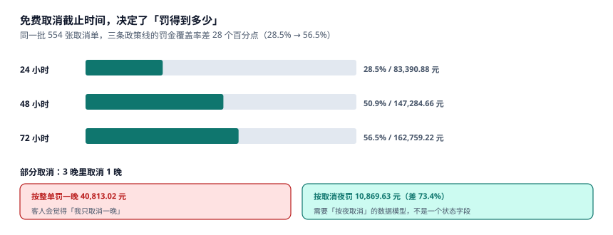

# 取消、no-show 与罚金

一张 3 晚的订单，客人只想取消第 2 晚。系统里 `booking.state` 是 `CANCELLED` 还是 `CONFIRMED`？如果整单取消，第 1、3 晚的房也一起放掉了；如果不取消，第 2 晚的房一直占着。

这就是取消模块的根本问题：**取消的粒度是「夜」，不是「单」**。而绝大多数 PMS 的状态字段只有一个，于是「部分取消」只能靠人工改房态，改完就对不上账。

::: tip 一句话理解
取消不是「把订单删掉」，是「按夜释放 + 按政策收钱」。释放的粒度与收钱的粒度必须是同一个，否则罚金永远和空出来的房对不上。
:::

## 一、罚金覆盖率：政策截止时间决定一切



本机 554 张取消单（占 3,081 张的 18%），按三条不同的免费取消截止线计算：

| 截止线 | 收罚单数 | 罚金 | 覆盖率 |
| --- | --- | --- | --- |
| 入住前 24 小时 | 158 | 83,390.88 | **28.5%** |
| 入住前 48 小时 | 282 | 147,284.66 | **50.9%** |
| 入住前 72 小时 | 313 | 162,759.22 | **56.5%** |

从 24 小时拉到 72 小时，覆盖率从 28.5% 涨到 56.5%，**多收了 79,368.34 元**。但这不是「越严越好」：截止线越早，客人越倾向于「先不订」，转化率下降。行业里 48 小时是主流，正是因为它把「临期取消」与「正常规划变更」分开了。

本机的取消提前量分布（用于算上面三行）：

| 提前量 | 占比 | 说明 |
| --- | --- | --- |
| 0–24 h | 28% | 临期，几乎必然收罚 |
| 24–48 h | 22% | 落在 24h 与 48h 政策之间 |
| 48–168 h | 30% | 一周内 |
| 168 h 以上 | 20% | 提前很久，任何政策都免费 |

## 二、部分取消：整单罚 vs 按夜罚

本机 147 张「3 晚里取消 1 晚」的订单：

| 算法 | 金额 | 客人感受 |
| --- | --- | --- |
| 按整单罚一晚 | **40,813.02** | 「我只取消一晚，为什么按整单算」 |
| 按取消夜罚 | **10,869.63** | 「取消哪晚罚哪晚」 |

差 **29,943.39 元（73.4%）**。这不是定价问题，是**数据模型问题**：如果 `booking_night` 没有「这一晚被取消」的标记，代码只能整单处理。

```sql
ALTER TABLE booking_night ADD COLUMN cancelled_at TEXT;
-- 部分取消：只标这一晚，不动 booking.state
UPDATE booking_night
   SET cancelled_at = '2026-09-28T10:12:00'
 WHERE booking_id = 'B1024' AND stay_date = '2026-10-02';
```

释放房态时按 `cancelled_at IS NULL` 过滤即可。这样：

- `booking.state` 仍是 `CONFIRMED`（客人还要住另外两晚）；
- 第 2 晚的房回到可售；
- 罚金按「被取消的那一晚」算。

::: danger 三个取消上的必错
1. **整单取消替代部分取消。** 客人还剩两晚要住，整单取消后前台要重建订单，房价按当天 BAR 重算——客人觉得「取消一晚反而涨价」。
2. **`cancel_lead_h` 在查询时算，不落库。** 政策一改（48h → 72h），历史订单的罚金全部重算，已收的钱和应收的钱对不上。
3. **渠道回传取消 + 前台手工取消双写。** 本机 323 张 OTA 取消单里，**19 张（5.88%）被退了两次**。防重的手段是给取消动作一个幂等键（`ch + cancel_ref`），不是靠人眼核对。
:::

## 三、no-show 与取消的区别

两者都让房空出来，但账完全不同：

| 维度 | 取消 `CANCELLED` | 未到店 `NO_SHOW` |
| --- | --- | --- |
| 谁发起 | 客人 / 渠道 | **系统在夜审判定** |
| 时间 | 入住前任意时刻 | 切点之后（本机 04:00） |
| 罚金 | 按取消政策 | 通常一晚（担保单） |
| 房态 | 立即释放 | 夜审后释放 |
| 客人权利 | 可改期 | 到店仍应接待（若还有房） |

最后一行是关键：**no-show 不等于拒客**。客人凌晨 5 点来了，虽然已被标 no-show，只要还有房就必须接待，只是押金/罚金的处理要按「no-show 后又入住」的特殊流程走。很多系统在这里直接拒绝，理由是「订单已关闭」——这是错的。

判定 no-show 的正确条件有三条同时成立：

```sql
SELECT b.id
FROM booking b
WHERE b.state IN ('CONFIRMED','GUARANTEED')
  AND EXISTS (SELECT 1 FROM booking_night n
              WHERE n.booking_id = b.id AND n.stay_date = :biz_date)
  AND NOT EXISTS (SELECT 1 FROM booking_night n
                  WHERE n.booking_id = b.id AND n.stay_date = :biz_date
                    AND n.room_no IS NOT NULL)      -- 没排房
  AND NOT EXISTS (SELECT 1 FROM folio f
                  WHERE f.booking_id = b.id AND f.item = 'ROOM'
                    AND f.biz_date = :biz_date);     -- 没挂房费
```

三条里最容易被漏的是第三条：**挂了房费的，说明人已经住了**（房费是入住后才由夜审挂的）。只看订单状态，会把「已入住但状态没改」的客人标成 no-show。

## 四、退款：三条路径与一个坑

| 路径 | 触发 | 退款对象 | 时长 |
| --- | --- | --- | --- |
| 原路退回 | 预付单取消 | 支付渠道 | 1–15 个工作日 |
| 挂账冲抵 | 客人改期 | 新订单 | 立即 |
| 线下退款 | 特殊情况 | 银行账户 | 3–7 个工作日 |

坑在第一条与第三条之间：**同一笔钱只能退一次**。判别依据不是「有没有退过」，而是「退款流水号是否唯一」。本机 5.88% 的重复退款全部来自「渠道侧退了一次、前台又手工退了一次」，两次流水的商户单号不同但订单号相同。

正确的做法是给退款加唯一约束：

```sql
CREATE TABLE refund(
  id          INTEGER PRIMARY KEY,
  booking_id  TEXT NOT NULL REFERENCES booking(id),
  channel_ref TEXT,                 -- 渠道退款单号
  amount_cents INTEGER NOT NULL CHECK(amount_cents > 0),
  created_at  TEXT NOT NULL
);
CREATE UNIQUE INDEX uq_refund_once
  ON refund(booking_id, amount_cents) WHERE channel_ref IS NOT NULL;
```

这个索引不是完美的（同额两次合法退款会被拦），但它把「重复退款」从「静默发生」变成「必须人工处理」，这就是工程上要的效果。

## 五、判据族 `HSC-A ~ HSC-H`

本页判据族 `HSC-A` ~ `HSC-H`，共 8 条。它们描述「取消是否按夜、罚金是否可复算、退款是否只退一次」。

| 编号 | 判据 | 怎么验 |
| --- | --- | --- |
| `HSC-A` | 取消可按夜（`booking_night.cancelled_at`） | 列存在，且部分取消不整单关闭 |
| `HSC-B` | `cancel_lead_h` 落库，政策变更不重算历史 | 列非空且不被批量更新 |
| `HSC-C` | 罚金计算引用「当时的政策版本」 | 存在 `policy_version` 或等价字段 |
| `HSC-D` | 取消动作幂等（渠道单号去重） | 唯一索引含 `ch + cancel_ref` |
| `HSC-E` | no-show 判定三条件同时成立 | 见本页 SQL，三条 `EXISTS` |
| `HSC-F` | no-show 后仍可接待（订单可恢复 `CHECKED_IN`） | 状态机允许 `NO_SHOW → CHECKED_IN` |
| `HSC-G` | 退款流水唯一，重复即报错 | 存在唯一索引或人工复核队列 |
| `HSC-H` | 部分取消后剩余夜次仍占房 | 剩余夜次的房态为 `OCCUPIED` 或已排房 |

## 六、验证方式

```shell
# 1. 罚金覆盖率（期望 28.5 / 50.9 / 56.5）
python3 -c "
for n in (158,282,313): print(round(n/554*100,1))"
# 期望输出：28.5 50.9 56.5

# 2. 部分取消两条算法（期望 40813.02 / 10869.63 / 73.4%）
python3 -c "
a=40813.02; b=10869.63
print(a,b,round((a-b)/a*100,1))"
# 期望输出：40813.02 10869.63 73.4

# 3. 重复退款（19 / 323）
python3 -c "print(round(19/323*100,2))"
# 期望输出：5.88
```

第 2 步是本页的核心：**同一批订单，两种粒度差 73.4%**。差得这么多，说明「按夜」与「按单」不是同一个问题的两种答案，而是两个不同的问题。

## 参考资料

- 《中华人民共和国民法典》第五百八十五条：违约金过高可请求调整，取消罚金的上限依据。
- 《中华人民共和国消费者权益保护法》第二十五条、第二十六条：格式条款不得排除消费者主要权利。
- 《旅馆业治安管理办法》（公安部令第 36 号，2020 年修订）：旅客退房与住宿记录的处理要求。
- 与本页相邻：[预订、担保与超售处置](../Booking/index.md)、[夜审与营业日切](../NightAudit/index.md)、[渠道对账与佣金](../ChannelRecon/index.md)。
