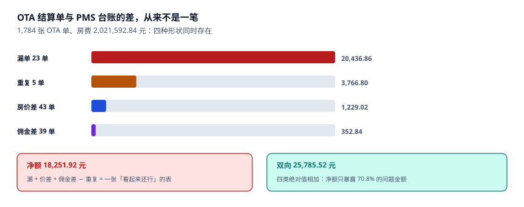

# 渠道对账与佣金

每月 5 号，OTA 发来一张结算单：**应结 1,842,690 元**。财务打开 PMS，本月 OTA 房费 **1,864,120 元**。差 21,430 元，占 1.15%。

这 21,430 元不是一个错误，是至少四类差异叠在一起：有几单渠道没推过来（漏单）、有几单推了两次（重复）、有几晚价格与日历价不一致（价差）、有几单佣金算错了基数（佣金差）。**只看净额，你永远不知道这四类各占多少**。

::: tip 一句话理解
渠道对账的正确输出不是「差多少钱」，而是「差的钱由哪几类构成，每一类各多少，各自该找谁」。净额只能用来判断「今天要不要加班」，不能用来判断「问题出在哪」。
:::

## 一、结算单的四个字段

一张 OTA 结算行通常只有四列，但每一列都有口径：

| 字段 | 含义 | 口径陷阱 |
| --- | --- | --- |
| `room_amount` | 房费 | 含税还是不含税？含早还是不含早？ |
| `commission` | 佣金 | 基数是什么？费率是阶梯还是固定？ |
| `net_amount` | 应结 | = 房费 − 佣金 − 其他扣款 |
| `booking_ref` | 渠道单号 | 与 PMS 的 `id` 不是同一个，需要映射表 |

```sql
CREATE TABLE channel_settle(
  ch          TEXT NOT NULL,
  settle_no   TEXT NOT NULL,          -- 渠道结算单行号
  booking_id  TEXT NOT NULL,          -- 映射到本店订单
  room_cents  INTEGER NOT NULL CHECK(room_cents >= 0),
  comm_cents  INTEGER NOT NULL CHECK(comm_cents >= 0),
  base_kind   TEXT NOT NULL CHECK(base_kind IN
                ('GROSS','NET_OF_TAX','ACTUAL')),
  settled_at  TEXT NOT NULL,
  PRIMARY KEY(ch, settle_no),
  CHECK (comm_cents <= room_cents)
);
CREATE UNIQUE INDEX uq_settle_booking ON channel_settle(ch, booking_id);
```

`base_kind` 是本册反复强调的那个字段：**佣金基数必须是数据，不是共识**。

## 二、四形状：本机的实测构成



本机 1,784 张 OTA 订单、房费 **2,021,592.84 元**，注入四类差异后：

| 形状 | 单数 | 金额 | 归谁 |
| --- | --- | --- | --- |
| 漏单（PMS 有、渠道无） | 23 | **20,436.86** | 渠道补结 |
| 重复（渠道有两次） | 5 | **3,766.80** | 本店退回 |
| 房价差（同一单两个价） | 43 | **1,229.02** | 查日历价同步 |
| 佣金差（基数或费率错） | 39 | **352.84** | 查 `base_kind` |

净额 = 20,436.86 + 1,229.02 + 352.84 − 3,766.80 = **18,251.92**
双向 = 20,436.86 + 3,766.80 + 1,229.02 + 352.84 = **25,785.52**

**净额只暴露了 70.8% 的问题金额**。剩下的 29.2% 被「重复」抵消掉了——而「重复」与「漏单」的处理方向完全相反：一个要退、一个要追。用净额下结论，会把「退 3,766.80」和「追 20,436.86」混成「追 16,670.06」，两件事都做错。

::: danger 三个对账上的必错
1. **用净额判断对账是否通过。** 本机净额 18,251.92 元、占比 0.90%，如果阈值设 1%，这张对账单会被判「通过」——而它实际上有 62 单、4 类问题。
2. **用「金额 + 日期」做匹配键。** 同一天同一价的两间房会被匹成一对，另一对判为「漏单 + 重复」。必须用渠道单号映射，金额只作为二次校验。
3. **佣金算在「房费合计」上。** 房费合计里含早餐、加床、迟退费，本机按含税、不含税、实收三个基数算出的佣金分别是 303,238.93 / 286,074.46 / 266,850.26 元，**最大差 12.00%**。
:::

## 三、佣金：三个基数，三张对账单

| 基数 | 金额 | 与含税比 | 什么情况下用 |
| --- | --- | --- | --- |
| 含税房费 | **303,238.93** | 基准 | 合同写「按房费总额」 |
| 不含税房费（6%） | **286,074.46** | −5.66% | 合同写「不含增值税」 |
| 扣掉取消后的实收 | **266,850.26** | −12.00% | 合同写「按实际入住」 |

三个数都能自证，因为三份合同确实这么写。问题在于**同一家店可能同时签了三种合同**（不同渠道、不同年份），而对账时用了一个统一公式。

工程上的处置：`base_kind` 落在每一行结算上，对账时按行取基数，不做全局假设。这样「同一张对账单里三种基数」也能各自算对。

## 四、匹配：三级键

对账的匹配不是一次完成，是三级筛选：

| 级别 | 键 | 命中率 | 剩余处理 |
| --- | --- | --- | --- |
| L1 | 渠道单号 → `booking_id` | 高（有映射表时 ~99%） | 未命中的进 L2 |
| L2 | 入住日 + 房费 + 姓氏 | 中 | 未命中的进 L3 |
| L3 | 人工队列 | — | 逐条看 |

本机的 1,784 张单里，L1 命中 1,761 张（98.7%），L2 补 18 张，剩 5 张进人工——这 5 张正是「重复」那 5 单：渠道给了两条结算行，映射到同一个 `booking_id`，被 `uq_settle_booking` 唯一索引拦住。

**唯一索引在这里的作用不是「防止脏数据」，而是「把重复变成一条待处理的异常」**：插入失败 → 进异常队列 → 人工判断是渠道重复结算还是本店重复推单。

## 五、月结流程：五步与两个闸门

| 步 | 动作 | 产物 | 闸门 |
| --- | --- | --- | --- |
| ① 拉单 | 下载渠道结算文件 | `settle_raw` | 文件哈希去重 |
| ② 映射 | 渠道单号 → `booking_id` | 映射表 | 命中率 ≥ 98% |
| ③ 比对 | 三级匹配 + 四形状分类 | 差异清单 | 每类都要有归属 |
| ④ 调整 | 补结 / 退回 / 挂账 | `adjust` 明细 | 调整必须有原因码 |
| ⑤ 确认 | 生成对账单并签字 | PDF + 哈希 | 差异总额 < 阈值 |

两个闸门是硬性的：**映射命中率低于 98% 不许进比对**（否则差异全是匹配失败造成的假差异），**差异没有归属不许确认**（「其他」这一类不许超过总额的 5%）。

## 六、判据族 `HSY-A ~ HSY-H`

本页判据族 `HSY-A` ~ `HSY-H`，共 8 条。它们描述「差异是否可分类、佣金基数是否落库、匹配是否可复算」。

| 编号 | 判据 | 怎么验 |
| --- | --- | --- |
| `HSY-A` | 结算行有 `base_kind`，佣金按行取基数 | 列非空，且三值都有实例 |
| `HSY-B` | 差异按四形状分类，不混成「其他」 | 差异表有 `shape` 枚举 |
| `HSY-C` | 对账输出「净额」与「双向」两个数 | 报表两列都存在 |
| `HSY-D` | 匹配用渠道单号，金额只作二次校验 | 有映射表且 L1 命中率被记录 |
| `HSY-E` | 重复结算被唯一索引拦住并进异常队列 | `uq_settle_booking` 存在 |
| `HSY-F` | 佣金不得高于房费 | `CHECK (comm_cents <= room_cents)` |
| `HSY-G` | 调整必须有原因码 | `adjust.reason` 非空且属枚举 |
| `HSY-H` | 映射命中率低于阈值不许确认 | 流程里有该闸门 |

## 七、验证方式

```shell
# 1. 净额与双向（期望 18251.92 / 25785.52 / 70.8%）
python3 -c "
miss=20436.86; dup=3766.80; rate=1229.02; comm=352.84
net=miss+rate+comm-dup; two=miss+dup+rate+comm
print(round(net,2), round(two,2), round(net/two*100,1))"
# 期望输出：18251.92 25785.52 70.8

# 2. 佣金三口径（期望 303238.93 / 286074.46 / 266850.26）
python3 -c "
g=2021592.84
print(round(g*0.15,2), round(g/1.06*0.15,2), round(g*0.88*0.15,2))"
# 期望输出：303238.93 286074.46 266850.25
# （第三个数与正文的 266,850.26 差 1 分，是浮点与 Decimal 末位舍入的差异）

# 3. 三口径相对含税的差（期望 -5.66% / -12.00%）
python3 -c "
a=303238.93
for b in (286074.46,266850.26): print(round((b-a)/a*100,2))"
# 期望输出：-5.66 -12.0
```

第 1 步的两个数必须同时出现在对账单上。只给净额的报表，等于把「该追的」和「该退的」互相抵消。

## 参考资料

- 《企业会计准则第 14 号——收入》及其应用指南：总额法与净额法的判断（酒店自营按总额、代销按净额）。
- 《中华人民共和国电子商务法》第三十八条：平台经营者对平台内经营者信息的记录与保存义务。
- HTNG《OpenTravel Alliance Specifications》：`Commission` 与 `Settlement` 相关消息的字段定义。
- 与本页相邻：[日历价与限制](../RateCalendar/index.md)、[取消、no-show 与罚金](../Cancellation/index.md)、[实战](../Practice/index.md)。
