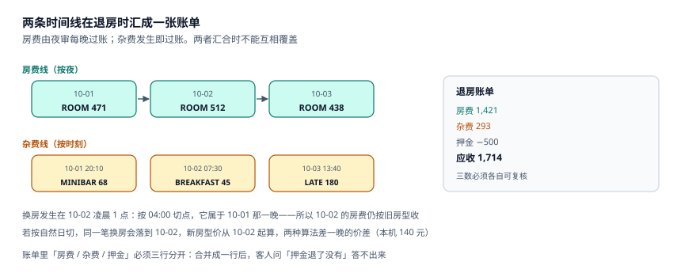

# 入住、换房与在住账

客人站到前台的第一分钟，系统要同时做四件事：核身份、收押金、把这间房标成在住、开一本账。四件事里只要漏一件，都会在退房时变成纠纷——**没核身份**是合规问题，**没记押金**是收款问题，**没写房态**是把房卖第二次，**没开账**是客人消费了却收不到钱。

这一页讲这四件事怎么落库，以及全店最容易算错的一个动作：换房。

::: tip 一句话理解
入住是「把一个预订变成一次占用」，退房是「把一次占用变成一笔收入」。中间的所有消费都记在 `folio` 上，而**房费是按夜由夜审过账的，不是退房时一次算的**。
:::

## 一、入住的四步与它们的顺序

| 步骤 | 写入 | 失败后果 | 能否事后补 |
| --- | --- | --- | --- |
| ① 核身份 | `guest` 证件号、姓名 | 违反住宿登记规定 | 能补，但要留痕 |
| ② 收押金 | `folio(item='DEPOSIT')` 或支付流水 | 退房时收不到钱 | 能补，客人可能已走 |
| ③ 写房态 | `room_state(state='OCCUPIED')` | 房被卖第二次 | **不能补**（已超卖） |
| ④ 开账 | `folio` 的房费行（由夜审生成） | 收入漏记 | 能补，但对账已乱 |

第三步不可逆：一旦这间房被写进 `OCCUPIED`，渠道侧的可售数就少了一间。**顺序必须是「核 → 押 → 房态 → 账」**，而不是先写房态再补手续——先占房能防止超卖，但会把「无证件入住」变成既成事实。

```sql
CREATE TABLE folio(
  id          INTEGER PRIMARY KEY,
  booking_id  TEXT NOT NULL REFERENCES booking(id),
  biz_date    TEXT NOT NULL,           -- 营业日，不是发生时刻
  item        TEXT NOT NULL CHECK(item IN
                ('ROOM','EXTRA_BED','BREAKFAST','MINIBAR','LAUNDRY',
                 'LATE_CHECKOUT','UPGRADE','DEPOSIT','ADJUST')),
  amount_cents INTEGER NOT NULL,
  posted_at   TEXT NOT NULL
);
CREATE INDEX idx_folio_biz ON folio(biz_date, item);
```

`item` 用枚举而不是自由文本，是为了让「房费 / 杂费 / 押金 / 调整」四类在报表里能分开加。混在一起加，会得出「本店杂费收入 30 万」这种把押金也算进去的结论。

## 二、在住账：房费按夜过账，杂费实时过账

| 类型 | 过账时点 | 过账方 | 可撤销 |
| --- | --- | --- | --- |
| 房费 `ROOM` | 每晚夜审 | 夜审批处理 | 封账前可，封账后不可 |
| 加床 `EXTRA_BED` | 入住时一次 | 前台 | 封账前可 |
| 早餐 `BREAKFAST` | 每早核销 | 餐饮 POS | 封账前可 |
| 迷你吧 `MINIBAR` | 消费时 | 客房部 | 封账前可 |
| 迟退 `LATE_CHECKOUT` | 退房时 | 前台 | 封账前可 |
| 押金 `DEPOSIT` | 入住时 | 前台 | 退房冲抵 |



这张图的重点是**两条时间线**：房费沿着「夜」推进，杂费沿着「时刻」推进。两者在退房时汇到一张账单上。如果房费也按「时刻」记（比如退房时一次性按 `夜数 × 均价`），就会丢掉「每晚多少钱」的明细，客人问「为什么第 3 晚贵 80 块」时答不出来。

本机房费合计 **2,942,330.56 元**、ADR **446.82 元**。这个数只能由 `folio(item='ROOM')` 汇总得出；用 `booking_night.price_cents` 汇总会得到另一个数（差额来自换房与折扣），两者必须在月末对平。

## 三、换房：两条重算路径差 50.3%

本机 87 单换房（占连住单的 5%），两条实现路径：

| 路径 | 规则 | 本机增量 | 差额 |
| --- | --- | --- | --- |
| A 全程按新房型 | 整段住宿的每晚都改成新房型价 | +46,722.40 | 基准 |
| B 只调换房后夜次 | 前一晚锁价，按换房时点切分 | +31,084.52 | **−15,637.88（50.3%）** |

A 的问题不在「多收了钱」，而在**追溯改价**：客人 10 月 1 日按 STD 380 入住，10 月 3 日换到 DLX 520，A 会把 10 月 1、2 日也改成 520。客人看到的账单与他入住时确认的价格不一致，这是可投诉的。

B 需要一个字段：**换房时点**。它决定了「哪一晚算旧房型、哪一晚算新房型」：

```sql
CREATE TABLE room_move(
  id          INTEGER PRIMARY KEY,
  booking_id  TEXT NOT NULL REFERENCES booking(id),
  from_room   TEXT NOT NULL REFERENCES room(no),
  to_room     TEXT NOT NULL REFERENCES room(no),
  moved_at    TEXT NOT NULL,
  biz_date    TEXT NOT NULL,          -- moved_at 落在哪个营业日
  reason      TEXT NOT NULL CHECK(reason IN
                ('UPGRADE','MAINTENANCE','GUEST_REQUEST','OVERBOOK')),
  CHECK (from_room <> to_room)
);
```

有了 `biz_date`，「凌晨 1 点换房算哪一晚」就有唯一答案：按营业日切点（本专题的 04:00）归到**前一个**营业日。

::: danger 三个换房上的必错
1. **只改 `booking_night.room_no`，不留历史。** 换完之后，原房间什么时候空出来的、为什么空，全部查不到；客房部的清洁排班也会错。
2. **换房时重算整段价格。** 见上表路径 A，多收 50.3%，且客人有确认信为证。
3. **换房不检查新房态的 `OOO`。** 换到一间正在维修的房，客人进去才发现在刷墙。触发器 `trg_state_ooo_check` 拦的正是这一条。
:::

## 四、加床、迟退与钟点房

三个「非标准住宿」场景，各自有一个容易被忽略的口径：

| 场景 | 计费口径 | 常见错法 | 后果 |
| --- | --- | --- | --- |
| 加床 | 按夜计（本机 120 元/晚） | 按人计 | 两人入住加一张床收两份 |
| 迟退 | 按小时阶梯（14:00 前免费 / 18:00 前半日 / 之后全日） | 一律收全日 | 客诉 |
| 钟点房 | 按小时，且**同一间房一天可卖多次** | 按夜占用房态 | 房态显示满，实际可卖 |

钟点房是唯一会打破「一间房一晚一单」的场景：`booking_night` 的主键是 `(booking_id, stay_date)`，同一间房同一天可以有多张钟点房订单，所以**不能给 `booking_night` 加「同房同日唯一」的约束**——本专题用的是 `UNIQUE(room_no, stay_date) WHERE room_no IS NOT NULL` 的部分索引，这个索引对钟点房同样会拦。

正确做法是把钟点房单独建一张表（`hourly_session`，含 `start_at` / `end_at`），并在算可售时把它从「当日剩余小时」里扣掉。本机没有建模钟点房，这里把它列为**已知缺口**：本册的 11 张表只覆盖整夜售卖。

## 五、退房：三个数必须同时成立

退房时系统要给出三个数，且三个数必须能各自复核：

| 数 | 来源 | 用途 |
| --- | --- | --- |
| 应收 | `SUM(folio.amount_cents)` | 账单金额 |
| 已收 | 押金 + 预付 + 中间付款 | 收款流水 |
| 应退 / 应补 | 应收 − 已收 | 前台操作金额 |

三者对不上时，不允许「手工改一个数让它平」，必须开一条 `ADJUST` 明细并写原因。**手工改数是酒店财务最常见的黑洞**：账平了，但没人知道为什么平。

## 六、判据族 `HSG-A ~ HSG-H`

本页判据族 `HSG-A` ~ `HSG-H`，共 8 条。它们描述「入住是否可追溯、在住账是否按夜过账、换房是否可复算」。

| 编号 | 判据 | 怎么验 |
| --- | --- | --- |
| `HSG-A` | 入住四步有序，房态写入晚于证件与押金 | 有入住时间线或审计日志 |
| `HSG-B` | `folio.item` 是枚举，四类可分开加 | `CHECK` 约束含 `ROOM`/`DEPOSIT`/`ADJUST` |
| `HSG-C` | 房费由夜审按夜过账，退房不重算整段 | `folio(ROOM)` 的 `biz_date` 逐夜 |
| `HSG-D` | 换房有独立记录，含时点与原因 | `room_move` 表存在且 `biz_date` 非空 |
| `HSG-E` | 换房重算只影响换房后夜次 | 换房前后账单可对比，前夜价格不变 |
| `HSG-F` | 换房目标房不得是 `OOO` | 触发器 `trg_state_ooo_check` |
| `HSG-G` | 退房三数（应收 / 已收 / 应退）可各自复核 | 账单页面同时给出三个数 |
| `HSG-H` | 调账必须走 `ADJUST` 明细，不直接改金额 | 无「改 `amount_cents`」的接口 |

## 七、验证方式

```shell
# 1. 换房两条路径的差（期望 15637.88 / 50.3%）
python3 -c "
a=46722.40; b=31084.52; print(round(a-b,2), round((a-b)/b*100,1))"
# 期望输出：15637.88 50.3

# 2. 房费与 ADR 的关系（期望 446.82）
python3 -c "print(round(2942330.56/6585,2))"
# 期望输出：446.82

# 3. 加床按夜与按人的差（两人 3 晚）
python3 -c "
by_night=120*3; by_person=120*3*2
print(by_night, by_person, by_person-by_night)"
# 期望输出：360 720 360
```

第 3 步是最容易被忽略的一处：**加床按人计时，一个双人间的加床会被收两次**。金额不大（本机 360 元），但每一单都错。

## 参考资料

- 《旅馆业治安管理办法》（公安部令第 36 号，2020 年修订）：入住登记、证件核验与旅客信息报送要求。
- 《中华人民共和国个人信息保护法》第二十八条：住宿信息属于敏感个人信息，处理需单独同意并最小化。
- AHLA《Uniform System of Accounts for the Lodging Industry》（11th ed.）：`Folio`、`City Ledger` 与 `House Account` 的科目划分。
- 与本页相邻：[房型、物理房与房态](../RoomModel/index.md)、[夜审与营业日切](../NightAudit/index.md)、[实战](../Practice/index.md)。
