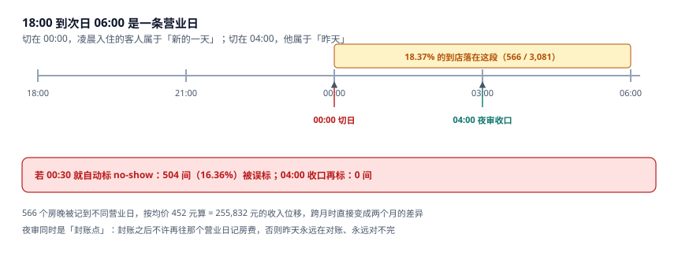
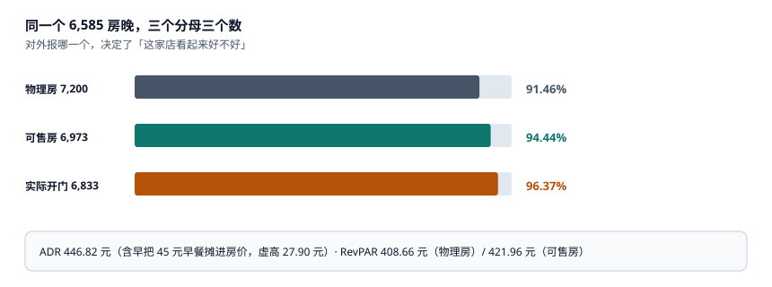

# 夜审与营业日切

每晚 23:30 到次日 04:00，酒店做一件所有零售都没有的事：**把昨天截断**。截断之后，昨天的房费不能改、昨天的账不能补、昨天没来的客人被标成 no-show。

这一步叫夜审（Night Audit）。它的产物不是报表，是**一个营业日的边界**。边界切在哪，决定了 18.37% 的客人的那晚算哪一天。

::: tip 一句话理解
营业日不是自然日。它从某个切点开始、到次日同一时刻结束；切点定在 04:00，凌晨 2 点入住的客人属于「昨天」。切点是一个配置，不是一个约定。
:::

## 一、切点：00:00 还是 04:00



本机 3,081 张订单的到店时刻分布：

| 到店时段 | 占比 | 切在 00:00 时归属 | 切在 04:00 时归属 |
| --- | --- | --- | --- |
| 14:00–22:00 | 60% | 当日 | 当日 |
| 22:00–24:00 | 22% | 当日 | 当日 |
| **00:00–04:00** | **18.37%（566 单）** | **次日** | **当日（前一营业日）** |
| 04:00 以后 | 0% | 当日 | 次日 |

两种切法都自洽，但结果差 **566 个房晚**。按均价 452 元算，是 **255,832 元**的收入位移。如果这个月正好跨月（本机 10 月 30 日、31 日各有 9~11 单落在 00:00–04:00），这笔钱会在两个月之间搬家。

行业惯例是 04:00（或 05:00、06:00），原因是：

1. **红眼航班与自驾晚到**是真实存在的，00:00 切会把它们的房费记到「新的一天」，而客人明明是在为「昨天那晚」付钱。
2. **夜审本身需要时间**。00:00 切意味着夜审要在 00:00 前完成，而前台还在办入住；04:00 切给了 4 小时窗口。
3. **no-show 判定必须晚于最晚到店时刻**。切在 00:00 又立刻标 no-show，本机会误标 **504 单（16.36%）**；切在 04:00 收口再标，误标 **0 单**。

::: danger 三个夜审上的必错
1. **00:00 切日 + 00:30 自动标 no-show。** 这是最经典的组合错误：客人 01:20 到店，系统已经把他标成 no-show、房已释放、押金已扣。本机这种误标率是 16.36%。
2. **夜审只出报表、不封账。** 不封账意味着昨天的房费今天还能改。改完之后，昨天出的日报与今天的对账永远差一笔，而且没人知道差在哪。
3. **用服务器本地时间做切点。** 服务器在 UTC、门店在东八区，切点会偏 8 小时——所有凌晨订单都归错日。切点必须用**门店时区**的本地时间算。
:::

## 二、夜审的五步

| 步 | 动作 | 产物 | 失败形态 |
| --- | --- | --- | --- |
| ① 挂账 | 把在住客的当晚房费写入 `folio` | `folio(item='ROOM')` | 漏挂 → 收入少计 |
| ② 判未到 | 把 `CONFIRMED`/`GUARANTEED` 且未入住的标 `NO_SHOW` | `booking.state` | 误标 → 客人到店无房 |
| ③ 结房态 | 把当日 `OCCUPIED` 滚动到次日 | `room_state` | 漏滚 → 次日房态全空 |
| ④ 出日报 | 房晚、收入、ADR、入住率 | `night_audit` | 口径不一致 |
| ⑤ 封账 | 写 `closed_at`，此后该日不可再写 | `night_audit.closed_at` | 不封 → 永远对不完 |

五步必须在一个事务里，且第 ⑤ 步是**唯一的封账点**：

```sql
CREATE TABLE night_audit(
  biz_date      TEXT PRIMARY KEY,
  cut_hour      INTEGER NOT NULL,        -- 切点（门店本地时区）
  closed_at     TEXT,                    -- 非空即已封账
  rooms_sold    INTEGER,
  revenue_cents INTEGER,
  adr_cents     INTEGER,
  occupancy_bp  INTEGER                  -- 万分比，避免浮点
);

CREATE TRIGGER trg_folio_after_close BEFORE INSERT ON folio
WHEN EXISTS(SELECT 1 FROM night_audit
            WHERE biz_date = NEW.biz_date AND closed_at IS NOT NULL)
BEGIN SELECT RAISE(ABORT, 'E_BIZ_DATE_CLOSED'); END;
```

触发器拦的是「封账后再记账」。这条约束的价值不在技术，而在**流程**：一旦有人要在昨天补一笔，系统会拒绝，他必须走「调账」流程（开一条今天的 `ADJUST`），于是差异有了记录。

## 三、一个入住率，三个分母



| 分母 | 值 | 入住率 | 适用场景 |
| --- | --- | --- | --- |
| 物理房 × 天数 | 7,200 | **91.46%** | 集团同比（分母稳定） |
| 可售房（扣维修与锁房） | 6,973 | **94.44%** | 单店运营（真实供给） |
| 当晚实际开门 | 6,833 | **96.37%** | 复盘单夜表现 |

同一分子 6,585，三个分母差 4.91 个百分点。日报上只写一个数时，读者无法判断「这家店还有多少空间」。

配套的两个指标同样有分母问题：

| 指标 | 公式 | 本机值 | 分母陷阱 |
| --- | --- | --- | --- |
| ADR | 房费收入 / 已售房晚 | **446.82** | 含早把早餐摊进房价，虚高 27.90 元 |
| RevPAR（物理） | 房费收入 / 物理房晚 | **408.66** | 与入住率同分母，可交叉验证 |
| RevPAR（可售） | 房费收入 / 可售房晚 | **421.96** | 比物理口径高 3.3%，不能混用 |

`ADR × 入住率 = RevPAR` 这条恒等式只在**分母一致**时成立：446.82 × 94.44% = 421.96（可售口径），446.82 × 91.46% = 408.66（物理口径）。两个 RevPAR 都对，但不能拿「物理口径的 RevPAR」去除「可售口径的入住率」——那会得出 446.82 以外的数，而这正是「口径混用」最典型的症状。

## 四、跨零点与夏令时

两个边界情形会让「一晚 = 24 小时」这个假设失效：

| 情形 | 现象 | 处置 |
| --- | --- | --- |
| 跨零点入住 | 客人 23:50 到店，办完手续 00:10 | 按**到店时刻**归日，不按办完时刻 |
| 夏令时开始 | 当地 02:00 跳到 03:00，一天 23 小时 | 营业日仍按「切点」定义，不按小时数 |
| 夏令时结束 | 当地 02:00 退回 01:00，一天 25 小时 | 同一钟点出现两次，需用带时区的时间戳 |
| 钟点房 | 一间房一天卖多次 | 单独建表，不进 `booking_night` |

中国大陆自 1991 年起不实行夏令时，所以国内 PMS 很少踩这个坑；但**跨境集团**（同一套系统跑在多个时区）一定会遇到。工程上的统一做法是：所有时间戳存 UTC + 门店时区 ID，营业日由「门店本地时间 + 切点」算出来，**永远不要用 `date(ts)` 直接取日期**。

::: warning 一个反直觉的结论
**夜审越晚，账越准；夜审越早，客诉越多。** 因为夜审的核心动作是「判定没来」，而判定得越早，被误判的客人越多。本机 00:30 判是 16.36% 误判，04:00 判是 0%。把夜审提前到 23:00「为了早点出报表」，等于用 16% 的客诉换 5 小时的报表提前量。
:::

## 五、判据族 `HSN-A ~ HSN-H`

本页判据族 `HSN-A` ~ `HSN-H`，共 8 条。它们描述「营业日是否唯一、封账是否有效、三个口径是否都能算」。

| 编号 | 判据 | 怎么验 |
| --- | --- | --- |
| `HSN-A` | 营业日切点是配置项，落库并在每笔账上可追溯 | `night_audit.cut_hour` 非空 |
| `HSN-B` | 切点按门店时区计算，不用服务器时区 | 代码里有 `zoneinfo` 或等价 |
| `HSN-C` | no-show 判定在切点之后，不在 00:00 | 判定任务时间 > `cut_hour` |
| `HSN-D` | 夜审五步在同一事务，失败整体回滚 | 无中间态（半封账） |
| `HSN-E` | 封账后该营业日不可再写 `folio` | 触发器 `trg_folio_after_close` |
| `HSN-F` | 日报同时给出三个入住率的分母 | 报表有 `denominator` 列 |
| `HSN-G` | ADR 与 RevPAR 的分母一致（可交叉验证） | `ADR × OCC = RevPAR` 成立 |
| `HSN-H` | 时间戳存 UTC，营业日由本地时间算 | 无 `date(ts)` 直接取日期 |

## 六、验证方式

```shell
# 1. 00:00–04:00 到店占比（期望 18.37%）
python3 -c "print(round(566/3081*100,2))"
# 期望输出：18.37

# 2. 切点位移的金额（期望 255832）
python3 -c "print(566*452)"
# 期望输出：255832

# 3. ADR × 入住率 = RevPAR（两个分母各自成立）
python3 -c "
adr=446.82
print(round(adr*0.9444,2), round(adr*0.9146,2))"
# 期望输出：421.96 408.66

# 4. 误标率对比（00:30 vs 04:00）
python3 -c "
print(round(504/3081*100,2), 0)"
# 期望输出：16.36 0
```

第 3 步是口径自检：**两个 RevPAR 都要能由 ADR 乘出来**。如果有一个乘不出来，说明那个入住率的分母与 ADR 的分子不是同一批房晚。

## 参考资料

- AHLA《Uniform System of Accounts for the Lodging Industry》（11th ed.）：营业日（`Hotel Day`）、`Night Audit` 与 `Occupancy` 的标准定义。
- 《旅馆业治安管理办法》（公安部令第 36 号，2020 年修订）：住宿登记与营业日志保存要求。
- IANA Time Zone Database：门店时区与夏令时规则的数据源。
- 与本页相邻：[入住、换房与在住账](../Checkin/index.md)、[取消、no-show 与罚金](../Cancellation/index.md)、[渠道对账与佣金](../ChannelRecon/index.md)。
