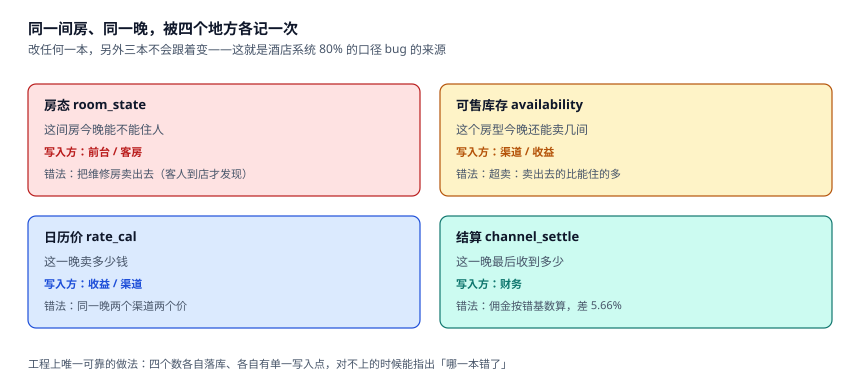

# 总览：一间房的四本账

一家 120 间房的店，60 个晚上能卖出 6,585 个房晚。这 6,585 在四个地方各有一份记录：前台的**房态**、渠道的**库存**、收益的**价格日历**、财务的**结算单**。四份记录都「对」，但它们的合计从来不完全相等。

本页把四本账摆在一起，说明它们各自回答什么问题、谁来写、写错了会以什么形态暴露——后面的九页都在往这四个格子里填东西。

::: tip 一句话理解
房态回答「这间房今晚能不能住人」，库存回答「这个房型今晚还能卖几间」，价格回答「这一晚卖多少」，结算回答「这一晚最后收到多少」。**四个问题的答案互相约束，但没有任何一个能推出另外三个。**
:::

## 一、同一晚的九个数字

取本机数据里一个住满的周末夜（10 月 3 日，国庆）：

| 数字 | 值 | 谁在算 | 用来干什么 |
| --- | --- | --- | --- |
| 物理房 | 120 | 房型配置 | 分母之一 |
| 维修停售（OOO） | 4 | 工程部 | 从分母里减掉 |
| 锁房（自用/免费房） | 2 | 前台 | 从分母里减掉 |
| 可售房 | 114 | 库存服务 | 渠道能看到的上限 |
| 已售房晚 | 114 | 预订系统 | 出现在 P&L 上 |
| 入住率（可售口径） | 100.0% | 收益 | 对外汇报 |
| 入住率（物理口径） | 95.0% | 集团报表 | 同比可比 |
| 房费收入 | 58,746 元 | 夜审 | 计入当日营收 |
| 渠道结算 | 21,340 元 | 财务 | 实际到账 |

九个数字都能在同一张日报上出现，而且**都正确**。但它们各自的分母、时点、剔除规则都不同：物理口径把维修房算成「没卖出去」，可售口径不算；房费收入按营业日归集，渠道结算按渠道的结算周期归集。想用一个数解释另一个数，必然出错。

## 二、七段链上，失败都长什么样



| 段 | 典型失败 | 什么时候暴露 | 暴露时已经错了多久 |
| --- | --- | --- | --- |
| ① 建 | 房型可售数写成了「房间数」而不是「可售数」 | 第一次超卖 | 数周 |
| ② 排 | 维修房被渠道卖掉 | 客人到店 | 当天，但已无法挽回 |
| ③ 价 | 某一晚的日历价漏改 | 月末对账 | 一个月 |
| ④ 订 | 两个渠道同时卖掉最后一间 | 到店排队 | 当天 |
| ⑤ 住 | 换房后按新房型重算了整段 | 退房结账 | 客人当场发现 |
| ⑥ 退 | 部分取消按整单罚 | 客诉或退款审计 | 数周 |
| ⑦ 结 | 佣金基数用挂牌价而非实收 | 与渠道月结 | 一个月 |

七段里四段是安静的。安静的段有一个共同特征：**数据库里每一行都能通过外键与 `CHECK`，报表里每一列都能加起来**，错的是「这一行属于哪一晚、这一晚算不算卖出去」。

## 三、四个必失的接缝

这四处接缝在本机数据上都能量化，后面各有专页：

1. **营业日切点 vs 自然日**：18.37% 的到店发生在 00:00–04:00 之间。切在 00:00，这 566 个房晚记进新的一天；切在 04:00，它们记进昨天。按均价 452 元算是 **255,832 元**的位移，跨月时直接变成两个月的差异。
2. **可售库存 vs 渠道分配**：库存是一个池子，渠道分配是池子上的若干个取水口。取水口之和大于池子时，超卖不是「谁的 bug」，是**配置的结果**。
3. **逐夜价 vs 整单一个价**：本机 1,757 张连住单，跨周末那 1,016 张差 **+1.30%**，平季那 741 张差 **−2.20%**，净差只有 **0.18%**——恰好低于任何「差异超过 1% 才报警」的阈值。
4. **净额 vs 双向**：渠道对账的四类差异（漏单、重复、价差、佣金差）净额是 18,251.92 元，双向绝对值是 25,785.52 元。只看净额，**29.2% 的问题金额被互相抵消掉了**。

::: danger 四个最常见的建模错误
1. **把房态写成 `room` 表上的 `status` 字段。** 那只能表达「此刻」，表达不了「10 月 3 日这间房是维修」。本机 60 晚 × 120 房需要 7,200 行状态，字段版一行也存不下。
2. **用 `checkin_date` 单列表示住宿区间。** 加一列 `nights` 看似够用，但一旦有「第 3 晚换房」，区间就不再连续，必须落到 `booking_night`（一晚一行）。
3. **把佣金算在「房费合计」上。** 房费合计里可能含早餐、含加床、含迟退费。佣金基数必须是明确的字段，否则每月都要和渠道吵一次。
4. **夜审只做「出报表」，不做「封账」。** 不封账的夜审等于没有夜审：昨天可以一直改，昨天就永远对不完。
:::

## 四、判据族 `HSO-A ~ HSO-H`

本页判据族 `HSO-A` ~ `HSO-H`，共 8 条。它们描述「四本账是否各自独立留存、是否都能被独立复核」。

| 编号 | 判据 | 怎么验 |
| --- | --- | --- |
| `HSO-A` | 房态按「房 × 营业日」存储，不是房间表字段 | `room_state` 行数 = 房数 × 天数（±停业日） |
| `HSO-B` | 可售数由「物理 − 维修 − 锁房」现算，不存冗余常量 | 存在该视图或函数，且渠道读到的是它 |
| `HSO-C` | 每个房晚单独定价，`booking_night` 一晚一行 | `COUNT(*) = SUM(nights)` |
| `HSO-D` | 营业日切点是配置项，且每笔账记下当时的切点 | `night_audit` 有 `cut_hour` 或等价列 |
| `HSO-E` | 佣金基数作为字段存储（含税 / 不含税 / 实收） | `channel_settle` 有 `base_kind` |
| `HSO-F` | 夜审封账后该营业日的账不可再写 | 触发器或权限，见[实战](../Practice/index.md) |
| `HSO-G` | 三个入住率口径都能算出来，且分母写进报表 | 报表有 `denominator` 列或注释 |
| `HSO-H` | 取消支持「按夜」，不是整单一个状态 | `booking_night` 有取消列或独立取消表 |

## 五、验证方式

```shell
# 1. 房态行数应等于「房 × 天」（本机 120 × 60 = 7,200）
python3 -c "print(120*60)"
# 期望输出：7200

# 2. 三个入住率的分母与同一个分子（期望 91.46 / 94.44 / 96.37）
python3 -c "
rn=6585
for name,cap in (('物理',7200),('可售',6973),('开门',6833)):
    print(name, round(rn/cap*100,2))"
# 期望输出：物理 91.46 / 可售 94.44 / 开门 96.37

# 3. 营业日切点位移（566 房晚 × 452 元）
python3 -c "print(566*452)"
# 期望输出：255832
```

第 2 步是本页最重要的一步：**三个数必须来自同一个分子**。任何一次「三个口径算出三个分子」的实现，都说明其中至少两个口径在偷偷改统计范围。

## 参考资料

- 《旅馆业治安管理办法》（公安部令第 36 号，2020 年修订）：住宿登记与营业日志的法定要求。
- GB/T 14308—2023《旅游饭店星级的划分与评定》：客房配置与服务项目分级。
- AHLA（American Hotel & Lodging Association）《Uniform System of Accounts for the Lodging Industry》（11th ed.）：房费收入、ADR、RevPAR 与 Occupancy 的标准定义，本册三个分母的行业出处。
- 与本页相邻：[房型、物理房与房态](../RoomModel/index.md)、[可售库存与超售额度](../Availability/index.md)、[实战](../Practice/index.md)。
