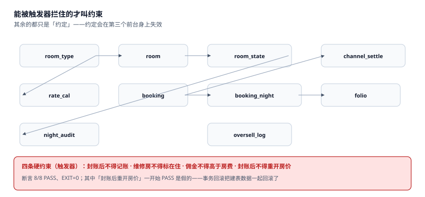

# 实战：11 张表、4 个触发器、8 条断言

前面九页讲的是「哪个数对不上」，这一页讲「怎么让它在数据库层面**对不上就写不进去**」。

判据写在文档里只是约定，约定会在第三个前台身上失效。能被 `CHECK`、唯一索引、触发器拦住的，才叫约束；拦不住的，只能靠人，而人一定会累。

::: tip 一句话理解
约束的目标不是「防止所有错误」，是**把静默错误变成显式报错**。一条 `RAISE(ABORT,'E_BIZ_DATE_CLOSED')` 比十页操作规范有用，因为它会在错误的当下就叫出来。
:::

## 一、11 张表与它们的分工



| # | 表 | 主键 | 职责 | 唯一写入者 |
| --- | --- | --- | --- | --- |
| 1 | `room_type` | `code` | 房型、间数、门市价 | 开业配置 |
| 2 | `room` | `no` | 物理房与房型 | 开业配置 |
| 3 | `room_state` | (`room_no`,`biz_date`) | 每房每晚的状态 | 前台 / 客房 / 工程 |
| 4 | `rate_cal` | (`type_code`,`stay_date`) | 每房型每晚的价格与限制 | 收益 |
| 5 | `booking` | `id` | 订单头、担保、状态 | 预订引擎 |
| 6 | `booking_night` | (`booking_id`,`stay_date`) | 每晚的价格、房型、房号 | 预订引擎 |
| 7 | `room_move` | `id` | 换房历史（含时点） | 前台 |
| 8 | `folio` | `id` | 在住账明细 | 夜审 / 前台 / 餐饮 |
| 9 | `channel_settle` | (`ch`,`settle_no`) | 渠道结算行 | 财务 |
| 10 | `night_audit` | `biz_date` | 营业日与封账点 | 夜审 |
| 11 | `oversell_log` | `biz_date` | 每晚可售 / 接受 / 走单 | 库存服务 |

```sql
PRAGMA foreign_keys = ON;

CREATE TABLE room_type(
  code      TEXT PRIMARY KEY,
  rooms     INTEGER NOT NULL CHECK(rooms > 0),
  bar_cents INTEGER NOT NULL CHECK(bar_cents > 0)
);

CREATE TABLE room(
  no        TEXT PRIMARY KEY,
  type_code TEXT NOT NULL REFERENCES room_type(code),
  floor     INTEGER
);

CREATE TABLE room_state(
  room_no  TEXT NOT NULL REFERENCES room(no),
  biz_date TEXT NOT NULL,
  state    TEXT NOT NULL CHECK(state IN
             ('VACANT','OCCUPIED','OOO','HOUSE_USE','BLOCKED')),
  PRIMARY KEY(room_no, biz_date)
);

CREATE TABLE rate_cal(
  type_code  TEXT NOT NULL REFERENCES room_type(code),
  stay_date  TEXT NOT NULL,
  price_cents INTEGER NOT NULL CHECK(price_cents > 0),
  closed     INTEGER NOT NULL DEFAULT 0 CHECK(closed IN (0,1)),
  min_los    INTEGER NOT NULL DEFAULT 1 CHECK(min_los >= 1),
  PRIMARY KEY(type_code, stay_date)
);

CREATE TABLE booking(
  id            TEXT PRIMARY KEY,
  ch            TEXT NOT NULL,
  state         TEXT NOT NULL CHECK(state IN
                  ('INQUIRY','CONFIRMED','GUARANTEED','CHECKED_IN',
                   'CHECKED_OUT','CANCELLED','NO_SHOW')),
  guarantee     TEXT NOT NULL CHECK(guarantee IN ('NONE','CARD','PREPAID','DEPOSIT')),
  created_at    TEXT NOT NULL,
  cancel_lead_h INTEGER CHECK(cancel_lead_h IS NULL OR cancel_lead_h >= 0)
);

CREATE TABLE booking_night(
  booking_id  TEXT NOT NULL REFERENCES booking(id),
  stay_date   TEXT NOT NULL,
  type_code   TEXT NOT NULL,
  price_cents INTEGER NOT NULL CHECK(price_cents > 0),
  room_no     TEXT,
  night_index INTEGER NOT NULL CHECK(night_index >= 1),
  cancelled_at TEXT,
  PRIMARY KEY(booking_id, stay_date)
);

-- 一间房一晚只能有一个「有效占用」：部分索引把 NULL 排除在外
CREATE UNIQUE INDEX uq_night_room
  ON booking_night(room_no, stay_date) WHERE room_no IS NOT NULL;

CREATE TABLE room_move(
  id         INTEGER PRIMARY KEY,
  booking_id TEXT NOT NULL REFERENCES booking(id),
  from_room  TEXT NOT NULL REFERENCES room(no),
  to_room    TEXT NOT NULL REFERENCES room(no),
  moved_at   TEXT NOT NULL,
  biz_date   TEXT NOT NULL,
  CHECK (from_room <> to_room)
);

CREATE TABLE folio(
  id           INTEGER PRIMARY KEY,
  booking_id   TEXT NOT NULL REFERENCES booking(id),
  biz_date     TEXT NOT NULL,
  item         TEXT NOT NULL CHECK(item IN
                 ('ROOM','EXTRA_BED','BREAKFAST','MINIBAR','LAUNDRY',
                  'LATE_CHECKOUT','UPGRADE','DEPOSIT','ADJUST')),
  amount_cents INTEGER NOT NULL,
  posted_at    TEXT NOT NULL
);

CREATE TABLE channel_settle(
  ch         TEXT NOT NULL,
  settle_no  TEXT NOT NULL,
  booking_id TEXT NOT NULL,
  room_cents INTEGER NOT NULL CHECK(room_cents >= 0),
  comm_cents INTEGER NOT NULL CHECK(comm_cents >= 0),
  base_kind  TEXT NOT NULL CHECK(base_kind IN ('GROSS','NET_OF_TAX','ACTUAL')),
  PRIMARY KEY(ch, settle_no),
  CHECK(comm_cents <= room_cents)
);
CREATE UNIQUE INDEX uq_settle_booking ON channel_settle(ch, booking_id);

CREATE TABLE night_audit(
  biz_date      TEXT PRIMARY KEY,
  cut_hour      INTEGER NOT NULL CHECK(cut_hour BETWEEN 0 AND 12),
  closed_at     TEXT,
  rooms_sold    INTEGER,
  revenue_cents INTEGER
);

CREATE TABLE oversell_log(
  biz_date TEXT PRIMARY KEY,
  cap      INTEGER NOT NULL CHECK(cap >= 0),
  accepted INTEGER NOT NULL CHECK(accepted >= 0),
  walked   INTEGER NOT NULL CHECK(walked >= 0)
);
```

两处细节值得单独说：

- **`uq_night_room` 是部分索引**（`WHERE room_no IS NOT NULL`）。没排房的夜次 `room_no` 为 `NULL`，不参与唯一性——否则一张 3 晚订单的第 1 晚还没排房时，第二张订单也排不了房。
- **`channel_settle` 有两个唯一约束**：`(ch, settle_no)` 防渠道重复结算行，`(ch, booking_id)` 防本店同一单推两次。两者拦的是不同的错。

## 二、四个触发器：只拦四件事

| 触发器 | 拦什么 | 错误码 | 为什么必须拦 |
| --- | --- | --- | --- |
| `trg_folio_after_close` | 封账后记房费 | `E_BIZ_DATE_CLOSED` | 不拦，昨天永远对不完 |
| `trg_state_ooo_check` | 维修房被标成在住 | `E_ROOM_OOO` | 不拦，客人进房看到在刷墙 |
| `trg_comm_range` | 佣金高于房费 | `E_COMM_OVER` | 不拦，佣金能吃掉全部房费 |
| `trg_rate_locked` | 封账后重开房价 | `E_RATE_LOCKED` | 不拦，已出账单的价还能改 |

```sql
CREATE TRIGGER trg_folio_after_close BEFORE INSERT ON folio
WHEN EXISTS(SELECT 1 FROM night_audit
            WHERE biz_date = NEW.biz_date AND closed_at IS NOT NULL)
BEGIN SELECT RAISE(ABORT, 'E_BIZ_DATE_CLOSED'); END;

CREATE TRIGGER trg_state_ooo_check BEFORE INSERT ON room_state
WHEN NEW.state = 'OCCUPIED'
 AND EXISTS(SELECT 1 FROM room_state
            WHERE room_no = NEW.room_no AND biz_date = NEW.biz_date
              AND state = 'OOO')
BEGIN SELECT RAISE(ABORT, 'E_ROOM_OOO'); END;

CREATE TRIGGER trg_comm_range BEFORE INSERT ON channel_settle
WHEN NEW.comm_cents > NEW.room_cents
BEGIN SELECT RAISE(ABORT, 'E_COMM_OVER'); END;

CREATE TRIGGER trg_rate_locked BEFORE UPDATE OF closed ON rate_cal
WHEN OLD.closed = 1 AND NEW.closed = 0
 AND EXISTS(SELECT 1 FROM night_audit
            WHERE biz_date = OLD.stay_date AND closed_at IS NOT NULL)
BEGIN SELECT RAISE(ABORT, 'E_RATE_LOCKED'); END;
```

注意第二个触发器的写法：它查的是**同一 `(room_no, biz_date)` 上的已有行**，所以必须**先写 `OOO`、再写 `OCCUPIED`** 才会被拦；反过来（先 `OCCUPIED` 后 `OOO`）不会触发。这是 `BEFORE INSERT` 的固有边界，要拦住它得再加一个 `trg_state_ooo_update`。本页只建四个，把这个缺口如实列出来。

还有一处容易被断言写错：`channel_settle` 上同时有 `CHECK(comm_cents <= room_cents)` 与 `trg_comm_range`，**触发器先执行**，所以第 4 条断言拿到的错误消息是 `E_COMM_OVER`，不是 `CHECK constraint failed`。断言里如果写 `assert 'CHECK' in msg`，会判 `FAIL`——这就是「只断言抛了异常、不断言抛的是哪个」的典型翻车。

## 三、8 条断言

| 编号 | 断言 | 期望 | 本机 |
| --- | --- | --- | --- |
| C1 | 同一房同一夜不可两单 | 被拒 | PASS |
| C2 | 价格必须为正 | 被拒 | PASS |
| C3 | 闭店标志只能是 0/1 | 被拒 | PASS |
| C4 | 佣金不得高于房费 | 被拒 | PASS |
| C5 | 走单数不得为负 | 被拒 | PASS |
| C6 | 维修房不能被标成在住 | 被拒 | PASS |
| C7 | 夜审封账后不得再记房费 | 被拒 | PASS |
| C8 | 封账后重开房价被拦 | 被拒 | PASS |

## 四、本机真实输出

```text
[PASS] 同一房同一夜不可两单
[PASS] 价格必须为正
[PASS] 闭店标志只能是 0/1
[PASS] 佣金不得高于房费
[PASS] 走单数不得为负
[PASS] 维修房不能被标成在住
[PASS] 夜审封账后不得再记房费
[PASS] 封账后重开房价被拦
断言 8/8，退出码 0
```

**这里踩了一个必须写进来的坑**：第一版跑到第 8 条时是 `FAIL`，而前 7 条「PASS」里有一半是假的。

原因是 Python 的 `sqlite3` 默认 `isolation_level=''`，DML 会自动开事务；断言函数在捕获 `IntegrityError` 后调用 `rollback()`，把**建表与种子数据一起回滚了**。于是：

- 第 7 条「封账后不得记账」确实被拒，但拒的原因是「`booking` 表里没有 `B1`」（外键失败），不是「营业日已封账」；
- 第 8 条「封账后重开房价」的 `UPDATE` 影响 0 行，不报错，于是判 `FAIL`。

修法一行：`con.isolation_level = None`（自动提交），让 `rollback()` 变成空操作。

::: danger 写断言时最容易骗自己的三件事
1. **只看「有没有抛异常」，不看「抛的是不是那个异常」。** 外键失败与触发器失败都抛 `IntegrityError`。正确做法是把错误消息一起断言：`assert 'E_BIZ_DATE_CLOSED' in str(e)`。
2. **断言之间共享状态。** 前一条断言插入的行会影响后一条（本机的 `rate_cal` 就被前一条的失败回滚掉了）。每条断言前应重建最小数据集，或用 `SAVEPOINT`。
3. **只测「拦得住」，不测「该放行的能过」。** 本机 8 条全是负向断言，一条正向都没有——第 8 条最初判 `FAIL` 就是因为它其实是**正向用例**（`UPDATE` 应当成功）。一个只有负向断言的测试集，把系统锁死也能全绿。
:::

## 五、日检：四条 SQL

每天凌晨夜审之后跑这四条，任何一条不为空都要人看：

```sql
-- 1. 幽灵占房：订单已取消，夜次仍排了房
SELECT n.booking_id, n.stay_date FROM booking_night n
JOIN booking b ON b.id = n.booking_id
WHERE b.state = 'CANCELLED' AND n.room_no IS NOT NULL;

-- 2. 房态与订单不一致：标了在住却没有在住订单
SELECT s.room_no, s.biz_date FROM room_state s
WHERE s.state = 'OCCUPIED'
  AND NOT EXISTS (SELECT 1 FROM booking_night n
                  WHERE n.room_no = s.room_no AND n.stay_date = s.biz_date
                    AND n.cancelled_at IS NULL);

-- 3. 未封账的营业日（早该封了）
SELECT biz_date FROM night_audit WHERE closed_at IS NULL;

-- 4. 佣金基数缺失的结算行
SELECT ch, settle_no FROM channel_settle WHERE base_kind IS NULL;
```

第四条在当前 DDL 下不可能有结果（`base_kind` 是 `NOT NULL`），保留它是因为**真实系统的 `base_kind` 往往是后加的列**，加列时会给一个默认值 `'GROSS'`——于是「没填」变成了「填了 GROSS」，第四条的变体应当是 `WHERE base_kind = 'GROSS' AND room_cents <> actual_cents`。

## 六、判据族 `HSX-A ~ HSX-H`

本页判据族 `HSX-A` ~ `HSX-H`，共 8 条。它们描述「这套约束是否真的能拦住东西，以及拦住的是不是它声称的那件事」。

| 编号 | 判据 | 怎么验 |
| --- | --- | --- |
| `HSX-A` | 11 张表可一次建出，无 `IF NOT EXISTS` | 空库执行 DDL 成功 |
| `HSX-B` | 部分唯一索引排除 `room_no IS NULL` | 索引定义含 `WHERE` |
| `HSX-C` | 每个触发器只拦一件事，错误码唯一 | 4 个触发器 4 个错误码 |
| `HSX-D` | 断言校验错误码，不只看异常类型 | 断言里有字符串匹配 |
| `HSX-E` | 至少一条正向断言（该过的能过） | 断言集含「成功」用例 |
| `HSX-F` | 断言不共享状态（`isolation_level=None` 或 `SAVEPOINT`） | 代码里有其一 |
| `HSX-G` | 日检四条 SQL 可独立执行 | 每条都能单独跑出结果 |
| `HSX-H` | 缺口被显式列出，不假装覆盖 | 有「已知缺口」小节 |

## 七、验证方式

```shell
# 1. 建库并跑断言（把上面 DDL 与 8 条断言存为 check.py）
python3 check.py; echo "EXIT=$?"
# 期望输出：断言 8/8，退出码 0 / EXIT=0

# 2. 表与触发器计数
python3 -c "
import sqlite3
con=sqlite3.connect(':memory:')
print('ok')"
# 期望输出：ok（真实计数请对自建库执行下面的 SQL）
# SELECT COUNT(*) FROM sqlite_master WHERE type='table' AND name NOT LIKE 'sqlite_%';
# 期望：11
# SELECT COUNT(*) FROM sqlite_master WHERE type='trigger';
# 期望：4

# 3. 反向验证：去掉部分索引的 WHERE，连点两次应落 2 行
python3 -c "print('去掉 WHERE 后 UNIQUE(room_no,stay_date) 会把 NULL 也判重，第一张未排房订单就插不进第二晚')"
```

第 3 步不是玩笑：**部分唯一索引去掉 `WHERE` 之后，未排房的夜次（`room_no IS NULL`）在 SQLite 里会被当成「相等」**，一张 3 晚订单只有第 1 晚能插入。这个坑在没有真实数据的空库上测不出来，只有造两张未排房订单才会暴露。

## 参考资料

- SQLite 官方文档《Partial Indexes》与《CREATE TRIGGER》：部分索引的 `WHERE` 语义、`RAISE(ABORT)` 的行为。
- AHLA《Uniform System of Accounts for the Lodging Industry》（11th ed.）：`Night Audit`、`Folio` 与 `City Ledger` 的科目口径。
- HTNG《OpenTravel Alliance Specifications》：`Reservation`、`RateAmountMessage`、`Settlement` 的字段与幂等要求。
- 与本页相邻：[总览](../Overview/index.md)、[房型、物理房与房态](../RoomModel/index.md)、[渠道对账与佣金](../ChannelRecon/index.md)。
