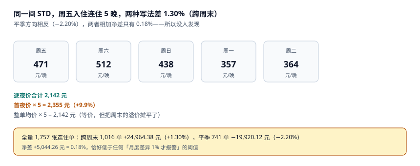

# 日历价：逐夜价、限制与连住

客房价格的载体不是一个数字，而是一张**日历**：60 晚 × 4 个房型 = 240 个格子，每格一个价、一组限制。它每天被改几十次（收益经理盯竞品、追展会、放尾房），所以它既是全店最活跃的表，也是全店最容易出错而不被发现的表。

错一晚的代价不大：按本机 ADR 446.82 元算，少收 50 元一晚、一个月也就 1,500 元。真正的代价是**它错了没人知道**——日历价不上报表、不进对账，只能靠客人投诉「为什么比携程贵」。

::: tip 一句话理解
房价必须**按夜**存：`(type_code, stay_date) → price`。任何「一个价 × 夜数」的写法，在跨周末、跨节假日、跨旺季时都会偏，而且偏的方向不一致，净差看起来很小。
:::

## 一、日历价的数据结构

```sql
CREATE TABLE rate_cal(
  type_code  TEXT NOT NULL REFERENCES room_type(code),
  stay_date  TEXT NOT NULL,
  price_cents INTEGER NOT NULL CHECK(price_cents > 0),
  closed     INTEGER NOT NULL DEFAULT 0 CHECK(closed IN (0,1)),
  min_los    INTEGER NOT NULL DEFAULT 1 CHECK(min_los >= 1),
  max_los    INTEGER CHECK(max_los IS NULL OR max_los >= min_los),
  cta        INTEGER NOT NULL DEFAULT 0 CHECK(cta IN (0,1)),  -- closed to arrival
  ctd        INTEGER NOT NULL DEFAULT 0 CHECK(ctd IN (0,1)),  -- closed to departure
  PRIMARY KEY(type_code, stay_date)
);
```

五个字段解决五类限制：

| 字段 | 含义 | 典型用法 | 设错会怎样 |
| --- | --- | --- | --- |
| `closed` | 这一晚整晚不卖 | 超额预订后的止血 | 忘记打开，房空一晚 |
| `min_los` | 最少住几晚 | 节假日防「只住一晚占房」 | 设成 3，散客全跑光 |
| `max_los` | 最多住几晚 | 防长住压价 | 设太小，长住客人订不进 |
| `cta` | 这一晚不能「到店」 | 满房夜不收新到店 | 与 `closed` 混用，报表分不清 |
| `ctd` | 这一晚不能「离店」 | 防「住一晚就走」的隔夜单 | 客人想走却走不了，客诉 |

`closed` 与 `cta` 的区别是本页最容易混的一处：**`closed` 表示这一晚没有任何人住**，`cta` 表示**这一晚可以有人住，但不能是今天来的**。满房夜正确做法是 `cta=1`（在住客可以续住），而不是 `closed=1`（把续住也关了）。

## 二、逐夜价 vs 一个价乘夜数



一间 STD，周五入住连住 5 晚：

| 夜 | 星期 | 价 |
| --- | --- | --- |
| 第 1 晚 | 周五 | 471 |
| 第 2 晚 | 周六 | 512 |
| 第 3 晚 | 周日 | 438 |
| 第 4 晚 | 周一 | 357 |
| 第 5 晚 | 周二 | 364 |

三种算法：

| 算法 | 表达式 | 合计 | 差 |
| --- | --- | --- | --- |
| 逐夜价 | 471 + 512 + 438 + 357 + 364 | **2,142** | 基准 |
| 首夜价 × 5 | 471 × 5 | 2,355 | +9.9% |
| 整单均价 × 5 | 428.4 × 5 | 2,142 | 金额对、明细错 |

全量 1,757 张连住单的实测：

| 分组 | 单数 | 差额 | 比例 |
| --- | --- | --- | --- |
| 跨周末 | 1,016 | **+24,964.38** | **+1.30%** |
| 平季 | 741 | **−19,920.12** | **−2.20%** |
| 合计 | 1,757 | **+5,044.26** | **+0.18%** |

**这才是本页最值得记住的一组数**：跨周末时「首夜价」偏高（周五最贵），平季时偏低（因为首夜往往是周日），两个方向的误差互相抵消，净差只有 0.18%——恰好低于任何「月度差异超过 1% 才报警」的阈值。

也就是说：**用「首夜价 × 夜数」的店，账面上几乎看不出来，但每一张账单都是错的**。客人拿到账单会发现「为什么第 4 晚按周五的价收」，这就是客诉的来源。

::: danger 三个房价上的必错
1. **用 `rooms × ADR` 反推收入。** ADR 是「房费收入 / 已售房晚」，反推出来的收入永远等于实际（因为 ADR 就是它算的），看起来「对得上」，实际上掩盖了「有 12% 的房晚是免费房/自用房」。
2. **把早餐价并进房价。** 本机 62% 的单含早，早餐 45 元摊进房价后，ADR 虚高 **27.90 元**（6.2%）。含早与不含早的单混在一起算 ADR，同比就没有意义。
3. **限制（`min_los`）与价格分开维护。** 改了 `min_los=3` 却没同步渠道，渠道仍按 1 晚卖，到店发现「1 晚的客人占了 3 晚的位置」。
:::

## 三、连住折与「平均每晚」的陷阱

连住折的三种写法，结果不同：

| 写法 | 规则 | 5 晚订单实收 | 问题 |
| --- | --- | --- | --- |
| 按整单打折 | 总价 × 0.92 | 1,970.64 | 简单，但把周末的溢价也打了折 |
| 按第 2 晚起打折 | 首晚全价，其余 × 0.92 | 2,009.28 | 相对合理，需要「第几晚」的概念 |
| 按夜逐一定价 | 每晚按日历价 × 该晚折扣 | 可变 | 最准确，但要求日历价逐夜可查 |

第二种是行业主流。它的实现要求 `booking_night` 上有 `night_index`（第几晚），否则「第 2 晚起」这个条件在 SQL 里写不出来——只能靠应用层循环，一旦重算就会错。

本机的价格模型只做「逐夜价」，不打折；这也是为什么跨周末 +1.30%、平季 −2.20% 的误差能干净地暴露出来：**任何折扣都会掩盖定价错误**，因为折扣本身就是一个「差一点」的数。

## 四、最低价保证与渠道价差

「官网最便宜」是一条承诺，也是一条**可被机器验证的判据**：

```sql
-- 找出「渠道价低于官网 BAR」的夜
SELECT r.type_code, r.stay_date, r.price_cents AS bar,
       MIN(c.price_cents) AS best_channel
FROM rate_cal r
JOIN channel_rate c
  ON c.type_code = r.type_code AND c.stay_date = r.stay_date
WHERE c.price_cents < r.price_cents
GROUP BY r.type_code, r.stay_date;
```

这条查询的结果应该是空集。一旦不为空，要么是渠道在补贴（平台券不该算进房价），要么是日历价没同步（本店改了价，渠道还是旧价）。两者的处置完全不同：前者不改价，后者要立刻推一次全量。

本机的渠道价差（对账页的第三类差异）有 43 单、1,229.02 元，占问题金额的 4.8%——**金额不大，但它是最容易演变成客诉的一类**，因为客人会拿着截图来前台。

## 五、判据族 `HSR-A ~ HSR-H`

本页判据族 `HSR-A` ~ `HSR-H`，共 8 条。它们描述「价格是否按夜可查、限制是否与价格同源、渠道价是否可验证」。

| 编号 | 判据 | 怎么验 |
| --- | --- | --- |
| `HSR-A` | 价格按 `(房型, 夜)` 存储，一晚一行 | `COUNT(*) = 房型数 × 天数` |
| `HSR-B` | 账单能打出「每晚多少」，不是只有合计 | 账单明细含 `stay_date` |
| `HSR-C` | `closed` 与 `cta` 语义分开 | 两列都存在，且满房夜用 `cta` |
| `HSR-D` | `min_los` 与价格同表维护、同批下发 | 同一事务写两个字段 |
| `HSR-E` | 连住折的「第几晚」可查 | `booking_night` 有 `night_index` |
| `HSR-F` | 官网上 BAR 可被查询验证 | 存在 BAR 视图或接口 |
| `HSR-G` | 渠道价低于 BAR 能自动检出 | 有该查询或告警 |
| `HSR-H` | 封账后该夜价格不可改（或改动留痕） | 触发器或审计表 |

## 六、验证方式

```shell
# 1. 5 晚逐夜价（期望 2142）
python3 -c "print(sum([471,512,438,357,364]))"
# 期望输出：2142

# 2. 首夜价 × 5 的偏差（期望 +9.9%）
python3 -c "
a=sum([471,512,438,357,364]); b=471*5
print(b, round((b-a)/a*100,1))"
# 期望输出：2355 9.9

# 3. 跨周末与平季的净差（期望 0.18%）
python3 -c "
we=24964.38; off=-19920.12
tot=we/0.0130 + (-off)/0.0220
print(round(we+off,2), round((we+off)/tot*100,2))"
# 期望输出：5044.26 0.18
```

第 3 步说明的是「净差掩盖方向」：两个方向的误差各 1~2 个点，加起来只剩 0.18%。**做对账时一定要按「跨周末 / 平季」分组看，只看总额会以为没事。**

## 参考资料

- AHLA《Uniform System of Accounts for the Lodging Industry》（11th ed.）：`BAR`（Best Available Rate）与 `Rate Plan` 的定义。
- HTNG《OpenTravel Alliance Specifications》：`RateAmountMessage` 的 `BaseRate`、`LengthOfStay` 与 `Restriction` 字段。
- 《中华人民共和国价格法》第十三条：经营者销售商品应当明码标价，不得在标价之外加价出售。
- 与本页相邻：[可售库存与超售额度](../Availability/index.md)、[预订、担保与超售处置](../Booking/index.md)、[渠道对账与佣金](../ChannelRecon/index.md)。
