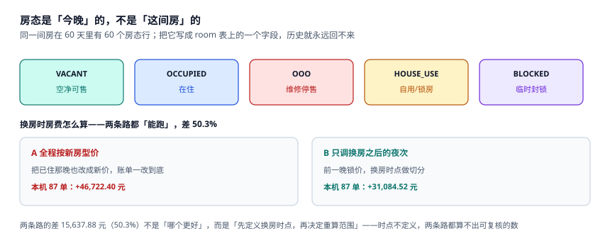

# 房型、物理房与房态

「还剩几间」这个问题，答案取决于你问的是**房型**还是**物理房**。本机 120 间房分四个房型（STD 60 / DLX 36 / FAM 16 / SUI 8），某晚 STD 卖满了、FAM 还空着 3 间，前台会告诉你「还有房」——因为在物理房层面确实有，只是**不在客人想住的房型里**。

房态系统要同时回答这两个问题，而且不能靠一张表硬扛：房型层面要「卖了几间、还能卖几间」，物理房层面要「这间今晚谁住、能不能住」。

::: tip 一句话理解
房态是**「房 × 营业日」的一行**，不是房间上的一个字段。字段只能表达「此刻」，表达不了「10 月 3 日这间房在维修」——而后者才是对账要用的那个。
:::

## 一、三层模型：房型、物理房、房态

| 层 | 表 | 主键 | 回答什么 | 变更频率 |
| --- | --- | --- | --- | --- |
| 房型 | `room_type` | `code` | 这个房型有几间、门市价多少 | 极低（改造时才变） |
| 物理房 | `room` | `no` | 这间房是哪个房型、在几楼 | 低（换房型罕见） |
| 房态 | `room_state` | (`room_no`, `biz_date`) | 这间房这一晚是什么状态 | **每晚都写** |

```sql
CREATE TABLE room_type(
  code       TEXT PRIMARY KEY,
  rooms      INTEGER NOT NULL CHECK(rooms > 0),
  bar_cents  INTEGER NOT NULL
);
CREATE TABLE room(
  no        TEXT PRIMARY KEY,
  type_code TEXT NOT NULL REFERENCES room_type(code),
  floor     INTEGER
);
CREATE TABLE room_state(
  room_no  TEXT NOT NULL REFERENCES room(no),
  biz_date TEXT NOT NULL,                       -- 营业日，不是自然日
  state    TEXT NOT NULL CHECK(state IN
             ('VACANT','OCCUPIED','OOO','HOUSE_USE','BLOCKED')),
  PRIMARY KEY(room_no, biz_date)
);
CREATE INDEX idx_state_date ON room_state(biz_date, state);
```

三层的分工很重要：**房型有「可售数」，物理房只有「状态」**。把可售数存到 `room_type.rooms` 上，就等于宣称「这个房型永远是满配」——本机 60 晚里维修平均 3.05 间，意味着可售数每天都在变。

## 二、五态与它们的边界



| 状态 | 含义 | 谁可以写 | 计入可售 | 常见错法 |
| --- | --- | --- | --- | --- |
| `VACANT` | 空净可售 | 客房部 | 是 | 只按「有没有人住」判断，忽略脏房 |
| `OCCUPIED` | 在住 | 前台（入住时写） | 否 | 退房后不回写，第二天仍占着 |
| `OOO` | 维修停售 | 工程部 | 否 | 与 `BLOCKED` 混用，报表分不清 |
| `HOUSE_USE` | 自用 / 免费房 | 店长 | 否 | 计入「已售」，拉高 ADR |
| `BLOCKED` | 临时封锁（如待修） | 前台 | 否 | 忘记解封，房永远卖不出去 |

`OOO` 与 `BLOCKED` 的区别不是措辞，是**责任人与时长**：`OOO` 由工程部开、要写预计恢复日，通常跨多晚；`BLOCKED` 由前台开，通常当晚就解。混用之后，「维修损失了多少房晚」这个数就永远算不出来——本机 227 个房晚的损失（占物理房晚的 3.15%）里，维修 3.05/晚、锁房 0.73/晚，两者相差 4 倍，混在一起看会得出完全不同的结论。

::: danger 三个房态上的必错
1. **把「脏房」当成可售。** 前一位客人 12:00 退房，`VACANT` 但未清洁。系统显示可售、渠道也卖了出去，客人 14:00 到店发现房没收拾。正确做法是给 `VACANT` 加 `dirty` 子状态，或在 `room_state` 加 `clean_at` 时间戳。
2. **退房时不回写次日的房态。** 本机有 3.4% 的在住跨过 3 晚以上，退房只改当天，后面几晚仍是 `OCCUPIED`，可售数被永久少算。
3. **用 `room.status` 字段代替 `room_state` 表。** 一旦这么做，「昨天这间房是什么状态」就查不到，夜审重算、维修统计、客诉复盘全部失效。
:::

## 三、物理房超卖 vs 房型超卖

这是两个完全不同的问题：

| 类型 | 表现 | 后果 | 处置 |
| --- | --- | --- | --- |
| 房型超卖 | STD 卖了 61 间，实际 60 间 | **可消化**：升级到 DLX | 付升级价差（本机 140 元/晚） |
| 物理房超卖 | 全店 121 位客人，只有 120 间房 | **不可消化**：必须走单 | 1.5 倍房费 + 交通（本机 998 元） |

本机 60 晚里，「房型住满但酒店还有空房」的格子有 **77 个**——这 77 个「夜 × 房型」就是升级的缓冲垫。也就是说：**房型超卖不一定导致走单，物理房超卖一定导致走单**。

两者在数据模型上的区别只有一处：`booking_night` 上的 `type_code` 是「卖的是什么」，`room_no` 是「住的是哪间」。允许 `type_code = 'STD'` 而 `room_no` 属于 `DLX`——这不是数据错误，这是升级。反过来，如果拿 `room_no` 反推 `type_code` 去做库存统计，升级就会被算成「STD 少卖一间、DLX 多卖一间」，两个房型的入住率同时错。

::: warning 升级要不要改价
两条都成立，取决于合同：
- **免费升级**：`booking_night.price_cents` 保持不变，只改 `room_no`。客人付 STD 的价住 DLX，升级成本由酒店承担（本机 140 元/晚）。
- **付费升级**：新增一条 `folio` 明细（`item='UPGRADE'`），房费不变、杂费增加。这样 ADR 不被污染，升级收入单独可见。

不要做的事：直接改 `price_cents`。那会让「这个房型卖了多少均价」永久失真，而且客人拿到的确认信与账单不一致。
:::

## 四、换房：先定「时点」，再定「重算范围」

换房是房态系统里唯一一个**同时改房态与改钱**的动作。本机 87 单换房（占连住单的 5%）在两条实现路径下差 **50.3%**：

| 路径 | 做法 | 本机金额 | 问题 |
| --- | --- | --- | --- |
| A 全程按新房型 | 把整段住宿的每晚价格都改成新房型的价 | +46,722.40 元 | 客人已住的那晚被追溯涨价 |
| B 只调换房后夜次 | 前一晚锁价，换房时点做切分 | +31,084.52 元 | 需要「换房时点」这个字段 |

两者差 **15,637.88 元**。这不是「哪个更合理」的争论，而是**必须先定义换房时点**：是「客人搬过去的那一刻」，还是「新房间的入住登记生效时」，还是「结算时按夜切分」。时点不定义，两条路都算不出可复核的数。

工程上的做法是给 `booking_night` 加一个 `room_no` 的**变更历史**（或独立 `room_move` 表），记录 `from_room`、`to_room`、`moved_at`，然后按 `moved_at` 所在营业日切分。这样「住到一半换房」与「换房发生在凌晨 1 点」都能落到唯一的一个夜里。

## 五、判据族 `HSK-A ~ HSK-H`

本页判据族 `HSK-A` ~ `HSK-H`，共 8 条。它们描述「房态是否按夜留存、房型与物理房是否分开、升级与换房是否可追溯」。

| 编号 | 判据 | 怎么验 |
| --- | --- | --- |
| `HSK-A` | 房态主键含营业日，行数 = 房数 × 天数 | `COUNT(*) = 120 × 60`（±停业日） |
| `HSK-B` | `OOO` 与 `BLOCKED` 分开，各有责任人与预计恢复日 | 两态都存在，且有 `until_date` 或等价列 |
| `HSK-C` | 退房回写覆盖整段住宿的剩余夜次 | 退房后该单所有 `booking_night` 的房态非 `OCCUPIED` |
| `HSK-D` | 允许 `booking_night.room_no` 的房型与 `type_code` 不同（升级） | 存在升级单，且不触发约束 |
| `HSK-E` | 换房有独立变更记录（含时点） | 存在 `room_move` 表或等价历史 |
| `HSK-F` | 同一房同一夜不得两单 | 部分唯一索引 `(room_no, stay_date)` |
| `HSK-G` | 维修房不得被标成在住 | 触发器拦 `OCCUPIED` 覆盖 `OOO` |
| `HSK-H` | 脏房不参与可售（或单独标记清洁时点） | 存在 `clean_at` 或 `dirty` 语义 |

## 六、验证方式

```shell
# 1. 房态行数（本机 120 房 × 60 晚）
python3 -c "print(120*60)"
# 期望输出：7200

# 2. 维修与锁房的差（4 倍，混用会掩盖结论）
python3 -c "
ooo=3.05; hu=0.73
print(round(ooo/hu,2), '倍'); print('损失房晚', round((ooo+hu)*60))"
# 期望输出：4.18 倍 / 损失房晚 227

# 3. 换房两条路径的差（期望 50.3%）
python3 -c "
a=46722.40; b=31084.52
print('差', round(a-b,2), '比例', round((a-b)/b*100,1))"
# 期望输出：差 15637.88 比例 50.3
```

第 3 步是本页的收尾判据：**同一批换房单，两条路径必须能算出两个不同的数**。如果两条路径算出同一个数，说明其中一条其实没有按「时点」切分，只是换了个说法。

## 参考资料

- 《旅馆业治安管理办法》（公安部令第 36 号，2020 年修订）：住宿登记项目与旅客身份核验要求。
- GB/T 14308—2023《旅游饭店星级的划分与评定》：客房类型（单人间、双人间、套间）与面积、设施的分级口径。
- HTNG《Guest Room Management Interface Specification》：房态（`Room Status`）与客房清洁状态的接口定义。
- 与本页相邻：[可售库存与超售额度](../Availability/index.md)、[入住、换房与在住账](../Checkin/index.md)、[实战](../Practice/index.md)。
