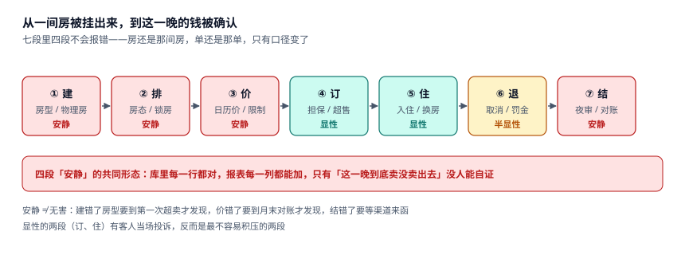
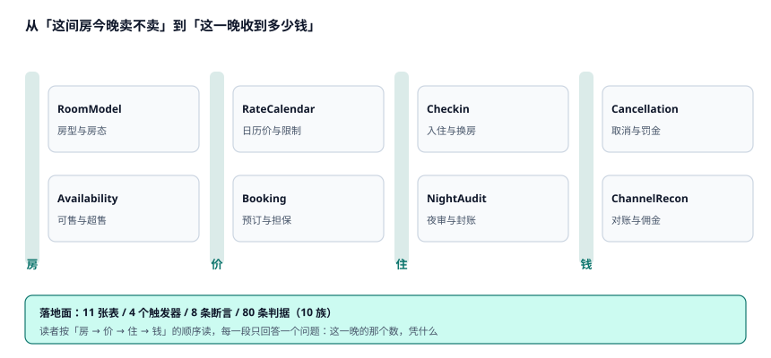

# 酒店与民宿的房态、房价与渠道对账工程

凌晨一点半，客人到店，前台在系统里找不到他的订单——不是没有这笔单，是这笔单**落在昨天**。他 00:47 下的单，渠道 00:51 推过来，系统的营业日切在 00:00，于是这张单被记进了新的一天；而房间库存的扣减还挂在昨天，因为房态是按「夜」算的。前台能看到「有单」，也能看到「有房」，但这两个「有」指的是**不同的两个晚上**。

**酒店系统的难点不是「算不对」，而是「一间房在同一晚被四个地方各记一次」**：房态说这间房今晚能不能住人，库存说这个房型今晚还能卖几间，日历价说这一晚卖多少钱，结算单说这一晚最后收到多少。改其中任何一本，另外三本不会跟着变。

::: tip 一句话理解
酒店卖的不是「一间房」，是**一间房在某一个「夜」上的使用权**；而「夜」不是自然日——它是从某个时刻切开、到次日同一时刻结束的一段营业日。切点定在哪，决定了收入落在哪个月、no-show 判在谁头上。
:::

## 一、这个专题讲什么

从一间房被挂出来，到这一晚的钱被确认，要走七段：

| 段 | 这一段在做什么 | 产物 | 失败是否安静 |
| --- | --- | --- | --- |
| ① 建 | 定房型、建物理房、配可售数 | `room_type` / `room` | **安静**（房型建错要到第一次超卖才发现） |
| ② 排 | 排房、锁房、维修停售 | `room_state` | **安静**（维修房被卖出去，客人到店才知道） |
| ③ 价 | 日历价、限制、连住规则 | `rate_cal` | **安静**（价格错一晚，只有对账能发现） |
| ④ 订 | 询价、担保、确认、超售 | `booking` / `booking_night` | 显性（订不上当场就投诉） |
| ⑤ 住 | 入住、换房、加床 | `booking_night.room_no` | 显性（换房算错，退房时吵） |
| ⑥ 退 | 取消、no-show、罚金 | `booking.state` | 半显性（罚金少收要等财务核） |
| ⑦ 结 | 夜审、封账、渠道对账 | `night_audit` / `channel_settle` | **安静**（差几百块，混在「正常波动」里） |

七段里**四段的失败是安静的**。它们的共同形态是：房还是那间房，单还是那单，报表每一列都能加得起来，只有「这一晚到底卖没卖出去、卖给了谁、收到多少」没人能自证。

本机读数最能说明问题的一组数字：60 晚 × 120 间房，接受 **3,081 张订单 / 6,585 个房晚**，入住率按可售房是 **94.44%**，按物理房是 **91.46%**，按「当晚实际开门」是 **96.37%**。同一个 6,585，三个分母三个数，差 **4.91 个百分点**。

| 视角 | 读数 | 它掩盖了什么 |
| --- | --- | --- |
| 物理房分母 | 91.46% | 把维修与锁房的 227 个房晚也算成「没卖出去」 |
| 可售房分母 | 94.44% | 看起来还行，但没算「当晚临时停售」 |
| 实际开门分母 | 96.37% | 最好看，但分母每天都在变，无法同比 |
| 拒单率 | 16.30% | 600 张单被拒，其中大量是「最后一间被别的渠道拿走」 |
| 走单（walk） | 5% 额度下 17 间 | 多卖的钱 7,684 元，补偿 16,966 元，**净亏 9,282 元** |

这就是酒店系统最典型的缺陷形态：**每个数字单独看都正常，放在一起就互相矛盾**。一个只盯「本月入住率」的看板，永远发现不了「95% 的入住率里有 3% 是把维修房算进了分母」这件事。

## 二、三个「还剩几间」与三个「这一晚多少钱」

| 口径 | 定义 | 谁在关心 | 常见错法 |
| --- | --- | --- | --- |
| 房态 `room_state` | 某个物理房在某个营业日的状态 | 前台、客房 | 把房态写成 `room` 表上的一个字段 |
| 可售库存 `availability` | 某房型某晚还能卖几间 | 渠道、收益 | 用「物理房数」直接当可售数 |
| 渠道分配 `allotment` | 某个渠道分到几间 | 渠道经理 | 分配之和大于可售数 |

| 口径 | 定义 | 谁在关心 | 常见错法 |
| --- | --- | --- | --- |
| 挂牌价 `BAR` | 门市最优可用价 | 收益 | 各渠道各改各的 |
| 逐夜价 | 每晚单独定价，跨周末会变 | 收益、账单 | 用一个价乘夜数 |
| 结算净价 | 房费减佣金、减税费后到账 | 财务 | 佣金按挂牌价算 |

### 一个必须自己算一遍的例子

一间 STD，周五入住连住 5 晚（周五 471 / 周六 512 / 周日 438 / 周一 357 / 周二 364）：

| 算法 | 表达式 | 合计 | 后果 |
| --- | --- | --- | --- |
| 逐夜价 | 471 + 512 + 438 + 357 + 364 | **2,142 元** | 正确：每晚按它自己的价 |
| 首夜价 × 5 | 471 × 5 | 2,355 元 | 多收 9.9%，客人比价后走人 |
| 整单均价 × 5 | 428.4 × 5 | 2,142 元 | 金额对、明细错，账单打不出「每晚多少」 |

三种算法都能写进代码，只有第一种回答了「这一晚是什么价」。

::: danger 三件事必须写进数据模型
1. **房态必须是「房 × 营业日」的行，不是房间表上的字段**。本机 120 间房 × 60 晚 = 7,200 行；写成字段后，昨天卖了什么、维修了几天，全部查不出来。
2. **营业日切点必须落库成一个可配置的值，并且每一笔账记下当时的切点**。本机 18.37% 的到店发生在 00:00–04:00 之间，切点从 00:00 改到 04:00，这 566 个房晚的归属日直接变，按均价 452 元算是 **255,832 元**的收入位移。
3. **佣金基数必须是字段，不是一个「大家都知道」的口径**。本机按含税房费算是 303,238.93 元，按不含税是 286,074.46 元（−5.66%），按扣掉取消后的实收是 266,850.26 元（−12.00%）——三张对账单都能自证。
:::

## 三、专题地图

按「一间房的一天」读：

| 阶段 | 页面 | 一句话 |
| --- | --- | --- |
| 立模型 | [房型、物理房与房态](RoomModel/index.md) | 房态是「今晚」的，不是「这间房」的 |
| 算库存 | [可售库存与超售额度](Availability/index.md) | 可售不是一个常量，是一晚一算的减法 |
| 定价 | [日历价与限制](RateCalendar/index.md) | 一个价乘夜数，跨周末就差 9.9% |
| 接单 | [预订、担保与超售处置](Booking/index.md) | 多卖一间赚 452，走一位赔 998 |
| 住进来 | [入住、换房与在住账](Checkin/index.md) | 换房重算的两条路差 50.3% |
| 切日 | [夜审与营业日切](NightAudit/index.md) | 切在哪，收入就落在哪 |
| 退掉 | [取消、no-show 与罚金](Cancellation/index.md) | 「按夜取消」需要一个数据模型 |
| 收钱 | [渠道对账与佣金](ChannelRecon/index.md) | 净额只暴露 70.8% 的问题金额 |
| 落地 | [实战：11 张表、4 个触发器、8 条断言](Practice/index.md) | 能被触发器拦住的才叫约束 |

## 四、和相邻专题的分工

本册只讲「一间房在某一晚卖没卖出去、卖多少钱、收到多少」。相邻主题各自讲透的部分，这里不重复：

| 相邻专题 | 它讲什么 | 本专题不重复讲 |
| --- | --- | --- |
| [预约与资源档期](../AppointmentBooking/Overview/index.md) | 时段容量、占位、候补 | 酒店卖的是**整夜**，不讲分钟级档期 |
| [电商库存](../Ecommerce/Inventory/index.md) | 中心可售、预占、超卖防护 | 房库存有**渠道分配**，不是一个大池子 |
| [定价与优惠](../PricingPromotion/Overview/index.md) | 规则引擎、优惠券、分摊 | 房价是**日历**驱动的，不讲券 |
| [收入确认](../RevenueRecognition/Overview/index.md) | 履约义务、递延、时点确认 | 房费按**夜**确认，只在对账页提一句 |
| [账务对账](../Ledger/Reconciliation/index.md) | 分录横平、未达账项、调节表 | 本册对的是**渠道结算单**，不是银行流水 |
| [租户隔离](../MultiTenantSaaS/TenantContext/index.md) | 多租户数据隔离 | 多店只讲**共享房型主数据**的那一处 |
| [消息通知](../NotificationDelivery/Operations/index.md) | 触达、回执、重投 | 确认信只讲**与房态冲突**的那一条 |
| [指标平台](../MetricPlatform/Overview/index.md) | 指标定义、口径契约 | 三个入住率口径只在本册展开一次 |
| [门店零售 POS](../RetailPOS/Overview/index.md) | 班结、钱箱、离线补传 | 前台收款只讲**挂账与夜审**的交界 |
| [订阅计费](../SubscriptionBilling/Overview/index.md) | 周期账单、按量计费 | 长住月结只讲**跨月归属**一条 |

## 五、版本组织：为什么不建版本目录

酒店侧最常见的疑问是「从单体 PMS 到云 PMS，文档是不是要分一代」。本册**不建 `LodgingOps/V1` 这类目录**，三条理由：

1. **换代的是部署形态，判据一字没变。** 「一间房一晚只能有一个在住」「可售 = 物理 − 维修 − 锁房」「封账后不得记账」这三条，从纸簿时代到今天都成立。把部署形态做成目录层级，会让读者以为「这三条在云上是另一套」。
2. **并存差异是业态与辖区，不是代际。** 城市商务酒店、度假村、民宿的差别在**渠道结构与最小停留**，不在链路本身；用版本目录去装「民宿」，会把商务条款问题伪装成代码分支问题。
3. **真正需要版本目录的是「同一份代码两套写法」。** 本库已有先例：[Spring5](../Java/Frame/Spring/Spring5/index.md) / [Spring6](../Java/Frame/Spring/Spring6/index.md)、[Vue2](../../Frontend/Frame/Vue/Vue2/index.md) / [Vue3](../../Frontend/Frame/Vue/Vue3/index.md)——同一框架两代 API 并存，旧版必须原样保留并标注维护状态。

::: info 旧渠道与旧协议的处置口径
遇到只支持 XML 旧接口的渠道，**不新建章节**，在[渠道对账](ChannelRecon/index.md)的兼容表里加一行，标注「旧接口仅存量渠道使用，新签合同要求 JSON + 回调」。这条口径和本库对 Spring5 / Vue2 的处理一致：旧内容保留、标注状态、不覆盖。
:::

## 六、建议阅读顺序

1. 先读[总览](Overview/index.md)——把「四本账、三个入住率、三个价」立起来。
2. 再读[房型、物理房与房态](RoomModel/index.md)与[可售库存](Availability/index.md)——决定「还剩几间」是不是一个数。
3. 然后读[日历价](RateCalendar/index.md)与[预订](Booking/index.md)——一间房怎么被卖出去。
4. 接着读[入住与换房](Checkin/index.md)、[夜审](NightAudit/index.md)、[取消](Cancellation/index.md)——一晚怎么被确认、怎么被退回。
5. 最后读[渠道对账](ChannelRecon/index.md)与[实战](Practice/index.md)——钱怎么对上、约束怎么落到库里。

## 七、本册的读数从哪来

所有数字来自一台 16 GB 笔记本上的 SQLite 3.50.4 / Python 3.13.12，种子 `20261105`，规模是 **60 晚（2026-09-01 至 2026-10-30）× 120 间房（4 个房型）= 3,081 张被接受的订单、6,585 个房晚**，**不是生产数据，也不是压测结论**。写进正文的每一个数都可以按各页「验证方式」重跑：

| 读数 | 值 | 出现在 |
| --- | --- | --- |
| 物理房 / 维修 / 锁房 / 可售 | 120 / 3.05 / 0.73 / 116.22（均值） | [可售库存与超售额度](Availability/index.md) |
| 三个入住率 | 91.46% / 94.44% / 96.37% | [夜审与营业日切](NightAudit/index.md) |
| 拒单率 | 16.30%（600 / 3,681） | [可售库存与超售额度](Availability/index.md) |
| 超售 5% 的账 | 多卖 17 间 / 净 −9,282 元 | [预订、担保与超售处置](Booking/index.md) |
| 00:00–04:00 到店占比 | 18.37%（566 / 3,081） | [夜审与营业日切](NightAudit/index.md) |
| 逐夜价 vs 首夜价 | 跨周末 +1.30% / 平季 −2.20% / 净 0.18% | [日历价与限制](RateCalendar/index.md) |
| 换房两条重算路 | +46,722.40 vs +31,084.52（差 50.3%） | [入住、换房与在住账](Checkin/index.md) |
| 罚金覆盖率 | 24h 28.5% / 48h 50.9% / 72h 56.5% | [取消、no-show 与罚金](Cancellation/index.md) |
| 对账四形状 | 漏 20,436.86 / 重 3,766.80 / 价差 1,229.02 / 佣金差 352.84 | [渠道对账与佣金](ChannelRecon/index.md) |
| 佣金三口径 | 303,238.93 / 286,074.46 / 266,850.26 | [渠道对账与佣金](ChannelRecon/index.md) |
| 断言通过 | 8/8，退出码 0 | [实战](Practice/index.md) |

::: warning 这些数字不能直接当 SLA
单机 SQLite 的毫秒级与真实 PMS 的高并发不是一回事。本文用它们判断**方向和量级**（例如「超售额度超过 no-show 率就是净亏」「净额掩盖双向」），不用它们承诺收益。凡涉及金额的结论，文中都注明了「按本机读数」。
:::

## 参考资料

- 《旅馆业治安管理办法》（公安部令第 36 号，2020 年修订）：入住登记、旅客身份核验与住宿记录的法定要求，本册「入住必须落实名」一条的依据。
- 《中华人民共和国个人信息保护法》：住宿记录属于个人信息，`guest` 相关字段的最小化与保留期依据。
- GB/T 14308—2023《旅游饭店星级的划分与评定》：客房数量、房型配置与服务项目的分级口径，本册「房型与可售数」的业务背景。
- 《中华人民共和国民法典》合同编关于「定金与违约责任」的条款：取消罚金上限与「违约金过高可请求调整」的依据。
- HTNG（Hotel Technology Next Generation）《OpenTravel Alliance Specifications》：渠道 `ARI`（Availability / Rates / Inventory）同步的字段定义。
- 与本册相邻：[预约与资源档期](../AppointmentBooking/Overview/index.md)、[电商库存](../Ecommerce/Inventory/index.md)、[渠道对账与佣金](./ChannelRecon/index.md)。
