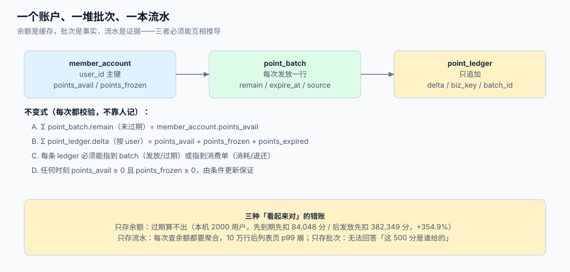

# 账户与流水：批次、余额与不变式

余额是这个系统里**唯一一个可以算错的数**。它出现在列表页、抵扣接口、客服工单、财务报表里，每一处都在做加减，而每一次加减都可能与其他加减并发。真正的解法不是「小心一点」，而是把余额降级成**缓存**：批次是事实，流水是证据，余额只是它们的一个投影，随时可以重建。

这一页给出可直接落库的模型：三层结构、完整 DDL、四条不变式、条件更新的写法、以及「时点余额」这个财务必问的问题怎么回答。



本页判据族 `LTM-A` ~ `LTM-H`，共 8 条。定义表在第七节。

## 一、三层结构，各管一件事

| 层 | 表 | 职责 | 不该放什么 |
| --- | --- | --- | --- |
| 缓存层 | `member_account` | 当前可用、冻结、累计过期三个数，供高频读取 | 到期日、来源、业务键 |
| 事实层 | `point_batch` | 每次发放一行：剩余多少、什么时候到期、从哪来 | 当前余额的权威值 |
| 证据层 | `point_ledger` | 每一次变动一行，只追加：发放、消耗、退还、过期、调整 | 可被 `update` 的字段 |

只存余额的系统在「客户问为什么少了 300 分」时只能回答「系统显示过期了」；只存流水的系统在列表页要聚合十万行。三层结构让高频读走缓存、追溯走事实、举证走证据。

## 二、完整 DDL

```sql
-- [schema/loyalty.sql]
create table member_account (
  user_id        bigint      primary key,
  tenant_id      bigint      not null,
  points_avail   bigint      not null default 0,
  points_frozen  bigint      not null default 0,   -- 冻结期内不可用
  points_expired bigint      not null default 0,   -- 累计过期（只增，便于对账）
  version        bigint      not null default 0,   -- 乐观锁（可选，条件更新不需要）
  updated_at     timestamptz not null default now(),
  check (points_avail  >= 0),
  check (points_frozen >= 0),
  check (points_expired >= 0)
);

create table point_batch (
  id          bigserial   primary key,
  user_id     bigint      not null references member_account(user_id),
  tenant_id   bigint      not null,
  qty         bigint      not null check (qty > 0),      -- 发放数量，永不修改
  remain      bigint      not null check (remain >= 0),  -- 剩余，只减不增（退还除外）
  source      text        not null,                      -- order / activity / manual / tier
  biz_key     text        not null,                      -- 发放侧业务键
  granted_at  timestamptz not null default now(),
  expire_at   timestamptz not null,                      -- 必须非空，见 §3
  frozen_until timestamptz,                              -- 冻结期结束时间（可空）
  unique (biz_key),                                      -- 一个业务事件只发一次
  check (remain <= qty),
  check (expire_at > granted_at)
);
create index ix_batch_expire on point_batch(expire_at) where remain > 0;
create index ix_batch_user   on point_batch(user_id, expire_at);

create table point_ledger (
  id         bigserial   primary key,
  user_id    bigint      not null,
  tenant_id  bigint      not null,
  kind       text        not null,       -- EARN / SPEND / REFUND / EXPIRE / ADJUST / THAW
  delta      bigint      not null,       -- 有符号；EARN 为正，SPEND 为负
  batch_id   bigint      references point_batch(id),
  order_id   text,                       -- 消耗/退还关联的订单
  biz_key    text        not null,       -- 幂等键，见 §4
  operator   text,                       -- 人工调整时的操作人
  reason     text,                       -- ADJUST 必填
  created_at timestamptz not null default now(),
  unique (biz_key)
);
create index ix_ledger_user on point_ledger(user_id, created_at);
```

三条设计取舍值得说明：

1. **`expire_at` 不允许为空**。「永不过期」用 `9999-12-31` 表达，而不是 `null`——`null` 会让所有 `where expire_at > now()` 静默漏掉这批数据，而这批数据恰恰是永久有效的那部分。
2. **`biz_key` 全局唯一，而不是 `(user_id, biz_key)`**。业务键本身就该带用户维度（`earn:{user_id}:{order_id}`），用全局唯一能顺带拦住「同一订单错发到两个账号」这类跨用户 bug。
3. **`points_expired` 只增不减**。它是过期量的累计计数器，用于月度对账与「过期率」指标；允许回退的过期（宽限期撤销）要再记一条 `ADJUST`，而不是把它减回去。

## 三、四条不变式

不变式的作用是「任何时候跑一遍就能发现错」，而不是靠代码评审：

| 编号 | 不变式 | 校验 SQL 要点 | 违反时的含义 |
| --- | --- | --- | --- |
| A | `points_avail` = 未过期批次 `remain` 之和 | `having a.points_avail <> sum(b.remain)` | 有人直接改了余额，或过期任务漏记 |
| B | 流水按用户求和 = 可用 + 冻结 + 已过期 | `sum(delta) = points_avail + points_frozen + points_expired` | 有流水没写余额，或余额被改 |
| C | 每条消耗/过期流水都能指到 `batch_id` | `where kind in ('SPEND','EXPIRE') and batch_id is null` | 扣的是「余额」而不是「批次」，过期无从追溯 |
| D | 任何时刻 `points_avail >= 0` 且批次 `remain >= 0` | 由 `check` 与条件更新共同保证 | 并发扣减失控（见 §5） |

A 与 B 一起才有意义：只查 A 会漏掉「批次对了但余额错了」，只查 B 会漏掉「余额对了但批次全错」。B 里的 `points_expired` 是必需的，否则过期流水永远让等式差一截。

::: danger 注意
1. **不要把 `points_avail` 当成「总额」**。可用、冻结、已过期是三个不同口径；报表里写「累计获得」应当从 `point_ledger` 里对 `kind='EARN'` 求和，而不是读账户表。
2. **不要在 `point_batch` 上做 `update qty`**。`qty` 是「当时发了多少」的证据，任何「修正发放量」都应当记一条 `ADJUST` 流水 + 新建一个负向批次（或调整 `remain`），改 `qty` 会让历史对账全部失效。
3. **不要让 `expire_at` 落在业务时区的午夜**。跨时区用户在同一秒集体过期，过期任务与月末结账撞车；建议统一按 `Asia/Shanghai` 的 03:00 过期，且**存 UTC 时间**。
:::

## 四、幂等键怎么构造

`biz_key` 是这套模型的骨架，构造错一次，后面所有「重投」「冲正」「对账」都跟着错：

| 场景 | 键的构造 | 为什么这样构造 |
| --- | --- | --- |
| 订单发放 | `earn:{user_id}:{order_id}` | 一单一发；同一单多次支付回调只算一次 |
| 活动发放 | `earn:{user_id}:{activity_id}:{round}` | 活动可能多轮，轮次进键 |
| 每日签到 | `earn:{user_id}:sign:{yyyymmdd}` | 一天一次，跨零点不重复 |
| 抵扣消耗 | `spend:{order_id}:{attempt}` 或 `spend:{trade_no}` | 一次交易一个键；重试沿用同一 `trade_no` |
| 退款回退 | `refund:{order_id}:{refund_no}` | 部分退款多笔，用退款单号区分 |
| 过期 | `expire:{batch_id}` | 一个批次只过期一次，天然幂等 |
| 人工调整 | `adjust:{ticket_no}` | 必须挂工单，可追溯审批 |

::: warning 一个常见误判
把 `user_id + 时间戳` 当幂等键是最常见也最危险的错法：并发重投的两次请求时间戳不同，于是**两条都能插进去**，而开发者以为「加了唯一键就幂等了」。键必须来自**业务事件的标识**（订单号、退款单号、批次 ID），不能来自请求自身。
:::

## 五、扣减：条件更新，不要先查后改

```sql
-- [sql/spend_conditional.sql]
-- 正确写法：把「判断」与「修改」压进同一条语句
update member_account
   set points_avail = points_avail - :n,
       updated_at   = now()
 where user_id = :uid
   and points_avail >= :n
returning points_avail;
```

`returning` 有行 = 扣减成功；无行 = 余额不足，直接返回业务错误，不需要先 `select`。这样做的收益不是「代码短」，而是**不存在「查完之后余额变了」的窗口**。

本机对照（16 线程 × 8 次、余额 1,000 分、每次扣 10 分、SQLite WAL、每线程独立连接）：

| 写法 | 应用层报成功 | 真实余额 | 流水合计 | 结论 |
| --- | --- | --- | --- | --- |
| 先查后改 | **128 次** | 910 分（只少了 90） | −1,280 分 | 报成功次数超过余额允许的 100 次；余额与流水差 **1,190 分** |
| 条件更新 | **100 次** | 0 分 | −1,000 分 | 恰好到 0，余额 = 流水，越界 0 次 |

先查后改的两个后果要一起看：**超发**（128 > 100，等于让客户透支 280 分）与**丢更新**（余额只减 90，等于账上还欠客户）。这两个错误方向相反，互相抵消一部分，所以在小流量下看不出来，一到月末对账就炸。

## 六、冻结期：把「可能被退」的部分单独放

「下单送 100 分、退货扣 100 分」听起来对称，实际不对称：客户可以在退货前把 100 分花掉，扣回时余额不足。三种处理方式：

| 方案 | 做法 | 优点 | 代价 |
| --- | --- | --- | --- |
| 冻结（推荐） | 发放先入 `points_frozen`，退换期（如 7 天）后转 `points_avail` | 客户可见、不可用，语义准确 | 需要解冻任务 + 展示两个数 |
| 延迟入账 | 发放时不写账户，7 天后才写批次 | 实现最简单 | 客户「买了东西没积分」，客诉多 |
| 允许负余额 | 直接给可用，回退时允许为负 | 无任务 | 负余额要能被抵扣逻辑处理，且财务上是「应收」 |

冻结的实现要点：

```sql
-- [sql/thaw.sql] 解冻任务：把到期批次从冻结挪到可用
update member_account a
   set points_frozen = a.points_frozen - x.qty,
       points_avail  = a.points_avail  + x.qty
  from (
    select user_id, sum(qty - remain) as used, sum(remain) as qty
      from point_batch
     where frozen_until <= now() and remain > 0 and frozen_until is not null
     group by user_id
  ) x
 where a.user_id = x.user_id
   and a.points_frozen >= x.qty;
```

注意 `x.qty` 用的是**当前剩余**而不是原发放量：冻结期内已经发生部分退货的批次，剩余部分才解冻。

## 七、时点余额：财务必问，模型必须能答

「3 月 31 日 23:59:59 这个用户有多少积分」——这个问题**不能**用账户表回答，因为账户表只有「现在」。两种可用的答法：

```sql
-- [sql/balance_as_of.sql] 用流水重放（推荐，口径唯一）
select coalesce(sum(delta), 0) as balance
  from point_ledger
 where user_id = :uid
   and created_at <= :as_of;
```

```sql
-- [sql/balance_as_of_batch.sql] 用批次重算（更快，但只覆盖「未过期剩余」）
select coalesce(sum(remain), 0)
  from point_batch
 where user_id = :uid
   and granted_at <= :as_of
   and expire_at  >  :as_of;
```

两式的差值是**过期流水**：第一式含过期，第二式不含（因为它只看还没到期的批次）。做月结时必须用第一式，且要确认 `EXPIRED` 类型的流水已经落库——否则时点余额会偏大。

## 八、索引与容量

| 查询 | 索引 | 说明 |
| --- | --- | --- |
| 列表页读余额 | 主键 `user_id` | 单行读，无压力 |
| 过期扫描 | `point_batch(expire_at) where remain > 0` | 部分索引，见[过期与失效](../ExpiryBatch/index.md) |
| 某用户批次明细 | `point_batch(user_id, expire_at)` | 覆盖排序，避免 filesort |
| 变动明细（客服页） | `point_ledger(user_id, created_at)` | 按时间倒序分页 |

容量估算（单租户 1,000 万会员、人均 12 个批次、人均 60 条流水）：批次 1.2 亿行、流水 6 亿行。流水是本专题最大的表，必须**按 `created_at` 月分区**，否则「查三个月前的明细」会变成全表扫。分批见[分区与归档](../../../DB/PartitionArchival/index.md)。

## 九、本页判据

| 判据 | 看什么现象 | 判成什么 | 不满足时改哪里 |
| --- | --- | --- | --- |
| `LTM-A` | 存在 `point_batch` 且 `expire_at` 非空 | 过期可计算 | 建表，`null` 改为 `9999-12-31` |
| `LTM-B` | `point_batch.biz_key` 全局唯一 | 一事件一发 | 加唯一索引，回填历史键 |
| `LTM-C` | `point_ledger` 只追加（无 `update` 权限） | 证据不可篡改 | `revoke update, delete` |
| `LTM-D` | 扣减使用 `update ... where points_avail >= n` 且校验 `rowcount` | 无超发 | 改写扣减语句，见 §5 |
| `LTM-E` | 不变式 A 的校验 SQL 每日跑且结果为 0 | 余额可推导 | 加对账任务，见[负债与对账](../LiabilityRecon/index.md) |
| `LTM-F` | 冻结期与可用余额分开存储与展示 | 退货期不可套利 | 加 `points_frozen` 与解冻任务 |
| `LTM-G` | 消费流水每条都带 `batch_id` | 扣的是批次 | 扣减按批次循环写流水 |
| `LTM-H` | 时点余额可由流水重放且与月结单一致 | 历史可回答 | 建 `balance_as_of` 查询，见 §7 |

## 十、验证方式

```shell
# 1) 不变式 A：余额 = 未过期批次剩余。必须 0 行
psql "$DSN" -c "
select a.user_id, a.points_avail, coalesce(sum(b.remain),0) bs
from member_account a
left join point_batch b on b.user_id=a.user_id and b.remain>0 and b.expire_at>now()
group by 1,2 having a.points_avail <> coalesce(sum(b.remain),0);"
```

预期输出：`(0 rows)`。

```shell
# 2) 条件更新必须挡住超额扣减：第二条应影响 0 行
psql "$DSN" -c "update member_account set points_avail=points_avail-1000 \
  where user_id=42 and points_avail>=1000 returning points_avail;"
```

预期输出：第一条（余额足够时）返回一行；余额不足时返回 `UPDATE 0`。若返回 `UPDATE 1` 且余额变负，说明缺 `check` 或 `where` 条件写错。

```shell
# 3) 流水求和必须等于三个余额之和（不变式 B）
psql "$DSN" -c "
select l.user_id, sum(l.delta) ledger_sum,
       a.points_avail + a.points_frozen + a.points_expired acct_sum
from point_ledger l join member_account a using (user_id)
where l.user_id = 42 group by 1,3
having sum(l.delta) <> a.points_avail + a.points_frozen + a.points_expired;"
```

预期输出：`(0 rows)`。

```shell
# 4) 时点余额可重放：与月结单比对，差值必须为 0
psql "$DSN" -c "select coalesce(sum(delta),0) from point_ledger \
  where user_id=42 and created_at <= '2026-09-30 23:59:59+08';"
```

预期输出：与 9 月对账单同一用户的期末余额一致。

```shell
# 5) 流水表不可改（LTM-C）：这条必须被拒绝
psql "$DSN" -c "update point_ledger set delta=999 where id=1;"
```

预期输出：`ERROR: permission denied for table point_ledger`。

## 十一、参考资料

- PostgreSQL 文档《UPDATE》（`WHERE` 条件更新、`RETURNING`、并发下的行锁语义）：<https://www.postgresql.org/docs/current/sql-update.html>
- PostgreSQL 文档《Constraints》（`check`、`unique`、外键与部分唯一索引）：<https://www.postgresql.org/docs/current/ddl-constraints.html>
- PostgreSQL 文档《Partial Indexes》（过期扫描用的部分索引）：<https://www.postgresql.org/docs/current/indexes-partial.html>
- PostgreSQL 文档《Transaction Isolation》（`READ COMMITTED` 下条件更新的安全性）：<https://www.postgresql.org/docs/current/transaction-iso.html>
- MySQL 文档《InnoDB Locking Reads》（`SELECT ... FOR UPDATE` 与条件更新的对照）：<https://dev.mysql.com/doc/refman/8.4/en/innodb-locking-reads.html>
