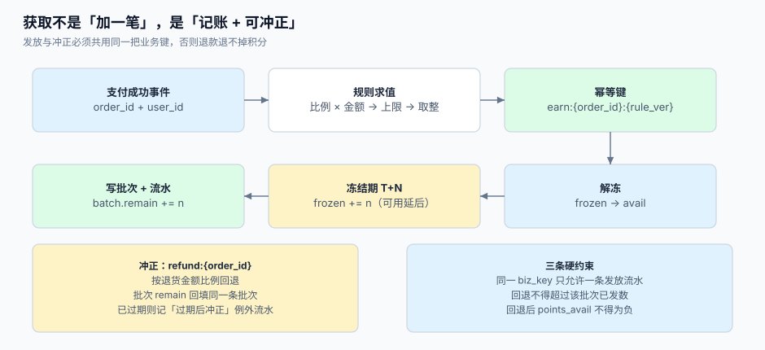

# 获取与冲正：规则、上限与幂等入账

「消费 100 元得 1 积分」这句话在需求文档里是一行，在系统里是**四件必须分别定死的事**：按什么基数算（含运费吗、含税吗、用券后的实付吗）、按什么比例取整（进位、舍去、四舍五入）、上限按什么周期（单笔、每日、每月）、以及**这笔积分能不能被撤回**。

这一页把发放链路拆成可验证的五步，并把「冲正」当成一等公民——因为**不能冲正的发放等于送钱**。



本页判据族 `LTE-A` ~ `LTE-H`，共 8 条。定义表在第七节。

## 一、五类事件来源，五种坑

| 来源 | 事件 | 常见坑 | 建议的 `source` 值 |
| --- | --- | --- | --- |
| 交易 | 订单支付成功 | 用「下单」而不是「支付成功」触发 → 大量未支付订单也发积分 | `order` |
| 交易 | 订单完成（确认收货） | 与支付成功重复发放，两套规则各算一遍 | `order_settled` |
| 行为 | 签到、评价、晒图、分享 | 无频次限制，被脚本刷 | `activity` |
| 活动 | 满减、加倍、拉新 | 活动叠加时按「原价」还是「叠加后」算基数没说清 | `campaign` |
| 人工 | 客诉补偿、运营调整 | 无工单号、无审批，事后无法举证 | `manual` |

::: danger 注意
1. **不要在「下单」时发积分**。未支付订单取消率常在 20% 以上，先发后收等于给套利者开门；正确触发点是**支付成功**或**订单完成**，二者只能选一个，且要在规则里写死。
2. **不要同时用「支付成功」和「订单完成」两条规则**。两套规则各算一遍，同一单发两次；如果必须都发（例如支付给基础分、完成给奖励分），两条规则必须用**不同的 `biz_key` 前缀**（`earn:` 与 `earn_settle:`），并在流水里用不同 `source` 区分。
3. **活动加倍不要改基数**。正确做法是「基础分 + 活动加分」两条批次，而不是把比例乘 2 后算一批——否则退款时无法区分哪部分该退。
:::

## 二、基数：三个必须写进配置的选择

| 选择 | 选项 | 差异举例（订单 200 元、运费 10 元、优惠券 30 元、税 12 元） |
| --- | --- | --- |
| 含运费？ | 含 / 不含 | 含：210 元基数；不含：200 元 |
| 含税？ | 含 / 不含 | 含：210 元；不含：198 元 |
| 用券后？ | 实付 / 原价 | 实付：180 元；原价：210 元 |

基数差 16.7% 就意味着同一笔消费在不同活动里的积分差 16.7%。这不是技术问题，是**商务条款问题**，必须写进会员章程并在系统里做成可配置项（`base_includes_shipping`、`base_includes_tax`、`base_is_paid_amount`），而不是散落在代码的 `if` 里。

## 三、取整：三种方向，三种客诉

比例常见 `1 元 = 1 分`、`1 元 = 0.5 分`、`100 元 = 1 分`。比例不是整数时，取整方向决定客户体验：

| 取整 | 例（基数 199 元、比例 0.5 分/元 = 99.5 分） | 客户感知 | 适用 |
| --- | --- | --- | --- |
| 向下取整 `floor` | 99 分 | 每次少一点，长期累积明显 | 默认推荐（成本可控、可解释） |
| 四舍五入 `round` | 100 分 | 更「公平」，但边界值（.5）争议多 | 客单价高、积分价值低 |
| 向上取整 `ceil` | 100 分 | 客户最开心，成本最高 | 短期活动 |

关键约束只有一条：**取整必须发生在「换算成最小单位」之后**，且全链路统一。混用（发放 `floor`、抵扣 `round`）会产生「发得少、抵得多」的持续漏损。

```sql
-- [sql/earn_floor.sql] 发放金额的取整口径写死在 SQL 里，避免各语言实现不一致
select floor(:base_amount_cents * :rate_numerator / :rate_denominator)::bigint as points;
```

## 四、上限：按什么周期算，决定了能不能被刷

| 上限口径 | 实现 | 能挡住什么 | 挡不住什么 |
| --- | --- | --- | --- |
| 单笔上限 | `min(得分, cap_per_order)` | 单笔天价订单 | 拆单刷（100 单 × 上限） |
| 每日上限 | 按 `user_id + 业务日` 聚合当日 `EARN` 之和 | 拆单刷、脚本刷 | 跨日慢刷 |
| 每月上限 | 按月聚合 | 长期刷 | 短期内的大额损失 |
| 分来源上限 | `source='activity'` 单独限 | 活动被刷 | 交易侧异常 |

三种上限可以叠加，但**必须在一次事务里判断**：先查当日已发、再算本次可发、再写批次，中间不能有别的请求插进来。做法与扣减相同——把判断压进写语句或用行锁，见[账户与流水](../AccountModel/index.md)第五节。

```sql
-- [sql/earn_cap_check.sql] 当日上限的原子判断：返回实际可发数量（0 表示已达上限）
with used as (
  select coalesce(sum(delta), 0) as today_earned
    from point_ledger
   where user_id = :uid
     and kind = 'EARN'
     and created_at >= date_trunc('day', now() at time zone 'Asia/Shanghai')
)
select greatest(0, :want - least(:want, :daily_cap - today_earned)) as grantable
  from used;
```

::: warning 「当日」的口径要写死
`date_trunc('day', now())` 在 UTC 库里是北京时间早上 8 点换日。签到类规则必须显式指定时区（`now() at time zone 'Asia/Shanghai'`），否则「每天签到」在北京时间 0~8 点之间可以被刷两次。
:::

## 五、幂等：唯一键是防线，不是体验

发放的幂等靠 `point_batch.biz_key` 的唯一索引；应用层要做的是「冲突时返回已有结果」，而不是「冲突时抛错给前端」。

```sql
-- [sql/earn_insert.sql] 冲突即视为已发放，返回已有批次
insert into point_batch (user_id, tenant_id, qty, remain, source, biz_key, expire_at)
values (:uid, :tid, :n, :n, :source, :biz_key, :expire_at)
on conflict (biz_key) do nothing
returning id;
```

`returning` 无行 = 已存在，此时查出已有 `id` 继续走「写流水」还是直接返回？**直接返回**，且不要再写流水——否则流水表会多出一条重复的 `EARN`。

本机读数（500 个业务事件 + 前 150 个重投一次）：

| 做法 | 落库行数 | 落库积分 | 结论 |
| --- | --- | --- | --- |
| 有唯一键 | **500 行** | 5,000 分 | 150 次重投被拦截，账面无变化 |
| 无唯一键（推算） | 650 行 | 6,500 分 | 多记 1,500 分，且没有人会发现 |

## 六、冲正：发放的对偶操作

冲正不是「扣一笔」，而是**把原批次退回**。两者的区别在追溯性：扣一笔只会让余额变小，客户问「为什么少」时系统答不上来；退回原批次能指出「这 500 分来自 3 月 1 日那笔订单，因退货退回」。

| 场景 | 冲正量 | 批次处理 | 流水 `kind` |
| --- | --- | --- | --- |
| 全额退款 | 原发放量 | `remain -= n`（可为 0） | `REFUND` |
| 部分退款（第一笔） | `round(原量 × 退款额 / 订单额)` | 同上 | `REFUND` |
| 部分退款（后续） | `累计目标 − 已回退`，**不是**再算一次比例 | 同上 | `REFUND` |
| 已过期后退款 | 不回填批次（批次已失效） | 记 `EXPIRED_REFUND` 例外流水 | `ADJUST` |
| 已消耗后退款 | 余额不足时允许负余额或挂应收 | 记欠款，不强行扣 | `ADJUST` |

第三条是关键：**部分退款必须按「累计目标」算差额**，逐笔各算一次比例会累计出 1 分的偏差。本机在 20,000 单上做过对照：分三次退款、每笔各自四舍五入，**66.62%** 的单最终累计回退 ≠ 一次回退（最大差 1 分）。详情见[抵扣与结算](../RedeemSettle/index.md)。

```sql
-- [sql/refund_points.sql] 按累计目标算差额，天然避免逐笔 round 漂移
with target as (
  select :orig_points::bigint * :cum_refund_cents / :order_cents as cum_target
)
select (select cum_target from target) - coalesce((
  select sum(delta) * -1 from point_ledger
   where order_id = :order_id and kind = 'REFUND'
), 0) as refund_now;
```

## 七、本页判据

| 判据 | 看什么现象 | 判成什么 | 不满足时改哪里 |
| --- | --- | --- | --- |
| `LTE-A` | 触发点是「支付成功」或「完成」，且只有一处 | 不重复发放 | 删掉另一处，或改用不同 `biz_key` 前缀 |
| `LTE-B` | 基数三项（运费、税、券后）是可配置项 | 口径可解释 | 抽成配置表，写进章程 |
| `LTE-C` | 取整方向全链路一致，且发生在最小单位换算之后 | 无「发少抵多」漏损 | 统一 `floor`，封装换算函数 |
| `LTE-D` | 上限至少有一层，且「当日」按业务时区界定 | 抗拆单刷 | 加每日上限 + 时区参数 |
| `LTE-E` | `point_batch.biz_key` 唯一，冲突时不写流水 | 重投不双发 | 加唯一索引，改冲突分支 |
| `LTE-F` | 冲正回填原批次，且按累计目标算差额 | 退款可追溯、无 1 分漂移 | 改用 `refund_points.sql` |
| `LTE-G` | 冻结期内的积分不计入可用 | 退货期不可套利 | 加 `frozen_until` 与解冻任务 |
| `LTE-H` | 人工发放必须带工单号与操作人 | 可审计 | `ADJUST` 强制 `reason` 非空 |

## 八、验证方式

```shell
# 1) 同一业务键重复发放，只允许一条批次（LTE-E）
psql "$DSN" -c "insert into point_batch(user_id,tenant_id,qty,remain,source,biz_key,expire_at) \
  values (42,1,100,100,'order','earn:42:SO-1','2027-12-31');"
psql "$DSN" -c "insert into point_batch(user_id,tenant_id,qty,remain,source,biz_key,expire_at) \
  values (42,1,100,100,'order','earn:42:SO-1','2027-12-31');"
```

预期输出：第一条 `INSERT 0 1`；第二条 `ERROR: duplicate key value violates unique constraint "point_batch_biz_key_key"`。若用 `on conflict do nothing`，第二条应为 `INSERT 0 0` 且**不产生流水**。

```shell
# 2) 当日上限必须挡住第二笔超额发放（LTE-D）
psql "$DSN" -c "select coalesce(sum(delta),0) from point_ledger \
  where user_id=42 and kind='EARN' and created_at >= date_trunc('day', now() at time zone 'Asia/Shanghai');"
```

预期输出：一个小于等于 `daily_cap` 的数；再执行一次发放接口后该数不应超过上限。

```shell
# 3) 部分退款按累计目标：退三次后的回退总量必须等于一次退全款
psql "$DSN" -c "select kind, sum(delta) from point_ledger where order_id='SO-1' group by 1;"
```

预期输出：`REFUND` 行合计为负，其绝对值等于原 `EARN` 之和（全额退时）；部分退时等于 `round(原量 × 已退额/订单额)`。

```shell
# 4) 冻结期内的积分不可用（LTE-G）
psql "$DSN" -c "select sum(qty-remain) as frozen_qty from point_batch \
  where user_id=42 and frozen_until > now();"
```

预期输出：大于 0 的数，且该数应与 `member_account.points_frozen` 一致。

## 九、参考资料

- IFRS 15 应用指南 B40~B42（积分构成重大权利时的单独售价估计与行使概率调整）：<https://www.ifrs.org/issued-standards/list-of-standards/ifrs-15-revenue-from-contracts-with-customers/>
- PostgreSQL 文档《INSERT ... ON CONFLICT》（`do nothing` / `do update` 与 `returning` 的幂等写法）：<https://www.postgresql.org/docs/current/sql-insert.html>
- PostgreSQL 文档《Date/Time Functions》（`date_trunc` 与 `AT TIME ZONE` 的换日口径）：<https://www.postgresql.org/docs/current/functions-datetime.html>
- 商务部《单用途商业预付卡管理办法（试行）》第十四条（章程须载明购买、充值、使用、退卡方式）：<https://www.mofcom.gov.cn/zcfb/blgg/art/2012/art_3ee43bfc933f4713a0a44e04b3b72939.html>
