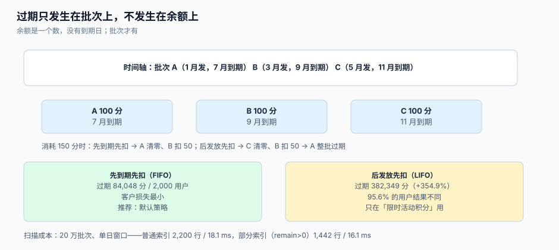

# 过期与失效：批次、顺序与宽限

过期是整个专题里**最容易被写成「余额清零」**的一段：查一遍余额、比一下时间、把到期的部分减掉。这个写法在单个批次时勉强成立，一旦用户有多个批次（每次消费都产生一个批次，一年就有几十个），它就会算出**完全错误的过期量**——因为余额没有到期日，而批次有。

这一页讲清三件事：为什么过期只能发生在批次上、消耗顺序怎么选、以及过期任务在工程上怎么做才不会把库压死。



本页判据族 `LTX-A` ~ `LTX-H`，共 8 条。定义表在第六节。

## 一、余额没有到期日

`points_avail = 1,200` 这个数里，可能混着 1 月发 300 分（7 月到期）、3 月发 500 分（9 月到期）、5 月发 400 分（11 月到期）。到 7 月 1 日，**该过期多少**？

| 写法 | 结果 | 客户感知 |
| --- | --- | --- |
| 按「余额 × 到期比例」 | 拍脑袋，无依据 | 随机 |
| 按「最早一批整批清零」 | 300 分 | 可能清掉客户刚获得的部分 |
| 按批次：只剩 A 批 300 分未用完 | 300 分 | 准确 |
| 按批次：A 已被优先消耗完 | 0 分 | 准确，且对客户最有利 |

只有在**批次**这一层，「到期」才是一个确定的事实。余额层的过期本质上是在猜。

## 二、消耗顺序：一个被低估的决策

消耗时先扣哪一批，直接决定过期量。两种主流策略：

| 策略 | 规则 | 对客户 | 对平台 |
| --- | --- | --- | --- |
| 先到期先扣（FIFO by expiry） | 到期日早的先扣 | 最有利（快过期的先用掉） | 过期量最小、负债释放慢 |
| 后发放先扣（LIFO） | 新批次先扣 | 不利（老批次躺着过期） | 过期量最大、短期负债释放快 |

本机 2,000 个用户（每人 8 批、每批 100 分、有效期 180 天、随机消耗 200~700 分，观察期 300 天）：

| 策略 | 过期总量 | 相对差 | 结果不同的用户 |
| --- | --- | --- | --- |
| 先到期先扣 | **84,048 分** | — | — |
| 后发放先扣 | **382,349 分** | **+354.9%** | **1,912 / 2,000（95.6%）** |

同一批发放、同一批消耗，过期量差三倍半。这说明「消耗顺序」不是一个技术细节，而是**会直接影响客诉率与负债规模的业务决策**，必须写进规则文档并做成可配置项（`spend_order = EXPIRY_ASC | GRANTED_DESC`）。

::: tip 什么时候该用 LIFO
只有一种情况：**限时活动积分**。活动送的积分有效期短，如果按 FIFO，客户会先花掉活动积分、把长期积分留到最后，活动的「限时感」失效。此时应按 `source` 分组，活动批次内部 LIFO、其余 FIFO。
:::

## 三、过期任务：扫描、判定、落账三步

一个可用的过期任务由三步组成，每步都要能单独重跑：

```sql
-- [sql/expire_scan.sql] 第一步：找出到期批次（部分索引，见 §4）
select id, user_id, remain
  from point_batch
 where remain > 0
   and expire_at <= now()
 order by expire_at
 limit :batch_size;
```

```sql
-- [sql/expire_apply.sql] 第二步：扣批次 + 写流水 + 更新账户，同一事务内
with due as (
  select id, user_id, remain from point_batch
   where remain > 0 and expire_at <= now()
   order by expire_at limit :batch_size
   for update skip locked            -- 多实例并行不打架
), upd as (
  update point_batch b set remain = 0
    from due where b.id = due.id
  returning b.id, b.user_id, due.remain
), led as (
  insert into point_ledger(user_id, tenant_id, kind, delta, batch_id, biz_key)
  select user_id, :tid, 'EXPIRE', -remain, id, 'expire:' || id from upd
  on conflict (biz_key) do nothing
  returning user_id, delta
)
update member_account a
   set points_avail  = a.points_avail + x.delta,
       points_expired = a.points_expired - x.delta,
       updated_at     = now()
  from (select user_id, sum(delta) delta from led group by 1) x
 where a.user_id = x.user_id;
```

三个细节值得强调：

1. `for update skip locked` 让多个 worker 并行而不互相阻塞——单实例跑 1 亿批次要几小时，多实例是常态。
2. 流水 `biz_key = 'expire:' || id` 让过期**天然幂等**：同一批次无论重跑多少次，只有一条 `EXPIRE` 流水。
3. `points_avail + x.delta`（`delta` 为负）而不是 `- remain`：这样流水与余额用的是同一个数，不会因为批次 `remain` 被并发改动而对不上。

## 四、扫描成本：索引决定能不能跑

本机 20 万批次行（35% 已耗尽）、单日到期窗口（约 2,200 行）：

| 索引 | 命中行数 | 单次扫描耗时 |
| --- | --- | --- |
| `point_batch(expire_at)` | 2,200 | **18.119 ms** |
| `point_batch(expire_at) where remain > 0` | **1,442** | **16.145 ms**（快 10.9%） |

收益看起来不大，因为样本小；真正的差别在**大表上的回表次数**：部分索引把已耗尽的批次（本机 35%）直接排除在索引之外，随历史增长这个比例只会更高（多数批次最终会被用完）。当表到 1 亿行时，普通索引要回表 3,000 万次，部分索引只回表不到 2,000 万次。

::: danger 注意
1. **不要用 `where expire_at::date = current_date`**。这会把索引废掉（表达式不匹配），在百万级批次上直接变全表扫。要写成范围：`expire_at >= :d and expire_at < :d + interval '1 day'`。
2. **不要在一个事务里处理全部到期批次**。10 万批次 = 10 万行锁 + 一条长事务，会阻塞所有扣减；必须分批（建议每批 500~2000），批间提交。
3. **不要在过期前删除批次**。批次是「这分积分曾被发放」的唯一证据，删掉之后「客户说我有 500 分」将无法举证。
:::

## 五、宽限期：过期不是一瞬间的事

监管与客诉共同要求「过期前告知、过期后可恢复」。三段式最稳妥：

| 阶段 | 时间 | 动作 | 客户可见 |
| --- | --- | --- | --- |
| 预告 | 到期前 30 天 / 7 天 | 发提醒（站内信 + 短信） | 「您有 300 分将于 X 日到期」 |
| 到期 | `expire_at` | 批次 `remain = 0`，写 `EXPIRE` 流水 | 「已过期」 |
| 宽限 | 到期后 0~15 天 | 客服可「一次性恢复」（记 `ADJUST`，带工单） | 恢复后余额可见 |

宽限期必须是**人工/工单触发**的补偿，不能是「到期后 15 天内仍可自动使用」——后者等于把有效期延长 15 天，会让「有效期」这个承诺失去意义。

```sql
-- [sql/expire_restore.sql] 宽限期内恢复：不改批次（批次已失效），补一个新批次
insert into point_batch(user_id, tenant_id, qty, remain, source, biz_key, expire_at)
values (:uid, :tid, :qty, :qty, 'restore', 'restore:' || :ticket_no, now() + interval '90 days');
```

## 六、法定差异：储值不能照抄积分

这是本页最重要的一条边界：**积分可以过期，储值不能**。

| 类型 | 过期规则 | 依据 |
| --- | --- | --- |
| 积分 | 可设有效期（通常 12~24 个月），到期前须告知 | 合同约定 + 消费者权益保护要求 |
| 记名储值卡 | **不得设有效期** | 商务部令 2012 年第 9 号第十九条 |
| 不记名储值卡 | 有效期**不少于 3 年**，过期有余额须提供激活、换卡 | 同上 |

也就是说，「积分过期」与「储值过期」**必须走两套代码**。把两者塞进同一个 `expire` 任务，迟早会把储值余额清掉——那不是 bug，是**侵占**。储值侧的详细处理见[储值账户](../StoredValue/index.md)。

## 七、本页判据

| 判据 | 看什么现象 | 判成什么 | 不满足时改哪里 |
| --- | --- | --- | --- |
| `LTX-A` | 过期只发生在 `point_batch`，账户表的 `points_expired` 只是累计器 | 过期可追溯 | 改写过期任务，见 §3 |
| `LTX-B` | 消耗顺序是可配置项且写进规则文档 | 决策显式化 | 加 `spend_order` 配置 |
| `LTX-C` | 过期流水 `biz_key = expire:{batch_id}` 唯一 | 重跑幂等 | 加唯一键 |
| `LTX-D` | 过期扫描走部分索引，且用范围条件不用 `::date` | 索引不失效 | 见 §4 |
| `LTX-E` | 过期任务分批提交，单批 ≤ 2000 行 | 不阻塞扣减 | 加 `limit` 与批间提交 |
| `LTX-F` | 到期前有预告（30 天 / 7 天两个点） | 客诉可降 | 接消息通知，见[消息通知与触达](../../NotificationDelivery/index.md) |
| `LTX-G` | 宽限期恢复走工单 + 新批次，不改历史批次 | 可审计 | 用 `expire_restore.sql` |
| `LTX-H` | 积分过期与储值过期是两套代码，储值不过期 | 不违法 | 拆任务，见 §6 |

## 八、验证方式

```shell
# 1) 过期量 = 到期批次剩余之和（LTX-A）：先算期望值
psql "$DSN" -c "select coalesce(sum(remain),0) from point_batch where remain>0 and expire_at<=now();"
```

```shell
# 2) 跑一次过期任务后，再算一次，必须为 0
psql "$DSN" -c "select count(*) from point_batch where remain>0 and expire_at<=now();"
```

预期输出：`0`。若不为 0，说明任务漏批次（常见原因：`limit` 太小且没有循环到空）。

```shell
# 3) 过期幂等：连续跑两次，EXPIRE 流水条数不变（LTX-C）
psql "$DSN" -c "select count(*) from point_ledger where kind='EXPIRE';"
```

预期输出：两次结果相同。若第二次变多，说明 `biz_key` 没生效。

```shell
# 4) 扫描计划必须走索引扫描而不是顺序扫描（LTX-D）
psql "$DSN" -c "explain (analyze, buffers) select id, user_id, remain from point_batch \
  where remain>0 and expire_at <= now() order by expire_at limit 500;"
```

预期输出：计划中出现 `Index Scan using ix_batch_expire`（或 `Index Only Scan`），**不应**出现 `Seq Scan on point_batch`。

```shell
# 5) 储值不得被过期任务波及（LTX-H）：储值表里不允许有 expire 字段被清零的记录
psql "$DSN" -c "select count(*) from wallet where principal_balance > 0 and status = 'EXPIRED';"
```

预期输出：`0`。非 0 就是合规事故。

## 九、参考资料

- 商务部《单用途商业预付卡管理办法（试行）》第十九条（记名卡不得设有效期、不记名卡不少于 3 年、过期须提供激活换卡）：<https://www.mofcom.gov.cn/zcfb/blgg/art/2012/art_3ee43bfc933f4713a0a44e04b3b72939.html>
- PostgreSQL 文档《SELECT ... FOR UPDATE / SKIP LOCKED》（过期任务多实例并行）：<https://www.postgresql.org/docs/current/sql-select.html>
- PostgreSQL 文档《Partial Indexes》（`where remain > 0` 的部分索引）：<https://www.postgresql.org/docs/current/indexes-partial.html>
- PostgreSQL 文档《Using EXPLAIN》（确认扫描走索引而不是顺序扫描）：<https://www.postgresql.org/docs/current/using-explain.html>
- IFRS 15 应用指南 B45~B46（未行使权利的确认时点与模式）：<https://www.ifrs.org/issued-standards/list-of-standards/ifrs-15-revenue-from-contracts-with-customers/>
