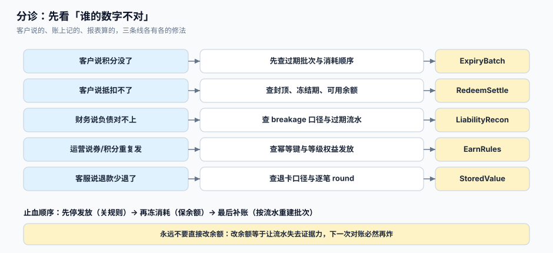

# 常见问题与分诊

积分与储值的问题有个共同特征：**客户说的、系统显示的、报表算的，三者往往都是对的**，它们只是在不同口径上正确。所以第一件事不是查代码，而是先确定「谁的数字不对」，再按口径去找。

这一页给一张分诊表、十个高频问答、一套止血顺序，以及上线前的自查清单。



本页判据族 `LTQ-A` ~ `LTQ-H`，共 8 条。定义表在第七节。

## 一、分诊表：先看谁的数字不对

| 症状 | 先查什么 | 一句话判断 | 跳到 |
| --- | --- | --- | --- |
| 客户说「积分凭空少了」 | 该用户最近 7 天的 `EXPIRE` 流水与批次 `expire_at` | 有过期流水 = 正常失效；无流水而余额减少 = 有人直接改了余额 | [过期与失效](../ExpiryBatch/index.md) |
| 客户说「有积分但抵不了」 | 冻结期、可用余额、抵扣上限 | 余额够但无冻结批次 = 上限或黑名单；有冻结 = 未解冻 | [获取与冲正](../EarnRules/index.md) |
| 客户说「抵扣金额不对」 | 换算比例、封顶、是否叠加券 | 差 1 分 = 取整；差很多 = 比例或封顶 | [抵扣与结算](../RedeemSettle/index.md) |
| 客户说「退货了积分没退」 | 原批次是否已过期、退款单号是否带积分回退 | 批次过期 = 走了 `ADJUST` 例外；无回退流水 = 接口没接 | [抵扣与结算](../RedeemSettle/index.md) |
| 客户说「退卡退少了」 | 退卡口径（A 先扣赠送金 / B 按比例）、已开发票 | 两口径差可达数百元，先确认章程写的是哪种 | [储值账户](../StoredValue/index.md) |
| 运营说「同一单发了两次积分」 | `point_batch.biz_key` 是否唯一、事件是否双触发 | 有两条不同 `biz_key` = 双触发；有两条相同 = 唯一键失效 | [获取与冲正](../EarnRules/index.md) |
| 财务说「积分负债和上月差很多」 | breakage 口径是否换过、是否一次性冲回 | 找不到 `breakage_version` 就是拍脑袋算的 | [负债与对账](../LiabilityRecon/index.md) |
| 财务说「余额和流水对不上」 | 三方对账差异单 | `LEDGER_MISMATCH` = 丢更新；`BATCH_MISMATCH` = 过期任务半途 | [账户与流水](../AccountModel/index.md) |
| 客诉「等级突然降了」 | 成长值窗口、是否有缓冲期、退款是否扣成长值 | 1 月初集中降级 = 自然年口径 | [等级与权益](../TierBenefit/index.md) |
| 客诉「折扣和下单时看到的不一样」 | 订单是否存 `discount_rate_snapshot` | 无快照 = 结算时重取了当前等级 | [等级与权益](../TierBenefit/index.md) |

## 二、止血顺序：三件事，顺序不能反

出事故时最容易犯的错是「先把余额改对」。正确顺序是：

1. **停发放**：关闭发放规则（配置开关），避免负债继续扩大。这步只影响新增，不影响存量。
2. **冻消耗**：把受影响的账户或全站抵扣切到只读，避免在错误余额上继续扣减，让差异扩散。
3. **补账**：用流水重建余额（或重建批次），并记录重建前后的差异清单。**不要手工 `update` 单条余额**——那样下一个对账周期还会炸。

```sql
-- [sql/status_freeze.sql] 止血第一步：把发放规则关掉（配置表驱动）
update loyalty_config set value = 'off', updated_at = now() where key = 'earn.enabled';
```

```sql
-- [sql/rebuild_balance.sql] 止血第三步：按流水重建余额（先跑 select 看差异，再决定是否 update）
select a.user_id,
       a.points_avail as current_avail,
       coalesce(sum(case when l.kind in ('EARN','REFUND','ADJUST') then l.delta
                         when l.kind in ('SPEND','EXPIRE') then l.delta end), 0) as ledger_net
  from member_account a
  left join point_ledger l using (user_id)
 group by 1,2
having a.points_avail <> coalesce(sum(case when l.kind in ('EARN','REFUND','ADJUST') then l.delta
                         when l.kind in ('SPEND','EXPIRE') then l.delta end), 0);
```

注意这个查询里 `EARN` 与 `SPEND` 的符号要按实际约定（`SPEND` 存负数则直接 `sum(delta)`），口径错会导致「重建后差异更大」。

## 三、十个高频问题

::: details 1. 积分一定要按批次记吗？
要。余额没有到期日、没有来源、没有证据。批次是唯一能回答「这 300 分哪来的、什么时候到期、被哪笔订单用掉」的结构。代价是多一张表与一次循环扣减，收益是过期、退款、对账三件事都能算清。
:::

::: details 2. 冻结期有必要吗？
有。没有冻结期时，客户可以在退货前把积分花掉，回退时余额不足。本机实测先查后改的扣减在并发下会出现「报成功 128 次而上限 100 次」，冻不冻结都会放大这类问题。
:::

::: details 3. 过期为什么不能用「余额 × 到期比例」？
因为这个比例没有业务含义。真实规则是「每一批在各自到期日失效」，只有批次层有这个信息。本机两种消耗顺序下过期量差 **354.9%**，正说明「余额 + 时间」推不出过期量。
:::

::: details 4. 抵扣上限该按什么算？
至少两层：单笔上限（防大额订单异常）+ 每日上限（防拆单刷）。上限的「当日」必须用业务时区（如 `Asia/Shanghai`）界定，否则凌晨 0~8 点能被刷两次。
:::

::: details 5. 部分退款为什么总是差 1 分？
因为每笔退款各自四舍五入。本机 20,000 单里 **66.62%** 存在这个差。解法是「按累计目标算差额」：`round(原量 × 累计退款/订单额) − 已回退`。
:::

::: details 6. 储值卡能不能设有效期？
记名卡不能；不记名卡不少于 3 年，且过期有余额须提供激活、换卡。依据是商务部令 2012 年第 9 号第十九条。把储值和积分塞进同一个过期任务，是最常见的违规写法。
:::

::: details 7. 赠送金退卡时怎么算？
两种口径（先扣赠送金 / 按比例扣本金）都能自圆其说，但必须写进章程且只有一处实现。本机两种口径下 **74.78%** 的卡退款额不同，最大差 **817.47 元**。
:::

::: details 8. breakage 抄行业值可以吗？
不行。成熟计划兑付率可达 95%，新计划可能 60% 以下。要用自己 12 个月以上的成熟批次外推；本机「迄今未兑」口径比真实高 **21.31 个百分点**。
:::

::: details 9. 等级折扣按下单时还是结算时？
按下单时，并把 `tier_code / discount_rate` 落到订单快照。本机 48,000 单里 **11.46%** 在两者之间掉档，累计差 **52,277.96 元**。
:::

::: details 10. 客户注销账号，积分怎么处理？
余额清零前要确认三件事：是否有未完成的退款、是否有未兑付的储值（涉及资金，不能随账号删除）、是否涉及法定留存。删除动作要落审计，并把批次与流水一并归档而不是物理删除，见[删除与派生数据传播](../../../Others/PrivacyEngineering/Deletion/index.md)。
:::

## 四、上线自查十二项

| 项 | 检查方式 | 通过标准 |
| --- | --- | --- |
| 1 批次表存在且 `expire_at` 非空 | `\d point_batch` | 有字段且有 `check` |
| 2 幂等键唯一 | `\d point_batch` 看唯一索引 | `biz_key` 唯一 |
| 3 扣减是条件更新 | 代码/`EXPLAIN` 审查 | 无「先 select 再 update」 |
| 4 余额有 `check >= 0` | `\d member_account` | 约束存在 |
| 5 过期任务分批且幂等 | 连跑两次看流水条数 | 条数不变 |
| 6 三方对账 SQL 可跑 | 手动执行 | 0 行 |
| 7 储值双列 | `\d wallet` | `principal_balance` 与 `gift_balance` |
| 8 记名卡无有效期 | `select count(*) ... where expire_at is not null` | 0 |
| 9 订单有等级快照 | `\d sales_order` | 三列齐全 |
| 10 breakage 有版本 | 查 `breakage_version` | 至少一条 ≥ 12 个月窗口 |
| 11 到期提醒已接 | 触发一次测试消息 | 收到 |
| 12 日志里有 `biz_key` | 查一条发放日志 | 能看到业务键 |

## 五、术语表

| 术语 | 含义 | 易混点 |
| --- | --- | --- |
| 批次（batch） | 一次发放形成的、有独立到期日的记录 | 与「流水」不同：批次只增不减（除 `remain`） |
| 流水（ledger） | 每一次变动的只追加记录 | 与「分录」不同：流水是明细账，分录在总账侧 |
| 可用 / 冻结 / 已过期 | 三个余额口径 | 报表里的「累计获得」不等于三者之和 |
| 单独售价（SSP） | 积分在单独出售时的价格 | 不是「兑换比例」 |
| breakage | 预期不会被行使的权利比例 | 不是「过期率」，前者是估计，后者是事实 |
| 合同负债 | 已收/已确认但尚未履约的部分 | 储值的合同负债 = 实收本金，不含赠送 |
| 记名 / 不记名卡 | 是否绑定持卡人身份 | 决定有效期是否合法 |

## 六、本页判据

| 判据 | 看什么现象 | 判成什么 | 不满足时改哪里 |
| --- | --- | --- | --- |
| `LTQ-A` | 分诊表覆盖「客户/运营/财务」三类症状 | 可分流 | 补分诊行 |
| `LTQ-B` | 止血有配置开关可一键停发放 | 可止损 | 建 `loyalty_config` |
| `LTQ-C` | 止血第三步是「按流水重建」而非手工改 | 差异可收敛 | 写重建脚本 |
| `LTQ-D` | 客服后台能展示「变动明细 + 批次来源」 | 客诉可解释 | 建明细视图 |
| `LTQ-E` | 到期前提醒有两个时间点（30 天 / 7 天） | 客诉可降 | 接通知 |
| `LTQ-F` | 储值与积分过期是两套逻辑 | 不违规 | 拆任务 |
| `LTQ-G` | 上线自查十二项有签字记录 | 可交付 | 建 checklist |
| `LTQ-H` | 术语表中「单独售价 / breakage」有明确定义 | 财务工程口径一致 | 补术语并培训 |

## 七、验证方式

```shell
# 1) 止血开关有效（LTQ-B）：关掉后发放接口必须拒绝
psql "$DSN" -c "update loyalty_config set value='off' where key='earn.enabled';"
curl -s -o /dev/null -w '%{http_code}\n' -X POST "$API/points/earn" -d '{"user_id":1,"n":100}'
```

预期输出：`409`（或业务码 `EARN_DISABLED`），**不是** `200`。

```shell
# 2) 重建脚本不会误伤（LTQ-C）：先 select 再看差异数
psql "$DSN" -c "select count(*) from (select a.user_id from member_account a \
  left join point_ledger l using (user_id) group by 1, a.points_avail \
  having a.points_avail <> coalesce(sum(l.delta),0)) t;"
```

预期输出：修复前 > 0，修复后为 `0`。

```shell
# 3) 客服明细视图可查（LTQ-D）
psql "$DSN" -c "select created_at, kind, delta, batch_id, order_id from point_ledger \
  where user_id=1 order by created_at desc limit 5;"
```

预期输出：5 行，含 `EARN/SPEND/EXPIRE` 中至少两类。

```shell
# 4) 储值不得被积分过期任务影响（LTQ-F）
psql "$DSN" -c "select count(*) from wallet where status='CLOSED' and principal_balance>0;"
```

预期输出：`0`。

## 八、参考资料

- 商务部《单用途商业预付卡管理办法（试行）》（退卡、有效期、限额的合规依据）：<https://www.mofcom.gov.cn/zcfb/blgg/art/2012/art_3ee43bfc933f4713a0a44e04b3b72939.html>
- IFRS 15 应用指南 B44~B47（合同负债、breakage、上缴第三方）：<https://www.ifrs.org/issued-standards/list-of-standards/ifrs-15-revenue-from-contracts-with-customers/>
- PostgreSQL 文档《Constraints》（`check` 约束在止血与验收中的作用）：<https://www.postgresql.org/docs/current/ddl-constraints.html>
- 全国人大常委会《中华人民共和国个人信息保护法》（账号注销与数据删除义务）：<https://www.npc.gov.cn/>
- 中国消费者协会《消费者权益保护法实施条例》解读（预付式消费与会员权益告知）：<https://www.cca.org.cn/>
