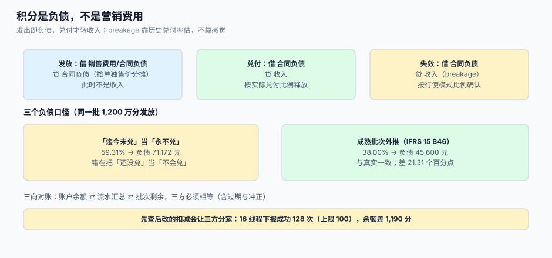

# 负债与对账：breakage、合同负债与三方核对

财务问「我们欠客户多少积分」时，工程能给出的答案往往是一个余额合计；而准则要的答案是**合同负债**——按单独售价分摊、扣除预期不会被行使的部分、按行使模式释放。两个数字的差额可能高达发行量的两成，且方向不定：算高了叫「藏负债」，算低了叫「虚增收入」。

这一页讲清三件事：积分负债怎么算（含 breakage 的三种口径与本机差）、三方对账怎么做、以及月结时差异该怎么分类。



本页判据族 `LTL-A` ~ `LTL-H`，共 8 条。定义表在第六节。

## 一、三类负债，三种确认方式

| 负债 | 触发 | 金额 | 释放 |
| --- | --- | --- | --- |
| 积分合同负债 | 发放积分（构成重大权利） | 交易价格按积分单独售价分摊的部分 | 兑付时转收入；失效时按 breakage 转收入 |
| 储值预收账款 | 充值到账 | 实收本金（赠送金另计营销费用） | 消费时转收入；退卡时冲回 |
| 券/权益负债 | 发券（可单独使用且有价值） | 面额 × 预计核销率 | 核销时转收入；过期时按政策转回 |

三者的共同点是**「收钱时不是收入」**，区别在于「金额怎么定」：储值等于实收，积分要靠分摊，券要靠预计核销率。

## 二、积分负债的第一步：分摊交易价格

按 IFRS 15，积分若是重大权利，要把订单金额在「商品」与「积分」之间按**单独售价**分摊：

| 步骤 | 公式 | 例（订单 800 元、得 2,000 分、每分单独售价 0.012 元、预计行使率 80%） |
| --- | --- | --- |
| 积分单独售价 | 分数 × 单位售价 × 预计行使率 | 2,000 × 0.012 × 0.8 = **19.20 元** |
| 分摊比例 | 积分售价 ÷（商品售价 + 积分售价） | 19.20 ÷ 819.20 = **2.34%** |
| 积分分摊额（负债） | 订单金额 × 比例 | 800 × 2.34% = **18.75 元** |
| 商品收入 | 订单金额 − 积分负债 | **781.25 元** |

三个参数缺一不可：`unit_price`（单个积分值多少钱）来自「积分能换到的东西的售价 ÷ 所需积分」，`expected_rate`（预计行使率）来自历史兑付，`order_amount` 是含税还是不含税要统一（通常按不含税）。

::: warning 「积分值多少钱」不能拍
「100 积分 = 1 元」是**兑换规则**，不是**单独售价**。两者在「积分只能换指定商品」时差异很大：若 1,000 分换一个标价 20 元、成本 8 元的杯子，则每分单独售价应参考 20 元的可观察价值（若客户只为杯子而积分，则接近 20 元；若积分还能抵扣现金，则按抵扣口径）。这条判断要写进会计政策备忘，而不是埋在代码常量里。
:::

## 三、breakage：三种口径，差 21 个百分点

breakage 是「预期不会被行使的权利」。它决定负债要扣掉多少，也决定收入什么时候确认。三种常见算法：

| 口径 | 算法 | 12 月末读数（发放 1,200 万分、按 100 分 = 1 元折算 12 万元） | 问题 |
| --- | --- | --- | --- |
| ① 迄今未兑 | `(发放 − 已兑) ÷ 发放` | **59.31%** → 负债 71,172 元 | 把「还没兑」当「不会兑」，**高估负债** |
| ② 成熟批次外推 | 只取已满有效期（或已过兑付窗口）的批次算失效率 | **38.00%** → 负债 45,600 元 | 需要足够长的历史，冷启动期不可用 |
| ③ 真实（事后） | 全部批次最终兑付率 | **38.00%** | 只能用来验证 ①② |

本机模型：12 个月各发 100 万分、每批最终兑付 62%、兑付按月展开（首月 30%、其后每月 6%），观察点为第 12 月末（最新批次只经历 1 个月）：

| 口径 | breakage | 与真实差 |
| --- | --- | --- |
| ① 迄今未兑 | 59.31% | **+21.31 个百分点** |
| ② 成熟批次外推 | 38.00% | 0 |
| ③ 真实 | 38.00% | — |

差 21.31 个百分点，在 1,200 万积分的规模上是 **2,557,500 分（约 2.56 万元）**；若积分规模是 12 亿分，差额就是 **256 万元**。这就是「口径」在财务上的重量。

::: danger 注意
1. **不要用「到期一次性冲回」代替 breakage**。准则要求按**权利行使的模式比例**确认（IFRS 15 B46），一次性冲回会让利润在到期月出现尖峰，审计必问。
2. **不要在冷启动期硬套别人的 breakage**。成熟计划兑付率可达 95%（breakage 约 5%），零售新计划可能 60% 以下；抄一个数字等于抄一个错误的负债。
3. **不要忘记「需上缴第三方」的情形**。若属地法规要求把未行使金额上缴（如无人认领财产法），这部分是**负债**而非收入（IFRS 15 B47），要单独设科目。
:::

## 四、三方对账：余额、流水、批次

月度对账不是「两个数比一比」，而是三方：

```sql
-- [sql/recon_three_way.sql] 三方对账：任一不一致都要出差异单
with acct as (
  select user_id, points_avail, points_frozen, points_expired from member_account
), led as (
  select user_id, sum(delta) as ledger_sum from point_ledger group by 1
), bat as (
  select user_id, sum(remain) as batch_sum from point_batch where remain > 0 group by 1
)
select a.user_id,
       a.points_avail + a.points_frozen + a.points_expired as acct_sum,
       coalesce(l.ledger_sum, 0)  as ledger_sum,
       coalesce(b.batch_sum, 0)   as batch_sum,
       case when a.points_avail + a.points_frozen + a.points_expired <> coalesce(l.ledger_sum,0)
            then 'LEDGER_MISMATCH'
            when a.points_avail <> coalesce(b.batch_sum,0)
            then 'BATCH_MISMATCH'
            else 'OK' end as verdict
  from acct a
  left join led l using (user_id)
  left join bat b using (user_id)
 where a.points_avail + a.points_frozen + a.points_expired <> coalesce(l.ledger_sum,0)
    or a.points_avail <> coalesce(b.batch_sum,0);
```

两列的语义不同，必须分开看：

| 差异类型 | 含义 | 常见原因 | 处置 |
| --- | --- | --- | --- |
| `LEDGER_MISMATCH` | 余额 ≠ 流水（含冻结与过期） | 先查后改丢更新、手工改余额、过期任务漏写流水 | 用流水重建余额，记录重建时间点 |
| `BATCH_MISMATCH` | 可用 ≠ 未过期批次剩余 | 批次被并发改动、过期任务只减余额不减批次 | 修正批次或余额，二者取「有证据的一方」 |

「取有证据的一方」是原则：流水是只追加的，批次有发放记录，**余额没有证据**。所以差异时以流水/批次为准重建余额，而不是反过来。

## 五、月结流程：五个步骤，缺一步就会被审计问

| 步 | 动作 | 产物 | 失败后果 |
| --- | --- | --- | --- |
| 1 | 冻结当月流水（不再接受补记，除 ADJUST 带工单） | 流水快照 | 报表反复变化，无法签字 |
| 2 | 跑三方对账，产出差异单 | 差异清单（账户级） | 差异被摊进「其他」科目 |
| 3 | 重算 breakage（用成熟批次外推） | breakage 比例 + 负债金额 | 负债靠估，月度波动大 |
| 4 | 生成凭证：负债变动、收入确认、失效转收入 | 分录清单 | 总账与明细账分家 |
| 5 | 与总账对账（明细账合计 = 总账科目余额） | 对账签字表 | 审计抽样必挂 |

第 3 步的 **breakage 更新频率**建议季度重算、月度沿用，且每次重算都要留版本（`breakage_version`、生效期间、依据的历史窗口），否则「为什么这个月负债降了 300 万」无法解释。

## 六、本页判据

| 判据 | 看什么现象 | 判成什么 | 不满足时改哪里 |
| --- | --- | --- | --- |
| `LTL-A` | 积分发放时按单独售价分摊并记合同负债 | 符合 IFRS 15 | 改发放记账，见 §2 |
| `LTL-B` | breakage 用成熟批次外推，且有版本与历史窗口 | 口径可复核 | 建 `breakage_version` |
| `LTL-C` | 不存在「到期一次性冲回」的实现 | 收入平滑 | 改为按行使模式比例确认 |
| `LTL-D` | 三方对账 SQL 每日跑，差异单有人处理 | 差异可视 | 接告警与工单 |
| `LTL-E` | 差异处置以流水/批次为准重建余额 | 有证据可依 | 写重建脚本并留审计 |
| `LTL-F` | 月结五步有固定产物与签字 | 可审计 | 建月结 checklist |
| `LTL-G` | 储值负债按实收本金确认，赠送金单独列示 | 不虚增负债 | 拆两科目 |
| `LTL-H` | 需上缴第三方的情形有独立科目 | 不误计收入 | 建 `due_to_third_party` |

## 七、验证方式

```shell
# 1) 三方对账必须无差异（LTL-D）
psql "$DSN" -f sql/recon_three_way.sql | head
```

预期输出：`(0 rows)`。有行即为差异单。

```shell
# 2) 积分负债金额可复算（LTL-A）：给定分摊参数，结果应与总账一致
psql "$DSN" -c "
select sum(round(order_amount_cents * pts_value / (order_amount_cents + pts_value))) as liability_cents
  from order_earn_snapshot where created_at >= '2026-10-01' and created_at < '2026-11-01';"
```

预期输出：与 10 月积分合同负债新增额一致（差异应为 0，或仅有分摊取整的 1 分内误差）。

```shell
# 3) breakage 口径可追溯（LTL-B）
psql "$DSN" -c "select version, window_start, window_end, breakage_rate from breakage_version order by version desc limit 3;"
```

预期输出：至少一条记录，且 `window_end - window_start >= interval '12 months'`。

```shell
# 4) 不存在一次性冲回（LTL-C）：单月失效转收入不应出现异常尖峰
psql "$DSN" -c "select date_trunc('month', created_at) m, sum(-delta) from point_ledger \
  where kind='EXPIRE' group by 1 order by 1 desc limit 6;"
```

预期输出：各月数值平滑；若某月是其他月的 10 倍以上，检查是否把 breakage 一次性确认了。

## 八、参考资料

- IFRS 15 应用指南 B40~B47（重大权利、单独售价、breakage 的按模式确认、上缴第三方为负债）：<https://www.ifrs.org/issued-standards/list-of-standards/ifrs-15-revenue-from-contracts-with-customers/>
- FASB ASC 606-10-55-48（未行使权利的确认口径，与 IFRS 15 B46 实质一致）：<https://asc.fasb.org/>
- 财政部《企业会计准则第 14 号——收入》应用指南（合同负债与单项履约义务的识别）：<https://www.mof.gov.cn/>
- KPMG《Accounting for revenue is changing》（忠诚度计划分摊与 breakage 的实务难点）：<https://assets.kpmg.com/content/dam/kpmg/xx/pdf/2018/01/banks-ifrs15-blog-printable.pdf>
- PostgreSQL 文档《WITH Queries》（三方对账用 CTE 组织多源数据）：<https://www.postgresql.org/docs/current/queries-with.html>
