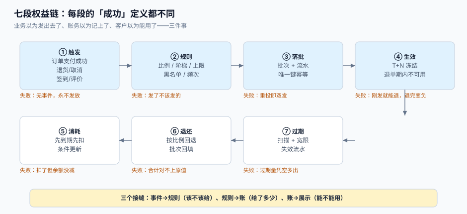

# 总览：七段权益链与三本账

会员权益系统的内部结构，说到底只有一句话：**把「业务事件」翻译成「一笔可追溯的负债」，再把它兑付掉**。麻烦的地方在于这句话被拆成了七段，每一段都有自己的「成功定义」，而上一段的成功并不保证下一段正确。

这一页给出整条链的形状：七段各管什么、三本账怎么分、四个接缝为什么必失、以及一条最小可用的判定标准。



本页判据族 `LTO-A` ~ `LTO-H`，共 8 条。定义表在第七节。

## 一、七段链：每段的「成功」都不一样

| 段 | 输入 | 这一段做的事 | 这一段眼里的「成功」 | 失败长什么样 |
| --- | --- | --- | --- | --- |
| ① 触发 | 订单支付成功、退货、签到、评价、活动参与 | 产出一个**业务事件**（带业务键） | 事件被写进 outbox 并投递成功 | 事件没产生 → 永远不发放，日志里一条错都没有 |
| ② 规则 | 事件 + 会员等级 + 活动配置 | 算出**该给多少**（比例、阶梯、上限、黑名单） | 规则求值返回一个非负数 | 发了不该发的：黑名单用户照样拿到、上限按单笔算而非按天算 |
| ③ 落批 | 金额 + 来源 + 有效期策略 | 写**批次**与**流水**，一个业务键只写一次 | 唯一键拦住了重投 | 重投即双发：同一个 `order_id` 出现两条 `EARN` |
| ④ 生效 | 批次 | 决定「什么时候能用」：立即 / T+N / 冻结至退换期结束 | 冻结期到点自动解冻 | 刚发就能用，客户用掉后再退货，余额变负 |
| ⑤ 消耗 | 抵扣请求 | 扣**批次**（按策略顺序）+ 写消费流水 | 余额减了、批次减了、流水记了，三者相等 | 扣了但余额没减（先查后改）、余额减了但批次没减 |
| ⑥ 退还 | 退款/取消 | 按比例回退到**原批次** | 累计回退 ≤ 原发放，且合计对得上 | 逐笔四舍五入累计差 1 分；已过期批次回退被静默丢弃 |
| ⑦ 过期 | 时间 | 扫描到期批次、写失效流水、更新余额 | 过期量 = 到期批次剩余之和 | 过期量凭空多出（余额过期而非批次过期） |

::: tip 一句话记住这条链
**①②决定「给不给」，③④决定「算不算数」，⑤⑥⑦决定「还不还得起」**。前四段错了，客户会来投诉；后三段错了，客户不会投诉，但账会错。
:::

## 二、三本账：为什么要分开

「积分」「储值」「等级」在数据库里可以都塞进 `member` 表的三列，但它们的**变化规律完全不同**，混在一张表里必然互相污染：

| 账 | 记什么 | 关键字段 | 变化规律 | 谁在看 |
| --- | --- | --- | --- | --- |
| 积分批次账 | 每次发放一行批次，消耗只减 `remain` | `expire_at`、`source`、`remain` | 只增批次、只减剩余；**过期是一等公民** | 运营（活动效果）、客服（为什么少了） |
| 储值双余额账 | 本金与赠送金两列，加一张充值/消费流水 | `principal_balance`、`gift_balance` | 有**真实资金流入**，受监管限额约束 | 财务（预收账款）、法务（退卡） |
| 等级成长值账 | 滚动窗口内的成长值累计 | `growth_window_start`、`growth_value` | 单调累加但会**滚动过期**，且影响折扣 | 运营（分层）、定价（折扣） |

分开的直接收益是**每个问题都有唯一答案**：「这 300 分哪来的」查批次、「这 100 元是谁充的」查储值流水、「我为什么不是金卡」查成长值窗口。合在一起的代价是每个问题都要靠猜。

## 三、四个接缝：错误都发生在边界上

| 接缝 | 典型错法 | 后果 | 本专题在哪讲 |
| --- | --- | --- | --- |
| 事件 → 规则 | 事件重复投递，规则没有幂等键 | 同一单发两次积分 | [获取与冲正](../EarnRules/index.md) |
| 规则 → 账 | 规则算出的数没有上限与取整约定 | 大额订单发出天量积分，或出现小数分 | [获取与冲正](../EarnRules/index.md) |
| 账 → 展示 | 展示层直接读 `points_avail`，忽略冻结与过期 | 客户看到可用但抵不了 | [账户与流水](../AccountModel/index.md) |
| 账 → 财务 | 财务按「发放减已兑」算负债 | 负债口径偏 20 个百分点 | [负债与对账](../LiabilityRecon/index.md) |

这四个接缝的共同点：**两边的「成功」定义不一样**。事件侧的成功是「投递成功」，账侧的成功是「唯一键没冲突」；展示侧的成功是「数字能显示」，账侧的成功是「余额等于批次之和」。

## 四、五个角色，五种「余额」

同一个数字，五种人都认为自己知道它是什么：

| 角色 | 他说的「余额」 | 他真正需要的 |
| --- | --- | --- |
| 客户 | 我能用多少 | **可用且未过期**的部分（不含冻结、不含已过期未清理） |
| 客服 | 客户说少了多少 | 变动明细（哪一笔、什么类型、什么时间） |
| 运营 | 这个活动发了多少 | 按 `source` 聚合的发放量与核销率 |
| 财务 | 我还欠客户多少 | 合同负债（含 breakage 估计），不是余额合计 |
| 风控/审计 | 有没有被刷 | 单用户短窗口内的发放速率与设备/IP 聚类 |

系统设计上必须**同时提供五个视图**，而不是让五个人去读同一张表。这也是本专题把「账户」与「流水」分开、把「批次」单独建表的原因。

## 五、最小可用标准：一个账户能不能上线

在写任何业务代码之前，先用下面四条判断你的模型够不够用（四条都能用 SQL 验证，见第七节）：

1. 给定一个用户，能列出**所有未过期批次**及其 `expire_at`；
2. 给定一笔消费，能指出**扣了哪几批、每批扣了多少**；
3. 给定一笔退款，能指出**回填到哪一批**，且累计不超过该批发放量；
4. 给定一个时间点，能算出**当时的余额**（而不是现在的余额）。

第 4 条最容易被忽略：财务要的是「3 月 31 日 23:59:59 的余额」，而 `update` 型余额表**天然回答不了历史时点**。答案只有一个——余额必须能由流水重放出来。

## 六、可观测的四个数

上线后每天看四个数就够发现大部分问题：

| 指标 | 算法 | 健康范围 | 异常时的含义 |
| --- | --- | --- | --- |
| 发放/核销比 | 当日发放 ÷ 当日核销 | 1.0 ~ 3.0 | 长期 > 10 说明积分在空转，负债在累积 |
| 过期率 | 当日过期 ÷ 当日到期批次发放量 | 与兑付率互补 | 突然升高先查消耗顺序有没有被改 |
| 抵扣失败率 | 抵扣请求失败 ÷ 总请求 | < 2% | 升高先查封顶与冻结期 |
| 对账差异账户数 | 三方不等的账户数 | 0 | 非 0 就是事故，不是「明天再看」 |

## 七、本页判据

| 判据 | 看什么现象 | 判成什么 | 不满足时改哪里 |
| --- | --- | --- | --- |
| `LTO-A` | 系统里存在「批次」这一层实体，而不只有余额 | 过期可追溯 | 建 `point_batch` 表，见[账户与流水](../AccountModel/index.md) |
| `LTO-B` | 每条发放/消耗/过期都能落到一个 `biz_key` | 可幂等、可冲正 | 流水表加唯一键，见[获取与冲正](../EarnRules/index.md) |
| `LTO-C` | 余额 = 未过期批次剩余之和（有校验 SQL） | 余额不是独立事实 | 加对账任务，见[负债与对账](../LiabilityRecon/index.md) |
| `LTO-D` | 储值的本金与赠送金分列 | 退卡可算清 | 拆两列，见[储值账户](../StoredValue/index.md) |
| `LTO-E` | 冻结期与可用余额分开表达 | 退货期不被钻空子 | 加 `points_frozen`，见[获取与冲正](../EarnRules/index.md) |
| `LTO-F` | 等级变更留下快照，订单按快照算折扣 | 折扣可自证 | 订单存 `tier_snapshot`，见[等级与权益](../TierBenefit/index.md) |
| `LTO-G` | 负债口径写明 breakage 的估计来源与更新频率 | 财务可复核 | 写月度口径文档，见[负债与对账](../LiabilityRecon/index.md) |
| `LTO-H` | 五个角色各有查询视图，而不是共读一张表 | 口径不打架 | 建视图，见本节第四节 |

## 八、验证方式

```shell
# 1) 是否存在「批次」这一层：没有这张表就说明余额是唯一事实（LTO-A 不满足）
psql "$DSN" -c "\d point_batch"
```

预期输出：包含 `remain`、`expire_at`、`source`、`user_id` 四个字段的表结构。若报 `Did not find any relation named "point_batch"`，说明系统只存余额。

```shell
# 2) 余额是否等于未过期批次剩余（LTO-C）：这条查询必须返回 0 行
psql "$DSN" -c "
select a.user_id, a.points_avail, coalesce(sum(b.remain),0) as batch_sum
from member_account a
left join point_batch b
  on b.user_id = a.user_id and b.remain > 0 and b.expire_at > now()
group by a.user_id, a.points_avail
having a.points_avail <> coalesce(sum(b.remain),0);"
```

预期输出：`(0 rows)`。任何一行都是欠账，先修数据再上线。

```shell
# 3) 储值是否分列（LTO-D）
psql "$DSN" -c "select column_name from information_schema.columns \
  where table_name='wallet' and column_name in ('principal_balance','gift_balance');"
```

预期输出：两行。只有 `balance` 一列则退卡口径无法表达。

```shell
# 4) 时点余额可重放（第五节第 4 条）：用流水重算某用户在某时刻的余额
psql "$DSN" -c "
select sum(delta) from point_ledger
where user_id = 42 and created_at <= '2026-03-31 23:59:59+08';"
```

预期输出：一个确定的整数，且与当时对账单一致。若流水里没有 `EXPIRED` 类型的记录，这个数一定会偏大——过期也是流水。

## 九、参考资料

- IFRS 15 应用指南 B40~B47（重大权利、单独售价、breakage 的确认模式）：<https://www.ifrs.org/issued-standards/list-of-standards/ifrs-15-revenue-from-contracts-with-customers/>
- 商务部《单用途商业预付卡管理办法（试行）》第六至二十条（限额、有效期、退卡、实名）：<https://www.mofcom.gov.cn/zcfb/blgg/art/2012/art_3ee43bfc933f4713a0a44e04b3b72939.html>
- PostgreSQL 文档《Aggregate Functions》（`sum`、`coalesce` 与 `having` 在对账 SQL 里的用法）：<https://www.postgresql.org/docs/current/functions-aggregate.html>
- Martin Fowler《Event Sourcing》（「状态由事件重放得出」的思想来源，用于理解余额与流水的关系）：<https://martinfowler.com/eaaDev/EventSourcing.html>
