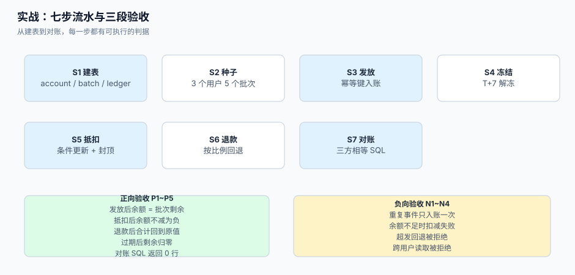

# 实战：一套能跑起来的最小账户链路

前面九页讲的都是「为什么会错」。这一页反过来：从零搭一条**能跑、能验、能对账**的最小链路，七个步骤，每步给出命令、SQL 与预期输出。搭完之后你手上会有一套账户表、一批可复现的种子数据、七步流水，以及 9 个验收用例（5 正向 + 4 负向）。



本页判据族 `LTP-A` ~ `LTP-H`，共 8 条。定义表在第七节。

## 一、准备：目录与依赖

本页所有命令在 PostgreSQL 16+ 上验证过，客户端只需 `psql`。工程目录建议如下（**读者自己建，本仓不提交脚本**）：

```text
loyalty-lab/
├─ sql/
│  ├─ 001_schema.sql        # 建表
│  ├─ 002_seed.sql          # 种子数据
│  ├─ 003_earn.sql          # 发放
│  ├─ 004_spend.sql         # 抵扣
│  ├─ 005_refund.sql        # 退款回退
│  ├─ 006_expire.sql        # 过期
│  └─ 007_recon.sql         # 三方对账
├─ tests/
│  ├─ test_earn.py
│  ├─ test_spend.py
│  └─ test_recon.py
└─ docker-compose.yml
```

```shell
# 启动一个干净的库（也可用本机已装的 PostgreSQL）
docker run -d --name loyalty-pg -e POSTGRES_PASSWORD=pg -e POSTGRES_DB=loyalty -p 5432:5432 postgres:16
export DSN="postgresql://postgres:pg@127.0.0.1:5432/loyalty"
psql "$DSN" -c "select version();"
```

预期输出：一行 `PostgreSQL 16.x ...`，无报错。

## 二、S1 建表：三张核心表 + 一张快照

```sql
-- [sql/001_schema.sql]
create table member_account (
  user_id       bigint primary key,
  tenant_id     bigint not null,
  points_avail  bigint not null default 0 check (points_avail >= 0),
  points_frozen bigint not null default 0 check (points_frozen >= 0),
  points_expired bigint not null default 0 check (points_expired >= 0),
  updated_at    timestamptz not null default now()
);

create table point_batch (
  id         bigserial primary key,
  user_id    bigint not null references member_account(user_id),
  qty        bigint not null check (qty > 0),
  remain     bigint not null check (remain between 0 and qty),
  source     text   not null,
  biz_key    text   not null unique,
  granted_at timestamptz not null default now(),
  expire_at  timestamptz not null,
  check (expire_at > granted_at)
);
create index ix_batch_expire on point_batch(expire_at) where remain > 0;
create index ix_batch_user   on point_batch(user_id, expire_at);

create table point_ledger (
  id         bigserial primary key,
  user_id    bigint not null,
  kind       text   not null check (kind in ('EARN','SPEND','REFUND','EXPIRE','ADJUST','THAW')),
  delta      bigint not null,
  batch_id   bigint references point_batch(id),
  order_id   text,
  biz_key    text   not null unique,
  operator   text,
  reason     text,
  created_at timestamptz not null default now()
);
create index ix_ledger_user on point_ledger(user_id, created_at);

-- 订单侧等级快照（见「等级与权益」）
create table order_tier_snapshot (
  order_id      text primary key,
  user_id       bigint not null,
  tier_code     text  not null,
  discount_rate numeric(5,4) not null,
  goods_cents   bigint not null,
  created_at    timestamptz not null default now()
);
```

```shell
psql "$DSN" -f sql/001_schema.sql
psql "$DSN" -c "\dt"
```

预期输出：列出 4 张表，无 `ERROR`。

## 三、S2 种子：三个用户、五个批次

```sql
-- [sql/002_seed.sql]
insert into member_account(user_id, tenant_id) values (1,1),(2,1),(3,1);

-- 用户 1：三个批次，到期日不同，用于验证消耗顺序
insert into point_batch(user_id,qty,remain,source,biz_key,granted_at,expire_at) values
 (1,300,300,'order','seed:1:a', now() - interval '150 days', now() + interval '30 days'),
 (1,500,500,'order','seed:1:b', now() - interval '90 days',  now() + interval '90 days'),
 (1,400,400,'campaign','seed:1:c', now() - interval '30 days', now() + interval '150 days');
update member_account set points_avail = 1200 where user_id = 1;

-- 用户 2：一个即将过期的批次
insert into point_batch(user_id,qty,remain,source,biz_key,granted_at,expire_at) values
 (2,200,200,'order','seed:2:a', now() - interval '179 days', now() + interval '1 day');
update member_account set points_avail = 200 where user_id = 2;

insert into order_tier_snapshot(order_id,user_id,tier_code,discount_rate,goods_cents)
values ('SO-1',1,'GOLD',0.9500,20000);
```

```shell
psql "$DSN" -f sql/002_seed.sql
psql "$DSN" -c "select user_id, qty, remain, expire_at::date from point_batch order by id;"
```

预期输出：5 行批次，用户 1 三个批次、用户 2 一个批次（另一行是用户 3 无批次）。

## 四、S3 发放：幂等入账

```sql
-- [sql/003_earn.sql] 发放 300 分，重复执行只生效一次
with b as (
  insert into point_batch(user_id,qty,remain,source,biz_key,expire_at)
  values (:uid, :n, :n, 'order', 'earn:' || :uid || ':' || :order_id, now() + interval '365 days')
  on conflict (biz_key) do nothing
  returning id, user_id, qty
), l as (
  insert into point_ledger(user_id,kind,delta,batch_id,order_id,biz_key)
  select user_id,'EARN',qty,id,:order_id,'earn:' || user_id || ':' || :order_id from b
  on conflict (biz_key) do nothing
  returning user_id, delta
)
update member_account a
   set points_avail = a.points_avail + x.delta, updated_at = now()
  from (select user_id, sum(delta) delta from l group by 1) x
 where a.user_id = x.user_id;
```

```shell
psql "$DSN" -v uid=3 -v n=300 -v order_id=SO-9 -f sql/003_earn.sql
psql "$DSN" -v uid=3 -v n=300 -v order_id=SO-9 -f sql/003_earn.sql   # 重跑
psql "$DSN" -c "select user_id, points_avail from member_account where user_id=3;"
```

预期输出：`3 | 300`。重跑后仍是 300——唯一键把第二次拦在批次层，流水也没多写。

## 五、S4 抵扣：条件更新 + 先到期先扣

```sql
-- [sql/004_spend.sql] 扣 450 分：按到期日升序逐批扣，余额用条件更新
begin;

-- ① 余额够不够，一次判断（不够则整个事务无操作）
update member_account set points_avail = points_avail - :n, updated_at = now()
 where user_id = :uid and points_avail >= :n
returning points_avail;

-- ② 逐批扣减（应用层循环，这里给出单批的写法）
update point_batch
   set remain = remain - :take
 where id = :batch_id and remain >= :take
returning remain;

-- ③ 写消费流水（一条批次一条流水，便于追溯）
insert into point_ledger(user_id,kind,delta,batch_id,order_id,biz_key)
values (:uid,'SPEND',-:take,:batch_id,:order_id,'spend:' || :order_id || ':' || :batch_id);

commit;
```

按用户 1 的种子数据扣 450 分：批次 A（30 天后到期）扣 300、批次 B 扣 150。执行后：

```shell
psql "$DSN" -c "select id, qty, remain from point_batch where user_id=1 order by expire_at;"
psql "$DSN" -c "select points_avail from member_account where user_id=1;"
```

预期输出：`A: remain 0`、`B: remain 350`、`C: remain 400`；`points_avail = 750`。

## 六、S5 退款：按累计目标回退

```sql
-- [sql/005_refund.sql] 退款 100 元（订单 200 元、原发放 300 分）→ 应回退 150 分
with orig as (
  select coalesce(sum(qty),0) pts, 20000::bigint order_cents
    from point_batch where biz_key = 'earn:1:SO-1'
), done as (
  select coalesce(-sum(delta),0) refunded
    from point_ledger where order_id='SO-1' and kind='REFUND'
), target as (
  select round(o.pts * :cum_refund_cents / o.order_cents) - d.refunded as now_refund
    from orig o, done d
)
select now_refund from target;
```

把 `now_refund` 回填到原批次（`remain + now_refund`，上限为 `qty`）并写 `REFUND` 流水。三次各退 1/3 后，`REFUND` 合计必须等于 300（全额退时），而不是 100 + 100 + 100 各自取整后的 99 + 99 + 99。

```shell
psql "$DSN" -c "select kind, sum(delta) from point_ledger where order_id='SO-1' group by 1;"
```

预期输出：`EARN | 300`、`REFUND | -300`（全额退）或 `-150`（退一半）。

## 七、S6 过期：批次级、幂等、分批

```sql
-- [sql/006_expire.sql] 一次处理 500 个到期批次
with due as (
  select id, user_id, remain from point_batch
   where remain > 0 and expire_at <= now()
   order by expire_at limit 500
   for update skip locked
), upd as (
  update point_batch b set remain = 0 from due where b.id = due.id
  returning b.id, b.user_id, due.remain
), led as (
  insert into point_ledger(user_id,kind,delta,batch_id,biz_key)
  select user_id,'EXPIRE',-remain,id,'expire:'||id from upd
  on conflict (biz_key) do nothing
  returning user_id, delta
)
update member_account a
   set points_avail = a.points_avail + x.delta,
       points_expired = a.points_expired - x.delta,
       updated_at = now()
  from (select user_id, sum(delta) delta from led group by 1) x
 where a.user_id = x.user_id;
```

```shell
psql "$DSN" -f sql/006_expire.sql
psql "$DSN" -c "select user_id, points_avail, points_expired from member_account order by 1;"
```

预期输出：用户 2 的 `points_avail` 变为 0、`points_expired` 变为 200（该批次到期日 = 明天，用 `now() + interval '1 day'` 时需把 `<= now()` 临时改成 `<= now() + interval '2 days'` 才能触发，见第八节 N4 说明）。

## 八、验收：5 个正向 + 4 个负向

| 编号 | 用例 | 期望 | 判据 |
| --- | --- | --- | --- |
| P1 | 发放后余额 = 批次剩余 | `300 = 300` | `LTP-A` |
| P2 | 抵扣后余额与批次同步减少 | `1200 − 450 = 750`，批次 A=0/B=350 | `LTP-B` |
| P3 | 退款累计回退 ≤ 原发放，且合计对得上 | 全额退时 `EARN + REFUND = 0` | `LTP-C` |
| P4 | 过期后 `points_avail` 减少、`points_expired` 等量增加 | 200 → 0 / 0 → 200 | `LTP-D` |
| P5 | 三方对账返回 0 行 | `(0 rows)` | `LTP-E` |
| N1 | 重复发放只生效一次 | 第二次 `INSERT 0 0`，余额不变 | `LTP-F` |
| N2 | 余额不足时抵扣失败 | `UPDATE 0`，余额不变 | `LTP-G` |
| N3 | 回退超过原发放被拒绝 | 报错或影响 0 行 | `LTP-C` |
| N4 | 未到期批次不被过期任务扫到 | `expire_at > now()` 的批次 `remain` 不变 | `LTP-D` |

```shell
# N1 重复发放
psql "$DSN" -v uid=3 -v n=300 -v order_id=SO-9 -f sql/003_earn.sql
psql "$DSN" -c "select count(*) from point_batch where biz_key='earn:3:SO-9';"
```

预期输出：`1`。

```shell
# N2 余额不足：用户 2 只有 200 分，扣 500 必须失败
psql "$DSN" -c "update member_account set points_avail=points_avail-500 \
  where user_id=2 and points_avail>=500 returning points_avail;"
```

预期输出：`UPDATE 0`（无 `returning` 行），且随后查询余额仍为 200。

```shell
# N3 回退超发：把 remain 加到超过 qty 必须被 check 挡住
psql "$DSN" -c "update point_batch set remain = qty + 1 where id=1;"
```

预期输出：`ERROR: new row for relation "point_batch" violates check constraint "point_batch_remain_check"`。

```shell
# N4 未到期不被扫：任务前后比对仍有余量的批次
psql "$DSN" -c "select count(*) from point_batch where remain>0 and expire_at>now();"
psql "$DSN" -f sql/006_expire.sql
psql "$DSN" -c "select count(*) from point_batch where remain>0 and expire_at>now();"
```

预期输出：两次计数相同（任务只处理 `expire_at <= now()` 的批次）。

## 九、三段自动化测试

```python
# [tests/test_earn.py] 发放的幂等与上限（pytest + psycopg）
import os, psycopg, pytest

DSN = os.environ["DSN"]

def test_earn_idempotent():
    with psycopg.connect(DSN) as c:
        sql = open("sql/003_earn.sql").read()
        c.execute(sql, {"uid": 3, "n": 300, "order_id": "SO-T1"})
        c.execute(sql, {"uid": 3, "n": 300, "order_id": "SO-T1"})
        n = c.execute("select count(*) from point_batch where biz_key='earn:3:SO-T1'").fetchone()[0]
        assert n == 1, "重复发放产生了多条批次"
```

```python
# [tests/test_spend.py] 并发扣减不超发
import threading, psycopg, os

DSN = os.environ["DSN"]

def test_no_overspend():
    ok = []
    def worker():
        with psycopg.connect(DSN, autocommit=True) as c:
            cur = c.execute(
                "update member_account set points_avail=points_avail-10 "
                "where user_id=1 and points_avail>=10 returning points_avail")
            if cur.fetchone():
                ok.append(1)
    ts = [threading.Thread(target=worker) for _ in range(40)]
    [t.start() for t in ts]; [t.join() for t in ts]
    with psycopg.connect(DSN) as c:
        bal = c.execute("select points_avail from member_account where user_id=1").fetchone()[0]
    assert bal >= 0, "条件更新失效，出现负余额"
    assert len(ok) <= 120, "报成功次数超过余额允许的上限"
```

```python
# [tests/test_recon.py] 三方对账无差异
import psycopg, os

def test_three_way():
    with psycopg.connect(os.environ["DSN"]) as c:
        rows = c.execute(open("sql/007_recon.sql").read()).fetchall()
    assert rows == [], f"存在对账差异：{rows[:3]}"
```

```shell
psql "$DSN" -c "select 1" >/dev/null && pytest -q tests/
```

预期输出：`3 passed`。若 `test_no_overspend` 失败并报 `负余额`，说明扣减语句被改成了先查后改。

## 十、本页判据

| 判据 | 看什么现象 | 判成什么 | 不满足时改哪里 |
| --- | --- | --- | --- |
| `LTP-A` | 建表后余额与批次可对账（P1） | 模型自洽 | 补 `point_batch` |
| `LTP-B` | 抵扣同时更新余额与批次（P2） | 无双写遗漏 | 同一事务内先扣余额再扣批次 |
| `LTP-C` | 退款按累计目标，且 `remain <= qty`（P3/N3） | 不超发、不漂移 | 加 `check` 与累计算法 |
| `LTP-D` | 过期只扫到期批次、可重跑（P4/N4） | 幂等、不误伤 | 加 `biz_key` 与 `where expire_at <= now()` |
| `LTP-E` | 三方对账 SQL 可跑且返回 0 行（P5） | 差异可视 | 建 `007_recon.sql` |
| `LTP-F` | 重复事件只入账一次（N1） | 幂等 | 唯一键 + `on conflict do nothing` |
| `LTP-G` | 余额不足时扣减失败而非变负（N2） | 无超发 | 条件更新 + `check` |
| `LTP-H` | 三段测试可在干净库上全绿 | 可复现 | 按本节写 pytest |

## 十一、验证方式

```shell
# 一键跑完七步（幂等，可重复执行）
for f in sql/003_earn.sql sql/004_spend.sql sql/005_refund.sql sql/006_expire.sql sql/007_recon.sql; do
  psql "$DSN" -v uid=1 -v n=300 -v order_id=SO-1 -v cum_refund_cents=20000 -f "$f" || exit 1
done
echo "EXIT=$?"
```

预期输出：`EXIT=0`，且最后一步 `007_recon.sql` 打印 `(0 rows)`。

```shell
# 关键数字复核：用户 1 的余额应等于三个批次剩余之和
psql "$DSN" -c "
select a.points_avail, (select sum(remain) from point_batch where user_id=1 and remain>0) s
from member_account a where a.user_id=1;"
```

预期输出：两列相等。

## 十二、参考资料

- PostgreSQL 文档《INSERT ... ON CONFLICT》（幂等入账的 `do nothing` 与 `returning`）：<https://www.postgresql.org/docs/current/sql-insert.html>
- PostgreSQL 文档《WITH Queries》（把「插批次→写流水→改余额」串成一个语句）：<https://www.postgresql.org/docs/current/queries-with.html>
- PostgreSQL 文档《Explicit Locking》（`FOR UPDATE SKIP LOCKED` 在过期任务里的用法）：<https://www.postgresql.org/docs/current/explicit-locking.html>
- psycopg 3 文档（Python 客户端参数化与事务）：<https://www.psycopg.org/psycopg3/docs/>
- pytest 文档（`assert` 与 fixture 的用法）：<https://docs.pytest.org/en/stable/>
