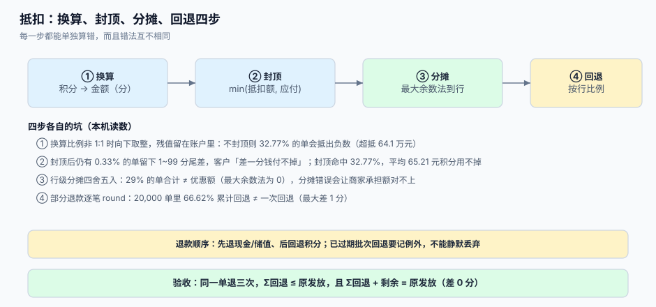

# 抵扣与结算：换算、封顶与部分退款

积分抵扣看起来是四则运算：100 积分 = 1 元，抵 30 元就扣 3000 分。可一旦把它放进真实订单——有运费、有券、有多行商品、可能部分退款、可能混合支付——它立刻变成**四个各自会算错的步骤**：换算（比例与取整）、封顶（不能抵出负数）、分摊（抵掉的钱落到哪一行）、回退（退款时按什么比例把积分退回来）。

这一页逐步拆开，每一步给出错误写法的后果与本机读数。



本页判据族 `LTR-A` ~ `LTR-H`，共 8 条。定义表在第六节。

## 一、四步链路

| 步 | 输入 | 输出 | 算错的表现 |
| --- | --- | --- | --- |
| ① 换算 | 使用积分、比例（如 100 分 = 1 元） | 抵扣金额（分） | 比例非 1:1 时取整方向错 → 残值留在账户里 |
| ② 封顶 | 抵扣金额、应付金额 | 实际抵扣额 | 不封顶 → 抵扣额大于应付，订单变负数 |
| ③ 分摊 | 实际抵扣额、行金额 | 每行分摊额 | 四舍五入 → 行合计 ≠ 抵扣额 |
| ④ 回退 | 退款金额、原发放量 | 回退积分 | 逐笔四舍五入 → 累计 ≠ 原值 |

四步可以合并成一次调用，但**不能合并成一次思考**：每一步的取整规则不同，混在一起的函数半年后没人敢改。

## 二、① 换算：比例与取整方向

比例常见三种，取整方向各自有坑：

| 比例 | 100 元订单可抵 | 用 `floor` 的残值 | 说明 |
| --- | --- | --- | --- |
| 100 积分 = 1 元 | 100 元（需 10,000 分） | 0 | 1:1 换算，无残值 |
| 200 积分 = 1 元 | 100 元（需 20,000 分） | 0 或 1 分 | 奇数积分被截断 |
| 100 积分 = 0.3 元 | 由积分上限决定 | 每单平均残留若干分 | 最容易被忽略的一类 |

第三类才是常态（「积分兑好礼」的兑换比例往往不是整元）。取整写在哪一步，决定了残值归谁：

```sql
-- [sql/deduct_amount.sql] 换算后立即向下取整到「分」，残值留在账户
select floor(:points * :cents_per_unit / :points_per_unit)::bigint as deduct_cents;
```

若反过来先算「需要多少分」再乘回去（`ceil(应付 / 单价) * 单价`），会出现「客户被多扣分」的投诉：抵 30 元需要 3,000 分，客户只有 2,999 分，向上取整会让他「差 1 分也能抵」，而下一次对账时这 1 分无处安放。

## 三、② 封顶：不封顶的代价是实打实的钱

抵扣额必须先与应付比大小，再决定扣多少分。若只做换算不做封顶，抵扣额可能大于应付，订单金额变负——财务上表现为「退款」，运营上表现为「白送」。

本机 30,000 单（应付 3~300 元、持有 0~200 元积分，均匀抽样）：

| 口径 | 结果 | 说明 |
| --- | --- | --- |
| 不封顶 | **9,831 单（32.77%）** 抵扣额 > 应付 | 超抵合计 **641,101.12 元** |
| 封顶 `min(抵扣额, 应付)` | 0 单超抵 | 必做 |
| 封顶后残留 | 命中封顶的 9,831 单平均有 **65.21 元**积分用不掉 | 需要产品决策：留着下次用，还是允许「积分 + 现金」混合 |
| 尾差 | **0.33%** 的单留下 1~99 分应付，客户「差一分钱付不掉」 | 需要「尾差抹零」或「允许 0 元订单」规则 |

最后一行是运营事故的高发点：客户用积分抵到只剩 3 分，支付渠道有最低金额限制（多数渠道 ≥ 0.01 元但收单侧常设 0.1 元），于是订单卡在待支付。规则要么允许「积分抵到 0 元直接完成」，要么明确「积分最多抵 99%」。

::: danger 注意
1. **不要把「抵扣上限」写成百分比而不写基数**。「最多抵 50%」的 50% 是「商品金额」还是「应付金额（含运费）」？两者差一个运费，结算页与后台对账会各说各话。
2. **不要在抵扣后重算优惠券**。券与积分谁先算必须写死顺序（建议：券 → 积分），否则「用了券之后积分抵扣额变了」会让同一单的两次试算结果不同。
3. **不要让抵扣改变积分的「获得基数」**。用积分抵掉的钱通常不再产生新积分，这条要写进规则，否则会出现「用积分买东西又得积分」的循环。
:::

## 四、③ 分摊：抵掉的钱要落到行上

退款是按行退的，所以抵扣额必须能分摊到行，否则退单行时不知道退多少积分。

| 方法 | 做法 | 行合计是否守恒 | 备注 |
| --- | --- | --- | --- |
| 逐行四舍五入 | `round(抵扣额 × 行金额/总额)` | **不守恒**（±1~2 分） | 最常见，也最常被审计挑出 |
| 最大余数法 | 先按比例取整，余数按小数部分从大到小分配 | 守恒（差 0） | 推荐 |
| 全给首行 | 抵扣额全记第一行 | 守恒 | 简单但退单行时体验差 |

最大余数法的实现（PostgreSQL）：

```sql
-- [sql/allocate_discount.sql] 最大余数法：先取整，再把余数按小数部分分配
with base as (
  select line_no, amount_cents,
         floor(:deduct_cents * amount_cents / :total_cents)::bigint as alloc,
         (:deduct_cents * amount_cents) % :total_cents as frac
    from order_line where order_id = :order_id
), ranked as (
  select *, row_number() over (order by frac desc, line_no) as rn,
         :deduct_cents - sum(alloc) over () as leftover
    from base
)
select line_no, alloc + case when rn <= leftover then 1 else 0 end as alloc_final
  from ranked;
```

## 五、④ 回退：按累计目标，不按逐笔比例

部分退款时回退积分，有两种写法：

| 写法 | 公式 | 问题 |
| --- | --- | --- |
| 逐笔比例 | 每次 `round(原量 × 本次退款/订单额)` | 多次退款累计 ≠ 一次全退 |
| 累计目标 | `round(原量 × 累计退款/订单额) − 已回退` | 恒等，推荐 |

本机 20,000 单（订单 10~500 元、原发放 10~500 分、分三次各退 1/3）：

| 写法 | 与「一次全退」不一致的单数 | 最大差 |
| --- | --- | --- |
| 逐笔四舍五入 | **13,324 单（66.62%）** | 1 分 |
| 累计目标 | 0 单 | 0 |

1 分看起来无关紧要，但它的两个后果都不小：一是客户在第二次退款时发现「少了 1 分」，客服无法解释；二是财务的「发放 = 已兑 + 已退 + 剩余 + 已过期」等式对不上，月结时要人工找平。

::: warning 已过期 / 已消耗后的退款
- **批次已过期**：不能回填 `remain`（批次已失效），要记一条 `ADJUST` 并标注 `EXPIRE_AFTER_REFUND`，且在客服侧可见。静默丢弃会让「客户退货了但积分没回来」变成无记录的黑洞。
- **积分已被消耗**：余额可能不足以回退。两种口径要选一种并写进条款：允许负余额（记应收）或允许欠账（下次发放时优先抵扣）。**绝不能**「能扣多少扣多少、剩下的不管」。
:::

## 六、本页判据

| 判据 | 看什么现象 | 判成什么 | 不满足时改哪里 |
| --- | --- | --- | --- |
| `LTR-A` | 换算函数只有一处，比例从配置读 | 口径唯一 | 抽出 `deduct_amount` 函数 |
| `LTR-B` | 抵扣额先与应付取 `min` 再扣分 | 不超抵 | 加封顶，见 §3 |
| `LTR-C` | 抵扣上限的百分比写明基数（商品额 or 应付） | 结算与后台一致 | 写进规则配置 |
| `LTR-D` | 分摊用最大余数法，行合计 = 抵扣额 | 守恒 | 改用 §4 的 SQL |
| `LTR-E` | 链式顺序写死（券 → 积分），且只有一处实现 | 两次试算一致 | 收口到计价引擎 |
| `LTR-F` | 回退按累计目标算差额 | 多次退款无 1 分漂移 | 改用 `refund_points.sql` |
| `LTR-G` | 已过期批次回退记 `ADJUST` 且客服可见 | 无静默黑洞 | 加例外流水 |
| `LTR-H` | 抵扣后不再产生新积分（规则写死并有用例） | 无循环发放 | 加规则与负向用例 |

## 七、验证方式

```shell
# 1) 封顶生效：抵扣额不得超过应付（LTR-B）
psql "$DSN" -c "select order_id, payable_cents, deduct_cents from order_settle where deduct_cents > payable_cents;"
```

预期输出：`(0 rows)`。任何一行都是超抵事故。

```shell
# 2) 分摊守恒：行分摊之和 = 实际抵扣额（LTR-D）
psql "$DSN" -c "
select order_id, sum(alloc_cents) alloc_sum, max(deduct_cents) deduct
from order_line_alloc group by order_id having sum(alloc_cents) <> max(deduct_cents);"
```

预期输出：`(0 rows)`。

```shell
# 3) 部分退款累计回退 = 累计目标（LTR-F）
psql "$DSN" -c "
select order_id,
       -sum(case when kind='REFUND' then delta else 0 end) refunded,
       round(orig.points * paid.cents / orig.cents) expected
from point_ledger l
join (select order_id, sum(qty) points, max(order_cents) cents from point_batch group by 1) orig using (order_id)
join (select order_id, sum(refund_cents) cents from refund_record group by 1) paid using (order_id)
group by order_id, orig.points, orig.cents, paid.cents
having -sum(case when kind='REFUND' then delta else 0 end) <> round(orig.points * paid.cents / orig.cents);"
```

预期输出：`(0 rows)`。

```shell
# 4) 抵扣后不再发积分（LTR-H）：用一张积分全额抵扣的订单试跑
curl -s -X POST "$API/orders/SO-T1/pay" -d '{"use_points":10000}' | jq '.earned_points'
```

预期输出：`0`（或按规则配置的仅运费部分），**不应**等于按订单原价算出的积分。

## 八、参考资料

- IFRS 15 应用指南 B40~B42（积分作为重大权利的单独售价与换算）：<https://www.ifrs.org/issued-standards/list-of-standards/ifrs-15-revenue-from-contracts-with-customers/>
- PostgreSQL 文档《Window Functions》（`row_number`、`sum() over` 在最大余数法里的用法）：<https://www.postgresql.org/docs/current/functions-window.html>
- PostgreSQL 文档《Numeric Types》（整数除法与 `floor`，避免浮点误差）：<https://www.postgresql.org/docs/current/datatype-numeric.html>
- 中国支付清算协会《商家收单业务自律公约》相关最低金额约定（尾差处理的渠道侧约束）：<https://www.pcac.org.cn/>
