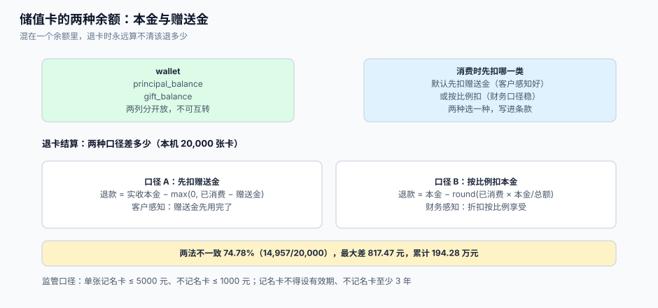

# 储值账户：本金、赠送金与退卡

储值和积分最大的区别是：**储值背后有真钱**。客户充 1,000 元，你收到 1,000 元现金，账上多 1,000 元负债；送他 100 元，负债就变成 1,100 元，而那 100 元从来没有进过账。三个月后他来退卡，问「能退多少」——这个问题的答案取决于你在第一天有没有把「本金」和「赠送金」分开记。

这一页给出双余额模型、充值赠送的三种记法、消费扣减顺序、退卡结算的两种口径与差额、以及监管红线。



本页判据族 `LTS-A` ~ `LTS-H`，共 8 条。定义表在第七节。

## 一、双余额：一个字段装不下两笔钱

| 字段 | 含义 | 来源 | 退款时 |
| --- | --- | --- | --- |
| `principal_balance` | 客户实际支付的余额 | 充值、退款回充 | **可退** |
| `gift_balance` | 赠送金额（含活动加赠、开卡礼） | 充值赠送、活动 | 按口径扣回，见 §4 |
| `total_balance`（视图） | 上面两者之和 | 计算得出 | 不作为退款依据 |

如果把两者合成一个 `balance`，会立刻丢三个能力：① 退卡时算不出该退多少；② 开票金额与消费金额对不上（赠送部分不开票）；③ 无法回答「赠送金用完了没有」，而这是「赠送金是否过期」的依据。

```sql
-- [schema/wallet.sql]
create table wallet (
  wallet_id        bigserial   primary key,
  user_id          bigint      not null,
  tenant_id        bigint      not null,
  card_type        text        not null default 'NAMED',   -- NAMED 记名 / BEARER 不记名
  principal_balance bigint     not null default 0,          -- 单位：分
  gift_balance     bigint      not null default 0,
  status           text        not null default 'ACTIVE',   -- ACTIVE / FROZEN / CLOSED
  issued_at        timestamptz not null default now(),
  expire_at        timestamptz,                             -- NAMED 必须为 null，见 §6
  unique (user_id, tenant_id, card_type),
  check (principal_balance >= 0),
  check (gift_balance >= 0),
  check (card_type <> 'NAMED' or expire_at is null)
);

create table wallet_txn (
  id         bigserial   primary key,
  wallet_id  bigint      not null references wallet(wallet_id),
  kind       text        not null,     -- RECHARGE / GIFT / SPEND / REFUND / CLOSE
  principal_delta bigint not null default 0,
  gift_delta      bigint not null default 0,
  order_id   text,
  biz_key    text        not null,
  created_at timestamptz not null default now(),
  unique (biz_key)
);
```

`check (card_type <> 'NAMED' or expire_at is null)` 这一条把**监管要求写进了数据库**：记名卡不可能有有效期，因为插不进去。

## 二、充值赠送的三种记法

「充 1,000 送 100」在账上有三种记法，后果完全不同：

| 记法 | 账务处理 | 优点 | 缺点 |
| --- | --- | --- | --- |
| A. 全额记本金（1,100 全进 `principal`） | 负债 1,100，无赠送科目 | 实现最简单 | 退卡退 1,100，直接亏 100 |
| B. 分列（本金 1,000 + 赠送 100） | 负债 1,100，其中 100 是营销费用 | 退卡可算清、可开票 | 需要双列与两套扣减规则 |
| C. 只记本金（赠送挂在规则里，消费时打折） | 负债 1,000，赠送体现为折扣 | 负债最小 | 「送 100」变成「打 9 折」，客户感知不同，且部分消费时无法表达 |

**B 是唯一能同时满足退款、开票、审计的记法**。A 的问题是实实在在的资损，C 的问题是营销话术与系统行为不一致。

```sql
-- [sql/recharge.sql] 充 1000 送 100：两条流水，同一事务
insert into wallet_txn(wallet_id, kind, principal_delta, gift_delta, biz_key)
values (:wid, 'RECHARGE', 100000, 0, 'rc:' || :recharge_no),
       (:wid, 'GIFT',      0, 10000, 'gift:' || :recharge_no);

update wallet
   set principal_balance = principal_balance + 100000,
       gift_balance      = gift_balance + 10000
 where wallet_id = :wid;
```

## 三、消费扣减顺序：先扣哪一类

| 顺序 | 规则 | 客户感知 | 退卡时的结果 |
| --- | --- | --- | --- |
| 先扣赠送金 | 赠送先用完，本金留到最后 | 「送的钱先花掉」 | 退款额高（本金剩得多） |
| 先扣本金 | 本金先用完 | 「送的钱一直在账上」 | 退款额低 |
| 按比例扣 | 每笔消费按 本金:赠送 = 本金余额:赠送余额 分摊 | 无感知 | 与「按比例退」自洽 |

三种都能自圆其说，但**必须选一种并写进章程**，因为退卡结算要以它为前提。行业常见做法是「先扣赠送金」（客户体验好、赠送部分尽快核销），本页后续的退卡口径以它为例。

```sql
-- [sql/spend_wallet.sql] 先扣赠送金：一条语句完成两列扣减，天然原子
update wallet
   set gift_balance = greatest(0, gift_balance - :amt),
       principal_balance = principal_balance - greatest(0, :amt - gift_balance)
 where wallet_id = :wid
   and principal_balance + gift_balance >= :amt
returning principal_balance, gift_balance;
```

第二行用 `greatest(0, :amt - gift_balance)` 是**旧值**参与计算，SQL 的 `set` 子句右侧取的是更新前的值，这一点在 PostgreSQL 与 MySQL 上一致；但依赖它可读性差，团队更常见的写法是先用 `select ... for update` 读出两列再算——只要在同一事务内加行锁就安全（与积分扣减的「条件更新」是两种正道，见[账户与流水](../AccountModel/index.md)第五节）。

## 四、退卡结算：两种口径，差 74.78%

退卡要回答「退多少」，而这取决于「已消费的部分算谁的」。两种口径：

| 口径 | 公式 | 含义 |
| --- | --- | --- |
| A. 先扣赠送金 | `退款 = 本金 − max(0, 已消费 − 赠送金)` | 赠送金视为「先用掉的钱」，客户已享受完赠送 |
| B. 按比例扣本金 | `退款 = 本金 − round(已消费 × 本金 ÷ 总额)` | 赠送金视为「折扣」，按消费比例享受 |

本机 20,000 张卡（本金 100~5,000 元、赠送 0/5%/10%/20%、随机已消费）：

| 指标 | 结果 |
| --- | --- |
| 两种口径退款额不同的卡 | **14,957 / 20,000（74.78%）** |
| 单卡最大差额 | **817.47 元** |
| 累计差额 | **1,942,803.87 元**（约 194.28 万元） |

这不是四舍五入级别的差异，而是**口径级别的差异**。选哪个都可以，但必须：① 写进购卡协议；② 在系统里只有一处实现；③ 客服后台展示时标明用的是哪一种。

::: danger 注意
1. **不要在退卡时用「当前余额」直接退**。当前余额里含赠送金，直接退等于把赠送的钱也退了；必须按口径算。
2. **不要忘记「已开发票」的影响**。充值开了发票、退卡时要按规定冲红；系统需记录每笔充值的开票状态（`invoice_no`），否则财务无法处理。
3. **不要允许「退到别的卡」**。办法第二十条要求退回原卡；原卡不存在时才退到同发卡企业的同类卡。退款接口的入参应是 `card_id` 而非 `user_id`。
:::

## 五、消费与退款的资金流

| 环节 | 资金流 | 账务 | 系统动作 |
| --- | --- | --- | --- |
| 充值 | 客户 → 平台 | 预收账款（合同负债）增加 | 写 `RECHARGE` + `GIFT` |
| 消费 | 无现金流动 | 合同负债减少、收入增加 | 写 `SPEND`，扣双余额 |
| 消费后退货 | 无现金流动 | 收入冲回、合同负债恢复 | 写 `REFUND`，**回原卡** |
| 退卡 | 平台 → 客户 | 合同负债减少、现金减少 | 写 `CLOSE`，按口径结算 |
| 过期 | 无 | 依业态而定（多数业态不得过期） | **不应存在**，见 §6 |

「消费后退货回原卡」这一条常被写成「退回余额」，两者在双卡场景下不同：客户有两张卡，A 卡消费、B 卡退款，等于把 A 卡的钱搬到 B 卡，破坏了「原卡追溯」。

## 六、监管红线：限额、有效期、实名

| 要求 | 条款 | 系统落点 |
| --- | --- | --- |
| 单张记名卡 ≤ 5,000 元、不记名卡 ≤ 1,000 元 | 办法第十八条 | 充值接口校验**充值后余额**，不是本次金额 |
| 充值后余额同样受限 | 同上 | `check (principal_balance + gift_balance <= limit)` 或用触发器 |
| 记名卡不得设有效期 | 第十九条 | `check` 约束（见 §1） |
| 不记名卡有效期 ≥ 3 年 | 同上 | 建卡时 `expire_at >= issued_at + 3 years` |
| 过期仍有余额须提供激活、换卡 | 同上 | 过期后状态转 `FROZEN`，保留激活入口，**不清零** |
| 退货资金退至原卡 | 第二十条 | 退款接口带 `card_id` |
| 实名与转账 | 第十五~十七条 | 发卡侧采集身份证件、留存 5 年；单位 5,000 元/个人 5 万元走转账 |
| 适用范围 | 第二条 | 仅零售、住宿餐饮、居民服务业的**企业法人**；其他业态不适用本办法 |

::: warning 赠送金能不能设有效期
办法对「卡内资金余额」设有效期限制，赠送金是否属于「资金余额」在实务中存在争议。稳妥做法：**赠送金随卡有效，不单独设更短的过期时间**；若必须设（例如活动加赠），要在章程中明确写出，并提供到期提醒。把赠送金设成 30 天过期，是最容易被投诉到监管的写法。
:::

## 七、本页判据

| 判据 | 看什么现象 | 判成什么 | 不满足时改哪里 |
| --- | --- | --- | --- |
| `LTS-A` | 本金与赠送金分两列，且有 `wallet_txn` 分别记增量 | 退卡可算 | 拆列，见 §1 |
| `LTS-B` | 充值赠送写两条流水（`RECHARGE` + `GIFT`） | 可开票、可审计 | 改充值逻辑 |
| `LTS-C` | 消费扣减顺序写进章程且只有一处实现 | 口径唯一 | 抽 `spend_wallet` 函数 |
| `LTS-D` | 退卡按口径 A 或 B 之一实现，且有单测覆盖边界 | 退款可复现 | 补单测，见 §4 |
| `LTS-E` | 充值校验「充值后余额 ≤ 限额」 | 合规 | 加校验与 `check` |
| `LTS-F` | 记名卡 `expire_at` 恒为 `null`，不记名卡 ≥ 3 年 | 合规 | 加 `check` 与建卡校验 |
| `LTS-G` | 过期不清零，转 `FROZEN` 且保留激活入口 | 合规、可恢复 | 改过期任务 |
| `LTS-H` | 退款回原卡（入参 `card_id`），并记录开票状态 | 可追溯、可冲红 | 改接口与表结构 |

## 八、验证方式

```shell
# 1) 记名卡不可能有有效期（LTS-F）：这条插入必须失败
psql "$DSN" -c "insert into wallet(user_id,tenant_id,card_type,expire_at) \
  values (42,1,'NAMED', now() + interval '1 year');"
```

预期输出：`ERROR: new row for relation "wallet" violates check constraint "wallet_check"`。

```shell
# 2) 充值后余额不得超过限额（LTS-E）
psql "$DSN" -c "update wallet set principal_balance = principal_balance + 600000 \
  where wallet_id = 1 and card_type='NAMED';"
```

预期输出：在有 `check` 或触发器时应报错；若成功，说明限额只在前端校验。

```shell
# 3) 退卡结算可复现（LTS-D）：给定一张卡，算出两种口径的退款额
psql "$DSN" -c "
select w.wallet_id, w.principal_balance, w.gift_balance,
       w.principal_balance - greatest(0, :spent - w.gift_balance)            as refund_a,
       w.principal_balance - round(:spent * w.principal_balance /
             (w.principal_balance + w.gift_balance))                         as refund_b
  from wallet w where w.wallet_id = :wid;"
```

预期输出：两列数值；与客服后台展示的金额一致，且与章程口径一致。

```shell
# 4) 过期批次不得出现在储值上（LTS-G）
psql "$DSN" -c "select count(*) from wallet where card_type='NAMED' and expire_at is not null;"
```

预期输出：`0`。

```shell
# 5) 充值赠送必须两条流水（LTS-B）
psql "$DSN" -c "select kind, count(*) from wallet_txn where biz_key like 'rc:RC-1%' or biz_key like 'gift:RC-1%' group by 1;"
```

预期输出：`GIFT | 1` 与 `RECHARGE | 1` 两行。

## 九、参考资料

- 商务部《单用途商业预付卡管理办法（试行）》（限额 5,000/1,000 元、记名卡不得设有效期、退至原卡、实名与转账）：<https://www.mofcom.gov.cn/zcfb/blgg/art/2012/art_3ee43bfc933f4713a0a44e04b3b72939.html>
- 商务部市场秩序司《如何做好单用途商业预付卡管理工作》（备案、章程、限额、有效期、退卡的执行要点）：<https://yfk.mofcom.gov.cn/card/page/common/NoticeView.html>
- 国家税务总局《关于单用途商业预付卡增值税问题的公告》（售卡与消费的发票处理）：<https://www.chinatax.gov.cn/>
- 财政部《企业会计准则第 14 号——收入》（预收性质款项确认为合同负债）：<https://www.mof.gov.cn/>
- PostgreSQL 文档《Constraints》（用 `check` 表达监管约束）：<https://www.postgresql.org/docs/current/ddl-constraints.html>
