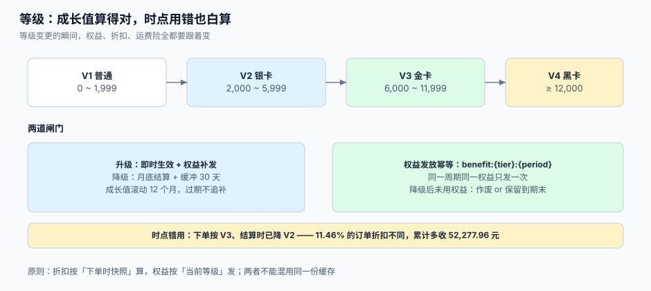

# 等级与权益：成长值、升降级与发放幂等

等级是会员体系里**唯一一个「算对了也可能出错」**的模块：成长值的加法不会错，错的永远是**时点**——客户下单时是金卡，结算时已经降成银卡，这一单按哪个折扣算？系统里如果只存「当前等级」，这个问题无解，因为「当前」在两次请求之间变了。

这一页讲清四件事：成长值按什么窗口算、升降级在什么时点生效、缓冲期怎么设、权益怎么发才不重复。



本页判据族 `LTT-A` ~ `LTT-H`，共 8 条。定义表在第六节。

## 一、成长值：三个必须写死的口径

| 口径 | 选项 | 差异 |
| --- | --- | --- |
| 统计窗口 | 滚动 12 个月 / 自然年 / 终身累计 | 滚动对老客户更公平，自然年会出现「1 月降级潮」 |
| 计入行为 | 只算实付金额 / 含运费 / 含税 / 含积分抵扣部分 | 与[获取规则](../EarnRules/index.md)的基数口径必须一致，否则「消费 1 万元却不是金卡」 |
| 是否扣减 | 退款是否扣成长值 / 是否允许负值 | 只加不减 → 刷单即升级；允许负值 → 退款后可能瞬间降两级 |

滚动窗口的实现要点：不要每天重算全量（那是 O(用户数 × 订单数)），而是**用月汇总表**：

```sql
-- [schema/tier_growth.sql]
create table growth_monthly (
  user_id    bigint not null,
  month      date   not null,          -- 月初日期，如 2026-10-01
  growth     bigint not null default 0,
  primary key (user_id, month)
);

-- 等级判定：滚动 12 个月求和
select coalesce(sum(growth), 0) as window_growth
  from growth_monthly
 where user_id = :uid
   and month > (date_trunc('month', now()) - interval '12 months');
```

月汇总表让「滚动 12 个月」变成 12 行求和，而不是扫全部订单。

## 二、自然年 vs 滚动：为什么「1 月降级潮」

自然年口径在 1 月 1 日把所有人清零重算，于是 12 月 31 日的金卡客户在 1 月 1 日看到自己「还差 8,000 元保级」——而他在 12 月刚消费了 2 万元（算在去年）。这是**口径导致的体验事故**，不是客户的问题。

| 口径 | 客户感知 | 运营成本 | 适用 |
| --- | --- | --- | --- |
| 自然年 | 每年 1 月集体「清零」，需大量解释 | 低（一次重算） | 强年度活动、权益按年售卖 |
| 滚动 12 个月 | 任何时点看都是「最近一年」，平滑 | 中（月度滚动） | 大多数零售会员 |
| 终身累计 | 只升不降 | 低 | 只做「荣誉等级」，不与折扣挂钩 |

若必须用自然年，**保级判定要延后到 1 月底**，并给 1 月留「保护期」（原等级继续生效 30 天），否则客诉会集中在开年第一周。

## 三、升降级的时点：三个候选，只有一个对

| 时点 | 做法 | 问题 |
| --- | --- | --- |
| 实时 | 每次消费后立即重算等级 | 一天内可能升降多次，通知风暴；退款后立刻降级引发投诉 |
| 日结 | 每日 03:00 批量重算 | 客户当天消费达标却要等一天，体验差但可控 |
| 月结 | 每月 1 日重算 | 与「自然年」叠加会产生 1 月双重跳变 |

推荐组合：**升级实时（达标即升，立即发权益）、降级日结（次日 03:00，且带 30 天缓冲）**。升级是「给好处」，越快越好；降级是「收好处」，必须给缓冲。

```sql
-- [sql/tier_change.sql] 升级即时：目标等级高于当前才更新，并记快照
update member_tier
   set tier_code = :new_tier,
       tier_since = now(),
       prev_tier  = tier_code
 where user_id = :uid
   and tier_rank < :new_rank           -- 只升不降，降级走日结任务
returning tier_code, prev_tier;
```

## 四、时点快照：订单必须记住「当时是几级」

这是本页最重要的一条。折扣、包邮、专属价都依赖等级，而等级会变，所以**订单必须存一份等级快照**：

```sql
-- [schema/order_tier_snapshot.sql]
alter table sales_order
  add column tier_code_snapshot text,
  add column tier_rank_snapshot smallint,
  add column discount_rate_snapshot numeric(5,4);   -- 0.9500 表示 95 折
```

三列都要存，因为：`tier_code` 用于展示（「您是金卡会员，享 95 折」）、`tier_rank` 用于计算（避免「金牌/金卡/黄金」三种叫法混用）、`discount_rate` 用于对账（折扣规则改版后，历史订单仍能自证）。

本机模拟（4,000 用户 × 12 单、18% 的订单在结算前因退款掉档）：

| 口径 | 折扣不同的订单 | 累计差额 |
| --- | --- | --- |
| 下单时等级 vs 结算时等级 | **5,501 / 48,000（11.46%）** | **52,277.96 元**（按结算口径多为收） |

11.46% 的订单会算出不同金额，而**客户手里的截图是下单时的价格**。没有快照，客诉时系统无法自证；有快照，只需展示快照即可。

::: danger 注意
1. **不要在结算时「重新取当前等级」**。这是 11.46% 差异的来源。结算应该读订单快照，除非「下单到支付」超过快照有效期（如 30 分钟），此时按规则重新定价并**明确告知客户**。
2. **不要用等级折扣去改「商品单价」**。折扣应体现在订单层的优惠金额上，否则退款按单价退会算错。
3. **不要让「等级」和「权益包」各自实现一套**。等级只是标签，权益是配置；两套实现必然出现「金卡但没包邮」。
:::

## 五、权益发放：幂等键要带周期

等级权益（生日礼、月度券包、免邮次数）最大的问题是**重复发放**：等级变更事件重投、月度任务重跑、手工补偿与自动发放叠加，都会让客户拿到两份。

| 权益 | 幂等键 | 周期 |
| --- | --- | --- |
| 月度券包 | `benefit:{user_id}:{tier}:{yyyymm}` | 月 |
| 生日礼 | `benefit:{user_id}:birthday:{yyyy}` | 年 |
| 升级礼 | `benefit:{user_id}:upgrade:{tier}:{tier_since_date}` | 每次升级 |
| 免邮次数 | `benefit:{user_id}:freeship:{yyyymm}` | 月（按次核销，不按次发放） |

```sql
-- [sql/grant_benefit.sql] 发放幂等：唯一键冲突即视为已发
insert into benefit_grant(user_id, benefit_code, period_key, biz_key, granted_at)
values (:uid, :code, :period, :biz_key, now())
on conflict (biz_key) do nothing
returning id;
```

注意 `upgrade` 类权益的键里带 `tier_since_date`：客户一年内升级两次（银→金→黑），应该拿两份升级礼；如果键只用 `{tier}`，第二次升级到更高等级时不会重复（键不同），但**降级后再升回同一等级**会被永久拦住——所以要带日期。

## 六、本页判据

| 判据 | 看什么现象 | 判成什么 | 不满足时改哪里 |
| --- | --- | --- | --- |
| `LTT-A` | 成长值统计窗口写明（滚动 12 个月 / 自然年），且有月汇总表 | 可算、可解释 | 建 `growth_monthly` |
| `LTT-B` | 成长值的计入基数与积分获取基数一致 | 口径不打架 | 共用一份配置 |
| `LTT-C` | 退款会扣成长值，且定义了负值处理 | 抗刷单 | 加扣减与下限规则 |
| `LTT-D` | 升级实时、降级日结，且有缓冲期 | 体验可控 | 拆两条任务 |
| `LTT-E` | 订单存 `tier_code / tier_rank / discount_rate` 三列快照 | 折扣可自证 | 加三列并回填 |
| `LTT-F` | 权益发放的幂等键带周期（月/年/升级日期） | 不重复发 | 改键构造 |
| `LTT-G` | 等级权益来自配置表，不散落在代码 | 可运营 | 抽 `benefit_config` |
| `LTT-H` | 降级前有通知，且通知里给出「还差多少保级」 | 客诉可降 | 接通知 + 差额查询 |

## 七、验证方式

```shell
# 1) 订单必须带等级快照（LTT-E）：历史订单不允许为空
psql "$DSN" -c "select count(*) from sales_order where created_at > '2026-01-01' and tier_code_snapshot is null;"
```

预期输出：`0`。

```shell
# 2) 折扣按快照算，不随等级变化：同一订单隔一天再算一次，金额必须不变
psql "$DSN" -c "select order_id, payable_cents, round(goods_cents * discount_rate_snapshot) expected \
  from sales_order where order_id='SO-T1';"
```

预期输出：`payable_cents` 与 `expected` 相差 0（或仅运费/券的差异）。

```shell
# 3) 权益发放幂等（LTT-F）：同一周期重跑任务，券数量不变
psql "$DSN" -c "select count(*) from benefit_grant where user_id=42 and period_key='202610';"
```

预期输出：重跑前后相同。

```shell
# 4) 升级即时、降级不即时（LTT-D）
psql "$DSN" -c "select tier_code, tier_since, prev_tier from member_tier where user_id=42;"
```

预期输出：`tier_since` 为升级时刻；降级应发生在日结任务之后，且 `prev_tier` 记录了上一级。

```shell
# 5) 成长值窗口可重算（LTT-A）
psql "$DSN" -c "select coalesce(sum(growth),0) from growth_monthly \
  where user_id=42 and month > (date_trunc('month', now()) - interval '12 months');"
```

预期输出：与会员中心展示的「近 12 个月成长值」一致。

## 八、参考资料

- IFRS 15 应用指南 B40（「重大权利」判定：等级权益是否构成单项履约义务，取决于它是否给了客户在别处得不到的权利）：<https://www.ifrs.org/issued-standards/list-of-standards/ifrs-15-revenue-from-contracts-with-customers/>
- PostgreSQL 文档《Date/Time Functions》（`date_trunc` 与滚动窗口计算）：<https://www.postgresql.org/docs/current/functions-datetime.html>
- PostgreSQL 文档《INSERT ... ON CONFLICT》（权益发放的幂等写法）：<https://www.postgresql.org/docs/current/sql-insert.html>
- 中国消费者协会《消费者权益保护法实施条例》相关解读（会员等级变更与告知义务）：<https://www.cca.org.cn/>
