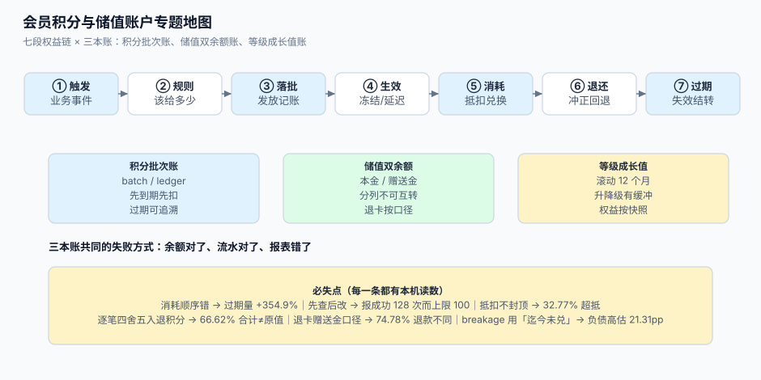

# 会员积分与储值账户工程

「消费 100 元得 100 积分」「充值 1000 送 100」——这两句话在任何电商后台里都只需要一个输入框，而在账务上它们是**两笔负债**：积分是「未来要给的东西」，储值是「已经收的钱」。营销部门把它当活动预算，财务把它当合同负债，客户把它当钱包里的钱，三个视角都不算错，但**没有一个系统能同时满足三者**，于是一到月底就要开会。

本专题讲**一个会员权益账户从发放到结转的完整链路**：积分怎么按批次记、储值怎么分本金与赠送金、抵扣怎么换算与封顶、退款怎么按比例回退、过期怎么算才不冤枉客户、等级变更在哪个时点生效、以及 breakage（失效比例）怎么估才不会让负债偏出一大截。它不讲某个会员 SaaS 后台怎么点，只讲**这条链路上哪些地方会安静地把账算错**。

::: tip 一句话理解
积分的失败**不出错**：客户余额少了 300 分、财务报表一切平衡、客服后台显示「已过期」——三句话都对，但客户说的「我没收到任何提醒」也对。因为**「过期」是按批次算的，而「余额」只是一个数**；系统里从来没有一条记录说「这 300 分是哪天给的、什么时候到期、为什么现在没了」。
:::

::: info 本专题与相邻专题的分工
- **会计分录与总账** → [账务与复式记账](../Ledger/DoubleEntry/index.md)：那边解决「借贷平衡、科目怎么设、分录怎么冲」。本专题只处理**两类特殊负债**（积分与储值）的**明细账**，并把「一笔消费该怎么记」交给那边；我们不重复讲复式记账原理。
- **营销计价与优惠分摊** → [营销计价与优惠分摊](../PricingPromotion/index.md)：那边算「这一单该付多少」，本专题算「这一单该给多少积分、这些积分值多少钱」。抵扣会进入计价链路，但**分摊到行的算法**归那边，本专题只说明接口边界。
- **订阅计费** → [订阅计费与周期账单](../SubscriptionBilling/index.md)：那边管「周期性收钱」，本专题管「收完钱之后给的权益」。订阅的用量计量与阶梯价格在那边，会员等级与它**不是一回事**（等级看历史累计，不看当期用量）。
- **单条请求的幂等** → [幂等与状态机](../IdempotencyStateMachine/IdempotencyKey/index.md)：那边讲「一个请求怎么只生效一次」，本专题的幂等是**业务事件级**（同一笔订单事件重投、同一批次重复过期），键的构造方式不同。
- **多租户隔离** → [多租户 SaaS 工程](../MultiTenantSaaS/index.md)：会员体系几乎必然多租户（一个集团多个品牌各自积分不通兑），隔离模型在那边，本专题只在[账户模型](AccountModel/index.md)里给 `tenant_id` 的落位建议。
- **对账与日结** → [账务 · 对账](../Ledger/Reconciliation/index.md)：通用「两套账怎么对」在那边；本专题的[负债与对账](LiabilityRecon/index.md)讲**三方对账**（余额、流水、批次）与 breakage 口径。
- **消息通知与触达** → [消息通知与触达工程](../NotificationDelivery/index.md)：过期前提醒、等级变更通知走那边；本专题只说明「提醒触发了但客户没看」不影响过期事实。
- **隐私与同意** → [隐私工程 · 删除与派生数据传播](../../Others/PrivacyEngineering/Deletion/index.md)：注销账号时积分余额属于**待清理的派生数据**，那边的删除清单要包含本专题的三张表。
:::

## 目录

- [总览：七段权益链与三本账](Overview/index.md)
- [账户与流水：批次、余额与不变式](AccountModel/index.md)
- [获取与冲正：规则、上限与幂等入账](EarnRules/index.md)
- [抵扣与结算：换算、封顶与部分退款](RedeemSettle/index.md)
- [过期与失效：批次、顺序与宽限](ExpiryBatch/index.md)
- [储值账户：本金、赠送金与退卡](StoredValue/index.md)
- [等级与权益：成长值、升降级与发放幂等](TierBenefit/index.md)
- [负债与对账：breakage、合同负债与三方核对](LiabilityRecon/index.md)
- [实战：一套能跑起来的最小账户链路](Practice/index.md)
- [常见问题与分诊](FAQ/index.md)

## 专题地图

## 判据纪律

沿用全库写法：**每页 8 条，编号形如 `LTO-A`**，逐页前缀唯一，可被 `utils/audit` 下的判据类巡检机械核对。每条判据回答三件事：**看什么现象、判成什么、不满足时改哪里**。

| 页 | 判据族 | 这一族管什么 | 条数 |
| --- | --- | --- | --- |
| 总览 | `LTO-A` ~ `LTO-H` | 七段链、三本账、必失点、接缝归属 | 8 |
| 账户与流水 | `LTM-A` ~ `LTM-H` | 批次、余额、流水、四条不变式、条件更新 | 8 |
| 获取与冲正 | `LTE-A` ~ `LTE-H` | 事件来源、规则求值、上限、幂等键、冲正、冻结 | 8 |
| 抵扣与结算 | `LTR-A` ~ `LTR-H` | 换算、封顶、分摊、混合支付、部分退款回退 | 8 |
| 过期与失效 | `LTX-A` ~ `LTX-H` | 批次到期、消耗顺序、扫描、宽限、提醒 | 8 |
| 储值账户 | `LTS-A` ~ `LTS-H` | 双余额、充值赠送、消费顺序、退卡、限额、监管 | 8 |
| 等级与权益 | `LTT-A` ~ `LTT-H` | 成长值口径、升降级、缓冲、权益发放、时点快照 | 8 |
| 负债与对账 | `LTL-A` ~ `LTL-H` | 合同负债、breakage、三方对账、月结、审计留痕 | 8 |
| 实战 | `LTP-A` ~ `LTP-H` | 建表、种子、七步流水、正负向验收、对账 SQL | 8 |
| 常见问题 | `LTQ-A` ~ `LTQ-H` | 分诊表、止血顺序、误判、上线自查 | 8 |

合计 **10 族 80 条**。

## 事实与规格速览（2026-10 口径）

这类工程的实现细节一半由**监管条款**决定、一半由**会计准则**决定，两者都不以「产品经理觉得」为转移：

| 事项 | 现状 | 对系统的影响 |
| --- | --- | --- |
| 单用途预付卡限额 | 商务部令 2012 年第 9 号（2016 年第 2 号令修订）第十八条：**单张记名卡 ≤ 5000 元、单张不记名卡 ≤ 1000 元**，充值后余额同样受此限制 | 充值接口必须有**限额校验**，且校验的是「充值后余额」不是「本次充值额」。见[储值账户](StoredValue/index.md) |
| 有效期 | 同办法第十九条：**记名卡不得设有效期；不记名卡有效期不少于 3 年**；过期仍有余额的应提供激活、换卡 | 「积分有效期 1 年」合法，「储值卡 1 年过期作废」**不合法**。两者不能用同一套过期逻辑 |
| 退货退款 | 同办法第二十条：退货资金应**退至原卡**；卡内余额超限额时退至同发卡企业同类卡；退货金额 ≤100 元可付现金 | 储值退款是「回原卡」，不是「新建一张卡」；退款接口要带 `card_id` 而不是 `user_id` |
| 大额购卡 | 第十五至十七条：购记名卡或一次性购 1 万元（含）以上不记名卡须实名；单位 5000 元（含）以上、个人 5 万元（含）以上须银行转账 | 实名与转账校验是**发卡侧**的合规要求，不是风控的可选项 |
| 适用范围 | 办法仅覆盖**零售业、住宿和餐饮业、居民服务业**的企业法人；健身、教培、医美等行业的预付卡不在其调整范围 | 不要把「单用途卡管理办法」当成所有储值业务的依据，写条款前先确认业态 |
| 积分的会计属性 | IFRS 15 / ASC 606：积分构成**重大权利（material right）**时是**单项履约义务**，收款时按单独售价分摊、确认合同负债，兑付或失效时才转收入（IFRS 15 B40、B42、B44~B47；ASC 606-10-55-48） | 积分发放当天就要产生负债；「年底一次性计提营销费用」在准则下不成立。见[负债与对账](LiabilityRecon/index.md) |
| breakage 的确认方式 | IFRS 15 B46：预期不会被行使的权利，按**权利被行使的模式比例**确认收入；不能可靠估计时，只在「剩余权利被行使的可能性极低」时确认 | 不能「到期一次性冲回」；到期那天只落地「估计与实际的差额」 |
| 需上缴第三方的情形 | 若法规要求把未行使金额上缴（如某些司法辖区的无人认领财产法），该部分是**负债**而非收入（IFRS 15 B47） | 预收资金存管与上缴规则要在系统里留出「应付上缴」科目，而不是当收入 |
| 行业参考量级 | 部分成熟计划的兑付率在 95% 左右（对应 breakage ≈ 5%），零售与航空类常见 breakage 更高 | breakage 是**估出来的**，必须按自己 12 个月以上的兑付历史算；抄别人的比例等于抄别人的负债 |

::: warning 两个「不能全信」
1. **不能全信「积分余额」**。余额是一个被反复加减的数字，它没有到期日、没有来源、没有证据。本机在 2,000 个用户上对比两种消耗顺序：先到期先扣过期 **84,048 分**，后发放先扣过期 **382,349 分**（差 **354.9%**）——余额一样，过期量差三倍半。见[过期与失效](ExpiryBatch/index.md)。
2. **不能全信「已兑付比例」**。财务常见的算法是「发放减已兑」，把「还没兑」当「不会兑」。本机同一批 1,200 万分发放，这样算出来 breakage **59.31%**，按成熟批次外推是 **38.00%**，负债口径差 **21.31 个百分点**（1,200 万积分按 100 分 = 1 元折算，差 **2,557,500 分 ≈ 2.56 万元**；规模放大 100 倍就是 256 万元）。见[负债与对账](LiabilityRecon/index.md)。
:::

## 七个必失点（本专题的全部理由）

这七条不是「注意一下」，而是**结构性的**：只要实现里缺少对应的一条，账就会安静地错，而且错在报表上、不在日志里。

1. **只有余额没有批次**——余额没有到期日，过期只能按比例拍脑袋；本机两种消耗顺序下过期量差 **354.9%**，**95.6%** 的用户结果不同。见[过期与失效](ExpiryBatch/index.md)。
2. **扣减用「先查后改」**——16 线程、余额 1,000 分、每次扣 10 分：应用层报成功 **128 次**（理论上限 100），余额只少了 90 分，流水记了 1,280 分，**余额与流水差 1,190 分**。见[账户与流水](AccountModel/index.md)。
3. **抵扣不封顶、取整方向不明**——30,000 单里 **32.77%** 的单在「不封顶」时会抵出负数（超抵合计 **64.1 万元**）；封顶后仍有 **0.33%** 的单留下 1~99 分尾差，客户「差一分钱付不掉」。见[抵扣与结算](RedeemSettle/index.md)。
4. **部分退款逐笔四舍五入**——20,000 单分三次退款，**66.62%** 的单「逐笔回退之和 ≠ 一次回退」（最大差 1 分），客户第二次退款时发现积分少了一分。见[抵扣与结算](RedeemSettle/index.md)。
5. **储值退卡的赠送金口径没写死**——「先扣赠送金」与「按比例扣本金」两种口径下，**74.78%** 的卡退款额不同，最大差 **817.47 元**，20,000 张卡累计差 **194.28 万元**。见[储值账户](StoredValue/index.md)。
6. **等级按「结算时」算折扣**——48,000 单里 **11.46%** 的订单在下单与结算之间掉档，同一单两种口径折扣不同，累计**多收 52,277.96 元**，且客户拿着截图来对账时系统无法自证。见[等级与权益](TierBenefit/index.md)。
7. **breakage 用「迄今未兑」**——把「还没兑」当「永不兑」，把负债算高 **21.31 个百分点**；反向的错（用早期批次外推、忽略新批次兑付窗口未到）会把负债算低，两种错都会在审计时被问。见[负债与对账](LiabilityRecon/index.md)。

## 为什么这里没有版本目录

本专题**不建 `v1/` `v2/` 这类版本目录**，理由三条：

1. **换代的是玩法，不是判据**。「消费返积分」换成「任务得积分」换成「签到得成长值」，变的是触发条件；而「发放要可按业务键冲正」「余额只能由流水推导」「过期只发生在批次上」这三类判据一字未变。
2. **并存差异是选型，不是代际**。同一时期里，自建积分账、买 SaaS 会员模块、集团多品牌各自建账并存——这是**三种部署形态**，按版本建目录会把「选型对照」拆成历史存档。
3. **可验证的差异已收敛进表格**。凡有「两种做法」的地方（先到期先扣 vs 后发放先扣、先扣赠送金 vs 按比例扣本金、下单时等级 vs 结算时等级），都用同一张表写清「什么时候用哪个、差多少」，并附本机读数。

作为对照，本库确实存在需要版本目录的主题：[Spring 5 / Spring 6](../Java/Frame/Spring/index.md)、[Vue 2 / Vue 3](../../Frontend/Frame/Vue/index.md)、[MySQL 5.7 / 8.4](../../DB/SchemaEvolution/index.md)——它们的共同点是**同一个产品的两代 API 不兼容且旧版仍在跑**，与本题不同。

## 三条底线

::: danger 三条不可让步的底线
1. **余额只能由流水推导，不能直接改**。任何「运维手动调账」都必须落一条 `ADJUST` 流水，带操作人、原因与审批单号。直接 `update account set points = 500` 的后果是：下一次三方对账必然炸，而且**无法证明哪一笔是真的**。本机先查后改的实验里，余额与流水差了 **1,190 分**，事后无从还原。见[账户与流水](AccountModel/index.md)。
2. **每一分积分都要能回答「哪一批、什么时候到期、被谁用掉」**。做不到这一条，[过期](ExpiryBatch/index.md)、[退款回退](RedeemSettle/index.md)、[负债](LiabilityRecon/index.md)三件事全部只能靠估算，而估算之间互相矛盾。
3. **储值的本金与赠送金必须分列**。合在一个余额里，「退卡该退多少」「赠送部分要不要开票」「过期作废是否合法」三个问题永远答不清；本机两种口径下 **74.78%** 的卡退款额不同。见[储值账户](StoredValue/index.md)。
:::

## 阅读顺序

先读[总览](Overview/index.md)拿到七段链与三本账，然后按手上的问题选主线：

- **客户说「我的积分怎么少了」** → [常见问题与分诊](FAQ/index.md) 的分诊表，再按指向跳
- **要设计积分表结构与不变式** → [账户与流水](AccountModel/index.md)
- **发放重复、退款退不掉积分** → [获取与冲正](EarnRules/index.md)
- **抵扣金额算错、退款积分对不上** → [抵扣与结算](RedeemSettle/index.md)
- **过期量莫名其妙、客户投诉过期** → [过期与失效](ExpiryBatch/index.md)
- **储值卡退卡、赠送金怎么算** → [储值账户](StoredValue/index.md)
- **等级降级引发客诉、权益重复发** → [等级与权益](TierBenefit/index.md)
- **财务问积分负债是多少** → [负债与对账](LiabilityRecon/index.md)
- **要从零搭一套能验收的最小链路** → [实战](Practice/index.md)，按 S1~S7 走

## 参考资料

- 商务部《单用途商业预付卡管理办法（试行）》（商务部令 2012 年第 9 号，2016 年第 2 号令修订；限额、有效期、退卡、实名与转账条款）：<https://www.mofcom.gov.cn/zcfb/blgg/art/2012/art_3ee43bfc933f4713a0a44e04b3b72939.html>
- 商务部市场秩序司《如何做好单用途商业预付卡管理工作》（备案、章程、限额、有效期、退卡的执行要点）：<https://yfk.mofcom.gov.cn/card/page/common/NoticeView.html>
- IFRS 15《Revenue from Contracts with Customers》应用指南 B40~B47（重大权利、单独售价、breakage、上缴第三方）：<https://www.ifrs.org/issued-standards/list-of-standards/ifrs-15-revenue-from-contracts-with-customers/>
- FASB ASC 606-10-55-48（未行使权利的确认口径，与 IFRS 15 B46 实质一致）：<https://asc.fasb.org/>
- 财政部《企业会计准则第 14 号——收入》（2017 年修订，与 IFRS 15 趋同，积分作为单项履约义务）：<https://www.mof.gov.cn/>
- KPMG《Accounting for revenue is changing》（忠诚度计划与 breakage 在新准则下的处理要点）：<https://assets.kpmg.com/content/dam/kpmg/xx/pdf/2018/01/banks-ifrs15-blog-printable.pdf>
- PostgreSQL 文档《Constraints》（唯一约束、`CHECK`、部分唯一索引）：<https://www.postgresql.org/docs/current/ddl-constraints.html>
- PostgreSQL 文档《UPDATE》（`WHERE` 条件更新与 `RETURNING`，条件扣减的实现基础）：<https://www.postgresql.org/docs/current/sql-update.html>
