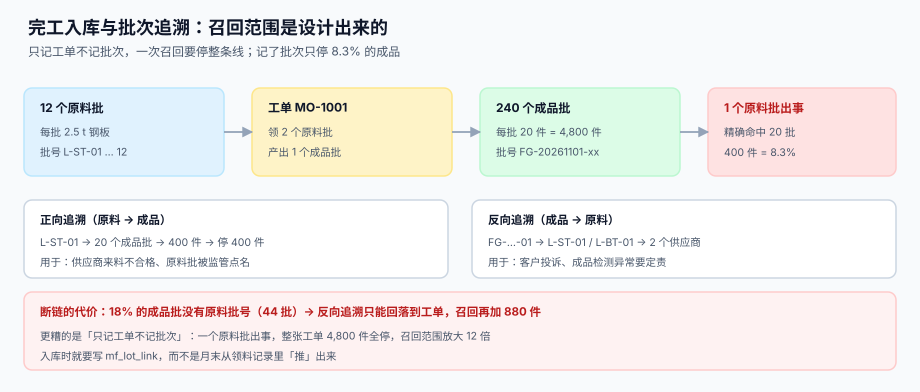

# 完工入库、批次与追溯

<p style="text-align:center;"></p>

入库动作在生产系统里只占一行代码：`INSERT INTO stock ...`。但它同时决定了三件后续所有事：**这批货能不能卖、卖出去出问题时能召回多少、成本结到哪个批次**。三件事里前两件在入库当天没人关心，直到出事那天。

本页判据族 `MFS-A` ~ `MFS-H`，共 8 条，定义在第六节。

## 一、入库确定的是「一个可售批次」



工单报工报的是「做完了多少件」，入库确定的是「这些件组成几个可以单独销售的批」。两者的关系不是一对一：

| 情形 | 工单数 | 成品批数 | 为什么 |
| --- | --- | --- | --- |
| 一次做完一次入库 | 1 | 1 | 最常见 |
| 分批入库（边做边出） | 1 | 3 | 客户急要，先出 2 批 |
| 跨原料批生产 | 1 | 2 | 中途换了钢板批号，可追溯性不同 |
| 返工后重新入库 | 1 + 1 | 2 | 返工单产出的批次必须与首批区分 |

```sql
CREATE TABLE mf_receipt (
  receipt_id INTEGER PRIMARY KEY AUTOINCREMENT,
  order_no   TEXT NOT NULL REFERENCES mf_order(order_no),
  lot        TEXT NOT NULL,                       -- 成品批号
  qty        INTEGER NOT NULL CHECK (qty > 0),
  received_at TEXT NOT NULL,
  UNIQUE (order_no, lot)                          -- 同一工单同一批不能入两次
);

CREATE TABLE mf_lot_link (
  fg_lot TEXT NOT NULL,                           -- 成品批
  rm_lot TEXT NOT NULL,                           -- 消耗的原料批
  qty    REAL NOT NULL DEFAULT 0,                 -- 该原料批的耗用量
  PRIMARY KEY (fg_lot, rm_lot)
);
```

`UNIQUE (order_no, lot)` 是入库幂等的全部实现：网关重试、页面重复点击、接口重投，都会撞在这个唯一键上，`ON CONFLICT DO NOTHING` 之后 `changes()=0` 即为重投。

## 二、批次链：两个方向都要能走

| 方向 | 查询 | 典型触发 | 输出 |
| --- | --- | --- | --- |
| 正向 | 原料批 → 成品批 | 供应商来料不合格、原料批被监管点名 | 要停哪些成品批、多少件 |
| 反向 | 成品批 → 原料批 | 客户投诉、成品检测异常 | 涉及哪些原料批、哪些供应商 |

```sql
-- 正向：一个原料批影响到的全部成品批
SELECT l.fg_lot, r.qty, r.received_at
  FROM mf_lot_link l JOIN mf_receipt r ON r.lot = l.fg_lot
 WHERE l.rm_lot = :rm_lot;

-- 反向：一个成品批用到的全部原料批
SELECT l.rm_lot, l.qty
  FROM mf_lot_link l
 WHERE l.fg_lot = :fg_lot;
```

本机读数（12 个原料批 → 240 个成品批、每批 20 件、共 4,800 件）：

| 场景 | 召回范围 | 占比 |
| --- | --- | --- |
| 有完整批次链 | 20 个成品批 / 400 件 | **8.3%** |
| 只记工单不记批次 | 整张工单 / 4,800 件 | 100%（放大 12 倍） |
| 18% 成品批缺原料批号 | 额外 44 批 / 880 件 回落到工单 | +18.3% |

**「8.3% 还是 100%」不是系统能力问题，是入库那天写没写 `mf_lot_link` 的问题。**

::: danger 批次链断掉的四种原因
1. **倒冲不落批**：倒冲自动扣料时只扣总量，不记「扣了哪几个批」，原料侧直接断链。
2. **月末补录**：入库时只记工单号，月末从领料记录「推」批次——推出来的是「可能用过」，不是「确实用过」。
3. **换批不记录**：中途换原料批，操作工没扫新批号，系统认为一直是第一批。
4. **返工另起批次但没连原料**：返工单的投料是新领的还是回用的，没有记录。
:::

## 三、序列号：比批次细一级的追溯

| 粒度 | 召回单位 | 记录量 | 适用 |
| --- | --- | --- | --- |
| 批次 | 一批（如 20 件） | 每工单几行 | 大多数离散装配 |
| 序列号 | 一件 | 每件一行 | 高价值、安全件、需单件保修 |

序列号**不能塞进 `lot` 字段**：一个批次里既可能有好件也可能有坏件，把序列号当批号会让「同批不同命」无法表达。

```sql
CREATE TABLE mf_serial (
  serial_no TEXT PRIMARY KEY,
  order_no  TEXT NOT NULL,
  fg_lot    TEXT NOT NULL,
  status    TEXT NOT NULL DEFAULT 'OK' CHECK (status IN ('OK','SCRAP','REWORK','SHIPPED')),
  FOREIGN KEY (order_no) REFERENCES mf_order(order_no)
);
```

::: warning 序列号的两个陷阱
1. **序列号在报工时生成**：报 100 件生成 100 个号，但其中 5 件报废——号已经发出去了，报废件占着号段，客户扫码查不到。
2. **序列号与批次不同步**：批次拆成两批入库，序列号仍挂在原批上，反向追溯走不到正确的成品批。
:::

## 四、部分入库与跨期

```text
工单 100 件 → 报工良品 95 → 第一次入库 60 → 第二次入库 33 → 在制 2
```

部分入库是常态（客户急要、库位不够、检验分批）。三条纪律：

1. **累计入库不得超过良品**：`received <= produced`，超出就是「入库比做出来的还多」。
2. **在制必须显式存在**：`wip = produced - received`，不能因为「差不多入库完了」就把在制抹成 0。
3. **跨月入库要分两期记**：12 月 31 日报工、1 月 2 日入库，成本归属期必须按入库日或报工日**二选一并写死**，不能两期都算。

## 五、入库与报工的时序

| 时序 | 后果 |
| --- | --- |
| 先报工后入库（正常） | 在制短暂 > 0，随后归零 |
| 先入库后报工 | 入库数 > 报工良品，违反 `received <= produced` |
| 只入库不报工 | 库存有、成本没有来源，月末盘盈 |
| 只报工不入库 | 在制永远挂着，成品库里查不到 |

系统的正确做法是**入库时校验 `received + qty <= produced`**，不满足就报 409 让操作员先补报工——而不是「先入了再说」。

## 六、判据清单

| 编号 | 判据 | 怎么验 |
| --- | --- | --- |
| `MFS-A` | 入库幂等：`UNIQUE (order_no, lot)` 且重投 `changes()=0` | 重复插入两次，`count(*)` = 1 |
| `MFS-B` | 累计入库不超良品：`received <= produced` | `CHECK` 或写入前校验 |
| `MFS-C` | 每条入库都有批次链（至少一条 `mf_lot_link`） | 反查无链接的成品批 = 0 |
| `MFS-D` | 正向追溯可执行且结果可枚举 | 一条 SQL 输出受影响成品批清单 |
| `MFS-E` | 反向追溯可执行且能到供应商 | join 到原料批的供应商字段 |
| `MFS-F` | 序列号独立表，不占用 `lot` 字段 | `mf_serial` 存在且 `lot` 只存批号 |
| `MFS-G` | 部分入库后 `wip` 与实物一致 | `produced - received = wip` 且可与车间实物核对 |
| `MFS-H` | 跨期入库的归属期口径写死在配置或文档里 | 页内 / 配置表有 `cost_period_basis` |

## 七、验证方式

```shell
# 1) 同批重复入库必须被拒：应报 UNIQUE 失败
sqlite3 /tmp/mf.db "INSERT INTO mf_receipt(order_no,lot,qty,received_at)
  VALUES('MO-1001','FG-20261101-01',1,'2026-11-01');"
# 期望：UNIQUE constraint failed: mf_receipt.order_no, mf_receipt.lot

# 2) 入库不得超良品：应输出 0
sqlite3 /tmp/mf.db "SELECT count(*) FROM mf_order WHERE received > produced;"
# 期望：0

# 3) 每个成品批都要有原料批：应输出 0
sqlite3 /tmp/mf.db "SELECT count(*) FROM mf_receipt r WHERE NOT EXISTS
  (SELECT 1 FROM mf_lot_link l WHERE l.fg_lot = r.lot);"
# 期望：0

# 4) 正向追溯：一个原料批影响多少成品批（本机应为 20 批 / 400 件）
sqlite3 /tmp/mf.db "SELECT count(DISTINCT l.fg_lot) AS fg_lots, SUM(r.qty) AS pcs
                      FROM mf_lot_link l JOIN mf_receipt r ON r.lot = l.fg_lot
                     WHERE l.rm_lot = 'L-ST-01';"

# 5) 反向追溯：一个成品批用了哪些原料批
sqlite3 /tmp/mf.db "SELECT rm_lot, qty FROM mf_lot_link WHERE fg_lot = 'FG-20261101-01';"
# 期望：L-ST-01 / L-BT-01 两行

# 6) 在制与实物核对（人工）：打印待核清单
sqlite3 /tmp/mf.db "SELECT order_no, produced, received, wip FROM mf_order WHERE wip > 0;"
```

## 参考资料

- [报工、在制品与工序交接](../Reporting/index.md)：`produced` 的来源
- [备料、领退料与倒冲](../MaterialIssue/index.md)：`rm_lot` 的来源
- [仓储作业与波次拣选](../../WarehouseOps/Overview/index.md)：入库后的库位与批次管理
- GS1 通用规范（`(10)` 批号、`(21)` 序列号的条码表示）：<https://www.gs1.org/standards/barcodes-epcrfid-id-keys/gs1-general-specifications>
- GB/T 19001—2016（ISO 9001:2015）8.5.2 标识和可追溯性：<https://openstd.samr.gov.cn/>
