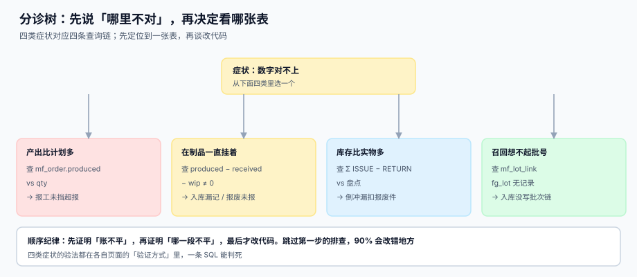

# 常见问题与分诊

<p style="text-align:center;"></p>

生产执行的问题有个共同点：**报上来的症状都是「数字对不上」，但根因分散在七段里**。这一页不解释概念，只给一张分诊表——从症状走到表，从表走到根因，每一步都能用一条 SQL 判死。

本页判据族 `MFX-A` ~ `MFX-H`，共 8 条，定义在第五节。

## 一、先分诊，再改代码



| 症状 | 第一件事查什么 | 常见根因 | 止血动作 |
| --- | --- | --- | --- |
| 产出比计划多 | `mf_order.produced` vs `qty` | 报工没挡超报 / 返工重复计数 | 先冻住该工单的报工入口，回放报工明细 |
| 在制品一直挂着 | `produced − received − wip` | 入库漏录 / 报废未报 | 按缺口排序，从最大的开始核 |
| 库存比实物多 | `Σ ISSUE + BACKFLUSH − RETURN` vs 盘点 | 倒冲漏扣报废件 / 损耗率没填 | 停倒冲，改推式领料，月末盘点 |
| 召回想不起批号 | `mf_lot_link` 是否有该 `fg_lot` | 入库没写批次链 / 倒冲未落批 | 按工单号圈定范围，先停发货 |
| 成本差异忽大忽小 | `route_version` 是否被改 | 主数据改动穿透在制 | 冻结主数据版本，重算差异 |
| 交期频繁延期 | `ρ` 的最大值（不是平均） | 瓶颈中心超载 / 用无限产能承诺 | 按瓶颈重排，改承诺口径 |
| 工时对不上 | 报工粒度与取整规则 | 按工单摊平均费率 / 抹零 | 改工序级报工，存原始精度 |
| 返工越多指标越好 | 良率分母是否含二次投入 | 返工良品进分子、投入没进分母 | 改成 RTY + 最终良率双指标 |

::: tip 分诊的第一步永远是「证明账不平」
先跑一条对账 SQL 证明「确实不平、差多少」，再去猜哪一段错。跳过这一步，90% 的排查会改错地方——因为人看到的「数字不对」经常只是**两个不同口径被放在同一个报表里**。
:::

## 二、八个高频问题

### 1. 为什么报工数会比计划数多？

因为**返工件每道工序都要报一次**。1,000 件的工单，52 件返工，报工累计就是 1,052 次。这不是错，错的是把报工累计当产量。正确口径见 [总览](../Overview/index.md) 第一节。

### 2. 在制为什么永远清不掉？

三种可能，按概率排序：① 报废件没报工（料扣了、产出没有）；② 入库单漏录（做了但没入）；③ 跨期入库（上期做的本期入）。判别方法：看缺口是「产出 > 入库 + 在制」还是「产出 < 入库 + 在制」，前者是漏录入库，后者是把返工件算进了成品。

### 3. 倒冲到底能不能用？

能，但必须满足三个前提：① BOM 有损耗率且不是 0；② 报废件也走倒冲（或显式扣料）；③ 每月盘点做差异归因。三个前提缺一个，倒冲的误差就会变成「期末盘亏」，而盘亏是无法归因的。

### 4. 批次追溯要做到什么程度？

按 GB/T 19001 的 8.5.2，要求是「必要时能识别并可追溯」。工程上的判据是：**给定一个原料批，能在 4 小时内列出受影响的所有成品批与客户**。做不到就说明入库时没写 `mf_lot_link`。

### 5. 标准工时不准，还能用吗？

能用于排产（均值无偏就够），不能用于考核（72.5% 的工序偏差超 ±10%，考核会大面积误判）。详见 [工艺路线](../Routing/index.md) 第二节。

### 6. 工单为什么必须分层（生产订单 / 工单 / 工序单）？

因为「做到哪一步」是工序级信息。合成一张表后，一张工单只能有一个状态，第 2 道在制、第 1 道已完工的组合无处表达。详见 [工单模型](../OrderModel/index.md) 第一节。

### 7. 返工要不要建独立工单？

要。返工是第二次投入，独立工单才能让 RTY 与最终良率各算各的。不建独立单的后果是「越返工越高效」——返工良品进了分子，投入没进分母。

### 8. 让步接收为什么必须留单号？

因为它是**唯一一种不动数量、只动责任的处置**。没有单号就无法证明「谁批的、批给谁、有效期到哪天」，出问题时只能整批召回。

## 三、术语一致性

同一件事在四个部门有四个叫法，混用会让排查从一开始就跑偏：

| 统一叫法 | 计划部叫 | 车间叫 | 财务叫 | 本专题用哪个字段 |
| --- | --- | --- | --- | --- |
| 计划数量 | 订单量 | 派工数 | 标准产量 | `mf_order.qty` |
| 产出 | 完成量 | 报工数 | 约当产量 | `mf_order.produced` |
| 在制 | 未完成 | 在机 | 在产品 | `mf_order.wip` |
| 报废 | 损耗 | 打掉 | 废品损失 | `mf_report.scrap` |
| 返工 | 二次加工 | 回修 | 返修 | `mf_report.rework` |

::: warning 最容易混的两个词
**「报工数」在车间指「今天报了多少次」，在财务指「产出了多少件」。** 这两个数在同一张工单上差 5% 是正常的（返工）。任何跨部门报表都必须写清用的是 `qty` 还是 `good`。
:::

## 四、止血顺序：先停血，再查因

| 阶段 | 目标 | 允许的动作 | 不允许的动作 |
| --- | --- | --- | --- |
| 止血 | 不让差异继续扩大 | 冻结报工入口、暂停倒冲、停发货 | 直接改历史数据 |
| 定位 | 找出哪一段、哪张单 | 跑对账 SQL、导出明细 | 凭经验猜 |
| 修复 | 让账回到守恒 | 补录单据、冲正（留痕） | 删除记录 |
| 复盘 | 让同类不再发生 | 加约束、加巡检 | 只改制度不改系统 |

**「不允许直接改历史数据」是硬纪律**：改一条报工记录，追溯链就断了；正确做法是补一条冲正记录，让两条都在。

## 五、判据清单

| 编号 | 判据 | 怎么验 |
| --- | --- | --- |
| `MFX-A` | 八类症状各有「先查哪张表」的映射 | 本页第一节表覆盖全部八类 |
| `MFX-B` | 每条分诊路径至少有一条可执行 SQL | 八个症状各能落到具体表与字段 |
| `MFX-C` | 术语表覆盖五个核心口径且与字段名对应 | 表内五个字段名与 DDL 一致 |
| `MFX-D` | 止血动作不包含「改历史数据」 | 第一节与第四节均无删改类动作 |
| `MFX-E` | 冲正代替修改，冲正记录留痕 | 存在冲正单据类型（如 `REVERSAL`） |
| `MFX-F` | 常见问题每条都能指回具体页面的具体小节 | 八条问题各带一个站内链接 |
| `MFX-G` | 「报工数」与「良品数」在报表上分列 | 报表字段名不出现含糊的 `qty` 单列 |
| `MFX-H` | 分诊顺序固定为「先证不平、再定段、后改码」 | 页内顺序与本条一致 |

## 六、验证方式

```shell
# 1) 八类症状都能落到表：应输出 8 行
grep -c '^| ' docs/Backend/Manufacturing/FAQ/index.md
# 期望：≥ 8（分诊表行数）

# 2) 术语表字段名必须真实存在：应输出 5 行且都能查到列
for c in qty produced wip scrap rework; do
  sqlite3 /tmp/mf.db "SELECT '$c', count(*) FROM pragma_table_info('mf_order')
                       WHERE name='$c' UNION ALL
                      SELECT '$c', count(*) FROM pragma_table_info('mf_report') WHERE name='$c';"
done
# 期望：每个字段至少在一张表里命中

# 3) 不存在「删除报工」的接口：应输出 0
git grep -c "DELETE FROM mf_report" -- docs project || true
# 期望：0

# 4) 冲正类型存在：应有 REVERSAL 或等价单据
sqlite3 /tmp/mf.db "SELECT count(*) FROM sqlite_master WHERE sql LIKE '%REVERSAL%';"
# 期望：≥ 1（若未实现，属欠账，写进页内「下一步」）
```

## 参考资料

- [总览：七段链与三个「做完了」](../Overview/index.md)：三个口径的定义
- [报工、在制品与工序交接](../Reporting/index.md)：在制不守恒的四种形态
- [完工入库、批次与追溯](../Completion/index.md)：召回范围怎么算
- [实战：从排产到入库的可运行闭环](../Practice/index.md)：五条自检的 SQL
- GB/T 19001—2016（ISO 9001:2015）8.5.2 标识和可追溯性、8.7 不合格输出的控制：<https://openstd.samr.gov.cn/>
