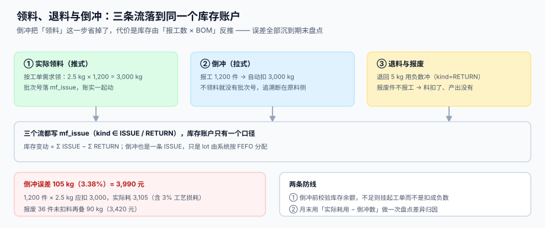

# 备料、领退料与倒冲

<p style="text-align:center;"></p>

「料」是生产执行里唯一**双向流动**的东西：领出去、退回来、报废掉、被倒冲扣掉。四种动作写进同一张库存流水，任何一条写错都不会当场报错——只会让某一天的库存对不上，而那天通常已经过去三周了。

本页判据族 `MFI-A` ~ `MFI-H`，共 8 条，定义在第六节。

## 一、三条流，一个账户



| 方式 | 触发 | 何时扣账 | 批号从哪来 | 失败方式 |
| --- | --- | --- | --- | --- |
| 推式领料 | 下达工单时按 BOM 算需求 | 领料单过账时 | 仓管扫码指定 | 领多了积压在车间 |
| 倒冲（backflush） | 报工时按「报工数 × BOM」扣 | 报工事务内 | 系统按 FEFO 自动分配 | **误差全沉到期末盘点** |
| 退料 / 报废 | 手工或质检处置 | 单据过账时 | 原领料批号 | 退错批次，追溯链断裂 |

三种方式在数据库里是**同一张表**，靠 `kind` 区分：

```sql
CREATE TABLE mf_issue (
  issue_id INTEGER PRIMARY KEY AUTOINCREMENT,
  order_no TEXT NOT NULL REFERENCES mf_order(order_no),
  seq      INTEGER NOT NULL,                     -- 对应哪道工序的投料
  item     TEXT NOT NULL,
  lot      TEXT NOT NULL,
  qty      REAL NOT NULL CHECK (qty > 0),        -- 正数，方向由 kind 决定
  kind     TEXT NOT NULL CHECK (kind IN ('ISSUE','RETURN','SCRAP','BACKFLUSH')),
  posted_at TEXT NOT NULL
);
```

库存变动只有一条公式：

```text
净耗用 = Σ qty(kind='ISSUE') + Σ qty(kind='BACKFLUSH') − Σ qty(kind='RETURN')
```

::: tip 为什么不用负数
返回值用 `kind='RETURN'` + 正数，而不是 `qty = -5`。原因是**校验方向**：正数 + 枚举让「数量必须大于 0」成为硬约束，而负数写法会让「少扣一点」和「退料」在同一列里无法区分，报表要处理两种符号。
:::

## 二、推式领料：需求算三遍，取哪个

同一张工单的物料需求有三个算法，结果不一样：

| 算法 | 公式 | 本机示例（1,000 件、BOM 2.5 kg、损耗 3%） |
| --- | --- | --- |
| 净需求 | 计划数 × 单位用量 | 2,500.0 kg |
| 含损耗 | 计划数 × 单位用量 × (1 + 损耗率) | 2,575.0 kg |
| 按良品反推 | 计划数 ÷ 良率 × 单位用量 | 2,777.8 kg（良率 90%） |

**报给仓库的应该是第三个**：因为报废的件也消耗了料，只按计划数领料，做到 90% 就没料了。但仓库实际只能按「整数包装」发放，所以还要向上取整到包装倍数：

```sql
-- 领料需求：按良率反推，再向上取整到包装倍数
SELECT item,
       CEIL( :qty / :yield_rate * b.qty_per / p.pack_size ) * p.pack_size AS issue_qty
  FROM mf_bom b JOIN mf_item p ON p.item = b.child
 WHERE b.parent = :sku;
```

::: danger 只按「计划数 × 用量」领料的两种结局
1. **做到 90% 停线等料**：良率 90% 意味着需要 1.11 倍的料，缺的这 11% 会在最后一段集中爆发。
2. **第二次补料没有工单依据**：补领的料挂在「临时领料」上，不进工单成本，于是这张工单的成本永远偏低。
:::

## 三、倒冲：省一步，误差换个地方出现

倒冲把「领料」这一步彻底省掉：报工 1,200 件，系统自动按 `1,200 × 2.5 = 3,000 kg` 扣账。听起来很干净，问题是**实际消耗不等于 BOM 消耗**。

本机读数（1,200 件、BOM 2.5 kg/件、工艺损耗 3%）：

| 口径 | 数量 | 说明 |
| --- | --- | --- |
| 倒冲应扣 | 3,000.0 kg | 1,200 × 2.5 |
| 实际耗用 | 3,105.0 kg | 含 3% 工艺损耗 + 15 kg 开机废料 |
| 差额 | **105.0 kg（3.38%）** | 账面比实物**多** 105 kg |
| 折金额 | **3,990.00 元** | 按 38 元/kg |

再加一层：**报废件也报了工但没有扣料**，36 件 × 2.5 kg = 90 kg 又少扣一次，折 **3,420.00 元**。两项相加，单张工单 7,410.00 元；1,000 张同规模工单累计 **741.00 万元**的库存差异。

::: danger 倒冲的四个必失点
1. **工艺损耗不进 BOM**：BOM 写「净用量」，损耗靠人工填损耗率——没人填时默认 0。
2. **报废件不扣料**：报废件通常也报工（否则产量对不上），但很多实现只在「良品」上倒冲。
3. **返工件重复扣料**：返工报工又触发一次倒冲，同一批料被扣两次。
4. **批次分配不看先进先出**：倒冲自动分配批次时若按 `lot` 字符串排序，`LOT-10` 会排在 `LOT-9` 前面。
:::

两条防线，写进系统而不是写进制度：

```sql
-- 防线一：倒冲前校验余额，不足则挂起而不是扣成负数
UPDATE mf_stock SET on_hand = on_hand - :qty
 WHERE item = :item AND lot = :lot AND on_hand >= :qty;
-- changes() = 0 → 抛「库存不足，工单挂起」，不要 -1 了事

-- 防线二：BOM 里必须显式写损耗率，不允许默认值
ALTER TABLE mf_bom ADD COLUMN scrap_rate REAL NOT NULL DEFAULT 0
  CHECK (scrap_rate >= 0 AND scrap_rate <= 0.5);
```

## 四、退料与报废：两种完全不同的账

| 动作 | 库存 | 成本 | 追溯 |
| --- | --- | --- | --- |
| 退料（`RETURN`） | 加回 | 从工单扣回 | 批号沿用原领料批 |
| 报废（`SCRAP`） | 不减（已领出） | 留在工单成本里 | 记录报废原因与责任工序 |

最容易混的是「车间余料退回仓库」与「车间把余料报废」：前者库存增加、工单成本下降；后者库存不变、工单成本不变（料已经算在工单里了）。**两者都不该动「产出」**，因为产出只由报工决定。

```sql
-- 退料必须能追到原领料批，不允许「凭空退一批新料」
INSERT INTO mf_issue(order_no, seq, item, lot, qty, kind, posted_at)
SELECT :order_no, :seq, :item, i.lot, :qty, 'RETURN', datetime('now')
  FROM mf_issue i
 WHERE i.order_no = :order_no AND i.item = :item AND i.kind IN ('ISSUE','BACKFLUSH')
 LIMIT 1;
```

## 五、批次分配与单位换算

倒冲自动分配批次时，三个细节决定追溯能不能成立：

1. **FEFO 而不是 FIFO**：按失效日期排序（先到期先出），没有失效期的再按入库时间。
2. **一个工单可以跨多个批**：领 3,000 kg 而单批只有 1,200 kg，就必须拆成 1,200 + 1,200 + 600 三条流水，每条带自己的 `lot`。
3. **单位换算只在一处发生**：BOM 用 kg、库存用 g、采购用 t，换算率必须来自物料主数据，不能写在代码里。

```text
反例：BOM 2.5 kg × 1,200 件 = 3,000 kg
     库存以 g 计量 → 3,000,000 g
     代码里写死 ×1000 → 换成 t 时又多除一次 1000 → 差 1000 倍
```

::: warning 单位不一致时的典型症状
「库存莫名其妙少了一千倍」几乎总是单位换算写了两处。判据很简单：**全库只能有一个 `uom_convert()` 函数，且它读的是物料主数据**。任何在业务代码里出现的 `* 1000` 都要被当成可疑代码审一遍。
:::

## 六、判据清单

| 编号 | 判据 | 怎么验 |
| --- | --- | --- |
| `MFI-A` | 领退料同表，`kind` 枚举，`qty` 恒为正 | `CHECK (qty > 0)` + 枚举约束 |
| `MFI-B` | 倒冲也是一条流水（`BACKFLUSH`），不直接改库存 | `mf_issue` 里能查到倒冲记录 |
| `MFI-C` | 倒冲前校验余额，不足则挂起而非扣负 | 条件更新 `on_hand >= :qty`，`changes()=0` 时抛错 |
| `MFI-D` | BOM 显式含损耗率，默认值为 0 但必须人工确认 | `scrap_rate` 列存在且非空 |
| `MFI-E` | 退料必须指向原领料批次 | 退料 SQL 从 `mf_issue` 取 `lot`，不接受外部传入 |
| `MFI-F` | 跨批领料拆成多条流水，每条带 `lot` | 一条工单的 `mf_issue` 可出现多个 `lot` |
| `MFI-G` | 单位换算只有一个入口，读物料主数据 | 全库只有一个换算函数 |
| `MFI-H` | 净耗用 = ISSUE + BACKFLUSH − RETURN，可与盘点对账 | 一条 SQL 输出净耗用与实盘差异 |

## 七、验证方式

```shell
# 1) 不允许零或负数量流水：应报 CHECK 失败
sqlite3 /tmp/mf.db "INSERT INTO mf_issue(order_no,seq,item,lot,qty,kind,posted_at)
  VALUES('MO-1001',10,'RM-ST','L-ST-01',0,'ISSUE','2026-11-01');"
# 期望：CHECK constraint failed: qty > 0

# 2) 倒冲必须有流水记录：倒冲后行数应增加
sqlite3 /tmp/mf.db "SELECT count(*) FROM mf_issue WHERE kind='BACKFLUSH';"
# 期望：≥ 1（每次报工倒冲都应留下一条）

# 3) 库存不得为负：应输出 0
sqlite3 /tmp/mf.db "SELECT count(*) FROM mf_stock WHERE on_hand < 0;"
# 期望：0

# 4) 净耗用与倒冲应扣量的差：应输出一行两个数（差额即损耗与报废漏扣）
sqlite3 /tmp/mf.db "SELECT ROUND(SUM(CASE WHEN kind IN ('ISSUE','BACKFLUSH') THEN qty
                                        WHEN kind='RETURN' THEN -qty END),1) AS net_consumed,
                           ROUND((SELECT SUM(r.qty * b.qty_per) FROM mf_report r
                                    JOIN mf_bom b ON b.parent='FG-A' AND b.child='RM-ST'
                                   WHERE r.order_no='MO-1001'),1) AS should_consume
                      FROM mf_issue WHERE order_no='MO-1001' AND item='RM-ST';"
# 期望：net_consumed > should_consume（差额 = 损耗 + 报废漏扣）

# 5) 退料批次必须存在于原领料：应输出 0
sqlite3 /tmp/mf.db "SELECT count(*) FROM mf_issue r WHERE r.kind='RETURN' AND NOT EXISTS
  (SELECT 1 FROM mf_issue i WHERE i.order_no=r.order_no AND i.item=r.item
     AND i.lot=r.lot AND i.kind IN ('ISSUE','BACKFLUSH'));"
# 期望：0
```

## 参考资料

- [报工、在制品与工序交接](../Reporting/index.md)：倒冲的触发点
- [完工入库、批次与追溯](../Completion/index.md)：原料批如何连到成品批
- [仓储作业与波次拣选](../../WarehouseOps/Overview/index.md)：库存余额与货位的上游
- [成本核算与月末结账](../../CostAccounting/Overview/index.md)：料耗差异如何进成本
- GS1 通用规范（批号 `(10)` 的编码规则）：<https://www.gs1.org/standards/barcodes-epcrfid-id-keys/gs1-general-specifications>
