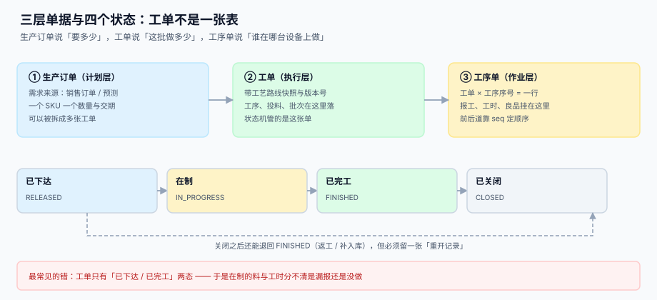

# 工单模型、状态机与变更

<p style="text-align:center;"></p>

工单是生产执行里**唯一一张「什么都能挂上去」的单据**：料挂在它上面、工时挂在它上面、良品与报废挂在它上面、成本差异也挂在它上面。正因为它承担了这么多，一旦它的状态模型设计得含糊，下游每一处都会用「补一张单」「改一个字段」来绕过，最后没人说得清一张工单到底做没做完。

本页判据族 `MFG-A` ~ `MFG-H`，共 8 条，定义在第六节。

## 一、三层单据：生产订单、工单、工序单



| 层 | 表 | 粒度 | 关键字段 | 谁改 |
| --- | --- | --- | --- | --- |
| 计划层 | `mf_prod_order` | 一个 SKU 一个交期 | `sku`、`qty`、`due_date` | 计划员 / MRP |
| 执行层 | `mf_order` | 一批 | `route_version`、`qty`、`status` | 车间调度 |
| 作业层 | `mf_op` | 一批 × 一道工序 | `seq`、`wc`、`std_min`、`good` | 班组长 |

三层的目的不同：计划层回答「客户要多少、什么时候要」，执行层回答「这一批现在做到哪」，作业层回答「谁在哪台设备上、做了多少」。**把三层合成一张表，代价是工序状态无处安放**：第 2 道在制、第 1 道已完工，单状态字段只能记成「在制」，于是「第 1 道到底完没完」只能靠人去问。

```sql
CREATE TABLE mf_order (
  order_no      TEXT PRIMARY KEY,
  prod_order_no TEXT REFERENCES mf_prod_order(prod_order_no),
  sku           TEXT NOT NULL,
  qty           INTEGER NOT NULL CHECK (qty > 0),
  route_version TEXT NOT NULL,             -- 下达时冻结的路线版本
  bom_version   TEXT NOT NULL,             -- 下达时冻结的 BOM 版本
  produced      INTEGER NOT NULL DEFAULT 0,
  received      INTEGER NOT NULL DEFAULT 0,
  wip           INTEGER NOT NULL DEFAULT 0,
  status        TEXT NOT NULL DEFAULT 'RELEASED'
                CHECK (status IN ('RELEASED','IN_PROGRESS','FINISHED','CLOSED')),
  due_date      TEXT NOT NULL,
  promise_date  TEXT NOT NULL,
  CHECK (wip = produced - received)
);
```

::: danger 不下冻结版本的三个后果
1. **工时差异无法归因**：主数据里把 OP20 的标准工时从 1.2 改成 1.0，正在生产的 300 张工单的差异同时变化，月末分析得出「效率突降 17%」的假结论。
2. **BOM 变更穿透在制**：改一条用量，倒冲按新用量扣，已投料的工单账面立刻不平。
3. **返工无法复现**：客户投诉时想按当时路线重算一遍成本，主数据已经没有那个版本了。
:::

## 二、四个状态，三条跃迁，一条回退

| 状态 | 含义 | 允许的写操作 |
| --- | --- | --- |
| `RELEASED` | 已下达，未开工 | 领料、首道报工 |
| `IN_PROGRESS` | 至少一道工序有报工 | 报工、领退料、质检 |
| `FINISHED` | 全部工序完工，可入库 | 入库、质检处置 |
| `CLOSED` | 已结算，差异已转出 | 只读（除重开） |

跃迁只有三条：`RELEASED → IN_PROGRESS → FINISHED → CLOSED`。**回退只有一条合法路径**：`FINISHED → IN_PROGRESS`，用于「入库后发现返工」。

```sql
-- 状态跃迁用条件更新，不用「读出来再判断再写」
UPDATE mf_order SET status = 'IN_PROGRESS'
 WHERE order_no = :no AND status = 'RELEASED';
-- 影响行数为 0 说明状态已经被别人改过，此时应报 409 而不是继续
```

::: warning 「关闭」不是「做完」
`FINISHED` 说的是**东西做完了**，`CLOSED` 说的是**账结清了**。两者之间隔着一次工单结算（差异计算 + 在制转出）。把两者合成一个状态，最常见的症状是「工单早关了，差异下个月才出来」——因为关闭时差异还没算。
:::

## 三、工单的五种变更，各有各的写法

| 变更 | 典型场景 | 正确写法 | 错误写法 |
| --- | --- | --- | --- |
| 改量 | 客户加单 / 减单 | 新增一条 `mf_order_change`，`qty` 只增不改 | 直接 `UPDATE qty`，报工上限跟着变，超报闸门失效 |
| 改期 | 客户推后交期 | 写 `promise_history`，旧值保留 | 覆盖 `promise_date`，兑现率永远算不出 |
| 拆单 | 一批太大，分两台设备做 | 新建子工单，`parent_order_no` 指回原单 | 在原单上改数量，原单的在制凭空少一半 |
| 合并 | 两张小单一起做 | 新建合并单，两张原单标记 `MERGED` | 把两张单的报工记到同一张，追溯链断掉 |
| 取消 | 客户退单 | 状态置 `CANCELLED`（第 5 态，只从 `RELEASED` 可入） | 直接删除工单，已领的料成了无主库存 |

改量是最容易出事的一种，因为**报工上限直接依赖 `qty`**：

```sql
-- 改量必须是「只增不改」+ 单独记录
CREATE TABLE mf_order_change (
  change_id  INTEGER PRIMARY KEY AUTOINCREMENT,
  order_no   TEXT NOT NULL REFERENCES mf_order(order_no),
  field      TEXT NOT NULL CHECK (field IN ('qty','due_date','route','bom')),
  old_value  TEXT NOT NULL,
  new_value  TEXT NOT NULL,
  reason     TEXT NOT NULL,
  approved_by TEXT NOT NULL,
  at         TEXT NOT NULL
);
```

::: danger 直接改 `qty` 会打开超报闸门
`trg_over_produce` 的判据是 `new.produced > new.qty`。把 `qty` 从 1,000 改成 1,200 之后，已经报工的 1,052 立刻变成「合法」，而实际只做了 1,000 件——**闸门还在，但基准被人悄悄挪了**。正确做法是新增一条变更记录并把 `qty` 同时更新，两件事在一个事务里，且变更记录必须先写。
:::

## 四、下达的幂等：一次点击不能变两张工单

下达动作来自三个地方：计划员手工点、MRP 自动跑、接口（MES / 客户系统）推。同一张生产订单被下达两次，会产生两张完全相同的工单，各领一份料、各报一份工——**账面产量翻倍，实物只有一份**。

```sql
-- 用 (prod_order_no, split_seq) 天然幂等
CREATE TABLE mf_order (
  ...
  split_seq INTEGER NOT NULL DEFAULT 1,
  UNIQUE (prod_order_no, split_seq)
);
```

```sql
INSERT INTO mf_order(order_no, prod_order_no, sku, qty, split_seq, route_version, bom_version, due_date, promise_date)
VALUES (:no, :po, :sku, :qty, 1, :rv, :bv, :due, :promise)
ON CONFLICT(prod_order_no, split_seq) DO NOTHING;
```

`DO NOTHING` 之后要检查 `changes()`：为 0 说明这张单已经下过，应返回已有的 `order_no` 而不是报错——**重投是正常的，报错会让调用方以为失败而重试第三次**。

## 五、关闭工单前的四道门

| 门 | 判据 | 不过怎么办 |
| --- | --- | --- |
| 数量门 | `produced = received + wip` 且 `wip = 0` | 有在制就不许关，先入库或报损 |
| 报工门 | 每道工序 `reported = Σ mf_report.qty` | 工序累计与报工明细不符，先修明细 |
| 料门 | 领退料已冲平，倒冲已扣 | 有未退的余料，先退料 |
| 结算门 | 差异已算且已转出 | 差异挂在在制里，先跑结算 |

```sql
-- 关闭前的四道门写成一条 SQL，返回不为 0 就不许关
SELECT count(*) FROM mf_order m
 WHERE m.order_no = :no
   AND ( m.produced != m.received + m.wip
      OR m.wip != 0
      OR EXISTS (SELECT 1 FROM mf_op o WHERE o.reported !=
                  (SELECT COALESCE(SUM(r.qty),0) FROM mf_report r
                    WHERE r.order_no = o.order_no AND r.seq = o.seq))
      OR m.settled_at IS NULL );
```

## 六、判据清单

| 编号 | 判据 | 怎么验 |
| --- | --- | --- |
| `MFG-A` | 三层单据分表，工序表主键 `(order_no, seq)` | `pragma_table_info('mf_op')` 的 pk 是两列 |
| `MFG-B` | 状态取值受 `CHECK` 约束，且只有四条合法跃迁 | 尝试 `RELEASED → CLOSED` 应失败 |
| `MFG-C` | 下达时冻结 `route_version` 与 `bom_version` | 工单表两列非空，且与主数据当前版本可比对 |
| `MFG-D` | 下达幂等：同 `(prod_order_no, split_seq)` 只产生一张工单 | 重复下达两次，`count(*)` = 1 |
| `MFG-E` | 改量只增不改且有变更记录 | `mf_order_change` 有 `old_value` / `new_value` |
| `MFG-F` | 承诺交期历史可查，旧值不被覆盖 | `promise_history` 行数随变更递增 |
| `MFG-G` | 关闭前四道门可被一条 SQL 判定 | 四门 SQL 返回 0 才允许 `CLOSED` |
| `MFG-H` | 取消的工单不删除，已领料有归属 | 存在 `CANCELLED` 状态且 `mf_issue` 仍指向它 |

## 七、验证方式

```shell
# 1) 下达幂等：连续下达两次，工单数应仍为 1
sqlite3 /tmp/mf.db "INSERT INTO mf_order(order_no,prod_order_no,sku,qty,split_seq,route_version,bom_version,due_date,promise_date)
  VALUES('MO-2001','PO-9001','FG-A',100,1,'RV-3','BV-7','2026-12-10','2026-12-12')
  ON CONFLICT(prod_order_no,split_seq) DO NOTHING;
  INSERT INTO mf_order(order_no,prod_order_no,sku,qty,split_seq,route_version,bom_version,due_date,promise_date)
  VALUES('MO-2002','PO-9001','FG-A',100,1,'RV-3','BV-7','2026-12-10','2026-12-12')
  ON CONFLICT(prod_order_no,split_seq) DO NOTHING;
  SELECT count(*) FROM mf_order WHERE prod_order_no='PO-9001';"
# 期望：1

# 2) 非法跃迁必须失败：应报 CHECK 或影响行数为 0
sqlite3 /tmp/mf.db "UPDATE mf_order SET status='CLOSED' WHERE order_no='MO-2001' AND status='RELEASED';
                    SELECT changes();"
# 期望：0（条件更新没命中）

# 3) 关闭四门：未结算的工单应被挡住
sqlite3 /tmp/mf.db "SELECT count(*) FROM mf_order WHERE settled_at IS NULL;"
# 期望：与未关闭工单数一致，不能为 0 时去关单

# 4) 改量必须留痕：变更表行数应等于改量次数
sqlite3 /tmp/mf.db "SELECT count(*) FROM mf_order_change WHERE field='qty';"
# 期望：等于人工改量次数（不是 0）
```

## 参考资料

- [工艺路线、工作中心与标准工时](../Routing/index.md)：`route_version` 的内容
- [报工、在制品与工序交接](../Reporting/index.md)：`produced` 与 `wip` 的写入点
- [成本核算与月末结账](../../CostAccounting/MonthEndClose/index.md)：工单结算与差异转出
- ISA-95 第 2 部分：对象模型与属性（工单 / 工序 / 物料的关系）：<https://www.isa.org/standards-and-publications/isa-standards/isa-95-series-standards>
- APICS 供应链术语表（Production Order / Work Order / Operation 的定义差别）：<https://www.ascm.org/>
