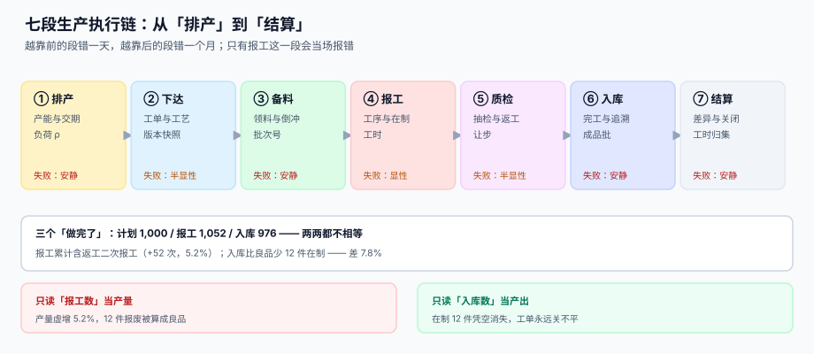

# 总览：七段链与三个「做完了」

<p style="text-align:center;"></p>

一张工单在系统里有四张面孔：计划数量、报工数量、入库数量、结算数量。它们**天生不相等**，而且差值各有各的名字——在制、报废、返工、差异。生产执行要做的不是「让四个数相等」，而是**让每一份差值都能被解释**。

本页判据族 `MFO-A` ~ `MFO-H`，共 8 条，定义在第五节。

## 一、三个「做完了」，谁是产量



先看一组本机读数（Python 3.13 + SQLite 3.50，种子 20261101，模拟 1,000 件工单）：

| 口径 | 读数 | 怎么来的 |
| --- | --- | --- |
| 计划数量 | 1,000 件 | 工单下达时冻结 |
| 报工累计 | 1,052 次 | 一次通过 942 + 返工 52 报两次 + 报废 12 报一次 |
| 最终良品 | 988 件 | 942 + 返工二次通过 46 |
| 入库数量 | 976 件 | 良品 988 − 在制 12 |

三个数两两都不相等，最大差 **76 件（7.8%）**：

- 报工比计划**多 5.2%**，因为返工件在每道工序都要报一次；
- 入库比良品**少 12 件**，因为料还在车间、只是没入完；
- 计划比入库**多 24 件**，这 24 件里 12 件是报废、12 件是在制。

::: danger 把报工数当产量的三个后果
1. **产量虚增 5.2%**：返工越多，「产量」越高，越返工越显得高效。
2. **12 件报废被算成良品**：报废件也报了一次工（这是对的，否则料对不上），但把它当良品就错了。
3. **在制永远清不掉**：入库与报工的差没人认领，月末盘点时突然出现一笔「在制盘亏」。
:::

正确的做法是**三个口径分列，谁也别替代谁**：

```sql
-- 工单主表只存三个累计，不存「产量」这个含糊概念
CREATE TABLE mf_order (
  order_no  TEXT PRIMARY KEY,
  sku       TEXT NOT NULL,
  qty       INTEGER NOT NULL CHECK (qty > 0),      -- 计划
  produced  INTEGER NOT NULL DEFAULT 0,            -- 最后一道工序的良品累计
  received  INTEGER NOT NULL DEFAULT 0,            -- 已入库
  wip       INTEGER NOT NULL DEFAULT 0,            -- 在制 = produced − received
  CHECK (wip = produced - received)
);
```

## 二、七段链，四段是安静的

| 段 | 输入 | 输出 | 出错的典型表现 | 何时被发现 |
| --- | --- | --- | --- | --- |
| 排产 | 工单池 + 产能 | 工序级开工时间 | 交期承诺比实际乐观 30% | 客户投诉时 |
| 下达 | 工单 + 路线版本 | 冻结的投料与工序 | 路线被改，老工单差异全变 | 月末差异分析时 |
| 备料 | BOM + 库存 | 领料单 / 倒冲流水 | 料扣少了，库存虚高 | 盘点时 |
| 报工 | 工序 + 数量 | 良品、报废、返工、工时 | 后道报的比前道多 | **当场**（有闸门时） |
| 质检 | 报工批 + 抽样方案 | 判定与处置 | 让步接收一路带到客户 | 售后时 |
| 入库 | 良品 + 成品批 | 库存 + 批次链 | 批次链没写，召回不了 | 出事时 |
| 结算 | 全部累计 | 工单差异 | 差异挂在在制里不结 | 季末审计时 |

「安静」的意思是：**它不报错，也不影响任何一笔即时业务**。备料少扣 105 kg，出库单照样能开、发货照样能走，只有期末盘点才会出现一笔没有来源的差异。

## 三、单据分三层，别挤在一张表

| 层 | 单据 | 一个实例代表 | 谁维护 |
| --- | --- | --- | --- |
| 计划层 | 生产订单 | 某 SKU 某交期要 1,000 件 | 计划员 / MRP |
| 执行层 | 工单 | 这 1,000 件拆成 3 批，每批带路线快照 | 车间调度 |
| 作业层 | 工序单 | 每批 × 每道工序 = 一行 | 班组长 / 设备 |

三层挤成一张表，最常见的症状是「工单只能有一个工序状态」：一旦第 2 道工序在制、第 1 道已完工，这张表就说不清了。所以 `mf_op` 必须是独立表，主键 `(order_no, seq)`。

## 四、四个口径的定义，写死在这里

| 口径 | 公式 | 用途 |
| --- | --- | --- |
| 直通率 RTY | 一次通过数 ÷ 投入数 | 看过程稳不稳（返工不算通过） |
| 最终良率 | 最终良品数 ÷ 总投入（含返工二次投入） | 看料用掉多少 |
| 达成率 | 按期完工工单数 ÷ 到期工单数 | 看交付承诺兑现 |
| 在制周转 | 平均在制金额 ÷ 日均产出成本 | 看在制压了多少钱 |

四个口径的分母全不一样，混用会自相矛盾。本机读数里，同一批数据：RTY **94.2%**、最终良率 **89.3%**（含返工二次投入）、报废率 **3.0%**——如果只报一个「良率」，永远说不清是哪一个。

::: tip 一张工单的四个数怎么记
**计划看 `qty`、做了多少看 `produced`、收了多少看 `received`、还剩多少看 `wip`。** 四个字段都在工单主表上，任何一个派生值（如「完成率」）只出现在查询里，不落库。
:::

## 五、判据清单

| 编号 | 判据 | 怎么验 |
| --- | --- | --- |
| `MFO-A` | 工单主表同时有 `qty` / `produced` / `received` / `wip` 四列，无「产量」列 | `pragma_table_info('mf_order')` 不含 `output_qty` 之类 |
| `MFO-B` | `wip = produced − received` 由约束或触发器保证 | 故意写 `wip = produced - received + 1` 应失败 |
| `MFO-C` | 三个口径在报表上分列呈现，不合并成「完成率」 | 报表 SQL 里三个数各自成列 |
| `MFO-D` | 七段各自的产物表都存在，缺一段能在页面上指出来 | 七张表名可逐一 `SELECT count(*)` |
| `MFO-E` | RTY 与最终良率分别可算，分母分别是投入与总投入 | 两条 SQL 分母不同且都能跑 |
| `MFO-F` | 每一份差值都能归到「在制 / 报废 / 返工 / 差异」四类之一 | 对账 SQL 的四类合计 = 计划 − 入库 |
| `MFO-G` | 工单与工序分层，工序表主键为 `(order_no, seq)` | `pragma_table_info('mf_op')` 的 pk 两列 |
| `MFO-H` | 安静失败的段（排产 / 备料 / 入库 / 结算）各有独立巡检 SQL | 四个段各有一条可执行对账语句 |

## 六、验证方式

```shell
# 1) 七个段位的产物表都在：应输出 7 行
sqlite3 /tmp/mf.db "SELECT name FROM sqlite_master WHERE type='table' AND name IN
  ('mf_order','mf_op','mf_issue','mf_report','mf_qc','mf_receipt','mf_settle') ORDER BY name;"

# 2) 在制守恒：应输出 0
sqlite3 /tmp/mf.db "SELECT count(*) FROM mf_order WHERE wip != produced - received;"
# 期望：0

# 3) 计划 = 入库 + 在制 + 报废（返工件最终仍计入良品，故不单列）：应输出 0
sqlite3 /tmp/mf.db "SELECT (SELECT SUM(qty) FROM mf_order)
                         - (SELECT SUM(received) FROM mf_order)
                         - (SELECT SUM(wip)     FROM mf_order)
                         - (SELECT SUM(scrap)   FROM mf_report);"
# 期望：0

# 4) 三个口径都能算：应输出三列
sqlite3 /tmp/mf.db "SELECT ROUND(100.0*SUM(good-scrap)/SUM(qty),1) AS rty_like
                          , ROUND(100.0*SUM(good)/SUM(qty),1) AS final_yield
                          , ROUND(100.0*SUM(received)/SUM(qty),1) AS inbound_rate
                      FROM mf_order m JOIN mf_report r USING(order_no);"
```

::: info 本页读数从哪来
第 1 节的四个数字由 `/tmp` 下的模拟脚本产出（1,000 件、一次通过率 94%、返工通过率 80%），脚本不入库——仓库只允许 Markdown 与配图。要复现，按本页第四节的口径自己跑一遍，**不要直接引用这里的数字当自己的基线**。
:::


## 与「设备维护与可靠性」专题的分工（第 233 天补充）

本册把「设备」当成**产能的载体**：它有多少可用工时、能排多少活。那一册把「设备」当成**会失效的物理对象**：它下一次什么时候停、停了多久、修它划不划算。同一台机器，一个问「还能干多少」，一个问「还能撑多久」。

| 你关心的问题 | 该读哪一册 | 为什么不是另一册 |
| --- | --- | --- |
| 这张工单排到哪台设备、交期能不能保 | 本册（[排产](../Planning/index.md)） | 那一册只提供「可用工时」这个输入，不管排产 |
| 这台设备为什么总在交期前停 | [设备维护与可靠性](../../EquipmentMaintenance/index.md) | 本册只看「停了导致延期」，不看「为什么停」 |
| 良品率与报废怎么算 | 本册（[报工](../Reporting/index.md)） | 那一册不判质量，只判可用性 |
| 维修工单和领料怎么走 | 那一册（[工单状态机](../../EquipmentMaintenance/WorkOrder/index.md)） | 本册的工单是**生产工单**，两者不是一张表 |

::: danger 一个安静的接口缺陷：设备停机不进停机表
生产侧遇到设备故障时，常见做法是把生产工单置为「暂停」，等修好再置回「进行中」。这样停机时长确实被记录了——但记在**生产工单的暂停累计**里，不在停机表里。

后果是连锁的：可用率算不出（没有停机区间）、OEE 的可用率因子只能估、维修侧的 MTTR 无法归因、备件缺件时长无处可查。而且这个缺陷**不会报错**，只会让两边的报表都对不上。

**正确做法**：生产工单的暂停必须**同时**在停机表落一条区间（`asset_id` + `cause`），两张表用 `wo_id` 关联；停机表是唯一事实来源，生产侧只引用不复制。
:::

## 与「合并报表」专题的分工

制造册判**数量守恒**（投入 = 良品 + 返工 + 报废），合并册判**这些数量在集团内部转手时的价格该不该留**。

| 你关心的问题 | 该读哪一册 | 为什么 |
| --- | --- | --- |
| 工单做完了没有、在制停在哪道工序 | 本册 | 七段链、报工守恒、良率回圈 |
| 母厂供料给子厂，合并层成本怎么算 | [合并报表与内部抵销](../../Consolidation/Intercompany/index.md) | 内部转移价要抵销，回到集团实际成本 |
| 合并后毛利率为什么和单体不一样 | 合并册 | 内部加价被抹掉 |
| 在制品在合并层要不要调整 | 合并册 | 在制里的内部材料成本部分要抵未实现利润 |
| 产能利用率与合并成本的关系 | 本册 | 单位固定成本随产量变化 |

::: danger 本页特有的一处坑：把「内部转移价」当成真实售价算毛利
本册的标准成本与差异分析都建立在转移价之上，那是**管理口径**，可以保留。但合并层的毛利率必须回到「集团对外部客户」的口径。

两者混用会得到一个奇怪结论：集团整体毛利率 32%，而每一家单体都在 25% 左右——多出来的 7 个点全部来自内部加价。本机在 500 笔内部交易上测到，未抵销的内部毛利 4,059,446.38 元足以让合并毛利率虚增 3 个点以上。
:::

## 与「全面预算」专题的分工

| 你关心的问题 | 该读哪一册 | 为什么不是本页 |
| --- | --- | --- |
| 「投了多少、良品多少、在制停在哪」 | 本页 | 判**数量守恒**：投入 = 良品 + 返工 + 报废 |
| 「这个月的制造费用有没有超」 | [全面预算与经营分析](../../Budgeting/Overview/index.md) | 那册判**费用额度**，不判数量 |
| 「产量差与费用差能不能互相抵消」 | [差异归因与口径桥](../../Budgeting/Variance/index.md) | 那册判**分解恒等式**，两支必须能分开 |
| 「设备停机导致的损失怎么算」 | [设备维护与可靠性](../../EquipmentMaintenance/Overview/index.md) | 那册判**停机时长与可用率** |

::: warning 一页一坑：产量差与费用差方向相反时互相掩盖
产量低于计划时，单位产品分摊的固定制造费用上升——成本侧出现**不利差异**；但同时这个月的制造费用总额可能没花完，预算侧出现**有利差异**。两个差异在「总差异」里方向相反、部分抵消，于是报表显示「基本持平」。

真相是两件事都不好：产量没达标，费用也只是因为产量低才没花完。本册判数量守恒能把第一件事量出来（RTY、在制、报废），预算册判额度能把第二件事量出来——**任何一册单独看，都会给出「差不多」的结论**。
:::

## 与「质量管理工程」专题的分工（第 248 天补充）

本页与 [质量管理工程](../../QualityManagement/index.md) 的分工写在下面这张表里，两册**不重复定义**同一件事：

| 维度 | 本页 | 另一侧 |
| --- | --- | --- |
| 本页管什么 | 生产执行：工单、报工、在制、良率 | 过程数据 |
| 质量工程管什么 | 这些数据能不能支撑判断：子组怎么分、控制限怎么算、异常怎么归因 | 判断口径 |
| 良率 | 合格数 / 投产数（按工单） | 不换算成能力指数 |
| 质量成本 | 失败成本 / 销售额（按期间） | 不从良率直接推 |

::: warning 只在本页成立的一个坑
拿良率去反推 Cpk。良率的分母是投产数、口径是「最终合格」，Cpk 的分母是组内 σ、口径是「过程潜在能力」；两者只有在过程受控且分布正态时才近似可换算，直接互推会得出「良率 99% 所以 Cpk 1.5」这种既不成立也无法复核的结论。
:::

## 参考资料

- [排产、有限产能与交期承诺](../Planning/index.md)：第一段为什么会安静地错
- [报工、在制品与工序交接](../Reporting/index.md)：三个口径的写入点
- [实战：从排产到入库的可运行闭环](../Practice/index.md)：本页七个段位的最小可跑实现
- ISA-95 层级模型（Level 3 = 制造执行）：<https://www.isa.org/standards-and-publications/isa-standards/isa-95-series-standards>
- ISO 22400-2 制造运行管理关键绩效指标：<https://www.iso.org/standard/54497.html>
