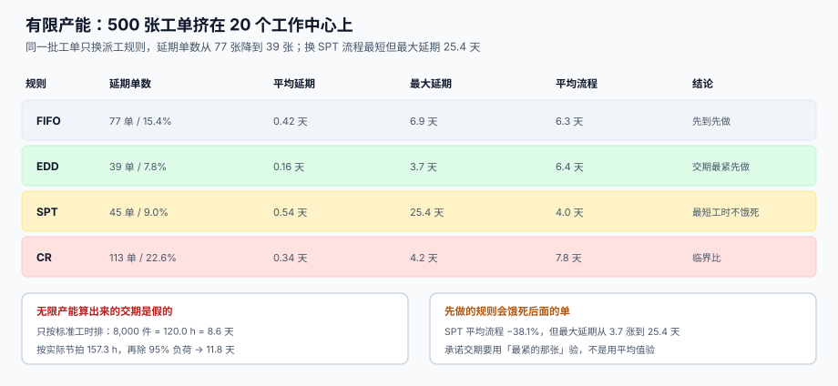

# 排产、有限产能与交期承诺

<p style="text-align:center;"></p>

排产是七段链里**唯一一段错了也不报错**的：排出来的计划再离谱，系统都认为「已排产」，工单照样能下达、能报工、能入库。它的错只在下游显形——延期交付、加班费、在制堆积，而且每一种都能被归因成「车间执行不力」。

本页判据族 `MFP-A` ~ `MFP-H`，共 8 条，定义在第六节。

## 一、无限产能排出来的交期是假的



「无限产能」的意思是：假设设备随时可用，一张工单的完工时间 = 各工序标准工时之和。算起来很快，看起来也合理，但它忽略了一件车间里唯一真实的事——**设备是共享的**。

本机读数（8,000 件、标准 0.9 min/件、实际 1.18 min/件）：

| 口径 | 计算 | 结果 |
| --- | --- | --- |
| 按标准工时 | 0.9 × 8,000 ÷ 60 | 120.0 h |
| 折成天（两班 14 h） | 120.0 ÷ 14 | **8.6 天** |
| 按实际节拍 | 1.18 × 8,000 ÷ 60 | 157.3 h |
| 折成天 | 157.3 ÷ 14 | 11.2 天 |
| 再除以 95% 负荷 | 11.2 ÷ 0.95 | **11.8 天** |

对外承诺 8.6 天、实际要 11.8 天——**差 3.2 天，31% 的乐观偏差**。这不是「车间不努力」，而是承诺时用的分母（标准工时）和履约时的分母（实际节拍 × 负荷）不是同一个。

::: danger 三个常见的「假交期」算法
1. **标准工时 × 数量 ÷ 日历天数**：把两班当 24 小时，把停机当不存在。
2. **只算瓶颈工序**：瓶颈决定产能是对的，但非瓶颈的排队时间会被完全忽略。
3. **拿上一张相似工单的实际天数**：相似不等于相同批量，批量翻倍时换型时间不翻倍、加工时间翻倍，两者不能线性外推。
:::

## 二、四种派工规则：没有最优，只有取舍

同一批 500 张工单、20 个工作中心、日产能 480 min，只换派工规则：

| 规则 | 全称 | 延期单数 | 平均延期 | 最大延期 | 平均流程 |
| --- | --- | --- | --- | --- | --- |
| FIFO | 先到先做 | 77 单（15.4%） | 0.42 天 | 6.9 天 | 6.3 天 |
| EDD | 交期最紧先做 | **39 单（7.8%）** | **0.16 天** | **3.7 天** | 6.4 天 |
| SPT | 最短工时不饿死 | 45 单（9.0%） | 0.54 天 | **25.4 天** | **4.0 天** |
| CR | 临界比（剩余时间 ÷ 工时） | 113 单（22.6%） | 0.34 天 | 4.2 天 | 7.8 天 |

四个结论，每一个都和教科书上的直觉不完全一致：

1. **EDD 把延期压到最低**（39 单），代价是平均流程最长（6.4 天）——因为它在等「不该急的单」。
2. **SPT 把平均流程压到最短**（4.0 天，比 EDD 快 38.1%），但**最大延期从 3.7 天暴涨到 25.4 天**：一张大单被无限推后，直到快到期才动。
3. **CR 在本例中最差**（113 单）。临界比会「抢救快要到期的单」，而当系统中大量工单同时逼近交期时，它会反复切换、把换型成本放大。
4. **FIFO 不是最差，但最不可控**：它的表现完全取决于工单到达顺序，改不了。

::: tip 怎么选
**对外承诺用 EDD 的结论，对内优化用 SPT 的结论，两者之间的差就是「缓冲」**。如果最大延期（25.4 天）不可接受，就先按 EDD 排、再用 SPT 填空——这就是「关键比 + 最短工时」的混合规则在车间里的真实用法。
:::

## 三、负荷 ρ 与瓶颈：先算一个数再谈排产

负荷率是最便宜、也最容易被跳过的指标：

```text
ρ = Σ(工单工时) ÷ (工作中心数 × 每日可用分钟 × 天数)
```

本机那 500 张工单：总工时约 440,000 min，20 个中心 × 480 min × 60 天 = 576,000 min，**ρ ≈ 0.76**。在 0.76 的负荷下已经出现 7.8% 的延期——因为负荷是**按中心平均**的，而实际负荷分布不均：某些中心的 ρ 超过 1.2，另一些只有 0.4。

| 判断 | 阈值 | 该怎么处理 |
| --- | --- | --- |
| 平均 ρ < 0.7 | 有余量 | 可以接急单，但要按**单中心最大 ρ** 判断，不是平均 |
| 0.7 ≤ ρ < 0.9 | 正常 | 排队时间开始非线性上升，交期要加缓冲 |
| 0.9 ≤ ρ < 1.0 | 饱和 | 排队时间对扰动极其敏感，一次故障就能连锁延期 |
| ρ ≥ 1.0 | 排不进去 | 不是排产问题，是产能问题，加规则只会延长队列 |

::: warning ρ 接近 1 时，排队时间不是线性的
按排队论（M/M/1 近似），平均等待时间 ∝ ρ / (1 − ρ)。ρ 从 0.8 涨到 0.9，等待时间涨一倍；从 0.9 涨到 0.95，再涨一倍。**所以「再加 5% 的活」在 ρ=0.9 时等于「等待时间翻倍」**，而在 ρ=0.5 时几乎没感觉。这也是为什么排产系统在淡季看起来「挺准」，旺季全线崩。
:::

## 四、有限产能的最小实现：时间桶 + 单指针

不需要引入 APS 引擎，一张「中心 × 时间桶」的占用表就能跑通有限产能：

```sql
-- 每个工作中心按 15 分钟一个桶记录已占用产能
CREATE TABLE mf_capacity_slot (
  wc       TEXT NOT NULL,
  slot_at  TEXT NOT NULL,          -- '2026-11-01T08:00'
  used_min INTEGER NOT NULL DEFAULT 0,
  cap_min  INTEGER NOT NULL DEFAULT 480,
  PRIMARY KEY (wc, slot_at),
  CHECK (used_min >= 0 AND used_min <= cap_min)
);
```

排一道工序就是一次「找第一个够用的桶」：

```sql
-- 为该工序找最早一个能放下 pt 分钟的桶（SQLite 写法）
WITH need(pt) AS (VALUES (:pt_min))
SELECT s.slot_at
  FROM mf_capacity_slot s, need
 WHERE s.wc = :wc
   AND s.cap_min - s.used_min >= pt
 ORDER BY s.slot_at
 LIMIT 1;
```

三条实现纪律：

1. **分配与占用必须在同一个事务里**，且用条件更新占位（`UPDATE ... WHERE cap_min - used_min >= :pt`），否则两个排产请求会同时抢同一个桶。
2. **桶的粒度决定排产精度**，15 分钟对离散装配够用，对注塑 / 热处理这类「一炉几小时」的工序要用「炉次」而不是时间桶。
3. **已下达工单的占用不能被「重排」清掉**，只能追加「调整记录」——否则排产一重跑，车间手里的纸单全作废。

## 五、交期承诺的写法：给客户一个能兑现的数

承诺交期不是排产结果的直接拷贝，而是「排产结果 + 缓冲」：

| 缓冲类型 | 取法 | 适用 |
| --- | --- | --- |
| 时间缓冲 | 排产完工日 + 2 天 | 单件小批、工艺稳定 |
| 数量缓冲 | 提前投产 10% 数量 | 良率波动大的行业 |
| 能力缓冲 | 预留 5%~10% 产能给急单 | 售后备件、返修 |

```text
承诺日 = 有限产能排产完工日 + 时间缓冲
若 承诺日 > 客户要求日 → 触发「交期协商」，不要先答应再延期
```

::: danger 承诺交期的三种典型错误
1. **按无限产能承诺**：本页第一节的 8.6 天 vs 11.8 天，就是这种错。
2. **按「最乐观的历史工单」承诺**：拿最快的那 10% 当基准，等于给自己设了一个必输的考核。
3. **客户催一次就改一次承诺日**：承诺日没有版本，永远无法统计「承诺兑现率」。正确做法是承诺日只增不改，变更留 `promise_history`。
:::

## 六、判据清单

| 编号 | 判据 | 怎么验 |
| --- | --- | --- |
| `MFP-A` | 排产基于有限产能，产能占用有独立表且带 `CHECK` | `mf_capacity_slot` 存在且 `used_min <= cap_min` |
| `MFP-B` | 派工规则可配置，不是写死在代码里 | 规则名以数据形式出现在配置表 / 参数表 |
| `MFP-C` | 负荷 ρ 可按工作中心算出，且报表给出最大值与平均值 | 一条 SQL 同时输出 `avg_rho` 与 `max_rho` |
| `MFP-D` | 承诺交期与排产完工日分列，且承诺日只增不改 | 工单表有 `plan_finish` 与 `promise_date` 两列 |
| `MFP-E` | 已下达工单的排产变更必须留痕 | 存在 `mf_schedule_change` 或等价审计表 |
| `MFP-F` | 标准工时与实际节拍在排产时可选，选哪个写在计划参数里 | 参数表有 `pace_basis`（`STD` / `ACTUAL`） |
| `MFP-G` | 急单插入有显式入口，不靠「改优先级」绕过 | 存在 `priority` 之外的 `expedite` 记录 |
| `MFP-H` | 延期单数、平均延期、最大延期三个指标同时可算 | 一条 SQL 输出三列，分母是到期工单数 |

## 七、验证方式

```shell
# 1) 产能占用不得超过桶容量：应输出 0
sqlite3 /tmp/mf.db "SELECT count(*) FROM mf_capacity_slot WHERE used_min > cap_min;"
# 期望：0

# 2) 同一工作中心同一桶不得被两个工单重复占满：应输出 0
sqlite3 /tmp/mf.db "SELECT count(*) FROM (SELECT wc, slot_at FROM mf_capacity_slot
                     GROUP BY wc, slot_at HAVING SUM(used_min) > MAX(cap_min));"
# 期望：0

# 3) 负荷 ρ：平均值与最大值应不同（分布不均才会延期）
sqlite3 /tmp/mf.db "SELECT ROUND(AVG(load),3) AS avg_rho, ROUND(MAX(load),3) AS max_rho
                      FROM (SELECT wc, 1.0*SUM(used_min)/SUM(cap_min) AS load
                              FROM mf_capacity_slot GROUP BY wc);"
# 期望：max_rho 明显大于 avg_rho（本机模拟 0.76 平均 / 1.2+ 峰值）

# 4) 承诺日不得早于排产完工日：应输出 0
sqlite3 /tmp/mf.db "SELECT count(*) FROM mf_order WHERE promise_date < plan_finish;"
# 期望：0

# 5) 延期三指标同时可算：应输出一行三列
sqlite3 /tmp/mf.db "SELECT SUM(actual_finish > promise_date) AS tardy_cnt,
                           ROUND(AVG(MAX(0, julianday(actual_finish)-julianday(promise_date))),2) AS avg_tardy,
                           ROUND(MAX(MAX(0, julianday(actual_finish)-julianday(promise_date))),1) AS max_tardy
                      FROM mf_order WHERE actual_finish IS NOT NULL;"
```

::: info 本页读数从哪来
四规则对比由 `/tmp` 下的事件驱动仿真产出（500 张工单、20 中心、480 min/日、EDD 与 SPT 共用同一批随机工单）。仿真脚本不入库；数字用来演示「规则之间的取舍」，不是行业基准。
:::

## 参考资料

- [工单模型、状态机与变更](../OrderModel/index.md)：排产结果如何落到工单上
- [工艺路线、工作中心与标准工时](../Routing/index.md)：排产的两个输入
- [常见问题与分诊](../FAQ/index.md)：交期频繁延期时先查哪里
- ISO 22400-2 制造运行管理关键绩效指标（含排队与达成率定义）：<https://www.iso.org/standard/54497.html>
- 《制造业中的排产与调度》APS 与有限产能的基本模型（APICS 术语表）：<https://www.ascm.org/>
