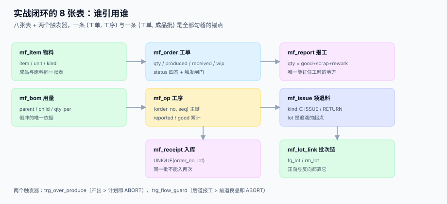

# 实战：从排产到入库的可运行闭环

<p style="text-align:center;"></p>

前面九页拆开讲了七段链的每一段。这一页把它们合成一个**能在本机跑起来的最小闭环**：八张表、两个触发器、五条自检、四个负向用例——不追求功能完整，追求**每一条守恒式都能被一条 SQL 判死**。

本页判据族 `MFT-A` ~ `MFT-H`，共 8 条，定义在第七节。

## 一、闭环要证明的四件事



| 要证明的事 | 谁来证明 | 不成立说明什么 |
| --- | --- | --- |
| 报工之间守恒 | `mf_report` 的 `CHECK` | 投入 ≠ 良品 + 返工 + 报废 |
| 工序之间守恒 | `trg_flow_guard` | 后道报了前道还没做出来的量 |
| 工单层面在制守恒 | 自检 C3 | 产出 ≠ 入库 + 在制 |
| 批次能正反追溯 | 自检 C5 | 成品批找不到原料批 |

这四件事合起来，就是「一张工单从下达到入库」的全部账。**它们都成立，账才对得上；只要有一件不成立，下游的成本一定错。**

## 二、八张表：最小但不残缺

```sql
PRAGMA foreign_keys = ON;

CREATE TABLE mf_item(item TEXT PRIMARY KEY, name TEXT NOT NULL, unit TEXT NOT NULL, kind TEXT NOT NULL);
CREATE TABLE mf_bom(parent TEXT NOT NULL, child TEXT NOT NULL, qty_per REAL NOT NULL CHECK(qty_per > 0),
  PRIMARY KEY(parent, child));
CREATE TABLE mf_order(order_no TEXT PRIMARY KEY, sku TEXT NOT NULL, qty INTEGER NOT NULL CHECK(qty > 0),
  produced INTEGER NOT NULL DEFAULT 0, received INTEGER NOT NULL DEFAULT 0,
  wip INTEGER NOT NULL DEFAULT 0,
  status TEXT NOT NULL DEFAULT 'RELEASED'
    CHECK(status IN ('RELEASED','IN_PROGRESS','FINISHED','CLOSED')));
CREATE TABLE mf_op(order_no TEXT NOT NULL REFERENCES mf_order(order_no), seq INTEGER NOT NULL,
  wc TEXT NOT NULL, std_min REAL NOT NULL CHECK(std_min > 0),
  reported INTEGER NOT NULL DEFAULT 0, good INTEGER NOT NULL DEFAULT 0,
  PRIMARY KEY(order_no, seq));
CREATE TABLE mf_issue(issue_id INTEGER PRIMARY KEY AUTOINCREMENT, order_no TEXT NOT NULL
    REFERENCES mf_order(order_no), item TEXT NOT NULL, lot TEXT NOT NULL,
  qty REAL NOT NULL, kind TEXT NOT NULL CHECK(kind IN ('ISSUE','RETURN')));
CREATE TABLE mf_report(report_id INTEGER PRIMARY KEY AUTOINCREMENT, order_no TEXT NOT NULL,
  seq INTEGER NOT NULL, qty INTEGER NOT NULL CHECK(qty > 0), good INTEGER NOT NULL,
  scrap INTEGER NOT NULL DEFAULT 0, rework INTEGER NOT NULL DEFAULT 0, at TEXT NOT NULL,
  FOREIGN KEY(order_no, seq) REFERENCES mf_op(order_no, seq),
  CHECK(good + scrap + rework = qty));
CREATE TABLE mf_receipt(receipt_id INTEGER PRIMARY KEY AUTOINCREMENT, order_no TEXT NOT NULL,
  lot TEXT NOT NULL, qty INTEGER NOT NULL CHECK(qty > 0), at TEXT NOT NULL,
  UNIQUE(order_no, lot));
CREATE TABLE mf_lot_link(fg_lot TEXT NOT NULL, rm_lot TEXT NOT NULL, PRIMARY KEY(fg_lot, rm_lot));
```

八张表的分工，一句话各表：

| 表 | 一句话职责 | 少了它会怎样 |
| --- | --- | --- |
| `mf_item` | 成品与原料同一张表 | 单位与编码无处统一 |
| `mf_bom` | 单位用量（倒冲依据） | 倒冲没有系数 |
| `mf_order` | 三个累计 + 四态 | 在制无处安放 |
| `mf_op` | 工序 × 累计报工 | 工序守恒无从判断 |
| `mf_issue` | 领退料流水 | 料耗不可追 |
| `mf_report` | 投入/良品/返工/报废 | 守恒式没有落脚点 |
| `mf_receipt` | 成品批入库 | 批次追溯没有起点 |
| `mf_lot_link` | 成品批 ⇄ 原料批 | 召回只能停整条线 |

## 三、两个触发器：把守恒写成硬约束

```sql
-- 产出不得超过计划数量（改量走变更表，不直接改 qty）
CREATE TRIGGER trg_over_produce AFTER UPDATE OF produced ON mf_order
WHEN new.produced > new.qty
BEGIN SELECT RAISE(ABORT, 'over_produce'); END;

-- 后道报工不得超过前道良品（首道不得超过工单数量）
CREATE TRIGGER trg_flow_guard BEFORE INSERT ON mf_report
BEGIN
  SELECT CASE WHEN new.qty > COALESCE(
    (SELECT MAX(good) FROM mf_op WHERE order_no = new.order_no AND seq < new.seq),
    (SELECT qty FROM mf_order WHERE order_no = new.order_no)
  ) THEN RAISE(ABORT, 'flow_exceeded') END;
END;
```

两个触发器的分工要看清：

- `trg_flow_guard` 是 **BEFORE INSERT**，在报工写入前拦住「后道超前道」；
- `trg_over_produce` 是 **AFTER UPDATE**，在工单累计产出后拦住「产出超计划」。

::: danger 为什么不能只用 CHECK
1. **`CHECK` 不能跨表**：`mf_report.qty` 与 `mf_op.good` 是两张表，`CHECK` 子查询在 SQLite 里不允许引用其他表。
2. **`CHECK` 看不到聚合**：`MAX(good)` 这类聚合必须放在触发器里。
3. **触发器的报错信息要能分诊**：`flow_exceeded` 与 `over_produce` 两个名字，直接告诉运维「是工序流错了还是总量错了」。
:::

## 四、跑一遍：领料 → 三道工序 → 入库

```text
MO-1001：计划 100 件，三道工序（下料 / 焊接 / 包装）
① 领料：钢板 255 kg（应耗 250 + 5 余量），螺栓 410 件，退钢板 5 kg
② OP10 报工：投入 100，良品 97，报废 2，返工 1
③ OP20 报工：投入 97，良品 95，报废 1，返工 1
④ OP30 报工：投入 95，良品 95
⑤ 入库：FG-20261101-01 共 93 件（在制 2）
⑥ 写批次链：成品批 ← 钢板批 L-ST-01 + 螺栓批 L-BT-01
```

```sql
-- ② 报工（触发器会校验工序守恒）
INSERT INTO mf_report(order_no, seq, qty, good, scrap, rework, at)
VALUES('MO-1001', 10, 100, 97, 2, 1, '2026-11-01T08:30:00');
-- 累计到工序
UPDATE mf_op SET reported = reported + 100, good = good + 97
 WHERE order_no = 'MO-1001' AND seq = 10;
-- ③ 下一道按 97 投入（不能按 100）
INSERT INTO mf_report(order_no, seq, qty, good, scrap, rework, at)
VALUES('MO-1001', 20, 97, 95, 1, 1, '2026-11-01T13:10:00');
-- ⑤ 入库：93 件，剩余 2 件在制
INSERT INTO mf_receipt(order_no, lot, qty, at)
VALUES('MO-1001', 'FG-20261101-01', 93, '2026-11-01T17:00:00');
UPDATE mf_order SET produced = 95, received = 93, wip = 2, status = 'FINISHED'
 WHERE order_no = 'MO-1001';
-- ⑥ 批次链
INSERT INTO mf_lot_link(fg_lot, rm_lot) VALUES('FG-20261101-01','L-ST-01'),
                                              ('FG-20261101-01','L-BT-01');
```

## 五、五条自检与四个负向用例

| 自检 | SQL 判据 | 期望 |
| --- | --- | --- |
| C1 产出不超计划 | `count(*) WHERE produced > qty` | 0 |
| C2 工序良品不超过上道 | 与前道 `MAX(good)` 或工单 `qty` 比 | 0 |
| C3 在制守恒 | `produced != received + wip` | 0 |
| C4 工序勾稽 | `mf_op.reported != Σ mf_report.qty` | 0 |
| C5 成品批可反查 | `mf_receipt` 无对应 `mf_lot_link` | 0 |

```sql
-- C2 的核心：每道工序的良品不得超过前道良品（首道与工单数量比）
SELECT count(*) FROM mf_op cur
 WHERE cur.good > COALESCE((SELECT MAX(p.good) FROM mf_op p
         WHERE p.order_no = cur.order_no AND p.seq < cur.seq),
       (SELECT qty FROM mf_order WHERE order_no = cur.order_no));
```

四个负向用例，每条都必须被系统拒绝：

| 用例 | 构造 | 期望的拒绝方式 |
| --- | --- | --- |
| N1 产出超计划 | `UPDATE produced = 120` | `over_produce` |
| N2 勾稽不平 | 插入 `qty=10, good=10, scrap=3` | `CHECK constraint failed` |
| N3 后道超前道 | OP20 报 98（前道良品 97） | `flow_exceeded` |
| N4 同批重复入库 | 再插 `FG-20261101-01` | `UNIQUE constraint failed` |

## 六、本机实测输出

```text
== 正向自检（期望全部 0）
C1 产出不超计划                                  0
C2 工序良品不超过上道                               0
C3 在制守恒（产出 = 入库 + 在制）                      0
C4 每道工序勾稽（报工 = 良品+报废+返工）                   0
C5 成品批可反查原料批                               0
工单读数：计划 100 / 产出 95 / 入库 93 / 在制 2
三道工序良品：[97, 95, 95]
== 负向用例（期望全部被拒）
N1 产出超计划         被拒：over_produce
N2 勾稽不平          被拒：CHECK constraint failed: good + scrap + rework = qty
N3 后道超前道良品       被拒：flow_exceeded
N4 同批重复入库        被拒：UNIQUE constraint failed: mf_receipt.order_no, mf_receipt.lot
== 汇总：自检合计 0（应为 0）/ 负向 4/4
EXIT=0
```

::: info 这段输出是真的跑出来的
本页的 DDL、触发器、自检与负向用例在本机（Python 3.13 + SQLite 3.50）完整执行过一次，退出码 0。**但脚本不入库**——仓库只提交 Markdown 与配图。要复现，把第二节的 DDL 与第三节的触发器抄进 `sqlite3 :memory:`，再按第四节的六步跑一遍。
:::

三处容易踩的实现细节：

1. **`PRAGMA foreign_keys = ON` 必须显式开**：SQLite 默认关闭外键，`mf_report` 的 `FOREIGN KEY` 不会生效，N3 的「工序不存在」就拦不住。
2. **触发器的 `WHEN` 与 `CASE` 不要混用**：`BEFORE INSERT` 里用 `SELECT CASE WHEN ... THEN RAISE(ABORT)` 才可移植，`WHEN` 子句在部分版本里对 `NEW` 的聚合子查询支持不一致。
3. **工单 `produced` 取最后一道工序的良品**，不是 `SUM(good)`——三道工序都报 95 时，`SUM` 会得到 287，直接冲破 `over_produce`。

## 七、判据清单

| 编号 | 判据 | 怎么验 |
| --- | --- | --- |
| `MFT-A` | 建库一次成功，八张表 + 两个触发器齐全 | `sqlite_master` 计数 = 10 |
| `MFT-B` | 五条自检全部为 0 | 五条 SQL 各自 `count(*)` = 0 |
| `MFT-C` | 四个负向用例全部被拒 | 四条 `INSERT/UPDATE` 均抛错 |
| `MFT-D` | 外键真实生效（`PRAGMA foreign_keys` = 1） | 插不存在的工序应失败 |
| `MFT-E` | 工单产出取最后一道工序良品，不是 `SUM` | `produced` = 95 而非 287 |
| `MFT-F` | 入库后有完整批次链 | C5 = 0 且正反查询各有结果 |
| `MFT-G` | 脚本退出码为 0，自检失败时为非 0 | `echo $?` = 0 |
| `MFT-H` | 全流程可在 `:memory:` 库中重复执行，不依赖外部服务 | 两次运行输出一致 |

## 八、验证方式

```shell
# 1) 建库并计数：应输出 10（8 表 + 2 触发器）
sqlite3 /tmp/mf.db < db/mf_schema.sql
sqlite3 /tmp/mf.db "SELECT count(*) FROM sqlite_master
                     WHERE (type='table' AND name LIKE 'mf_%') OR (type='trigger' AND name LIKE 'trg_%');"
# 期望：10

# 2) 外键开关：命令行默认 0，显式开启后为 1（脚本里必须写 PRAGMA）
sqlite3 /tmp/mf.db "PRAGMA foreign_keys;"
sqlite3 /tmp/mf.db "PRAGMA foreign_keys = ON; PRAGMA foreign_keys;"
# 期望：0 与 1 两行

# 3) 五个自检：应输出五行，每行末尾都是 0
sqlite3 /tmp/mf.db "SELECT 'C1', count(*) FROM mf_order WHERE produced > qty
  UNION ALL SELECT 'C3', count(*) FROM mf_order WHERE produced != received + wip
  UNION ALL SELECT 'C4', count(*) FROM mf_op o WHERE o.reported !=
    (SELECT COALESCE(SUM(r.qty),0) FROM mf_report r WHERE r.order_no=o.order_no AND r.seq=o.seq)
  UNION ALL SELECT 'C5', count(*) FROM mf_receipt r WHERE NOT EXISTS
    (SELECT 1 FROM mf_lot_link l WHERE l.fg_lot=r.lot);"

# 4) 负向用例：应报 flow_exceeded
sqlite3 /tmp/mf.db "INSERT INTO mf_report(order_no,seq,qty,good,scrap,rework,at)
  VALUES('MO-1001',20,98,98,0,0,'2026-11-01T18:00:00');"
# 期望：Runtime error: flow_exceeded

# 5) 正反追溯各一条
sqlite3 /tmp/mf.db "SELECT rm_lot FROM mf_lot_link WHERE fg_lot='FG-20261101-01';"
sqlite3 /tmp/mf.db "SELECT fg_lot FROM mf_lot_link WHERE rm_lot='L-ST-01';"
# 期望：各输出 2 行与 1 行
```

## 参考资料

- [报工、在制品与工序交接](../Reporting/index.md)：两个触发器背后的守恒式
- [完工入库、批次与追溯](../Completion/index.md)：`mf_lot_link` 的正反查询
- [总览：七段链与三个「做完了」](../Overview/index.md)：四个口径的定义
- SQLite 触发器与 `RAISE(ABORT)` 语法：<https://www.sqlite.org/lang_createtrigger.html>
- SQLite 外键约束（默认关闭，需 `PRAGMA foreign_keys = ON`）：<https://www.sqlite.org/foreignkeys.html>
